<h1>
IF2150 REKAYASA PERANGKAT LUNAK
 
TUGAS 10
 
HASIL IMPLEMENTASI DAN UJI PERANGKAT LUNAK (HIUPL)
</h1>
 

## EcoTrack
### 

### Untuk: Agatha Tatianingseto

Dipersiapkan oleh:
| Informasi | Keterangan |
| --- | --- |
| Kelas | K2 |
| Kelompok | 5 |

| NIM | Nama |
|---|---|
| 13525038 | Mochammad Adhitya Nur Rohman |
| 13525068 | Kelvin Sebastian Yen |
| 13525086 | Arla Salsabila |
| 13525137 | Maharani Puan Satira |
| 13525146 | Muhammad Reffah |
---

## Daftar Isi

- [BAB 1: Pendahuluan](#bab-1-pendahuluan)
  - [1.1 Tujuan Penulisan Dokumen](#11-tujuan-penulisan-dokumen)
  - [1.2 Lingkup Masalah](#12-lingkup-masalah)
  - [1.3 Definisi, Istilah, dan Singkatan](#13-definisi-istilah-dan-singkatan)
  - [1.4 Aturan Penomoran](#14-aturan-penomoran)
  - [1.5 Referensi](#15-referensi)
  - [1.6 Deskripsi Umum Dokumen (Ikhtisar)](#16-deskripsi-umum-dokumen-ikhtisar)
- [BAB 2: Deskripsi Umum Perangkat Lunak](#bab-2-deskripsi-umum-perangkat-lunak)
- [BAB 3: Implementasi](#bab-3-implementasi)
  - [3.1 Lingkungan Implementasi](#31-lingkungan-implementasi)
  - [3.2 Implementasi Modul](#32-implementasi-modul)
  - [3.3 Implementasi Antarmuka](#33-implementasi-antarmuka)
  - [3.4 File Lain](#34-file-lain)
- [BAB 4: Hasil Pengujian](#bab-4-hasil-pengujian)
  - [4.1 Strategi dan Kedalaman Pengujian Kelas](#41-strategi-dan-kedalaman-pengujian-kelas)
  - [4.2 Pengujian Unit Kelas](#42-pengujian-unit-kelas)
  - [4.3 Pengujian Integrasi](#43-pengujian-integrasi)
  - [4.4 Pengujian Use Case](#44-pengujian-use-case)
  - [4.5 Pengujian Kebutuhan Non-Fungsional (KNF)](#45-pengujian-kebutuhan-non-fungsional-knf)
  - [4.6 Tangkapan Layar dan Bukti Hasil Pengujian](#46-tangkapan-layar-dan-bukti-hasil-pengujian)
- [BAB 5: Traceability](#bab-5-traceability)

---

## Daftar Perubahan

| Revisi | Deskripsi |
| :--- | :--- |
| *A* | *Deskripsikan perubahan yang dilakukan dari dokumen sebelumnya pada dokumen ini. Jika tidak terdapat perubahan, harap kosongkan tabel.* |
| *B* |  |
| *C* |  |
| ... |  |

---

# BAB 1: Pendahuluan

## 1.1 Tujuan Penulisan Dokumen
Dokumen DPPL ditulis dengan tujuan menciptakan suatu dokumen penghubung antara pengembang dan pengguna perangkat lunak. Tidak dapat dipungkiri bahwa dalam pengembangan perangkat lunak, terdapat banyak masalah yang menghambat proses pengembangan, termasuk tapi tidak terbatas pada konflik kepentingan, tuntutan kontrak, dan pemahaman yang berbeda. Aplikasi EcoTrack sendiri tidak terlepas dari masalah ini, mengingat kompleksitas sistem yang dirancang dan akan dibangun. Oleh karena itu, diharapkan bahwa penulisan dokumen ini akan menghilangkan ambiguitas, mencegah miskomunikasi, dan menghasilkan perangkat lunak yang sesuai kebutuhan dan mudah dirawat.

Pengguna dokumen ini mencakup sejumlah pihak yang terlibat dalam proses pengembangan perangkat lunak. Pertama, dokumen ini akan digunakan oleh pengembang awal dan pengembang yang akan datang sebagai acuan kesesuaian spesifikasi dalam pengembangan dan perawatan lanjut. Kedua, dokumen ini menjadi standar untuk memverifikasi kesesuaian fungsionalitas perangkat lunak bagi penguji/evaluator. Ketiga, klien yang merupakan pemangku kepentingan dapat mengacu pada dokumen ini untuk memastikan kebutuhannya telah dipahami dan diimplementasikan dengan benar.

## 1.2 Lingkup Masalah
EcoTrack adalah sebuah sistem aplikasi perangkat lunak berbasis mobile yang dirancang untuk mengatasi isu tentang sampah. Aplikasi ini digunakan untuk mengidentifikasi jenis sampah secara praktis, penyedia panduan daur ulang serta sebagai penghubung antara masyarakat dengan petugas kebersihan.

## 1.3 Definisi, Istilah, dan Singkatan

Tabel 1.3. Definisi, Istilah, dan Singkatan

| Singkatan, Akronim, atau Istilah | Penjelasan |
| :--- | :--- |
| P/L | Singkatan dari Perangkat Lunak, yaitu aplikasi yang memberikan perintah kepada komputer untuk menjalankan tugas tertentu. |
| SKPL | Singkatan dari Spesifikasi Kebutuhan Perangkat Lunak, yaitu dokumen yang merangkum kriteria-kriteria yang diperlukan dalam membangun aplikasi agar dapat menjalankan tugasnya. |
| DPPL | Singkatan dari Deskripsi Perancangan Perangkat Lunak, yaitu dokumen yang berisi rancangan arsitektur, kelas, algoritma, dan antarmuka P/L yang menjadi acuan implementasi. |
| HIUPL | Singkatan dari Hasil Implementasi dan Uji Perangkat Lunak, yaitu dokumen ini, yang melaporkan elemen P/L yang telah diimplementasikan beserta hasil pengujiannya. |
| KF | Singkatan dari Kebutuhan Fungsional. |
| KNF | Singkatan dari Kebutuhan Non-Fungsional. |
| UC | Singkatan dari Use Case. |
| OS | Singkatan dari Operating System. |
| DBMS | Singkatan dari Database Management System. |
| UML | Singkatan dari Unified Modeling Language, yaitu bahasa notasi grafis untuk memodelkan sistem perangkat lunak. |
| MVC | Singkatan dari Model-View-Controller, yaitu pola arsitektur yang memisahkan data (Model), tampilan (View/Interface), dan logika pemrosesan (Controller). |
| TPS | Singkatan dari Tempat Penampungan Sementara untuk sampah. |
| WIB | Singkatan dari Waktu Indonesia Barat (UTC+7), yaitu zona waktu acuan seluruh tanggal jadwal pengambilan sampah. |
| API | Singkatan dari Application Programming Interface, yaitu mekanisme yang memungkinkan perangkat lunak berkomunikasi dengan perangkat lunak lainnya untuk bertukar data. |
| Computer Vision | Bidang dari kecerdasan buatan yang memungkinkan komputer memproses dan menganalisis gambar atau video agar dapat menghasilkan suatu informasi yang dapat digunakan untuk pengambilan keputusan. |
| Database | Kumpulan data yang disimpan secara terstruktur dalam sistem komputer. |
| Barcode | Representasi data dalam pola garis-garis vertikal dengan ketebalan dan jarak yang berbeda-beda yang dapat dipindai untuk mengidentifikasi suatu produk. |
| Query | Perintah yang dikirimkan ke database untuk mengambil, menambah, mengubah, atau menghapus data. |
| Dummy Data | Data tiruan yang digunakan untuk menguji sistem perangkat lunak. |
| Server | Sistem yang digunakan untuk memberikan layanan kepada komputer lain dalam satu jaringan. |
| Client | Sistem yang digunakan untuk mengakses layanan server. |
| Expo / React Native | *Framework* JavaScript untuk membangun aplikasi *mobile* Android dan iOS dari satu basis kode. Expo Go adalah aplikasi untuk menjalankan proyek Expo langsung di HP selama pengembangan. |
| Cloud Firestore | DBMS NoSQL milik Firebase yang menyimpan data dalam bentuk koleksi dan dokumen. |
| Firebase Authentication | Layanan Firebase untuk autentikasi pengguna (email dan kata sandi) yang mengelola kredensial petugas. |
| Security Rules | Aturan akses pada Cloud Firestore yang menentukan siapa yang boleh membaca atau mengubah suatu dokumen. |
| Firebase Emulator Suite | Emulator lokal Cloud Firestore dan Firebase Authentication yang dipakai untuk menjalankan aplikasi dan pengujian integrasi tanpa mengakses Firebase *cloud*. |
| Seed | Proses dan skrip pengisian data awal (data uji) ke basis data. |
| Jest | *Framework* pengujian JavaScript yang dipakai untuk menjalankan *unit test*, *integration test*, dan mengukur *coverage*. |
| Unit Test | Pengujian terhadap satu kelas atau operasi secara terisolasi; dependensi luar diganti tiruan (*mock*). |
| Integration Test | Pengujian interaksi antarkomponen yang melewati batas (Controller - Model, aplikasi - basis data, aplikasi - sistem eksternal) menggunakan komponen nyata. |
| Mock | Objek tiruan yang menggantikan dependensi asli (misalnya Firestore) agar suatu unit dapat diuji secara terisolasi. |
| Coverage | Persentase baris (*line*) dan cabang (*branch*) kode yang dieksekusi oleh pengujian. |
| Test Case | Satu skenario pengujian yang terdiri dari prosedur, masukan, hasil yang diharapkan, hasil aktual, dan kesimpulan. |
| Pass / Fail | Kesimpulan test case. *Pass* berarti hasil aktual sesuai dengan hasil yang diharapkan; *Fail* berarti tidak sesuai. |
| Traceability | Keterlacakan hubungan antara kebutuhan (KF/KNF), use case, kelas, file implementasi, dan test case. |

## 1.4 Aturan Penomoran

Tabel 1.4. Aturan Penomoran

| Hal/Bagian | Penomoran | Keterangan |
| :--- | :--- | :--- |
| Kebutuhan Fungsional | KFXX | ID kebutuhan fungsional sesuai SKPL dengan 2 digit angka, dimulai dari KF01. |
| Kebutuhan Non-Fungsional | KNFXX | ID kebutuhan non-fungsional sesuai SKPL dengan 2 digit angka, dimulai dari KNF01. |
| Use Case | UCXX | ID use case sesuai SKPL dengan 2 digit angka, dimulai dari UC01. |
| Kelas | CXX | ID kelas sesuai DPPL dengan 2 digit angka, dimulai dari C01. |
| Antarmuka (Layar) | I-XX | ID layar sesuai DPPL dengan 2 digit angka, dimulai dari I-01. |
| Algoritma Kelas AkunPetugas | Algo-AP-XXX | ID algoritma kelas AkunPetugas sesuai DPPL dengan 3 digit angka, dimulai dari Algo-AP-001. |
| Algoritma Kelas AkunPetugasController | Algo-APC-XXX | ID algoritma kelas AkunPetugasController sesuai DPPL dengan 3 digit angka, dimulai dari Algo-APC-001. |
| Algoritma Kelas AkunPetugasInterface | Algo-API-XXX | ID algoritma kelas AkunPetugasInterface sesuai DPPL dengan 3 digit angka, dimulai dari Algo-API-001. |
| Algoritma Kelas Jadwal | Algo-J-XXX | ID algoritma kelas Jadwal sesuai DPPL dengan 3 digit angka, dimulai dari Algo-J-001. |
| Algoritma Kelas JadwalController | Algo-JC-XXX | ID algoritma kelas JadwalController sesuai DPPL dengan 3 digit angka, dimulai dari Algo-JC-001. |
| Algoritma Kelas JadwalInterface | Algo-JI-XXX | ID algoritma kelas JadwalInterface sesuai DPPL dengan 3 digit angka, dimulai dari Algo-JI-001. |
| Algoritma Kelas InformasiSampah | Algo-IS-XXX | ID algoritma kelas InformasiSampah sesuai DPPL dengan 3 digit angka, dimulai dari Algo-IS-001. |
| Algoritma Kelas InformasiSampahController | Algo-ISC-XXX | ID algoritma kelas InformasiSampahController sesuai DPPL dengan 3 digit angka, dimulai dari Algo-ISC-001. |
| Algoritma Kelas InformasiSampahInterface | Algo-ISI-XXX | ID algoritma kelas InformasiSampahInterface sesuai DPPL dengan 3 digit angka, dimulai dari Algo-ISI-001. |
| Algoritma Kelas PemindaiController | Algo-PC-XXX | ID algoritma kelas PemindaiController sesuai DPPL dengan 3 digit angka, dimulai dari Algo-PC-001. |
| Algoritma Kelas PemindaiInterface | Algo-PI-XXX | ID algoritma kelas PemindaiInterface sesuai DPPL dengan 3 digit angka, dimulai dari Algo-PI-001. |
| Pengujian Unit Kelas | CXX-UTYY | ID test case unit untuk kelas CXX dengan 2 digit nomor urut YY, dimulai dari CXX-UT01 (contoh: C04-UT01). |
| Pengujian Integrasi | INT-IXX-TCYY | ID test case integrasi untuk antarmuka I-XX dengan 2 digit nomor urut YY, dimulai dari INT-IXX-TC01 (contoh: INT-I09-TC01). |
| Pengujian Use Case | UCXX-TCYY | ID test case use case UCXX dengan 2 digit nomor urut YY, dimulai dari UCXX-TC01 (contoh: UC03-TC01). |
| Pengujian KNF | KNFXX-TCYY | ID test case kebutuhan non-fungsional KNFXX dengan 2 digit nomor urut YY, dimulai dari KNFXX-TC01 (contoh: KNF05-TC01). |
| Tabel | Tabel X.Y | Nomor tabel mengikuti nomor subbab tempat tabel berada. |
| Gambar | Gambar X.Y | Nomor gambar mengikuti nomor bab tempat gambar berada. |

## 1.5 Referensi
- 11,3 Juta Ton Sampah di Indonesia Tidak Terkelola dengan Baik, brin.go.id, 26 Juli 2024, https://brin.go.id/drid/posts/kabar/113-juta-ton-sampah-di-indonesia-tidak-terkelola-dengan-baik. Accessed 30 Agustus 2026.
- Dampak Sampah yang Tidak Dikelola dengan Baik, paxel.co, 8 Juni 2025, https://paxel.co/id/berita-dan-promo/dampak-sampah-yang-tidak-dikelola-dengan-baik. Accessed 30 Agustus 2026.
- Apa yang terjadi jika target SDGs gagal tercapai pada tahun 2030?, jejakin.com, https://www.jejakin.com/id/blog/if-sdgs-fail-by-2030. Accessed 30 Agustus 2026.
- Pengelolaan Sampah Jadi Prioritas, Pemerintah Siapkan Strategi Komprehensif, Kementerian Sekretariat Negara Republik Indonesia, 12 Maret 2025, https://setneg.go.id/baca/index/pengelolaan_sampah_jadi_prioritas_pemerintah_siapkan_strategi_komprehensif. Accessed 30 Agustus 2026.
- 8 Manfaat Daur Ulang Sampah dan Cara Membiasakannya, BANK MEGA Syariah, 9 Desember 2024, https://www.megasyariah.co.id/id/artikel/edukasi-tips/lainnya/manfaat-daur-ulang. Accessed 30 Agustus 2026.
- Pristiandaru, Danur Lumbang. Mengenal Tujuan 15 SDGs: Ekosistem Daratan Sumber: https://lestari.kompas.com/read/2023/05/23/080000286/mengenal-tujuan-15-sdgs--ekosistem-daratan. Membership: https://kmp.im/plus6 Download aplikasi: https://kmp.im/app6, Kompas.com, 23 Mei 2023, https://lestari.kompas.com/read/2023/05/23/080000286/mengenal-tujuan-15-sdgs--ekosistem-daratan. Accessed 30 Agustus 2026.

## 1.6 Deskripsi Umum Dokumen (Ikhtisar)
Dokumen SKPL ini terdiri dari enam bab. Bab pertama adalah pendahuluan, yang merupakan penjelasan dari dokumen SKPL ini. Bab tersebut terdiri dari tujuan penulisan, lingkup masalah, tabel definisi, istilah, dan singkatan, aturan penomoran yang digunakan, referensi pembuatan dokumen, serta deskripsi umum dokumen. Bab kedua membahas deskripsi perangkat lunak yang dirancang. Bab tersebut terdiri dari deskripsi umum sistem, dan perangkat lunak, pengguna dan kebutuhannya, batasan perangkat lunak, dan lingkungan operasi perangkat lunak.

Bab tiga berisi deskripsi kebutuhan perangkat lunak, yang terdiri dari kebutuhan fungsional dan non fungsional perangkat lunak terkait. Bab empat membahas pemodelan use case, yang berisi identifikasi aktor dan use case, diagram use case, dan skenario-skenario terhadap use case terkait. Bab lima mendeskripsikan pemodelan kelas, yang terdiri dari identifikasi kelas, pemodelan kelas per use case, dan gabungan pemodelan kelas secara keseluruhan. Terkahkih, bab enam berisi tabel traceability yang menghubungkan kelas dan use case dengan kebutuhan awalnya.

 

---

# BAB 2: Deskripsi Umum Perangkat Lunak

Bagian ini diisi dengan *System Overview*, dalam bentuk gambar dan narasi yang memberikan gambaran tentang aplikasi dan konteksnya. **Batasan dan keterkaitan** antara sistem yang dibangun dengan sistem lain di luarnya harus jelas. Deskripsi umum sistem perlu dilengkapi dengan pemodelan kasus yang dihadapi, seperti *use case diagram*. Berikan narasi yang jelas untuk setiap gambar yang ditampilkan.

Bagian ini dapat menyalin atau meringkas dari dokumen SKPL atau DPPL.

<i>Gambar 2.1. Use Case Diagram [Nama P/L]</i>

 

---

# BAB 3: Implementasi

## 3.1 Lingkungan Implementasi

Tabel 3.1. Lingkungan Implementasi

| Aspek | Keterangan |
| :--- | :--- |
| *Hardware* | *Smartphone* Android dengan kamera dan koneksi internet. |
| *Operating System* | Android 7.0 (API 24) atau lebih baru. |
| *Bahasa Pemrograman* | JavaScript (ES2022) dengan JSX, dijalankan oleh Node.js 22.13+ atau 24.3+ (diuji dengan Node.js 22.23.1 dan 24.14.1). |
| *Framework/Library* | Expo SDK 58 (`expo` ~58.0.23), React Native 0.88.1, React 19.3.0, Expo Router ~58.0.30 (navigasi), Firebase JS SDK ^13.2.0 (Firestore dan Authentication), `expo-camera` ~58.0.14 (kamera dan barcode), `@react-native-async-storage/async-storage` 2.2.0 (penyimpanan sesi login), `@expo/vector-icons` ^15.0.2, `@expo-google-fonts/roboto` ^0.4.3. Sisi basis data: `firebase-admin` ^13.0.0 (skrip seed) dan `firebase-tools` ^14.0.0 (emulator dan *deploy rules*). |
| *DBMS* | Cloud Firestore (NoSQL) dan Firebase Authentication. Untuk pengembangan dan pengujian digunakan Firebase Emulator Suite (Firestore emulator v1.19.8 pada port 8080, Authentication emulator pada port 9099) dengan Java JDK 21 atau lebih baru. |
| *Development Tools* | Visual Studio Code, Git dan GitHub (*version control*, Pull Request, Issues, Projects), Figma dan Procreate (desain antarmuka), Android Studio (Android Emulator), Expo Go, Expo CLI dan Metro Bundler, npm. |
| *Testing Tools* | Jest ~30.5.2 dengan preset `jest-expo` ~58.0.14 (*unit test* dan *integration test*), Jest Coverage/Istanbul (`--coverage`, laporan *line* dan *branch coverage*), Firebase Emulator Suite dan Emulator UI (`http://localhost:4000`) untuk pengujian integrasi serta inspeksi basis data. |

## 3.2 Implementasi Modul

Tabel 3.2. Implementasi Modul

| No | ID Kelas | Nama Modul/Kelas | Nama File Fisik | Nama File Executable |
| :--- | :--- | :--- | :--- | :--- |
| 1 | C01 | AkunPetugas | `src/ecotrack/src/model/AkunPetugas.js` | - |
| 2 | C02 | AkunPetugasController | `src/ecotrack/src/controller/AkunPetugasController.js` | - |
| 3 | C03 | AkunPetugasInterface | `src/ecotrack/src/app/(auth)/login/index.jsx` `src/ecotrack/src/app/(auth)/signup/index.jsx` `src/ecotrack/src/app/profil/index.jsx` | - |
| 4 | C04 | Jadwal | `src/ecotrack/src/model/Jadwal.js` | - |
| 5 | C05 | JadwalController | `src/ecotrack/src/controller/JadwalController.js` | - |
| 6 | C06 | JadwalInterface | `src/ecotrack/src/app/(tabs)/jadwal/index.jsx` `src/ecotrack/src/app/(tabs)/jadwal/[idJadwal]/index.jsx` `src/ecotrack/src/app/(tabs)/jadwal/[idJadwal]/edit/index.jsx` `src/ecotrack/src/ui/jadwal/Kalender.jsx` `src/ecotrack/src/ui/jadwal/KartuLokasi.jsx` `src/ecotrack/src/ui/jadwal/KartuInfoLokasi.jsx` | - |
| 7 | C07 | InformasiSampah | `src/ecotrack/src/model/InformasiSampah.js` | - |
| 8 | C08 | InformasiSampahController | `src/ecotrack/src/controller/InformasiSampahController.js` | - |
| 9 | C09 | InformasiSampahInterface | `src/ecotrack/src/app/(tabs)/informasi/index.jsx` `src/ecotrack/src/app/(tabs)/informasi/[idSampah]/index.jsx` `src/ecotrack/src/ui/informasi-sampah/KategoriSampahCard.jsx` `src/ecotrack/src/ui/informasi-sampah/MetodeSolusiCard.jsx` `src/ecotrack/src/ui/informasi-sampah/TutorialModal.jsx` `src/ecotrack/src/ui/informasi-sampah/LangkahTutorial.jsx` `src/ecotrack/src/ui/informasi-sampah/ContohHasilKreasi.jsx` | - |
| 10 | C10 | PemindaiController | `src/ecotrack/src/controller/PemindaiController.js` | - |
| 11 | C11 | PemindaiInterface | `src/ecotrack/src/app/(tabs)/pemindai/index.jsx` `src/ecotrack/src/ui/pemindai/KameraView.js` `src/ecotrack/src/ui/pemindai/FotoDeteksi.js` | - |

## 3.3 Implementasi Antarmuka

Tabel 3.3. Implementasi Antarmuka

| No | ID Antarmuka | Nama Antarmuka | Nama File Fisik | Nama File Executable |
| :--- | :--- | :--- | :--- | :--- |
| 1 | I-01 | Daftar Akun/Sign Up | `src/ecotrack/src/app/(auth)/signup/index.jsx` | - |
| 2 | I-02 | Masuk Akun/Log In | `src/ecotrack/src/app/(auth)/login/index.jsx` | - |
| 3 | I-03 | Halaman Utama Daur Ulang | `src/ecotrack/src/app/(tabs)/informasi/index.jsx`, `src/ecotrack/src/ui/informasi-sampah/KategoriSampahCard.jsx` | - |
| 4 | I-04 | Halaman Utama Kosong Daur Ulang | `src/ecotrack/src/app/(tabs)/informasi/index.jsx` (keadaan hasil pencarian kosong, memakai `src/ecotrack/src/ui/component/EmptyState.jsx`) | - |
| 5 | I-05 | Halaman Informasi Material Sampah | `src/ecotrack/src/app/(tabs)/informasi/[idSampah]/index.jsx`, `src/ecotrack/src/ui/informasi-sampah/MetodeSolusiCard.jsx` | - |
| 6 | I-06 | Pop-up Panduan Daur Ulang | `src/ecotrack/src/ui/informasi-sampah/TutorialModal.jsx`, `src/ecotrack/src/ui/informasi-sampah/LangkahTutorial.jsx`, `src/ecotrack/src/ui/informasi-sampah/ContohHasilKreasi.jsx` | - |
| 7 | I-07 | Halaman Utama Jadwal Pengambilan Sampah | `src/ecotrack/src/app/(tabs)/jadwal/index.jsx`, `src/ecotrack/src/ui/jadwal/KartuLokasi.jsx` | - |
| 8 | I-08 | Halaman Utama Kosong Jadwal Pengambilan Sampah | `src/ecotrack/src/app/(tabs)/jadwal/index.jsx` (keadaan hasil pencarian kosong, memakai `src/ecotrack/src/ui/component/EmptyState.jsx`) | - |
| 9 | I-09 | Halaman Utama Kalender (Masyarakat Umum) | `src/ecotrack/src/app/(tabs)/jadwal/[idJadwal]/index.jsx`, `src/ecotrack/src/ui/jadwal/Kalender.jsx`, `src/ecotrack/src/ui/jadwal/KartuInfoLokasi.jsx` | - |
| 10 | I-10 | Halaman Utama Kalender (Petugas Kebersihan) | `src/ecotrack/src/app/(tabs)/jadwal/[idJadwal]/index.jsx` (tombol EDIT JADWAL tampil jika `bolehEdit = true`), `src/ecotrack/src/ui/jadwal/Kalender.jsx` | - |
| 11 | I-11 | Halaman Edit Kalender (Petugas Kebersihan) | `src/ecotrack/src/app/(tabs)/jadwal/[idJadwal]/edit/index.jsx`, `src/ecotrack/src/ui/jadwal/Kalender.jsx` (mode edit) | - |
| 12 | I-12 | Pop-up Simpan Kalender Baru (Petugas Kebersihan) | `src/ecotrack/src/app/(tabs)/jadwal/[idJadwal]/edit/index.jsx` (dialog "Simpan Jadwal"), `src/ecotrack/src/ui/component/Dialog.jsx` | - |
| 13 | I-13 | Pop-up Kalender Baru Berhasil Tersimpan (Petugas Kebersihan) | `src/ecotrack/src/app/(tabs)/jadwal/[idJadwal]/edit/index.jsx` (`toast.berhasil`), `src/ecotrack/src/ui/component/Toast.jsx` | - |
| 14 | I-14 | Pop-up Kalender Baru Gagal Tersimpan (Petugas Kebersihan) | `src/ecotrack/src/app/(tabs)/jadwal/[idJadwal]/edit/index.jsx` (`toast.gagal`), `src/ecotrack/src/ui/component/Toast.jsx` | - |
| 15 | I-15 | Halaman Utama Profil Petugas Kebersihan | `src/ecotrack/src/app/profil/index.jsx` | - |
| 16 | I-16 | Halaman Edit Profil Petugas Kebersihan | `src/ecotrack/src/app/profil/index.jsx` (mode edit profil) | - |
| 17 | I-17 | Halaman Berhasil Simpan Profil Baru Petugas Kebersihan | `src/ecotrack/src/app/profil/index.jsx` (`toast.berhasil`), `src/ecotrack/src/ui/component/Toast.jsx` | - |
| 18 | I-18 | Halaman Gagal Simpan Profil Baru Petugas Kebersihan | `src/ecotrack/src/app/profil/index.jsx` (`toast.gagal`), `src/ecotrack/src/ui/component/Toast.jsx` | - |
| 19 | I-19 | Pop-up Keluar Akun Petugas | `src/ecotrack/src/app/profil/index.jsx` (dialog "Keluar Akun"), `src/ecotrack/src/ui/component/Dialog.jsx` | - |
| 20 | I-20 | Halaman Edit Password Akun Petugas | `src/ecotrack/src/app/profil/index.jsx` (mode ubah kata sandi) | - |
| 21 | I-21 | Halaman Berhasil Edit Password Akun Petugas | `src/ecotrack/src/app/profil/index.jsx` (`toast.berhasil`), `src/ecotrack/src/ui/component/Toast.jsx` | - |
| 22 | I-22 | Halaman Gagal Edit Password Akun Petugas | `src/ecotrack/src/app/profil/index.jsx` (`toast.gagal`), `src/ecotrack/src/ui/component/Toast.jsx` | - |
| 23 | I-23 | Halaman Utama Pemindaian Sampah | `src/ecotrack/src/app/(tabs)/pemindai/index.jsx`, `src/ecotrack/src/ui/pemindai/KameraView.js` | - |
| 24 | I-24 | Halaman Hasil Pemindaian Sampah | `src/ecotrack/src/app/(tabs)/pemindai/index.jsx`, `src/ecotrack/src/ui/pemindai/FotoDeteksi.js` | - |
| 25 | I-25 | Pop-up Material Sampah Belum Tersedia | `src/ecotrack/src/app/(tabs)/pemindai/index.jsx` | - |
| 26 | I-26 | Masuk Akun/Log In Salah | `src/ecotrack/src/app/(auth)/login/index.jsx` (keadaan kredensial salah) | - |
| 27 | I-27 | Daftar Akun/Sign Up Salah | `src/ecotrack/src/app/(auth)/signup/index.jsx` (keadaan isian tidak valid) | - |

## 3.4 File Lain

Tabel 3.4. File Lain

| No | Nama File | Keterangan |
| :--- | :--- | :--- |
| 1 | `src/README.md` | Panduan instalasi, konfigurasi, menjalankan aplikasi dan test, akun uji, serta struktur folder. |
| 2 | `src/ecotrack/package.json`, `src/ecotrack/package-lock.json` | Daftar dependensi aplikasi, skrip npm (`start`, `android`, `test`), dan konfigurasi Jest. |
| 3 | `src/ecotrack/app.json` | Konfigurasi Expo (nama aplikasi, ikon, *splash screen*, dan *plugin*). |
| 4 | `src/ecotrack/jsconfig.json` | Alias impor `@/` ke folder `src/ecotrack/src/`. |
| 5 | `src/ecotrack/.env.example` | Daftar *environment variable* (mode emulator/cloud, host emulator, konfigurasi Firebase, URL layanan pemindai) tanpa nilai rahasia. |
| 6 | `src/ecotrack/src/database/firebase.js` | Inisialisasi Firebase App, Firestore, dan Authentication; menyambungkan ke emulator atau *cloud* sesuai `.env`. |
| 7 | `src/ecotrack/src/model/barcodeModel.js` | Fungsi akses koleksi `barcodeProduk` dan informasi jenis sampah untuk fitur pemindai (Tabel B.1 No. 2 dokumen Implementasi). Pada rilis ini file belum dipanggil; pencarian barcode berjalan melalui `InformasiSampahController.cariBarcode()`. |
| 8 | `src/ecotrack/src/model/sampahModel.js` | Mengirim foto ke layanan *computer vision* (Cloudflare Worker) dan menerima hasil deteksi (Tabel B.1 No. 1 dokumen Implementasi). |
| 9 | `src/ecotrack/src/app/_layout.jsx`, `src/ecotrack/src/app/index.jsx` | Layout akar aplikasi (memuat font Roboto dan wadah Toast) dan pengalihan awal ke halaman Daur Ulang. |
| 10 | `src/ecotrack/src/app/(tabs)/_layout.jsx`, `src/ecotrack/src/app/(tabs)/jadwal/_layout.jsx`, `src/ecotrack/src/app/(tabs)/informasi/_layout.jsx` | Layout navigasi tab dan *stack* untuk setiap fitur. |
| 11 | `src/ecotrack/src/ui/theme.js` | Token warna dan tipografi bersama. |
| 12 | `src/ecotrack/src/ui/component/Button.jsx`, `Dialog.jsx`, `EmptyState.jsx`, `Header.jsx`, `InputField.jsx`, `NavBar.jsx`, `SearchBar.jsx`, `Toast.jsx` | Komponen antarmuka bersama yang dipakai oleh seluruh kelas Interface. |
| 13 | `src/ecotrack/src/utils/validators.js` | Validasi isian (email, NIK, nomor telepon, kata sandi, dan konfirmasi kata sandi). |
| 14 | `src/ecotrack/src/utils/gambarSampah.js` | Pemetaan atribut `gambar` ke file gambar informasi sampah. |
| 15 | `src/ecotrack/src/utils/penjagaNavigasi.js` | Penjaga perpindahan tab saat masih ada perubahan jadwal yang belum disimpan. |
| 16 | `src/ecotrack/assets/images/**` | Logo, ikon aplikasi, ilustrasi, dan gambar informasi sampah. |
| 17 | `src/firebase/firebase.json`, `src/firebase/firestore.indexes.json` | Konfigurasi Firebase Emulator (port Firestore, Authentication, dan Emulator UI) serta indeks Firestore. |
| 18 | `src/firebase/firestore.rules` | *Security rules* Firestore (misalnya hanya petugas dengan wilayah tugas yang sama yang boleh mengubah jadwal). |
| 19 | `src/firebase/seed.js` | Skrip pengisian data awal ke emulator atau *cloud* dan pembuatan akun uji. |
| 20 | `src/firebase/pull.js` | Skrip menyalin data dari Firebase *cloud* ke file `data/*.json`. |
| 21 | `src/firebase/data/informasiSampah.json`, `jadwal.json`, `barcodeProduk.json`, `dataPemerintah.json`, `akunPetugas.json` | Data awal (*seed*) dan data uji seluruh koleksi; juga dipakai sebagai data acuan pengujian KNF05. |
| 22 | `src/firebase/README.md` | Panduan basis data (emulator, *seed*, *cloud*, dan *rules*). |
| 23 | `src/tests/JadwalController.test.js` | *Unit test* kelas C05 JadwalController (C05-UT01 s.d. C05-UT36). |
| 24 | `src/tests/Jadwal.test.js` | *Unit test* kelas C04 Jadwal (C04-UT01 s.d. C04-UT17). |
| 25 | `src/tests/JadwalIntegrasi.test.js` | *Integration test* antarmuka I-07 s.d. I-14 terhadap Firebase Emulator (INT-I07-TC01 s.d. INT-I14-TC02). |
| 26 | `src/tests/KNF05Akurasi.test.js` | Pengujian KNF05 (akurasi jadwal, informasi daur ulang, dan kategori barcode) terhadap Firebase Emulator. |

 

---

# BAB 4: Hasil Pengujian

Bab ini melaporkan hasil pengujian P/L pada level unit, integrasi, dan sistem. Pengujian dilakukan pada tag release terakhir Tugas 9. Hasil aktual diisi berdasarkan pengamatan saat pengujian. Kesimpulan diisi `Pass` atau `Fail`, dan untuk `Fail` dilengkapi penyebab serta usulan perbaikan.

## 4.1 Strategi dan Kedalaman Pengujian Kelas

Setiap kelas perancangan pada Tabel 4.1 DPPL diklasifikasikan ke dalam tiga tingkat kedalaman pengujian. Tingkat **Mendalam** diberikan pada kelas yang memuat logika bisnis, perhitungan, validasi, aturan status, algoritma, integrasi eksternal, atau keamanan. Tingkat **Sedang** diberikan pada kelas yang hanya mengoordinasikan atau mendelegasikan proses. Tingkat **Tidak perlu** diberikan pada kelas tanpa logika, seperti *entity/DTO* dan kelas konfigurasi, yang teruji secara tidak langsung melalui test case use case. Seluruh kelas wajib dicantumkan beserta alasan penentuan tingkatnya.

Tabel 4.1.1. Identifikasi Tingkat Pengujian Kelas

| ID Kelas | Nama Kelas | Tingkat | Alasan | Test Case Terkait |
| :--- | :--- | :--- | :--- | :--- |
| *C02* | *Pesanan* | *Mendalam* | *Memuat `hitungTotal()` dan transisi status pembayaran* | *C02-UT01 s.d. C02-UT08* |
| *C03* | *Keranjang* | *Sedang* | *Delegasi sederhana ke Produk dan Pesanan* | *C03-UT01 s.d. C03-UT03, INT-TC02* |
| *C01* | *Pelanggan* | *Tidak perlu* | *Hanya menyimpan data akun, tanpa logika* | *-* |
| *[CXX]* | *[Nama kelas]* | *[Mendalam/Sedang/Tidak perlu]* | *[Alasan penentuan tingkat pengujian]* | *[ID test case atau -]* |
| *...* | *...* | *...* | *...* | *...* |

## 4.2 Pengujian Unit Kelas

Pengujian unit dilakukan pada kelas bertingkat Mendalam dan Sedang. Kelas Mendalam diuji pada seluruh operasi public dengan kasus normal, batas, dan negatif, serta mencapai *coverage* minimal 70%. Kelas Sedang diuji minimal dengan satu kasus normal dan satu kasus gagal pada operasi public utama.

Cara menjalankan unit test: `cd src/ecotrack && npm install && npm test`.

Cara menjalankan test coverage (kelas C04 dan C05): `cd src/ecotrack && npx jest Jadwal --coverage --collectCoverageFrom=src/model/Jadwal.js --collectCoverageFrom=src/controller/JadwalController.js`. Laporan tampil di terminal dan versi HTML-nya tersimpan di `src/ecotrack/coverage/lcov-report/index.html`.

Lokasi file test: `src/tests/`.

### 4.2.1 Kelas [Nama Kelas 1]

**ID Kelas:** *[C02]*  
**Nama Kelas:** *[Pesanan]*  
**Tingkat:** *[Mendalam]*

Tabel 4.2.1. Hasil Pengujian Unit Kelas [C02]

| ID Pengujian | Operasi yang Diuji | Jenis Kasus | Prosedur/Masukan | Hasil yang Diharapkan | Hasil Pengujian | Kesimpulan |
| :--- | :--- | :--- | :--- | :--- | :--- | :--- |
| *C02-UT01* | *`hitungTotal(): Decimal`* | *Normal* | *Pesanan berisi 2 item: 10.000 x 2 dan 5.000 x 1* | *Total = 25.000* | *[Hasil aktual]* | *Pass/Fail* |
| *C02-UT02* | *`hitungTotal(): Decimal`* | *Batas* | *Pesanan berisi tepat 1 item dengan jumlah 1* | *Total = harga item tersebut* | *[...]* | *Pass/Fail* |
| *C02-UT03* | *`hitungTotal(): Decimal`* | *Negatif* | *Pesanan tanpa item* | *Total = 0 atau melempar kesalahan sesuai rancangan* | *[...]* | *Pass/Fail* |
| *...* | *...* | *...* | *...* | *...* | *...* | *...* |

Khusus kelas **Mendalam**:

Tabel 4.2.1b. Ringkasan Cakupan Kelas [C02]

| Informasi | Keterangan |
| :--- | :--- |
| Daftar operasi public pada DPPL | *[op1(), op2(), ...]* |
| Operasi yang diuji | *[op1(), op2(), ...]* |
| ID Algoritma yang tercakup | *[Algo-001, ...]* |
| Coverage (wajib ≥ 70%) | *[% baris / % cabang, alat dan bukti pada 4.6]* |

### 4.2.2 Kelas [Nama Kelas 2]

*[Ulangi pola 4.2.1 untuk setiap kelas bertingkat Mendalam atau Sedang.]*

### 4.2.4 Kelas Jadwal

**ID Kelas:** C04  
**Nama Kelas:** Jadwal  
**Tingkat:** Mendalam

Tabel 4.2.4. Hasil Pengujian Unit Kelas C04

| ID Pengujian | Operasi yang Diuji | Jenis Kasus | Prosedur/Masukan | Hasil yang Diharapkan | Hasil Pengujian | Kesimpulan |
| :--- | :--- | :--- | :--- | :--- | :--- | :--- |
| C04-UT01 | `getIdJadwal()`, `getKecamatan()`, `getKelurahan()`, `getTanggal()` | Normal | Buat `Jadwal` dengan id `lebak-siliwangi`, kecamatan Coblong, kelurahan Lebak Siliwangi, tanggal [2 Nov 2026, 5 Nov 2026] | Setiap getter mengembalikan nilai yang sama dengan masukan konstruktor | Seluruh getter mengembalikan nilai sesuai masukan | Pass |
| C04-UT02 | `getTanggal(): List<Date>` | Batas | Tambahkan tanggal ke list hasil `getTanggal()`, lalu panggil `getTanggal()` lagi | List di dalam objek tidak ikut berubah (yang dikembalikan adalah salinan) | List tetap berisi [2 Nov 2026] | Pass |
| C04-UT03 | Atribut privat (`#idJadwal`, `#daftarTanggal`) | Negatif | Akses `jadwal.idJadwal` dan `jadwal.daftarTanggal` dari luar kelas | Bernilai `undefined` (atribut tidak dapat diakses dari luar) | Keduanya `undefined` | Pass |
| C04-UT04 | `setTanggal(daftarTanggalBaru)` | Normal | `setTanggal([9 Nov 2026])` | `getTanggal()` = [9 Nov 2026] dan tidak ada penulisan ke database | Sesuai harapan; `runTransaction` tidak dipanggil | Pass |
| C04-UT05 | `setTanggal(daftarTanggalBaru)` | Batas | `setTanggal([])` (semua tanggal dihapus) | `getTanggal()` = [] | `getTanggal()` = [] | Pass |
| C04-UT06 | `setTanggal(daftarTanggalBaru)` | Batas | `setTanggal(list)`, lalu tambahkan tanggal ke `list` asal | Objek tidak terpengaruh perubahan list asal | `getTanggal()` tetap [9 Nov 2026] | Pass |
| C04-UT07 | `simpanJadwal()` | Normal | Jadwal `lebak-siliwangi` dengan 2 tanggal, `runTransaction` tiruan berhasil | Dokumen `jadwal/lebak-siliwangi` di-*update* dengan `daftarTanggal` berupa 2 Timestamp dan `diperbaruiPada` = `serverTimestamp()` | Isi *update* sesuai harapan | Pass |
| C04-UT08 | `simpanJadwal()` | Batas | Jadwal dengan daftar tanggal kosong | Dokumen di-*update* dengan `daftarTanggal: []` | Sesuai harapan | Pass |
| C04-UT09 | `simpanJadwal()` | Negatif | `runTransaction` gagal dengan error `permission-denied` | Error dilempar ke pemanggil (Controller) | Melempar `permission-denied` | Pass |
| C04-UT10 | `getSemuaJadwal()` | Normal | `getDocs` mengembalikan 2 dokumen (pasteur dengan 1 tanggal, dago tanpa tanggal) | List 2 objek `Jadwal` dengan tanggal bertipe `Date` | 2 objek `Jadwal`, tanggal sesuai | Pass |
| C04-UT11 | `getSemuaJadwal()` | Batas | Dokumen `kopo` tanpa *field* `daftarTanggal` | `getTanggal()` = [] (tidak error) | `getTanggal()` = [] | Pass |
| C04-UT12 | `getSemuaJadwal()` | Batas | Koleksi kosong | List kosong | List kosong | Pass |
| C04-UT13 | `getSemuaJadwal()` | Negatif | `getDocs` mengembalikan data dengan `metadata.fromCache = true` (offline) | Melempar error "Tidak bisa terhubung ke server" | Melempar error sesuai harapan | Pass |
| C04-UT14 | `getSemuaJadwal()` | Negatif | `getDocs` gagal dengan error `unavailable` | Error diteruskan ke pemanggil | Melempar `unavailable` | Pass |
| C04-UT15 | `getJadwalById(idJadwal)` | Normal | `getJadwalById('lebak-siliwangi')`, dokumen ada | Objek `Jadwal` dengan kelurahan Lebak Siliwangi dan tanggal [2 Nov 2026] | Sesuai harapan | Pass |
| C04-UT16 | `getJadwalById(idJadwal)` | Negatif | `getJadwalById('tidak-ada')`, dokumen tidak ada | `null` | `null` | Pass |
| C04-UT17 | `getJadwalById(idJadwal)` | Negatif | `getDoc` mengembalikan data dari *cache* (offline) | Melempar error "Tidak bisa terhubung ke server" | Melempar error sesuai harapan | Pass |

Tabel 4.2.4b. Ringkasan Cakupan Kelas C04

| Informasi | Keterangan |
| :--- | :--- |
| Daftar operasi public pada DPPL | `getIdJadwal()`, `getKecamatan()`, `getKelurahan()`, `getTanggal()`, `setTanggal(daftarTanggalBaru)`, `simpanJadwal()`. Operasi pengambilan data pada implementasi: `getSemuaJadwal()` dan `getJadwalById(idJadwal)` (Tabel B.1 No. 8 dokumen Implementasi). |
| Operasi yang diuji | Seluruh operasi di atas (8 dari 8 operasi public). |
| ID Algoritma yang tercakup | Algo-J-001, Algo-J-002, Algo-J-003, Algo-J-004, Algo-J-005, dan algoritma `simpanJadwal()` (tertulis Algo-IS-006 pada DPPL 5.4.6); Q-J-001 dan Q-J-002 pada implementasi. |
| Coverage (wajib ≥ 70%) | `src/ecotrack/src/model/Jadwal.js`: **100% baris, 100% cabang, 100% fungsi**. Alat: Jest Coverage (Istanbul). |

### 4.2.5 Kelas JadwalController

**ID Kelas:** C05  
**Nama Kelas:** JadwalController  
**Tingkat:** Mendalam

Tabel 4.2.5. Hasil Pengujian Unit Kelas C05

| ID Pengujian | Operasi yang Diuji | Jenis Kasus | Prosedur/Masukan | Hasil yang Diharapkan | Hasil Pengujian | Kesimpulan |
| :--- | :--- | :--- | :--- | :--- | :--- | :--- |
| C05-UT01 | `getJadwal(idJadwal)` | Normal | Petugas login dengan wilayah tugas `lebak-siliwangi`, `getJadwal('lebak-siliwangi')` | `statusLogin = true`, `bolehEdit = true` | Sesuai harapan | Pass |
| C05-UT02 | `getJadwal(idJadwal)` | Negatif | Petugas wilayah `lebak-siliwangi` membuka `getJadwal('pasteur')` | `statusLogin = true`, `bolehEdit = false` | Sesuai harapan | Pass |
| C05-UT03 | `getJadwal(idJadwal)`, `cekStatusLogin()` | Negatif | Belum login, `getJadwal('lebak-siliwangi')` | `statusLogin = false`, `bolehEdit = false`, wilayah tugas tidak dibaca | Sesuai harapan; `getWilayahTugas` tidak dipanggil | Pass |
| C05-UT04 | `getJadwal(idJadwal)` | Negatif | Login, tetapi pembacaan wilayah tugas gagal (offline) | Detail jadwal tetap dikembalikan, `bolehEdit = false` | Kelurahan Lebak Siliwangi tetap dikembalikan, `bolehEdit = false` | Pass |
| C05-UT05 | `editJadwal(idJadwal, daftarTanggalBaru)` | Batas | `editJadwal('pasteur', [9 Nov 00:00, 2 Nov 10:30, 2 Nov 00:00])` (duplikat dan jam bukan 00:00) | Disimpan [2 Nov 00:00 WIB, 9 Nov 00:00 WIB] | Sesuai harapan | Pass |
| C05-UT06 | `editJadwal(idJadwal, daftarTanggalBaru)` | Normal | `editJadwal('pasteur', [5 Nov 2026])` | Mengembalikan objek Jadwal `pasteur` dengan tanggal [5 Nov 2026] | Sesuai harapan | Pass |
| C05-UT07 | `editJadwal(idJadwal, daftarTanggalBaru)` | Normal | Simpan berhasil, lalu `cariLokasiTPS('pasteur')` | Daftar jadwal di *cache* ikut diperbarui | Tanggal pada *cache* = [5 Nov 2026] | Pass |
| C05-UT08 | `editJadwal(idJadwal, daftarTanggalBaru)` | Batas | `editJadwal('lebak-siliwangi', [])` | Disimpan dengan daftar tanggal kosong | Sesuai harapan | Pass |
| C05-UT09 | `editJadwal(idJadwal, daftarTanggalBaru)` | Negatif | `simpanJadwal()` gagal `permission-denied` | Mengembalikan `null`, *cache* tidak berubah | `null`, *cache* tetap [2 Nov 2026] | Pass |
| C05-UT10 | `editJadwal(idJadwal, daftarTanggalBaru)` | Negatif | `editJadwal('tidak-ada', [])` | Mengembalikan `null` tanpa menyimpan | `null`, `simpanJadwal()` tidak dipanggil | Pass |
| C05-UT11 | `getDaftarJadwal()` | Normal | Data 4 lokasi acak | Terurut per kecamatan lalu kelurahan: tamansari, dago, lebak-siliwangi, pasteur | Sesuai harapan | Pass |
| C05-UT12 | `getDaftarJadwal()` | Negatif | Model gagal (offline) | Error dilempar ke halaman | Melempar `offline` | Pass |
| C05-UT13 | `cariLokasiTPS(keyword)` | Normal | `cariLokasiTPS('coblong')` | [dago, lebak-siliwangi] | Sesuai harapan | Pass |
| C05-UT14 | `cariLokasiTPS(keyword)` | Normal | `cariLokasiTPS('PASTEUR')` (huruf besar) | [pasteur] | Sesuai harapan | Pass |
| C05-UT15 | `cariLokasiTPS(keyword)` | Batas | `cariLokasiTPS('  dago ')` (spasi di awal dan akhir) | [dago] | Sesuai harapan | Pass |
| C05-UT16 | `cariLokasiTPS(keyword)` | Negatif | `cariLokasiTPS('jakarta')` | List kosong (*notFound*) | List kosong | Pass |
| C05-UT17 | `cariLokasiTPS(keyword)` | Batas | `cariLokasiTPS('')` | Seluruh lokasi (4) | 4 lokasi | Pass |
| C05-UT18 | `getJadwal(idJadwal)` | Normal | Login, `getJadwal('pasteur')` | Objek berisi jadwal Pasteur dan `statusLogin = true` | Sesuai harapan | Pass |
| C05-UT19 | `getJadwal(idJadwal)` | Negatif | `getJadwal('tidak-ada')` | `null` | `null` | Pass |
| C05-UT20 | `getJadwal(idJadwal)` | Normal | Data Pasteur di database berubah menjadi [25 Des 2026] | Data terbaru diambil dengan `getJadwalById` (1 dokumen), bukan seluruh koleksi | `getJadwalById('pasteur')` dipanggil, `getSemuaJadwal` tidak; tanggal [25 Des 2026] | Pass |
| C05-UT21 | `getJadwal(idJadwal)` | Negatif | Model gagal (offline) | Error dilempar ke halaman | Melempar `offline` | Pass |
| C05-UT22 | `susunKalender(bulan, daftarTanggal)` | Normal | November 2026, tanggal [2 Nov 2026] | Sel 2 Nov ditandai pengambilan, 1 Nov tidak | Sesuai harapan | Pass |
| C05-UT23 | `susunKalender(bulan, daftarTanggal)` | Batas | Desember 2026 dengan tanggal 31 Des 2026 dan 1 Jan 2027; Januari 2026 dengan 29 Des 2025 | Tanggal tahun tetangga yang terlihat tetap ditandai (`bulanIni = false`) | Sesuai harapan | Pass |
| C05-UT24 | `bisaGeserBulan(bulan, selisih)` | Batas | Sekarang 31 Des 2026 18:00 UTC (= 1 Jan 2027 WIB), tampilan Januari 2027 | Mundur tidak boleh, maju boleh (tahun berjalan 2027 menurut WIB) | Sesuai harapan | Pass |
| C05-UT25 | `bisaGeserBulan(bulan, selisih)` | Batas | Tahun berjalan 2026: Januari mundur, Januari maju, Desember maju, Desember mundur | false, true, false, true | Sesuai harapan | Pass |
| C05-UT26 | `toggleTanggal(daftarTanggal, kunci)` | Normal | [2 Nov, 9 Nov] + `'2026-11-05'` | [2 Nov, 5 Nov, 9 Nov] pukul 00:00 WIB; list asli tidak berubah | Sesuai harapan | Pass |
| C05-UT27 | `apakahBerubah(daftarAwal, daftarBaru)` | Batas | Hari sama, urutan dan jam berbeda, ada duplikat | `false` | `false` | Pass |
| C05-UT28 | `apakahBerubah(daftarAwal, daftarBaru)` | Normal | Satu tanggal dihapus; satu tanggal ditambah | `true` untuk keduanya | `true` | Pass |
| C05-UT29 | `apakahBerubah(daftarAwal, daftarBaru)` | Batas | Tanggal dipilih lalu dibatalkan lagi dengan `toggleTanggal` | `false` | `false` | Pass |
| C05-UT30 | `toggleTanggal(daftarTanggal, kunci)` | Normal | [2 Nov, 9 Nov] dengan `'2026-11-02'` | [9 Nov] (tanggal yang sudah ada dihapus) | Sesuai harapan | Pass |
| C05-UT31 | `susunKalender(bulan, daftarTanggal, sekarang)` | Batas | Sekarang 5 Nov 2026 18:00 UTC (= 6 Nov 01:00 WIB) | Penanda hari ini pada 6 Nov, bukan 5 Nov | Sesuai harapan | Pass |
| C05-UT32 | `susunKalender(bulan, daftarTanggal)` | Normal | November 2026 (1 Nov hari Minggu, 30 hari) | 35 sel; sel pertama 1 Nov, sel terakhir 5 Des (`bulanIni = false`) | Sesuai harapan | Pass |
| C05-UT33 | `susunKalender(bulan, daftarTanggal)` | Normal | Oktober 2026 (1 Okt hari Kamis) | Sel pertama 27 Sep (`bulanIni = false`), sel ke-5 1 Okt | Sesuai harapan | Pass |
| C05-UT34 | `geserBulan(bulan, selisih)` | Batas | Desember 2026 + 1; Januari 2026 − 1 | Januari 2027; Desember 2025 | Sesuai harapan | Pass |
| C05-UT35 | `getJudulBulan(bulan)`, `getTeksHariIni(sekarang)` | Normal | Oktober 2026; 5 Okt 2026 | "Oktober 2026"; "Senin, 5 Oktober 2026" | Sesuai harapan | Pass |
| C05-UT36 | `getBulanIni(sekarang)` | Batas | 31 Okt 2026 20:00 UTC (= 1 Nov WIB) | `{ tahun: 2026, bulan: 10 }` (November) | Sesuai harapan | Pass |

Tabel 4.2.5b. Ringkasan Cakupan Kelas C05

| Informasi | Keterangan |
| :--- | :--- |
| Daftar operasi public pada DPPL | `getDaftarJadwal()`, `cariLokasiTPS(keyword)`, `getJadwal(idJadwal)`, `cekStatusLogin()`, `editJadwal(idJadwal, daftarTanggalBaru)`. Operasi bantuan kalender pada implementasi (Tabel B.1 No. 12 dokumen Implementasi): `apakahBerubah()`, `toggleTanggal()`, `getBulanIni()`, `geserBulan()`, `bisaGeserBulan()`, `getJudulBulan()`, `getTeksHariIni()`, `susunKalender()`. |
| Operasi yang diuji | Seluruh operasi di atas (13 dari 13 operasi public). `cekStatusLogin()` diuji melalui C05-UT01 s.d. C05-UT03. |
| ID Algoritma yang tercakup | Algo-JC-001 (`getDaftarJadwal`), Algo-JC-002 (`cariLokasiTPS`), Algo-JC-003 (`getJadwal`), Algo-JC-004 (`editJadwal`); Q-JC-001 dan Q-JC-002 (melalui *mock* model). |
| Coverage (wajib ≥ 70%) | `src/ecotrack/src/controller/JadwalController.js`: **100% baris, 80,76% cabang, 100% fungsi**. Cabang yang tidak tercakup hanya nilai bawaan parameter `sekarang = new Date()` dan `keyword ?? ''`. Alat: Jest Coverage (Istanbul). |

## 4.3 Pengujian Integrasi

Pengujian integrasi memeriksa interaksi antarkomponen yang melewati batas, yaitu *Controller* ke *Model*, aplikasi ke basis data, dan aplikasi ke sistem eksternal. Daftar antarmuka mengacu pada dokumen DPPL, dengan minimal satu test case untuk setiap antarmuka. Pengujian memakai komponen nyata, bukan *mock*. Apabila ada antarmuka tambahan yang belum didaftarkan pada dokumen DPPL, cantumkan juga.

Tabel 4.3.1. Daftar Antarmuka Antarkomponen

| ID Antarmuka | Komponen Asal | Komponen Tujuan | Jenis Batas | Test Case |
| :--- | :--- | :--- | :--- | :--- |
| I-07 | JadwalController (`getDaftarJadwal`, `cariLokasiTPS`) | Jadwal (Model, `getSemuaJadwal`) → Cloud Firestore (`jadwal`) | Controller - Model, Aplikasi - Basis data | INT-I07-TC01, INT-I07-TC02 |
| I-08 | JadwalController (`cariLokasiTPS`) | Jadwal (Model) → Cloud Firestore (`jadwal`) | Controller - Model, Aplikasi - Basis data | INT-I08-TC01 |
| I-09 | JadwalController (`getJadwal`, `susunKalender`) | Jadwal (Model) → Cloud Firestore (`jadwal`) | Controller - Model, Aplikasi - Basis data | INT-I09-TC01, INT-I09-TC02, INT-I09-TC03 |
| I-10 | JadwalController (`getJadwal`, `cekStatusLogin`) | AkunPetugas (Model) → Firebase Authentication dan Cloud Firestore (`akunPetugas`) | Controller - Model, Aplikasi - Sistem eksternal | INT-I10-TC01, INT-I10-TC02 |
| I-11 | JadwalController (`getJadwal`, `toggleTanggal`, `apakahBerubah`) | Jadwal (Model) → Cloud Firestore (`jadwal`) | Controller - Model, Aplikasi - Basis data | INT-I11-TC01 |
| I-12 | JadwalController (`editJadwal`) | Jadwal (Model, `simpanJadwal`) → Cloud Firestore (`jadwal`, *transaction*) | Controller - Model, Aplikasi - Basis data | INT-I12-TC01 |
| I-13 | JadwalController (`getJadwal` setelah `editJadwal`) | Jadwal (Model) → Cloud Firestore (`jadwal`) | Controller - Model, Aplikasi - Basis data | INT-I13-TC01 |
| I-14 | JadwalController (`editJadwal`) | Jadwal (Model) → Cloud Firestore dan *Security Rules* (`firestore.rules`) | Aplikasi - Basis data, Aplikasi - Sistem eksternal | INT-I14-TC01, INT-I14-TC02 |

Tabel 4.3.2. Hasil Pengujian Integrasi

| ID Pengujian | ID Antarmuka | Skenario | Prosedur/Masukan | Hasil yang Diharapkan | Hasil Pengujian | Kesimpulan |
| :--- | :--- | :--- | :--- | :--- | :--- | :--- |
| INT-I07-TC01 | I-07 | Normal: menampilkan daftar lokasi TPS | Panggil `JadwalController.getDaftarJadwal()`, lalu bandingkan dengan koleksi `jadwal` yang dibaca langsung dari server | Jumlah dan ID lokasi sama dengan database (151 lokasi), terurut per kecamatan lalu kelurahan | 151 lokasi sama dengan database dan terurut per kecamatan lalu kelurahan (378 ms) | Pass |
| INT-I07-TC02 | I-07 | Normal: mencari lokasi TPS | Setelah INT-I07-TC01, `cariLokasiTPS('coblong')`, lalu bandingkan dengan dokumen di database yang kecamatan/kelurahannya memuat "coblong" | Hasil tidak kosong dan ID lokasi sama dengan hasil penyaringan dari database | 6 lokasi Kecamatan Coblong, sama dengan database (160 ms) | Pass |
| INT-I08-TC01 | I-08 | Gagal: lokasi yang dicari tidak terdata | `cariLokasiTPS('Bekasi')` | Mengembalikan daftar kosong (halaman menampilkan "Lokasi TPS tidak ditemukan") | Daftar kosong (< 1 ms) | Pass |
| INT-I09-TC01 | I-09 | Normal: masyarakat (belum login) membuka kalender lokasi TPS | Tanpa login, panggil `JadwalController.getJadwal('lebak-siliwangi')`, lalu bandingkan dengan dokumen `jadwal/lebak-siliwangi` yang dibaca langsung dari server | Kecamatan, kelurahan, dan seluruh tanggal sama dengan database; `statusLogin = false`, `bolehEdit = false` | Data sama dengan database, `statusLogin = false`, `bolehEdit = false` (21 ms) | Pass |
| INT-I09-TC02 | I-09 | Gagal: lokasi tidak ada di database | `getJadwal('kelurahan-tidak-ada')` | Mengembalikan `null` (halaman menampilkan "Lokasi TPS tidak ditemukan") | `null` (6 ms) | Pass |
| INT-I09-TC03 | I-09 | Normal: penanda kalender sesuai data database | Ambil jadwal Lebak Siliwangi, susun kalender bulan tanggal pertamanya dengan `susunKalender()` | Sel yang ditandai pengambilan pada bulan itu sama persis dengan tanggal di database | Sel yang ditandai sama dengan tanggal di database (7 ms) | Pass |
| INT-I10-TC01 | I-10 | Normal: petugas login di wilayah tugasnya | Login ke Authentication emulator sebagai `petugas@ecotrack.test` / `Petugas123!`, lalu `getJadwal('lebak-siliwangi')` | `getWilayahTugas()` = `lebak-siliwangi` (dibaca dari `akunPetugas`); `statusLogin = true`, `bolehEdit = true` | Sesuai harapan (41 ms) | Pass |
| INT-I10-TC02 | I-10 | Gagal: petugas membuka jadwal wilayah lain | Masih login, `getJadwal('pasteur')` | `statusLogin = true`, `bolehEdit = false` (tombol EDIT JADWAL tidak tampil) | Sesuai harapan (10 ms) | Pass |
| INT-I11-TC01 | I-11 | Normal: memilih lalu membatalkan tanggal di form edit | Ambil jadwal, `toggleTanggal(awal, '2026-12-25')`, lalu `toggleTanggal` lagi pada tanggal yang sama; baca database | `apakahBerubah` = `true` setelah dipilih dan `false` setelah dibatalkan; database tidak berubah | Sesuai harapan; isi database tetap (34 ms) | Pass |
| INT-I12-TC01 | I-12 | Normal: petugas menyimpan jadwal baru | Login sebagai petugas Lebak Siliwangi, `editJadwal('lebak-siliwangi', [24 Des 00:00, 21 Des 09:30, 24 Des 00:00])`, lalu baca dokumen dari server | Mengembalikan jadwal [21 Des, 24 Des]; dokumen di database berisi tepat 2 Timestamp pukul 00:00 WIB dan `diperbaruiPada` lebih baru dari sebelumnya | Sesuai harapan (42 ms) | Pass |
| INT-I13-TC01 | I-13 | Normal: detail menampilkan data yang baru disimpan | Setelah INT-I12-TC01, panggil `getJadwal('lebak-siliwangi')` | Tanggal = [21 Des 2026, 24 Des 2026] | Sesuai harapan (11 ms) | Pass |
| INT-I14-TC01 | I-14 | Gagal: *security rules* menolak perubahan jadwal wilayah lain | Masih login sebagai petugas Lebak Siliwangi, `editJadwal('pasteur', [25 Des 2026])` | Firestore menolak (`permission-denied`), `editJadwal` mengembalikan `null` (halaman menampilkan "Jadwal gagal diperbarui"), dokumen Pasteur tidak berubah | `null`, log `permission-denied`, dokumen Pasteur tetap (38 ms) | Pass |
| INT-I14-TC02 | I-14 | Gagal: pengguna belum login mencoba menyimpan | Logout, `editJadwal('lebak-siliwangi', [25 Des 2026])` | Firestore menolak (`permission-denied`), mengembalikan `null`, dokumen tidak berubah | `null`, log `permission-denied`, dokumen tetap [21 Des, 24 Des] (18 ms) | Pass |

 

## 4.4 Pengujian Use Case

Pengujian use case dilakukan pada seluruh skenario normal dan alternatif sesuai Subbab 4.4 SKPL, dengan minimal satu test case untuk setiap skenario. Kolom ID KF menunjukkan KF yang diverifikasi oleh test case tersebut.

### 4.4.1 Use Case [Nama Use Case 1]

**ID Use Case:** *[UC01 sesuai SKPL]*  
**Nama Use Case:** *[Nama use case sesuai SKPL]*

Tabel 4.4.1. Hasil Pengujian Use Case [UC01]

| ID Pengujian | ID KF | Skenario | Prosedur Pengujian | Masukan | Hasil yang Diharapkan | Hasil Pengujian | Kesimpulan |
| :--- | :--- | :--- | :--- | :--- | :--- | :--- | :--- |
| *UC01-TC01* | *KF01* | *Normal* | *1. Buka halaman login. 2. Masukkan kredensial. 3. Klik tombol "Login".* | *User: rpl@gmail.com Pass: 123456* | *Pengguna diarahkan ke Halaman Dashboard.* | *Pengguna diarahkan ke Halaman Dashboard sesuai hasil yang diharapkan.* | *Pass* |
| *UC01-TC02* | *KF01* | *Alternatif 1: [Nama skenario]* | *[Langkah-langkah pengujian]* | *[Data masukan]* | *[Hasil yang diharapkan]* | *[Hasil aktual]* | *[Pass/Fail. Jika Fail: penjelasan dan solusi]* |
| *...* | *...* | *...* | *...* | *...* | *...* | *...* | *...* |

### 4.4.2 Use Case [Nama Use Case 2]

*[Lanjutkan untuk seluruh use case dengan pola yang sama, hingga 4.4.N.]*

### 4.4.3 Use Case Mengatur Jadwal

**ID Use Case:** UC03  
**Nama Use Case:** Mengatur Jadwal

Tabel 4.4.3. Hasil Pengujian Use Case UC03

| ID Pengujian | ID KF | Skenario | Prosedur Pengujian | Masukan | Hasil yang Diharapkan | Hasil Pengujian | Kesimpulan |
| :--- | :--- | :--- | :--- | :--- | :--- | :--- | :--- |
| UC03-TC01 | KF05 | Normal | 1. Tekan ikon profil, lalu Log In sebagai petugas. 2. Buka tab Kalender, cari dan pilih "Lebak Siliwangi". 3. Tekan EDIT JADWAL, lalu geser ke bulan Desember 2026. 4. Tekan satu tanggal kosong (menambah) dan satu tanggal hijau (menghapus). 5. Tekan SIMPAN, lalu Simpan pada *pop-up*. 6. Periksa dokumen `jadwal/lebak-siliwangi` di Emulator UI. | Email: `petugas@ecotrack.test` Kata sandi: `Petugas123!` Tambah: 25 Desember 2026 Hapus: 3 Desember 2026 | Tombol EDIT JADWAL tampil (I-10). Halaman edit (I-11) dan *pop-up* "Simpan Jadwal" (I-12) tampil. Muncul *toast* "Jadwal berhasil diperbarui" (I-13) dan aplikasi kembali ke kalender yang menampilkan 25 Des sebagai hari pengambilan, sedangkan 3 Des tidak lagi. `daftarTanggal` di database ikut berubah dan `diperbaruiPada` diperbarui. | Tombol EDIT JADWAL tampil pada kalender Lebak Siliwangi. Halaman edit dan *pop-up* "Simpan Jadwal" tampil. Setelah menekan Simpan, muncul *toast* "Jadwal berhasil diperbarui" dan aplikasi kembali ke kalender yang menampilkan 25 Desember 2026 sebagai hari pengambilan, sedangkan 3 Desember 2026 tidak lagi ditandai. Pada Emulator UI, `daftarTanggal` dokumen `jadwal/lebak-siliwangi` ikut berubah dan `diperbaruiPada` diperbarui, sesuai hasil yang diharapkan. | Pass |
| UC03-TC02 | KF05 | Alternatif: batal pada *pop-up* simpan | 1. Lakukan langkah 1–4 UC03-TC01. 2. Tekan SIMPAN, lalu Batal pada *pop-up*. | Tambah: 26 Desember 2026 | *Pop-up* tertutup, form edit tetap terbuka dengan pilihan tanggal yang sama, dan database tidak berubah. | Setelah menekan Batal, *pop-up* tertutup dan form edit tetap terbuka dengan 26 Desember 2026 masih terpilih. Dokumen `jadwal/lebak-siliwangi` di database tidak berubah, sesuai hasil yang diharapkan. | Pass |
| UC03-TC03 | KF05 | Alternatif: penyimpanan gagal (koneksi terputus) | 1. Lakukan langkah 1–4 UC03-TC01. 2. Matikan emulator atau putuskan Wi-Fi HP. 3. Tekan SIMPAN, lalu Simpan. | Tambah: 29 Desember 2026 | Muncul *toast* "Jadwal gagal diperbarui" (I-14), form tetap terbuka dengan tanggal yang sudah dipilih, dan database tidak berubah. | Saat koneksi terputus, muncul *toast* "Jadwal gagal diperbarui". Form edit tetap terbuka dengan 29 Desember 2026 masih terpilih, dan database tidak berubah, sesuai hasil yang diharapkan. | Pass |
| UC03-TC04 | KF05 | Alternatif: petugas membuka jadwal di luar wilayah tugasnya | 1. Log In sebagai petugas. 2. Buka tab Kalender, pilih "Pasteur". | Lokasi: Kelurahan Pasteur | Kalender Pasteur tampil tanpa tombol EDIT JADWAL, sehingga petugas tidak dapat mengubah jadwal wilayah lain. | Kalender Kelurahan Pasteur tampil tanpa tombol EDIT JADWAL sehingga petugas tidak dapat mengubah jadwal wilayah lain, sesuai hasil yang diharapkan. | Pass |
| UC03-TC05 | KF05 | Alternatif: keluar dari form saat ada perubahan belum disimpan | 1. Lakukan langkah 1–4 UC03-TC01. 2. Tekan BATAL (atau tombol Back Android, atau tab lain). 3. Pada dialog, tekan "Buang Perubahan". | Tambah: 30 Desember 2026 | Muncul dialog "Perubahan Belum Disimpan". Setelah "Buang Perubahan", aplikasi kembali ke kalender dengan tanggal semula dan database tidak berubah. | Muncul dialog "Perubahan Belum Disimpan". Setelah menekan "Buang Perubahan", aplikasi kembali ke kalender dengan tanggal semula (30 Desember 2026 tidak ditandai) dan database tidak berubah, sesuai hasil yang diharapkan. | Pass |
| UC03-TC06 | KF05 | Alternatif: tempat pembuangan sampah belum terdata | 1. Log In sebagai petugas. 2. Buka tab Kalender. 3. Ketik nama lokasi yang belum terdata pada kolom "Cari Kecamatan/Kelurahan". | Kata kunci: "Bekasi" | Tampil "Lokasi TPS tidak ditemukan" (I-08). | Tampil "Lokasi TPS tidak ditemukan", sesuai hasil yang diharapkan. | Pass |

### 4.4.4 Use Case Melihat Jadwal

**ID Use Case:** UC04  
**Nama Use Case:** Melihat Jadwal

Tabel 4.4.4. Hasil Pengujian Use Case UC04

| ID Pengujian | ID KF | Skenario | Prosedur Pengujian | Masukan | Hasil yang Diharapkan | Hasil Pengujian | Kesimpulan |
| :--- | :--- | :--- | :--- | :--- | :--- | :--- | :--- |
| UC04-TC01 | KF03, KF04 | Normal | 1. Buka aplikasi tanpa login. 2. Tekan tab Kalender. 3. Pilih kartu "Lebak Siliwangi". | Lokasi: Kelurahan Lebak Siliwangi, Kecamatan Coblong | Daftar "Lokasi TPS Kota Bandung" (151 lokasi) tampil terurut per kecamatan (I-07). Setelah lokasi dipilih, kalender bulan berjalan (I-09) tampil dengan kartu lokasi, penanda hari ini, dan tanggal pengambilan berwarna hijau sesuai `jadwal.json`, tanpa tombol EDIT JADWAL. | Daftar "Lokasi TPS Kota Bandung" tampil terurut per kecamatan. Setelah memilih Lebak Siliwangi, kalender bulan berjalan tampil dengan kartu lokasi, penanda hari ini, dan tanggal pengambilan berwarna hijau, tanpa tombol EDIT JADWAL, sesuai hasil yang diharapkan. | Pass |
| UC04-TC02 | KF03 | Alternatif: mencari lokasi TPS | 1. Buka tab Kalender. 2. Ketik kata kunci pada kolom "Cari Kecamatan/Kelurahan". | Kata kunci: "coblong" | Hanya lokasi di Kecamatan Coblong yang tampil; pencarian tidak peka huruf besar/kecil. | Hanya lokasi di Kecamatan Coblong yang tampil, sesuai hasil yang diharapkan. | Pass |
| UC04-TC03 | KF03 | Alternatif: lokasi tidak ditemukan | 1. Buka tab Kalender. 2. Ketik kata kunci lokasi di luar Kota Bandung. | Kata kunci: "Bekasi" | Tampil "Lokasi TPS tidak ditemukan" (I-08). | Tampil "Lokasi TPS tidak ditemukan", sesuai hasil yang diharapkan. | Pass |
| UC04-TC04 | KF04 | Alternatif: melihat jadwal bulan lain | 1. Buka kalender Lebak Siliwangi. 2. Tekan panah kanan dan kiri berulang kali. | - | Kalender berpindah bulan dan tetap menandai tanggal pengambilan; panah tidak dapat melewati Januari dan Desember tahun berjalan. | Kalender berpindah ke bulan sebelumnya dan berikutnya dengan tanggal pengambilan tetap ditandai. Panah kiri tidak aktif pada Januari dan panah kanan tidak aktif pada Desember tahun berjalan, sesuai hasil yang diharapkan. | Pass |
| UC04-TC05 | KF03, KF04 | Alternatif: sistem gagal mengambil jadwal dari database | 1. Matikan emulator atau putuskan Wi-Fi HP. 2. Buka tab Kalender. 3. Nyalakan kembali emulator, lalu tekan COBA LAGI. | - | Tampil ikon *cloud-off*, "Gagal memuat jadwal", dan tombol COBA LAGI. Setelah koneksi pulih, COBA LAGI menampilkan daftar lokasi. | Saat koneksi terputus, tampil ikon *cloud-off*, "Gagal memuat jadwal", dan tombol COBA LAGI. Setelah emulator dinyalakan kembali, menekan COBA LAGI menampilkan daftar lokasi TPS, sesuai hasil yang diharapkan. | Pass |

 

## 4.5 Pengujian Kebutuhan Non-Fungsional (KNF)

Setiap KNF pada Tabel 3.2 SKPL diuji secara terukur berdasarkan parameter yang telah didefinisikan. Setiap pengujian memuat target terukur, metode dan alat yang sesuai dengan parameter (misalnya Chrome DevTools untuk *response time* dan inspeksi basis data untuk *security*), serta hasil aktual berupa angka atau data. KNF yang belum dipenuhi atau tidak diimplementasikan dicantumkan beserta alasan dan rencana perbaikan.

Tabel 4.5. Hasil Pengujian KNF

| ID Pengujian | ID KNF | Parameter | Target Terukur | Metode dan Alat | Hasil Aktual | Kesimpulan |
| :--- | :--- | :--- | :--- | :--- | :--- | :--- |
| KNF05-TC01 | KNF05 | Reliability (akurasi jadwal pembuangan sampah) | Akurasi ≥ 90% jadwal yang ditampilkan (kecamatan, kelurahan, dan seluruh tanggal pengambilan) sama dengan data acuan | Jest (`src/tests/KNF05Akurasi.test.js`) terhadap Firebase Emulator yang di-*seed*. Untuk setiap lokasi pada `src/firebase/data/jadwal.json`, panggil `JadwalController.getJadwal(id)` (Controller → Model → Firestore) dan bandingkan hasilnya dengan data acuan. Akurasi = lokasi cocok / seluruh lokasi. | 151/151 lokasi cocok, **akurasi 100,00%** (903 ms untuk 151 pembacaan) | Pass |
| KNF05-TC02 | KNF05 | Reliability (akurasi informasi cara mendaur ulang) | Akurasi ≥ 90% informasi material (nama, jenis sampah, deskripsi, serta seluruh tipe beserta langkah dibuang/kreasi/gunakan ulang) sama dengan data acuan | Jest terhadap emulator. Untuk setiap material pada `informasiSampah.json`, bandingkan hasil `InformasiSampahController.getMain()` dan `getDetail(id)` dengan data acuan. | 10/10 material cocok pada halaman daftar dan detail, **akurasi 100,00%** | Pass |
| KNF05-TC03 | KNF05 | Reliability (akurasi kategori sampah melalui barcode) | Akurasi ≥ 90% kategori (`idSampah`) dan tipe (`idTipe`) hasil pencarian barcode sesuai data acuan dan tipe tersebut ada pada informasi material | Jest terhadap emulator. Untuk setiap kode pada `barcodeProduk.json`, panggil `InformasiSampahController.cariBarcode(kode)` dan bandingkan dengan data acuan. | 6/6 barcode cocok, **akurasi 100,00%** | Pass |
| KNF05-TC04 | KNF05 | Reliability (akurasi kategori sampah melalui *computer vision*) | Akurasi ≥ 90% kategori sampah hasil deteksi model *computer vision* terhadap foto sampah berlabel | Jest (`src/tests/KNF05ComputerVision.test.js`). Sepuluh foto material pada `src/ecotrack/assets/images/informasi-sampah/material/` (satu foto per material, label = nama file) dikirim ke layanan pemindai (Cloudflare Worker, `EXPO_PUBLIC_PEMINDAI_URL`) melalui `sampahModel.kirimFoto()` yang dipanggil `PemindaiController.identifikasi()`. `idSampah` deteksi pertama dibandingkan dengan label foto. Akurasi = deteksi benar / total foto. | 9/10 foto benar, **akurasi 90,00%**. Foto yang salah: `lainnya.png` (tumpukan barang campuran) terdeteksi sebagai plastik. | Pass |

 

## 4.6 Tangkapan Layar dan Bukti Hasil Pengujian

Bukti pengujian dilampirkan sesuai ID Pengujian pada Subbab 4.2 sampai 4.5, berupa tangkapan layar aplikasi, keluaran *test runner*, laporan *coverage* untuk setiap kelas Mendalam, atau hasil alat ukur.

Tabel 4.6. Bukti Hasil Pengujian

| ID Pengujian | Bukti Hasil Pengujian |
| :--- | :--- |
| C04-UT01 – C04-UT17, C05-UT01 – C05-UT36 |    |
| C04, C05 (coverage) |  |
| INT-I07-TC01 – INT-I14-TC02 |  |
| UC03-TC01 |    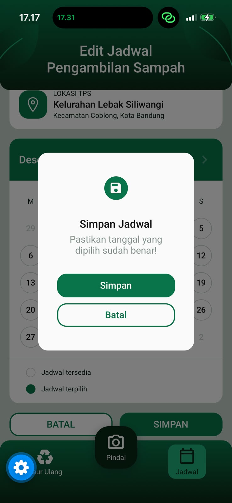 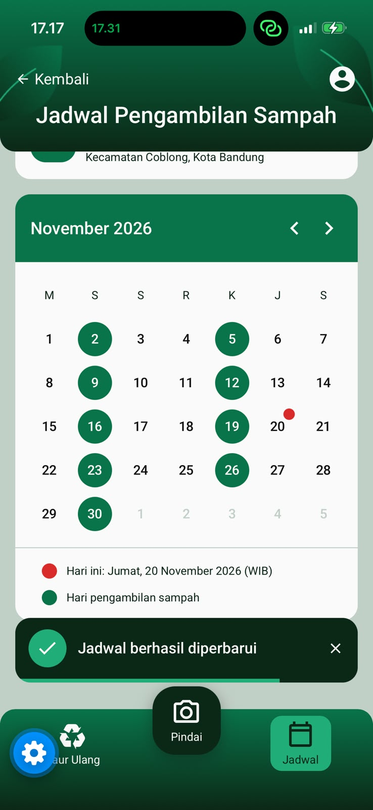 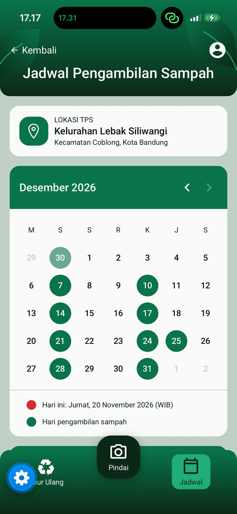  |
| UC03-TC02 | 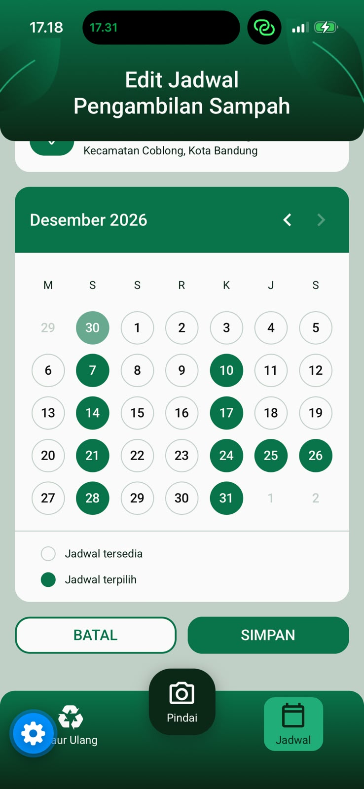 |
| UC03-TC03 | 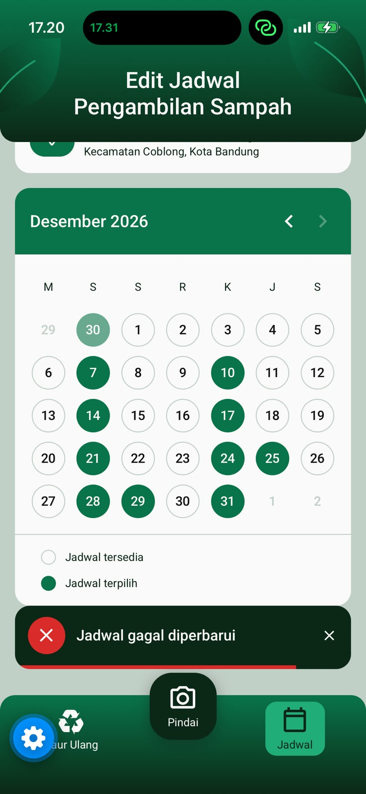 |
| UC03-TC04 |  |
| UC03-TC05 | 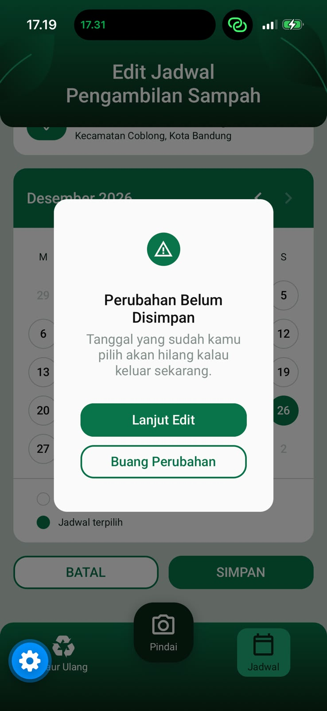 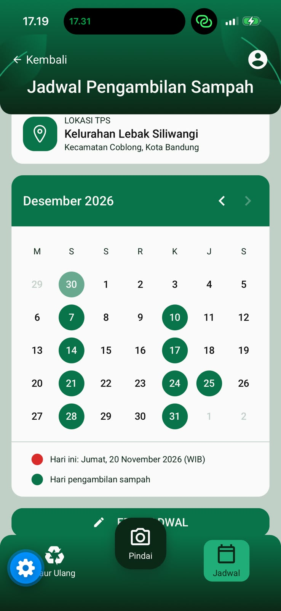 |
| UC03-TC06 | 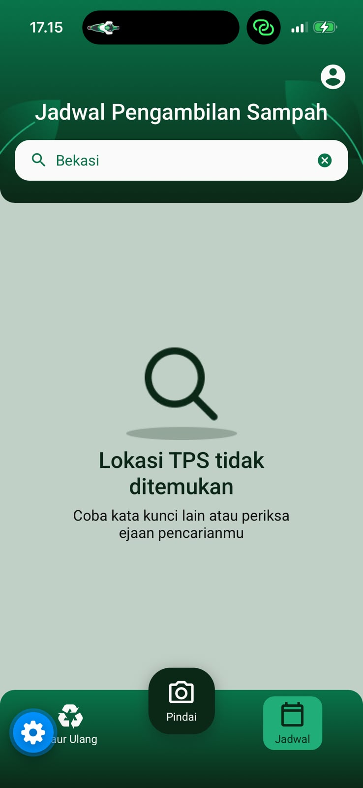 |
| UC04-TC01 | 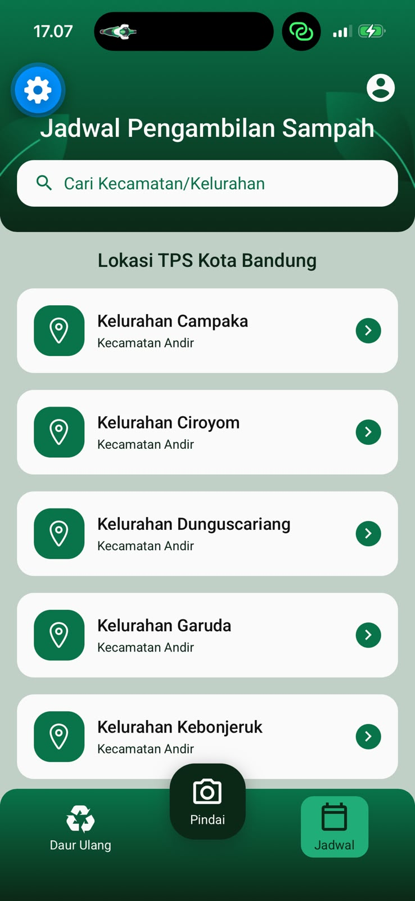  |
| UC04-TC02 | 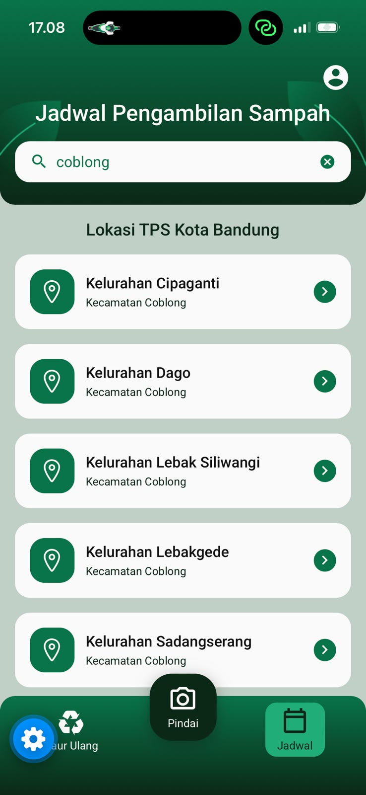 |
| UC04-TC03 |  |
| UC04-TC04 |  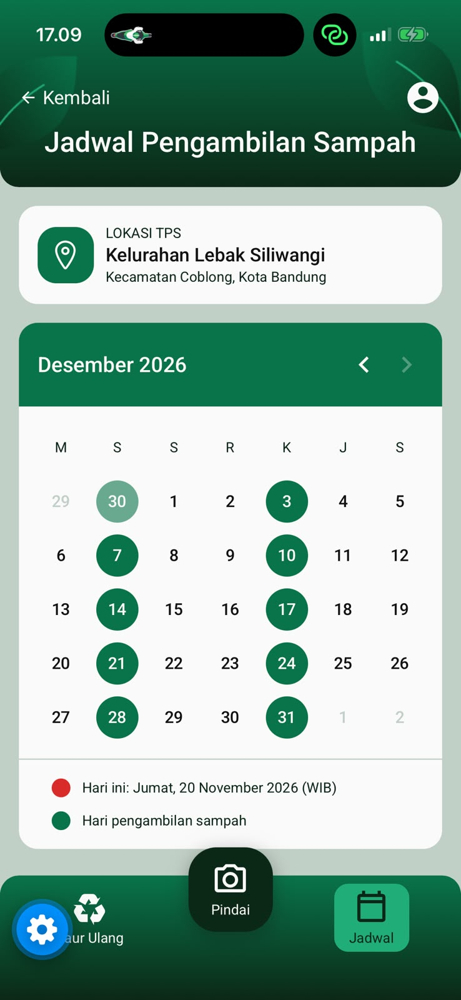 |
| UC04-TC05 |   |
| KNF05-TC01 – KNF05-TC03 |  |
| KNF05-TC04 |  |

 

---

# BAB 5: Traceability

Petakan setiap KF ke KNF, use case, kelas perancangan, file implementasi, dan test case. Tabel traceability berikut akan menjadi sarana verifikasi KF. Setiap KF memiliki minimal satu test case dan dinyatakan terpenuhi apabila **seluruh** test case terkaitnya berkesimpulan `Pass`. KF yang tidak diimplementasikan tetap dicantumkan beserta alasannya.

Tabel 5.1. Matriks Kerunutan KF terhadap Implementasi dan Pengujian

| KF ID | KNF Terkait | Use Case ID | Kelas Terkait | Implementasi File Terkait | Test Case (UC) | Test Case (Unit/Integrasi/KNF) |
| :--- | :--- | :--- | :--- | :--- | :--- | :--- |
| *KF05* | *KNF01* | *UC03* | *C02 - Pesanan* | *`src/...`* | *UC03-TC01* | *C02-UT05, INT-TC04, KNF01-TC01* |
| *KF01* | *-* | *UC01 UC02* | *[C01 - Nama kelas] [C02 - Nama kelas]* | *[path/ke/file1] [path/ke/file2]* | *UC01-TC01, UC01-TC02 UC02-TC01* | *-* |
| *KF02* | *[KNFXX atau -]* | *[UCXX]* | *[CXX - Nama kelas]* | *[path/ke/file]* | *[UCXX-TCYY]* | *[CXX-UTYY, INT-TCYY, KNFXX-TCYY atau -]* |
| *KFXX* | *-* | *[UCXX atau -]* | *[CXX - Nama kelas atau -]* | *Tidak diimplementasikan: [alasan]* | *-* | *-* |
| *...* | *...* | *...* | *...* | *...* | *...* | *...* |

Tabel 5.2. Matriks Kerunutan KNF terhadap Pengujian

| ID KNF | Parameter | KF/UC Terkait | Test Case |
| :--- | :--- | :--- | :--- |
| *KNF01* | *Reliability* | *KF05 / UC03* | *KNF01-TC01* |
| *KNFXX* | *[Parameter]* | *[KFXX / UCXX atau -]* | *[KNFXX-TCYY]* |
| *...* | *...* | *...* | *...* |