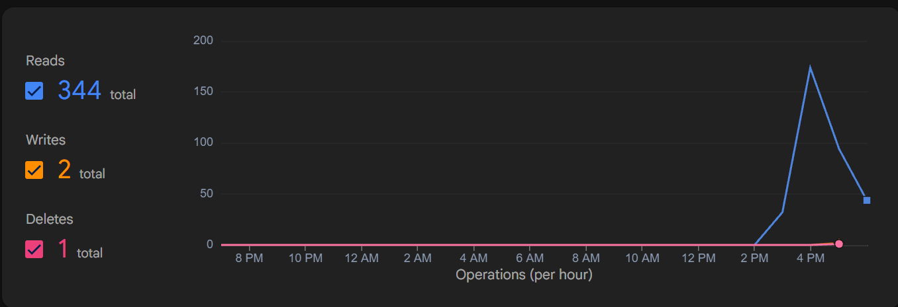
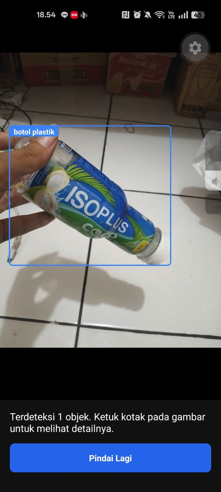
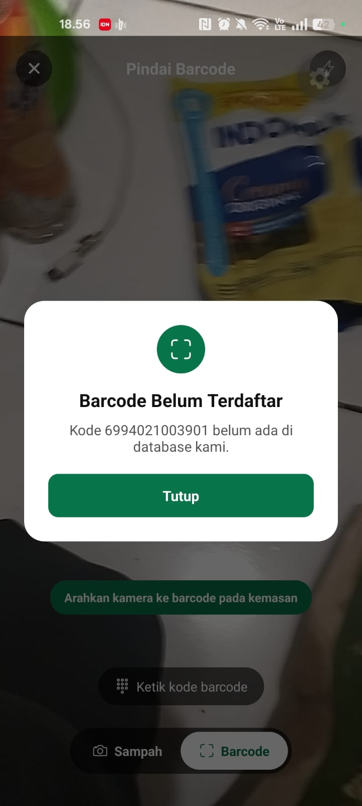
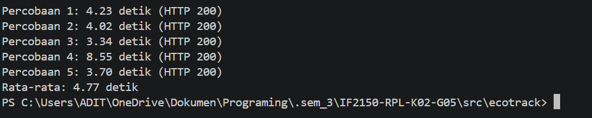

<h1>
IF2150 REKAYASA PERANGKAT LUNAK
 
TUGAS 10
 
HASIL IMPLEMENTASI DAN UJI PERANGKAT LUNAK (HIUPL)
</h1>
 

## EcoTrack
### 

### Untuk: Agatha Tatianingseto

Dipersiapkan oleh:
| Informasi | Keterangan |
| --- | --- |
| Kelas | K2 |
| Kelompok | 5 |

| NIM | Nama |
|---|---|
| 13525038 | Mochammad Adhitya Nur Rohman |
| 13525068 | Kelvin Sebastian Yen |
| 13525086 | Arla Salsabila |
| 13525137 | Maharani Puan Satira |
| 13525146 | Muhammad Reffah |
---

## Daftar Isi

- [BAB 1: Pendahuluan](#bab-1-pendahuluan)
  - [1.1 Tujuan Penulisan Dokumen](#11-tujuan-penulisan-dokumen)
  - [1.2 Lingkup Masalah](#12-lingkup-masalah)
  - [1.3 Definisi, Istilah, dan Singkatan](#13-definisi-istilah-dan-singkatan)
  - [1.4 Aturan Penomoran](#14-aturan-penomoran)
  - [1.5 Referensi](#15-referensi)
  - [1.6 Deskripsi Umum Dokumen (Ikhtisar)](#16-deskripsi-umum-dokumen-ikhtisar)
- [BAB 2: Deskripsi Umum Perangkat Lunak](#bab-2-deskripsi-umum-perangkat-lunak)
- [BAB 3: Implementasi](#bab-3-implementasi)
  - [3.1 Lingkungan Implementasi](#31-lingkungan-implementasi)
  - [3.2 Implementasi Modul](#32-implementasi-modul)
  - [3.3 Implementasi Antarmuka](#33-implementasi-antarmuka)
  - [3.4 File Lain](#34-file-lain)
- [BAB 4: Hasil Pengujian](#bab-4-hasil-pengujian)
  - [4.1 Strategi dan Kedalaman Pengujian Kelas](#41-strategi-dan-kedalaman-pengujian-kelas)
  - [4.2 Pengujian Unit Kelas](#42-pengujian-unit-kelas)
  - [4.3 Pengujian Integrasi](#43-pengujian-integrasi)
  - [4.4 Pengujian Use Case](#44-pengujian-use-case)
  - [4.5 Pengujian Kebutuhan Non-Fungsional (KNF)](#45-pengujian-kebutuhan-non-fungsional-knf)
  - [4.6 Tangkapan Layar dan Bukti Hasil Pengujian](#46-tangkapan-layar-dan-bukti-hasil-pengujian)
- [BAB 5: Traceability](#bab-5-traceability)

---

## Daftar Perubahan

| Revisi | Deskripsi |
| :--- | :--- |
| *A* | *Menambahkan fitur memindai barcode dan komponen-komponennya* |
| *B* |  |
| *C* |  |
| ... |  |

---

# BAB 1: Pendahuluan

## 1.1 Tujuan Penulisan Dokumen
Dokumen DPPL ditulis dengan tujuan menciptakan suatu dokumen penghubung antara pengembang dan pengguna perangkat lunak. Tidak dapat dipungkiri bahwa dalam pengembangan perangkat lunak, terdapat banyak masalah yang menghambat proses pengembangan, termasuk tapi tidak terbatas pada konflik kepentingan, tuntutan kontrak, dan pemahaman yang berbeda. Aplikasi EcoTrack sendiri tidak terlepas dari masalah ini, mengingat kompleksitas sistem yang dirancang dan akan dibangun. Oleh karena itu, diharapkan bahwa penulisan dokumen ini akan menghilangkan ambiguitas, mencegah miskomunikasi, dan menghasilkan perangkat lunak yang sesuai kebutuhan dan mudah dirawat.

Pengguna dokumen ini mencakup sejumlah pihak yang terlibat dalam proses pengembangan perangkat lunak. Pertama, dokumen ini akan digunakan oleh pengembang awal dan pengembang yang akan datang sebagai acuan kesesuaian spesifikasi dalam pengembangan dan perawatan lanjut. Kedua, dokumen ini menjadi standar untuk memverifikasi kesesuaian fungsionalitas perangkat lunak bagi penguji/evaluator. Ketiga, klien yang merupakan pemangku kepentingan dapat mengacu pada dokumen ini untuk memastikan kebutuhannya telah dipahami dan diimplementasikan dengan benar.

## 1.2 Lingkup Masalah
EcoTrack adalah sebuah sistem aplikasi perangkat lunak berbasis mobile yang dirancang untuk mengatasi isu tentang sampah. Aplikasi ini digunakan untuk mengidentifikasi jenis sampah secara praktis, penyedia panduan daur ulang serta sebagai penghubung antara masyarakat dengan petugas kebersihan.

## 1.3 Definisi, Istilah, dan Singkatan

Tabel 1.3. Definisi, Istilah, dan Singkatan

| Singkatan, Akronim, atau Istilah | Penjelasan |
| :--- | :--- |
| P/L | Singkatan dari Perangkat Lunak, yaitu aplikasi yang memberikan perintah kepada komputer untuk menjalankan tugas tertentu. |
| SKPL | Singkatan dari Spesifikasi Kebutuhan Perangkat Lunak, yaitu dokumen yang merangkum kriteria-kriteria yang diperlukan dalam membangun aplikasi agar dapat menjalankan tugasnya. |
| KF | Singkatan dari Kebutuhan Fungsional. |
| KNF | Singkatan dari Kebutuhan Non-Fungsional. |
| UC | Singkatan dari Use Case. |
| OS | Singkatan dari Operating System. |
| DBMS | Singkatan dari Database Management System. |
| UML | Singkatan dari Unified Modeling Language, yaitu bahasa notasi grafis untuk memodelkan sistem perangkat lunak. |
| TPS | Singkatan dari Tempat Penampungan Sementara untuk sampah. |
| API | Singkatan dari Application Programming Interface, yaitu mekanisme yang memungkinkan perangkat lunak berkomunikasi dengan perangkat lunak lainnya untuk bertukar data. |
| Computer Vision | Bidang dari kecerdasan buatan yang memungkinkan komputer memproses dan menganalisis gambar atau video agar dapat menghasilkan suatu informasi yang dapat digunakan untuk pengambilan keputusan. |
| Database | Kumpulan data yang disimpan secara terstruktur dalam sistem komputer. |
| Barcode | Representasi data dalam pola garis-garis vertikal dengan ketebalan dan jarak yang berbeda-beda yang dapat dipindai untuk mengidentifikasi suatu produk. |
| Query | Perintah yang dikirimkan ke database untuk mengambil, menambah, mengubah, atau menghapus data. |
| Dummy Data | Data tiruan yang digunakan untuk menguji sistem perangkat lunak. |
| Server | Sistem yang digunakan untuk memberikan layanan kepada komputer lain dalam satu jaringan. |
| Client | Sistem yang digunakan untuk mengakses layanan server. |

## 1.4 Aturan Penomoran

Tabel 1.4. Aturan Penomoran

| Hal/Bagian | Penomoran | Keterangan |
| :--- | :--- | :--- |
| Use Case | UCXX | Penomoran untuk ID use case dengan 2 digit angka yang dimulai dari UC01. |
| Kelas | CXX | Penomoran untuk ID kelas dengan 2 digit angka yang dimulai dari C01. |
| Algoritma Kelas AkunPetugas | Algo-AP-XXX | Penomoran untuk ID algoritma kelas AkunPetugas dengan 3 digit angka yang dimulai dari Algo-AP-001. |
| Algoritma Kelas AkunPetugasController | Algo-AP-XXX | Penomoran untuk ID algoritma kelas AkunPetugasController dengan 3 digit angka yang dimulai dari Algo-APC-001. |
| Algoritma Kelas AkunPetugasInterface | Algo-API-XXX | Penomoran untuk ID algoritma kelas AkunPetugasInterface dengan 3 digit angka yang dimulai dari Algo-API-001. |
| Algoritma Kelas Jadwal | Algo-J-XXX | Penomoran untuk ID algoritma kelas Jadwal dengan 3 digit angka yang dimulai dari Algo-J-001. |
| Algoritma Kelas JadwalController | Algo-JC-XXX | Penomoran untuk ID algoritma kelas JadwalController dengan 3 digit angka yang dimulai dari Algo-JC-001. |
| Algoritma Kelas JadwalInterface | Algo-JI-XXX | Penomoran untuk ID algoritma kelas JadwalInterface dengan 3 digit angka yang dimulai dari Algo-JI-001. |
| Algoritma Kelas InformasiSampah | Algo-IS-XXX | Penomoran untuk ID algoritma kelas InformasiSampah dengan 3 digit angka yang dimulai dari Algo-IS-001. |
| Algoritma Kelas InformasiSampahController | Algo-ISC-XXX | Penomoran untuk ID algoritma kelas InformasiSampahController dengan 3 digit angka yang dimulai dari Algo-ISC-001. |
| Algoritma Kelas InformasiSampahInterface | Algo-ISI-XXX | Penomoran untuk ID algoritma kelas InformasiSampahInterface dengan 3 digit angka yang dimulai dari Algo-ISI-001. |
| Algoritma Kelas PemindaiController | Algo-PC-XXX | Penomoran untuk ID algoritma kelas PemindaiController dengan 3 digit angka yang dimulai dari Algo-PC-001. |
| Algoritma Kelas PemindaiInterface | Algo-PI-XXX | Penomoran untuk ID algoritma kelas PemindaiInterface dengan 3 digit angka yang dimulai dari Algo-PI-001. |
| Query Kelas AkunPetugas | Q-AP-XXX | Penomoran untuk ID Query kelas AkunPetugas dengan 3 digit angka yang dimulai dari Q-AP-001. |
| Query Kelas AkunPetugasController | Q-AP-XXX | Penomoran untuk ID Query kelas AkunPetugasController dengan 3 digit angka yang dimulai dari Q-APC-001. |
| Query Kelas AkunPetugasInterface | Q-API-XXX | Penomoran untuk ID Query kelas AkunPetugasInterface dengan 3 digit angka yang dimulai dari Q-API-001. |
| Query Kelas Jadwal | Q-J-XXX | Penomoran untuk ID Query kelas Jadwal dengan 3 digit angka yang dimulai dari Q-J-001. |
| Query Kelas JadwalController | Q-JC-XXX | Penomoran untuk ID Query kelas JadwalController dengan 3 digit angka yang dimulai dari Q-JC-001. |
| Query Kelas JadwalInterface | Q-JI-XXX | Penomoran untuk ID Query kelas JadwalInterface dengan 3 digit angka yang dimulai dari Q-JI-001. |
| Query Kelas InformasiSampah | Q-IS-XXX | Penomoran untuk ID Query kelas InformasiSampah dengan 3 digit angka yang dimulai dari Q-IS-001. |
| Query Kelas InformasiSampahController | Q-ISC-XXX | Penomoran untuk ID Query kelas InformasiSampahController dengan 3 digit angka yang dimulai dari Q-ISC-001. |
| Query Kelas InformasiSampahInterface | Q-ISI-XXX | Penomoran untuk ID Query kelas InformasiSampahInterface dengan 3 digit angka yang dimulai dari Q-ISI-001. |
| Query Kelas PemindaiController | Q-PC-XXX | Penomoran untuk ID Query kelas PemindaiController dengan 3 digit angka yang dimulai dari Q-PC-001. |
| Query Kelas PemindaiInterface | Q-PI-XXX | Penomoran untuk ID Query kelas PemindaiInterface dengan 3 digit angka yang dimulai dari Q-PI-001. |
| Layar | I-XX | Penomoran untuk ID layar dengan 2 digit angka yang dimulai dari Q-PI-01. |

## 1.5 Referensi
- 11,3 Juta Ton Sampah di Indonesia Tidak Terkelola dengan Baik, brin.go.id, 26 Juli 2024, https://brin.go.id/drid/posts/kabar/113-juta-ton-sampah-di-indonesia-tidak-terkelola-dengan-baik. Accessed 30 Agustus 2026.
- Dampak Sampah yang Tidak Dikelola dengan Baik, paxel.co, 8 Juni 2025, https://paxel.co/id/berita-dan-promo/dampak-sampah-yang-tidak-dikelola-dengan-baik. Accessed 30 Agustus 2026.
- Apa yang terjadi jika target SDGs gagal tercapai pada tahun 2030?, jejakin.com, https://www.jejakin.com/id/blog/if-sdgs-fail-by-2030. Accessed 30 Agustus 2026.
- Pengelolaan Sampah Jadi Prioritas, Pemerintah Siapkan Strategi Komprehensif, Kementerian Sekretariat Negara Republik Indonesia, 12 Maret 2025, https://setneg.go.id/baca/index/pengelolaan_sampah_jadi_prioritas_pemerintah_siapkan_strategi_komprehensif. Accessed 30 Agustus 2026.
- 8 Manfaat Daur Ulang Sampah dan Cara Membiasakannya, BANK MEGA Syariah, 9 Desember 2024, https://www.megasyariah.co.id/id/artikel/edukasi-tips/lainnya/manfaat-daur-ulang. Accessed 30 Agustus 2026.
- Pristiandaru, Danur Lumbang. Mengenal Tujuan 15 SDGs: Ekosistem Daratan Sumber: https://lestari.kompas.com/read/2023/05/23/080000286/mengenal-tujuan-15-sdgs--ekosistem-daratan. Membership: https://kmp.im/plus6 Download aplikasi: https://kmp.im/app6, Kompas.com, 23 Mei 2023, https://lestari.kompas.com/read/2023/05/23/080000286/mengenal-tujuan-15-sdgs--ekosistem-daratan. Accessed 30 Agustus 2026.

## 1.6 Deskripsi Umum Dokumen (Ikhtisar)
Dokumen SKPL ini terdiri dari enam bab. Bab pertama adalah pendahuluan, yang merupakan penjelasan dari dokumen SKPL ini. Bab tersebut terdiri dari tujuan penulisan, lingkup masalah, tabel definisi, istilah, dan singkatan, aturan penomoran yang digunakan, referensi pembuatan dokumen, serta deskripsi umum dokumen. Bab kedua membahas deskripsi perangkat lunak yang dirancang. Bab tersebut terdiri dari deskripsi umum sistem, dan perangkat lunak, pengguna dan kebutuhannya, batasan perangkat lunak, dan lingkungan operasi perangkat lunak.

Bab tiga berisi deskripsi kebutuhan perangkat lunak, yang terdiri dari kebutuhan fungsional dan non fungsional perangkat lunak terkait. Bab empat membahas pemodelan use case, yang berisi identifikasi aktor dan use case, diagram use case, dan skenario-skenario terhadap use case terkait. Bab lima mendeskripsikan pemodelan kelas, yang terdiri dari identifikasi kelas, pemodelan kelas per use case, dan gabungan pemodelan kelas secara keseluruhan. Terkahkih, bab enam berisi tabel traceability yang menghubungkan kelas dan use case dengan kebutuhan awalnya.

 

---

# BAB 2: Deskripsi Umum Perangkat Lunak

Bagian ini diisi dengan *System Overview*, dalam bentuk gambar dan narasi yang memberikan gambaran tentang aplikasi dan konteksnya. **Batasan dan keterkaitan** antara sistem yang dibangun dengan sistem lain di luarnya harus jelas. Deskripsi umum sistem perlu dilengkapi dengan pemodelan kasus yang dihadapi, seperti *use case diagram*. Berikan narasi yang jelas untuk setiap gambar yang ditampilkan.

Bagian ini dapat menyalin atau meringkas dari dokumen SKPL atau DPPL.

<i>Gambar 2.1. Use Case Diagram [Nama P/L]</i>

 

---

# BAB 3: Implementasi

Bagian ini diisi dengan informasi tentang elemen P/L yang dikembangkan (*executable files*, *configuration files*, *data files*, dan sebagainya) serta perubahannya terhadap rancangan pada DPPL (jika ada).

## 3.1 Lingkungan Implementasi

Tuliskan *hardware* dan *software* yang digunakan untuk implementasi, mencakup *operating system*, bahasa pemrograman beserta versinya, *framework*/*library*, DBMS, *development tools*, dan *version control*. Lingkungan ini harus konsisten dengan **Subbab 2.1 DPPL**; jelaskan jika ada perubahan. Cantumkan juga *framework* dan alat pengujian yang dipakai.

Tabel 3.1. Lingkungan Implementasi

| Aspek | Keterangan |
| :--- | :--- |
| *Hardware* | *[Spesifikasi perangkat keras]* |
| *Operating System* | *[Nama dan versi OS]* |
| *Bahasa Pemrograman* | *[Bahasa dan versi]* |
| *Framework/Library* | *[Daftar framework/library beserta versi]* |
| *DBMS* | *[Nama dan versi DBMS]* |
| *Development Tools* | *[IDE, version control, tools lain]* |
| *Testing Tools* | *[Framework unit test, alat ukur performa, alat coverage]* |

## 3.2 Implementasi Modul

Daftar modul/kelas yang **TELAH** diimplementasikan. Gunakan nama dan ID kelas yang sama dengan DPPL, dan konsisten dengan Tabel B.5 pada dokumen Implementasi (Tugas 9).

Tabel 3.2. Implementasi Modul

| No | ID Kelas | Nama Modul/Kelas | Nama File Fisik | Nama File Executable |
| :--- | :--- | :--- | :--- | :--- |
| 1 | *[C01]* | *[Nama modul/kelas]* | *[path/ke/file]* | *[Nama file executable, atau - jika tidak ada]* |
| 2 | *[C02]* | *[Nama modul/kelas]* | *[path/ke/file]* | *[...]* |
| ... | *...* | *...* | *...* | *...* |

## 3.3 Implementasi Antarmuka

Daftar antarmuka yang telah diimplementasikan. Gunakan ID dan nama layar yang sama dengan ID dan nama layar pada tugas DPPL.

Tabel 3.3. Implementasi Antarmuka

| No | ID Antarmuka | Nama Antarmuka | Nama File Fisik | Nama File Executable |
| :--- | :--- | :--- | :--- | :--- |
| 1 | *[I-01]* | *[Nama layar]* | *[path/ke/file]* | *[Nama file executable, atau - jika tidak ada]* |
| 2 | *[I-02]* | *[Nama layar]* | *[path/ke/file]* | *[...]* |
| ... | *...* | *...* | *...* | *...* |

## 3.4 File Lain

Daftar file lain yang dibuat selain file kelas dan antarmuka, misalnya file *utility*, *configuration*, *database schema/seed*, *file test*, atau *data*.

Tabel 3.4. File Lain

| No | Nama File | Keterangan |
| :--- | :--- | :--- |
| 1 | *[Nama file]* | *[Fungsi file]* |
| ... | *...* | *...* |

 

---

# BAB 4: Hasil Pengujian

Bab ini melaporkan hasil pengujian P/L pada level unit, integrasi, dan sistem. Pengujian dilakukan pada tag release terakhir Tugas 9. Hasil aktual diisi berdasarkan pengamatan saat pengujian. Kesimpulan diisi `Pass` atau `Fail`, dan untuk `Fail` dilengkapi penyebab serta usulan perbaikan.

## 4.1 Strategi dan Kedalaman Pengujian Kelas

Setiap kelas perancangan pada Tabel 4.1 DPPL diklasifikasikan ke dalam tiga tingkat kedalaman pengujian. Tingkat **Mendalam** diberikan pada kelas yang memuat logika bisnis, perhitungan, validasi, aturan status, algoritma, integrasi eksternal, atau keamanan. Tingkat **Sedang** diberikan pada kelas yang hanya mengoordinasikan atau mendelegasikan proses. Tingkat **Tidak perlu** diberikan pada kelas tanpa logika, seperti *entity/DTO* dan kelas konfigurasi, yang teruji secara tidak langsung melalui test case use case. Seluruh kelas wajib dicantumkan beserta alasan penentuan tingkatnya.

Tabel 4.1.1. Identifikasi Tingkat Pengujian Kelas

| ID Kelas | Nama Kelas | Tingkat | Alasan | Test Case Terkait |
| :--- | :--- | :--- | :--- | :--- |
| *C02* | *Pesanan* | *Mendalam* | *Memuat `hitungTotal()` dan transisi status pembayaran* | *C02-UT01 s.d. C02-UT08* |
| *C03* | *Keranjang* | *Sedang* | *Delegasi sederhana ke Produk dan Pesanan* | *C03-UT01 s.d. C03-UT03, INT-TC02* |
| *C01* | *Pelanggan* | *Tidak perlu* | *Hanya menyimpan data akun, tanpa logika* | *-* |
| C10 | PemindaiController | Mendalam | Mengatur jalannya pengambilan foto dan pembacaan barcode, serta mengatur status tampilan | C10-UT01 s.d. C10-UT11, INT-TC01 s.d. INT-TC04 |
| C11 | PemindaiInterface | Tidak perlu | Hanya bertugas menampilkan layar kamera, kotak penanda objek sampah, dan kartu hasil pemindaian | - |
| C12 | SampahModel | Mendalam | Bertugas mengirim foto sampah ke layanan AI di server luar | C12-UT01 s.d. C12-UT04, INT-TC03, INT-TC04 |
| C13 | BarcodeModel | Mendalam | Bertugas mencocokkan nomor barcode produk ke basis data serta mengambil panduan cara daur ulangnya | C13-UT01 s.d. C13-UT03, INT-TC01, INT-TC02, INT-TC05, INT-TC06 |

| *...* | *...* | *...* | *...* | *...* |

## 4.2 Pengujian Unit Kelas

Pengujian unit dilakukan pada kelas bertingkat Mendalam dan Sedang. Kelas Mendalam diuji pada seluruh operasi public dengan kasus normal, batas, dan negatif, serta mencapai *coverage* minimal 70%. Kelas Sedang diuji minimal dengan satu kasus normal dan satu kasus gagal pada operasi public utama.

Cara menjalankan unit test: *[tuliskan perintah, mis. `pytest src/tests/`]*.

Lokasi file test: *[path, mis. `src/tests/`]*.

### 4.2.1 Kelas [Nama Kelas 1]

**ID Kelas:** *[C02]*  
**Nama Kelas:** *[Pesanan]*  
**Tingkat:** *[Mendalam]*

Tabel 4.2.1. Hasil Pengujian Unit Kelas [C02]

| ID Pengujian | Operasi yang Diuji | Jenis Kasus | Prosedur/Masukan | Hasil yang Diharapkan | Hasil Pengujian | Kesimpulan |
| :--- | :--- | :--- | :--- | :--- | :--- | :--- |
| *C02-UT01* | *`hitungTotal(): Decimal`* | *Normal* | *Pesanan berisi 2 item: 10.000 x 2 dan 5.000 x 1* | *Total = 25.000* | *[Hasil aktual]* | *Pass/Fail* |
| *C02-UT02* | *`hitungTotal(): Decimal`* | *Batas* | *Pesanan berisi tepat 1 item dengan jumlah 1* | *Total = harga item tersebut* | *[...]* | *Pass/Fail* |
| *C02-UT03* | *`hitungTotal(): Decimal`* | *Negatif* | *Pesanan tanpa item* | *Total = 0 atau melempar kesalahan sesuai rancangan* | *[...]* | *Pass/Fail* |
| *...* | *...* | *...* | *...* | *...* | *...* | *...* |

Khusus kelas **Mendalam**:

Tabel 4.2.1b. Ringkasan Cakupan Kelas [C02]

| Informasi | Keterangan |
| :--- | :--- |
| Daftar operasi public pada DPPL | *[op1(), op2(), ...]* |
| Operasi yang diuji | *[op1(), op2(), ...]* |
| ID Algoritma yang tercakup | *[Algo-001, ...]* |
| Coverage (wajib ≥ 70%) | *[% baris / % cabang, alat dan bukti pada 4.6]* |

### 4.2.2 Kelas [Nama Kelas 2]

*[Ulangi pola 4.2.1 untuk setiap kelas bertingkat Mendalam atau Sedang.]*

### 4.2.10 Kelas PemindaiController

**ID Kelas:** *C10*  
**Nama Kelas:** *PemindaiController*  
**Tingkat:** *Mendalam*

Tabel 4.2.1. Hasil Pengujian Unit Kelas PemindaiController

| ID Pengujian | Operasi yang Diuji | Jenis Kasus | Prosedur/Masukan | Hasil yang Diharapkan | Hasil Pengujian | Kesimpulan |
| :--- | :--- | :--- | :--- | :--- | :--- | :--- |
| C10-UT01 | identifikasi() | Normal | Pengguna menekan tombol pemindai saat kamera aktif, lalu layanan AI mengenali 2 objek sampah (Botol & Kaleng) | Hasil deteksi dan ukuran foto tersimpan untuk ditampilkan, status memuat (loading) berhenti, dan berkas foto sementara dihapus | Data 2 objek sampah berhasil diterima, status memuat berhenti, dan berkas foto sementara langsung dihapus | Pass |
| C10-UT02 | identifikasi() | Batas | Kamera berhasil memotret, tetapi layanan AI tidak menemukan satu pun objek sampah di dalam foto (hasil kosong) | Sistem tetap menampilkan foto dengan daftar deteksi kosong beserta pesan pemberitahuan, dan berkas foto sementara tetap dihapus | Daftar deteksi kosong ([]) tercatat bersama pesan dari sistem, ukuran foto menggunakan ukuran bawaan kamera (640x480), dan berkas foto dihapus | Pass |
| C10-UT03 | identifikasi() | Negatif | Tombol pemindai ditekan saat kamera belum siap atau proses sebelumnya masih berjalan | Sistem mengabaikan perintah tersebut agar tidak terjadi pemrosesan ganda | Perintah langsung dihentikan tanpa mengirim permintaan ke server | Pass |
| C10-UT04 | identifikasi() | Negatif | Proses identifikasi gagal karena koneksi internet terputus atau server bermasalah | Muncul pesan peringatan kegagalan kepada pengguna, status memuat berhenti, dan berkas foto sementara tetap dihapus | Pesan peringatan "Gagal mengidentifikasi" muncul, berkas foto tetap dihapus, dan status memuat berhenti | Pass |
| C10-UT05 | cariKode() | Normal | Memasukkan atau memindai kode barcode produk yang terdaftar (899123) beserta jenis sampahnya (plastik) | Data nama produk dan panduan jenis sampahnya berhasil dimuat, serta status memuat berhenti | Informasi produk dan panduan sampah "plastik" berhasil dimuat dengan lengkap | Pass |
| C10-UT06 | cariKode() | Batas | Kamera menangkap kode barcode yang sama berkali-kali secara beruntun dalam waktu sepersekian detik | Sistem mengunci pemindaian pertama sehingga pencarian ke basis data hanya dilakukan 1 kali, bukan berulang-ulang | Pencarian ke basis data hanya dijalankan 1 kali untuk kode pertama ("111111"), sedangkan pindaian susulan diabaikan | Pass |
| C10-UT07 | cariKode() | Negatif | Memindai kode barcode yang belum tercatat di basis data (0000000000000) | Sistem menandai kode tersebut sebagai "tidak terdaftar" dan tidak menampilkan kartu informasi produk | Kode tercatat sebagai tidak terdaftar dan kartu hasil produk tetap kosong | Pass |
| C10-UT08 | cariKode() | Negatif | Terjadi gangguan jaringan saat mencari data barcode ke basis data | Muncul pesan peringatan gagal mencari barcode dan kunci pemindaian dibuka kembali agar pengguna bisa mencoba memindai ulang | Pesan peringatan "Gagal mencari barcode" tampil dan pemindai siap digunakan kembali untuk percobaan berikutnya | Pass |
| C10-UT09 | onBarcodeScanned() | Normal | Kamera mendeteksi kode QR/barcode (QR123) saat layar dalam keadaan siap memindai | Sistem otomatis meneruskan kode tersebut ke proses pencarian data produk | Proses pencarian produk otomatis dijalankan untuk kode "QR123" | Pass |
| C10-UT10 | onBarcodeScanned() | Negatif | Kamera mendeteksi barcode baru saat hasil pemindaian foto sampah sebelumnya masih tampil di layar | Sistem mengabaikan barcode baru tersebut agar tidak menimpa hasil yang sedang dilihat pengguna | Pemindaian barcode baru diabaikan sepenuhnya | Pass |
| C10-UT11 | setMode() & pindaiLagi() | Normal | Pengguna mengganti mode dari Sampah ke Barcode saat lampu kilat (flash) menyala, lalu menekan tombol Pindai Lagi | Lampu kilat otomatis dimatikan, mode berpindah, dan seluruh hasil pemindaian sebelumnya dibersihkan seperti semula | Mode berpindah ke Barcode, lampu kilat mati, dan seluruh hasil pemindaian sebelumnya bersih kembali | Pass |

Tabel 4.2.1b. Ringkasan Cakupan Kelas PemindaiController

| Informasi | Keterangan |
| :--- | :--- |
| Daftar operasi public pada DPPL | startPemindaian(), prosesFrame(), prosesBarcode() (diimplementasikan sebagai identifikasi(), cariKode(), onBarcodeScanned(), scanLagi(), setMode(), pindaiLagi(), pilih()) | 
| Operasi yang diuji | identifikasi(), cariKode(), onBarcodeScanned(), scanLagi(), setMode(), pindaiLagi(), pilih() | 
| ID Algoritma yang tercakup | Algo-PC-001, Algo-PC-002 | 
| Coverage (wajib ≥ 70%) | 100% line / 88.88% branch, tool: Jest, bukti pada Subbab 4.6 | 

### 4.2.12 Kelas sampahModel

**ID Kelas:** *C12*  
**Nama Kelas:** *sampahModel*  
**Tingkat:** *Sedang*

Tabel 4.2.12. Hasil Pengujian Unit Kelas C12

| ID Pengujian | Operasi yang Diuji | Jenis Kasus | Prosedur/Masukan | Hasil yang Diharapkan | Hasil Pengujian | Kesimpulan |
| :--- | :--- | :--- | :--- | :--- | :--- | :--- |
| C12-UT01 | kirimFoto() | Normal | Mengirim data foto sampah saat pengguna sudah masuk (login) dan server merespons berhasil | Foto terkirim ke server AI beserta identitas token pengguna, lalu daftar objek sampah yang terdeteksi dikembalikan | Foto berhasil dikirim beserta identitas pengguna dan data hasil deteksi diterima dengan sesuai | Pass |
| C12-UT02 | kirimFoto() | Batas | Mengirim data foto sampah saat pengguna memakai aplikasi sebagai tamu (tanpa login) | Foto tetap dapat dikirim ke server AI tanpa token identitas dan tetap menghasilkan deteksi sampah | Permintaan tetap terkirim sebagai pengguna umum dan hasil deteksi berhasil diterima | Pass |
| C12-UT03 | kirimFoto() | Negatif | Mengirim data foto yang rusak sehingga ditolak oleh server AI | Sistem menangkap penolakan dari server dan meneruskan pesan kesalahan yang jelas | Sistem menampilkan pesan kesalahan sesuai respons server ("Gambar tidak valid" atau "Permintaan gagal") | Pass |
| C12-UT04 | hapusFile() | Normal & Negatif | Menghapus berkas foto sementara pada 3 kondisi: berkas masih ada, berkas sudah terhapus, dan akses penyimpanan ditolak | Berkas dihapus jika memang ada; jika berkas tidak ada atau akses ditolak, aplikasi tetap berjalan normal tanpa error | Berkas dihapus hanya saat tersedia, dan aplikasi tetap berjalan stabil tanpa gangguan pada kondisi gagal | Pass |

Tabel 4.2.12b. Ringkasan Cakupan Kelas PemindaiController

| Informasi | Keterangan |
| :--- | :--- |
| Daftar operasi public pada DPPL | kirimFoto(), hapusFile() | 
| Operasi yang diuji | kirimFoto(), hapusFile() | 
| ID Algoritma yang tercakup | Algo-PC-001 | 
| Coverage (wajib ≥ 70%) | 100% line / 90% branch, tool: Jest, bukti pada Subbab 4.6 |

 

### 4.2.13 Kelas barcodeModel

**ID Kelas:** *C13*  
**Nama Kelas:** *barcodeModel*  
**Tingkat:** *Sedang*

Tabel 4.2.13. Hasil Pengujian Unit Kelas C13

| ID Pengujian | Operasi yang Diuji | Jenis Kasus | Prosedur/Masukan | Hasil yang Diharapkan | Hasil Pengujian | Kesimpulan |
| :--- | :--- | :--- | :--- | :--- | :--- | :--- |
| C13-UT01 | cariProduk() | Normal | Mencari kode barcode standar (8992761139018) yang sudah tersimpan di basis data | Sistem mengembalikan informasi lengkap produk beserta kategori jenis sampahnya | Informasi nama produk dan kategori sampah berhasil ditemukan dari basis data | Pass |
| C13-UT02 | cariProduk() | Batas | Memasukkan kode barcode dengan spasi berlebih atau perbedaan panjang standar 12 digit (UPC-A) dengan 13 digit awalan angka 0 (EAN-13) | Sistem otomatis membersihkan spasi serta mencocokkan variasi 12 dan 13 digit secara dua arah hingga produk ditemukan | Spasi dibersihkan dan variasi kode 12 digit maupun 13 digit berhasil dicocokkan dengan tepat | Pass |
| C13-UT03 | cariProduk() | Negatif | Menguji masukan kosong/spasi | Sistem mengembalikan hasil kosong (null) tanpa error | Masukan kosong ditangani dengan aman tanpa membuat aplikasi terhenti | Pass |
| C13-UT03 | ambilInfoSampah() | Normal & Negatif | Mengambil panduan daur ulang untuk kategori valid ("plastik"), serta saat basis data sedang luring (offline) | Panduan daur ulang dikembalikan untuk kategori valid; untuk gangguan basis data, sistem mengembalikan hasil kosong (null) tanpa error | Panduan sampah "plastik" berhasil dimuat, sedangkan gangguan koneksi ditangani dengan aman tanpa membuat aplikasi terhenti | Pass |

Tabel 4.2.13b. Ringkasan Cakupan Kelas BarcodeModel

| Informasi | Keterangan |
| :--- | :--- |
| Daftar operasi public pada DPPL | cariProduk(), ambilInfoSampah() |
| Operasi yang diuji | cariProduk(), ambilInfoSampah() |
| ID Algoritma yang tercakup | Algo-PC-002 |
| Coverage (wajib ≥ 70%) | 100% line / 100% branch, tool: Jest, bukti pada Subbab 4.6 |

 

## 4.3 Pengujian Integrasi

Pengujian integrasi memeriksa interaksi antarkomponen yang melewati batas, yaitu *Controller* ke *Model*, aplikasi ke basis data, dan aplikasi ke sistem eksternal. Daftar antarmuka mengacu pada dokumen DPPL, dengan minimal satu test case untuk setiap antarmuka. Pengujian memakai komponen nyata, bukan *mock*. Apabila ada antarmuka tambahan yang belum didaftarkan pada dokumen DPPL, cantumkan juga.

Tabel 4.3.1. Daftar Antarmuka Antarkomponen

| ID Antarmuka | Komponen Asal | Komponen Tujuan | Jenis Batas | Test Case |
| :--- | :--- | :--- | :--- | :--- |
| *I-01* | *KeranjangController* | *Keranjang (Model)* | *Controller - Model* | *INT-TC01, INT-TC02* |
| *I-02* | *Pesanan (Model)* | *Database* | *Aplikasi - Basis data* | *INT-TC03* |
| *I-03* | *PaymentGatewayAdapter* | *Payment Gateway (dummy)* | *Aplikasi - Sistem eksternal* | *INT-TC04, INT-TC05* |
| *I-23* | *PemindaiInterface -> PemindaiController* | *SampahModel dan BarcodeModel* | *Controller - Model* | *INT-I23-TC01, INT-I23-TC02* |
| *I-24* | *PemindaiInterface -> PemindaiController* | *SampahModel -> Cloudflare Worker API (ai-penilai.3no.workers.dev)* | *Aplikasi - Sistem eksternal* | *INT-I24-TC01, INT-I24-TC02* |
| *I-25* | *PemindaiInterface -> PemindaiController* | *BarcodeModel -> Cloud Firestore (barcodeProduk)* | *Aplikasi - basis data* | *INT-I25-TC01, INT-I25-TC02* |

Tabel 4.3.2. Hasil Pengujian Integrasi

| ID Pengujian | ID Antarmuka | Skenario | Prosedur/Masukan | Hasil yang Diharapkan | Hasil Pengujian | Kesimpulan |
| :--- | :--- | :--- | :--- | :--- | :--- | :--- |
| *INT-TC01* | *I-01* | *Normal: tambah item ke keranjang* | *Panggil `tambahItem()` melalui KeranjangController dengan produk valid* | *Item tersimpan pada Keranjang dan tampil pada daftar item* | *[Hasil aktual]* | *Pass/Fail* |
| *INT-TC03* | *I-02* | *Normal: simpan pesanan* | *Buat pesanan, lalu baca ulang langsung dari basis data* | *Baris pesanan ada dengan nilai total dan status yang sama* | *[...]* | *Pass/Fail* |
| *INT-TC05* | *I-03* | *Gagal: gateway mengembalikan status gagal* | *Kirim otorisasi dengan saldo dummy tidak cukup* | *Status pesanan tidak berubah menjadi "Lunas", pesan gagal diteruskan ke pengguna* | *[...]* | *Pass/Fail* |
| INT-I23-TC01 | I-23 | Normal: Alur terpadu pemindaian barcode dari layar pemindai hingga pengambilan detail sampah | Memanggil cariKode("2000000000015") pada PemindaiController untuk memicu pencarian produk melalui BarcodeModel, lalu meneruskannya ke kartu hasil | Data produk dan informasi panduan daur ulang terhubung dengan benar serta siap ditampilkan pada antarmuka | Data produk dari BarcodeModel berhasil diteruskan dan digabungkan dengan detail panduan sampah di PemindaiController untuk ditampilkan | Pass |
| INT-I23-TC02 | I-23 | Gagal: Penanganan ketika data jenis sampah belum tersedia | Memanggil cariKode("98909899") dari layar pemindai dengan kode barcode produk yang terdaftar, tetapi kode jenis sampahnya belum ada | Kartu hasil tetap menampilkan informasi produk sementara bagian panduan sampah bernilai kosong | Informasi produk tetap berhasil dimuat dan tampil di layar I-25 | Pass |
| INT-I24-TC01 | I-24 | Normal: Pengiriman foto sampah dari layar kamera ke server AI | Mengambil foto pada antarmuka pemindai dan mengirimkan gambar botol plastik melalui kirimFoto() | Server merespons status berhasil dan mengembalikan daftar objek terdeteksi beserta koordinat kotak deteksi untuk ditampilkan pada antarmuka hasil | Server AI merespons dengan status 200 dan mengembalikan objek deteksi botol plastik beserta koordinat dan kategori sampahnya untuk ditampilkan di antarmuka | Pass |
| INT-I24-TC02 | I-24 | Gagal: Pengiriman data gambar tidak valid ke server AI | Mengirimkan teks kosong atau format gambar yang rusak melalui kirimFoto() | Server menolak permintaan tersebut dan aplikasi menangkap pesan kesalahan dari server | Server menolak permintaan dan fungsi meneruskan pesan kesalahan sesuai respons server | Pass |
| INT-I25-TC01 | I-25 | Normal: Pembacaan data produk dari Cloud Firestore | Memanggil cariProduk() dengan kode barcode yang tersimpan di koleksi barcodeProduk, lalu meneruskan kode jenis sampahnya ke ambilInformasiSampah() | Dokumen produk dari koleksi barcodeProduk dan koleksi informasiSampah berhasil dibaca secara lengkap dari basis data | Dokumen produk dan panduan daur ulang berhasil dibaca dari Cloud Firestore sesuai dengan data yang tersimpan | Pass |
| INT-I25-TC02 | I-25 | Gagal: Pencarian kode barcode yang tidak ada di Cloud Firestore | Memanggil cariProduk("9999999999999") secara langsung ke koleksi barcodeProduk dari mode barcode | Basis data mengembalikan hasil kosong sehingga antarmuka menampilkan modal "Barcode Belum Terdaftar" | Fungsi mengembalikan nilai kosong dengan aman | Pass |

 

## 4.4 Pengujian Use Case

Pengujian use case dilakukan pada seluruh skenario normal dan alternatif sesuai Subbab 4.4 SKPL, dengan minimal satu test case untuk setiap skenario. Kolom ID KF menunjukkan KF yang diverifikasi oleh test case tersebut.

### 4.4.1 Use Case [Nama Use Case 1]

**ID Use Case:** *[UC01 sesuai SKPL]*  
**Nama Use Case:** *[Nama use case sesuai SKPL]*

Tabel 4.4.1. Hasil Pengujian Use Case [UC01]

| ID Pengujian | ID KF | Skenario | Prosedur Pengujian | Masukan | Hasil yang Diharapkan | Hasil Pengujian | Kesimpulan |
| :--- | :--- | :--- | :--- | :--- | :--- | :--- | :--- |
| *UC01-TC01* | *KF01* | *Normal* | *1. Buka halaman login. 2. Masukkan kredensial. 3. Klik tombol "Login".* | *User: rpl@gmail.com Pass: 123456* | *Pengguna diarahkan ke Halaman Dashboard.* | *Pengguna diarahkan ke Halaman Dashboard sesuai hasil yang diharapkan.* | *Pass* |
| *UC01-TC02* | *KF01* | *Alternatif 1: [Nama skenario]* | *[Langkah-langkah pengujian]* | *[Data masukan]* | *[Hasil yang diharapkan]* | *[Hasil aktual]* | *[Pass/Fail. Jika Fail: penjelasan dan solusi]* |
| *...* | *...* | *...* | *...* | *...* | *...* | *...* | *...* |

### 4.4.2 Use Case Memindai Sampah

**ID Use Case:** *UC02*  
**Nama Use Case:** *Memindai Sampah*

Tabel 4.4.1. Hasil Pengujian Use Case UC02

| ID Pengujian | ID KF | Skenario | Prosedur Pengujian | Masukan | Hasil yang Diharapkan | Hasil Pengujian | Kesimpulan |
| :--- | :--- | :--- | :--- | :--- | :--- | :--- | :--- |
| UC02-TC01 | KF01, KF02, KF06 | Normal | 1. Buka aplikasi EcoTrack dan tekan tombol ikon kamera pada bilah navigasi bawah 2. Setujui permintaan akses kamera perangkat 3. Arahkan kamera ke objek sampah lalu ambil gambar 4. Setelah foto hasil muncul, tekan kotak deteksi pada objek dan tekan tombol "Lihat Cara Daur Ulang" |gambar botol plastik | Foto beku tampil disertai kotak deteksi berlabel "Plastik" dan kategori "Anorganik", lalu pengguna diarahkan ke halaman panduan daur ulang jika menekan tombolnya | Gambar botol plastik terdeteksi dengan kotak berlabel "Plastik" dan tag "Anorganik", serta tombol navigasi mengarah ke halaman panduan daur ulang dengan tepat | Pass |
| UC02-TC02 | KF01 | Alternatif 1: Akses izin kamera ditolak | 1. Buka menu pemindai pada perangkat yang belum memberikan atau menolak izin akses kamera | Izin akses kamera ditolak | Aplikasi menampilkan halaman pemberitahuan "Aplikasi butuh izin kamera untuk mengidentifikasi sampah" beserta tombol "Izinkan Kamera" | Layar pemberitahuan kebutuhan izin kamera dan tombol "Izinkan Kamera" tampil dengan jelas | Pass |
| UC02-TC03 | KF06 | Alternatif 2: Memindai barcode kemasan lewat kamera | 1. Pada layar pemindai, tekan tab "Barcode" di bagian bawah 2. Arahkan kamera ke barcode pada kemasan produk yang terdaftar  3. tekan tombol "Lihat Cara Daur Ulang" pada kartu hasil yang muncul | Kemasan produk dengan barcode terdaftar | Sistem menampilkan kartu hasil berisi informasi produk dan kategori sampah yang sesuai | Barcode terbaca otomatis, kartu informasi produk dan kategori sampahnya muncul dari bawah, serta tombol panduan daur ulang berfungsi | Pass |
| UC02-TC04 | KF06 | Alternatif 2b: Memasukkan kode barcode secara manual | 1. Pada mode "Barcode", tekan tombol "Ketik kode barcode" 2. Masukkan angka kode barcode produk terdaftar pada kolom isian, lalu tekan "Cari" | 2000000000015 | Sistem menampilkan kartu hasil berisi informasi produk dan kategori sampah yang sesuai | Dialog input tertutup dan kartu informasi produk beserta kategori sampahnya muncul sesuai kode yang diketik | Pass |
| UC02-TC05 | KF06 | Alternatif 3: Kode barcode tidak ditemukan di basis data | 1. Pada mode "Barcode", tekan "Ketik kode barcode" 2. Masukkan kombinasi angka acak yang tidak terdaftar, lalu tekan Cari | 101940 (kode tidak terdaftar) | Muncul jendela peringatan ("Barcode Belum Terdaftar") beserta tombol "Tutup" | Jendela peringatan "Barcode Belum Terdaftar" dan tombol "Tutup" tampil di layar pemindai | Pass |
| UC02-TC06 | KF06 | Alternatif 4: Objek sampah tidak terdeteksi / belum tersedia | 1. Pada mode "Sampah", arahkan kamera ke bidang kosong 2. Ambil gambar | Foto dinding kosong | Layar hasil menampilkan pesan dari sistem bahwa tidak ada sampah yang terdeteksi dan menampilkan tombol "Pindai Lagi" untuk mengulang pemindaian | Sistem menampilkan pesan bahwa objek tidak terdeteksi beserta tombol "Pindai Lagi" untuk memindai ulang | Pass |

### 4.4.2 Use Case [Nama Use Case 2]

*[Lanjutkan untuk seluruh use case dengan pola yang sama, hingga 4.4.N.]*

 

## 4.5 Pengujian Kebutuhan Non-Fungsional (KNF)

Setiap KNF pada Tabel 3.2 SKPL diuji secara terukur berdasarkan parameter yang telah didefinisikan. Setiap pengujian memuat target terukur, metode dan alat yang sesuai dengan parameter (misalnya Chrome DevTools untuk *response time* dan inspeksi basis data untuk *security*), serta hasil aktual berupa angka atau data. KNF yang belum dipenuhi atau tidak diimplementasikan dicantumkan beserta alasan dan rencana perbaikan.

Tabel 4.5. Hasil Pengujian KNF

| ID Pengujian | ID KNF | Parameter | Target Terukur | Metode dan Alat | Hasil Aktual | Kesimpulan |
| :--- | :--- | :--- | :--- | :--- | :--- | :--- |
| *KNF01-TC01* | *KNF01* | *Reliability* | *Tidak ada data hilang/ganda saat jaringan putus di tengah transaksi* | *Simulasi putus koneksi saat bayar, lalu cek status di DB* | *[Hasil aktual]* | *Pass/Fail* |
| *KNF02-TC01* | *KNF02* | *Security* | *Password tersimpan sebagai hash, bukan plain-text* | *Inspeksi tabel pengguna di DB* | *[...]* | *Pass/Fail* |
| *KNFXX-TC01* | *KNFXX* | *Response time* | *Halaman tampil ≤ 4 detik* | *Chrome DevTools, 5 kali ukur, ambil rata-rata* | *[Rata-rata ... detik, maks ... detik]* | *Pass/Fail* |
| KNF02-TC01 | KNF02 | Response Time | Rata-rata waktu respons klasifikasi sampah melalui computer vision beserta kategori daur ulang tampil dalam waktu <5 detik | Pengukuran selisih waktu menggunakan pencatatan timestamp log pada 5 kali percobaan pengiriman gambar sampah ke layanan AI, lalu dihitung rata-ratanya | Dari 5 kali pengujian diperoleh waktu respons masing-masing 4,23 detik, 4,02 detik, 3,34 detik, 8,55 detik, dan 3,70 detik, dengan rata-rata 4,77 detik serta seluruh respons berstatus HTTP 200 | Pass |
| KNF04-TC01 | KNF04 | Availability | Layanan pemindaian tersedia dengan tingkat ketersediaan ≥99% | Pengujian availability probe dengan mengirimkan 20 permintaan beruntun secara otomatis ke endpoint Cloudflare Worker API dan Cloud Firestore REST API serta pemeriksaan status respons server | Dari 20 kali pengujian ketersediaan beruntun, diperoleh tingkat ketersediaan 100% pada Cloudflare Worker API dan 100% pada Cloud Firestore | Pass |
| *...* | *...* | *...* | *...* | *...* | *...* | *...* |

 

## 4.6 Tangkapan Layar dan Bukti Hasil Pengujian

Bukti pengujian dilampirkan sesuai ID Pengujian pada Subbab 4.2 sampai 4.5, berupa tangkapan layar aplikasi, keluaran *test runner*, laporan *coverage* untuk setiap kelas Mendalam, atau hasil alat ukur.

Tabel 4.6. Bukti Hasil Pengujian

| ID Pengujian | Bukti Hasil Pengujian |
| :--- | :--- |
| *C10-UT01 – C10-UT11, C12-UT01 – C12-UT04, C13-UT01 – C13-UT03* | ** |
| *C10, C12, C13(Coverage)* | ** |
| *INT-I23-TC01, INT-I23-TC02, INT-I24-TC01, INT-I24-TC02, INT-I25-TC01, INT-I25-TC02* | ** |
| *UC02-TC01* | ** |
| *UC02-TC02* | ** |
| *UC02-TC03* | ** |
| *UC02-TC04* | ** |
| *UC02-TC05* | ** |
| *UC02-TC06* | ** |
| *KNF02-TC01* | ** |
| *KNF02-TC01* | ** |
| *...* | *...* |

 

---

# BAB 5: Traceability

Petakan setiap KF ke KNF, use case, kelas perancangan, file implementasi, dan test case. Tabel traceability berikut akan menjadi sarana verifikasi KF. Setiap KF memiliki minimal satu test case dan dinyatakan terpenuhi apabila **seluruh** test case terkaitnya berkesimpulan `Pass`. KF yang tidak diimplementasikan tetap dicantumkan beserta alasannya.

Tabel 5.1. Matriks Kerunutan KF terhadap Implementasi dan Pengujian

| KF ID | KNF Terkait | Use Case ID | Kelas Terkait | Implementasi File Terkait | Test Case (UC) | Test Case (Unit/Integrasi/KNF) |
| :--- | :--- | :--- | :--- | :--- | :--- | :--- |
| *KF05* | *KNF01* | *UC03* | *C02 - Pesanan* | *`src/...`* | *UC03-TC01* | *C02-UT05, INT-TC04, KNF01-TC01* |
| *KF01* | *-* | *UC01 UC02* | *[C01 - Nama kelas] [C02 - Nama kelas]* | *[path/ke/file1] [path/ke/file2]* | *UC01-TC01, UC01-TC02 UC02-TC01* | *-* |
| *KF02* | *[KNFXX atau -]* | *[UCXX]* | *[CXX - Nama kelas]* | *[path/ke/file]* | *[UCXX-TCYY]* | *[CXX-UTYY, INT-TCYY, KNFXX-TCYY atau -]* |
| *KFXX* | *-* | *[UCXX atau -]* | *[CXX - Nama kelas atau -]* | *Tidak diimplementasikan: [alasan]* | *-* | *-* |
| *...* | *...* | *...* | *...* | *...* | *...* | *...* |

Tabel 5.2. Matriks Kerunutan KNF terhadap Pengujian

| ID KNF | Parameter | KF/UC Terkait | Test Case |
| :--- | :--- | :--- | :--- |
| *KNF01* | *Reliability* | *KF05 / UC03* | *KNF01-TC01* |
| *KNFXX* | *[Parameter]* | *[KFXX / UCXX atau -]* | *[KNFXX-TCYY]* |
| *...* | *...* | *...* | *...* |