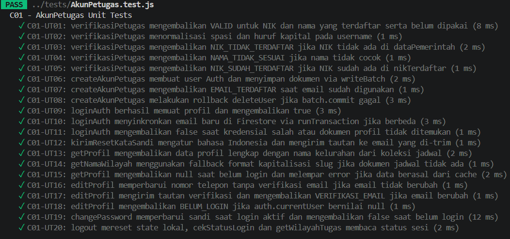
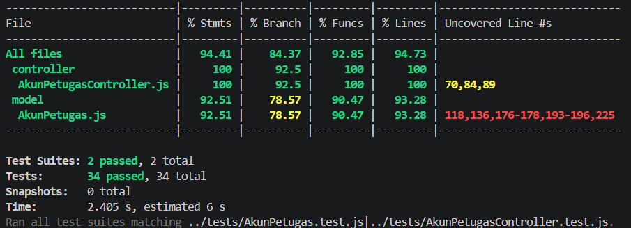
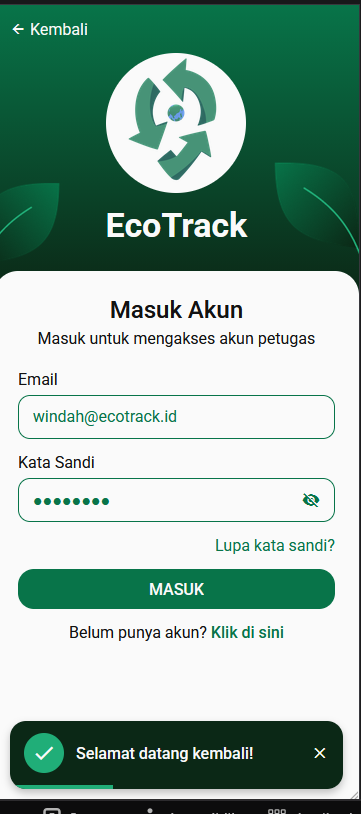
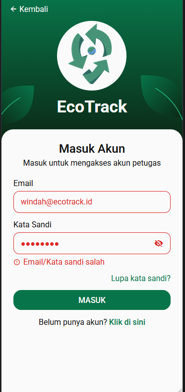
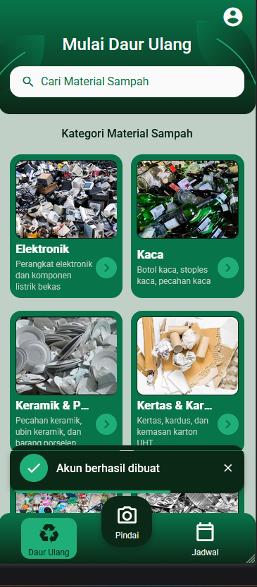
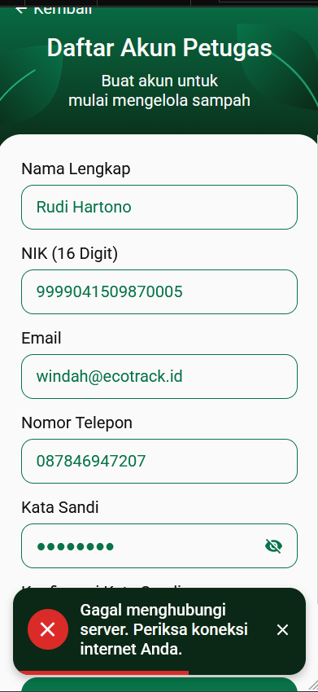

<h1>
IF2150 REKAYASA PERANGKAT LUNAK
 
TUGAS 10
 
HASIL IMPLEMENTASI DAN UJI PERANGKAT LUNAK (HIUPL)
</h1>
 

## EcoTrack
### 

### Untuk: Agatha Tatianingseto

Dipersiapkan oleh:
| Informasi | Keterangan |
| --- | --- |
| Kelas | K2 |
| Kelompok | 5 |

| NIM | Nama |
|---|---|
| 13525038 | Mochammad Adhitya Nur Rohman |
| 13525068 | Kelvin Sebastian Yen |
| 13525086 | Arla Salsabila |
| 13525137 | Maharani Puan Satira |
| 13525146 | Muhammad Reffah |
---

## Daftar Isi

- [BAB 1: Pendahuluan](#bab-1-pendahuluan)
  - [1.1 Tujuan Penulisan Dokumen](#11-tujuan-penulisan-dokumen)
  - [1.2 Lingkup Masalah](#12-lingkup-masalah)
  - [1.3 Definisi, Istilah, dan Singkatan](#13-definisi-istilah-dan-singkatan)
  - [1.4 Aturan Penomoran](#14-aturan-penomoran)
  - [1.5 Referensi](#15-referensi)
  - [1.6 Deskripsi Umum Dokumen (Ikhtisar)](#16-deskripsi-umum-dokumen-ikhtisar)
- [BAB 2: Deskripsi Umum Perangkat Lunak](#bab-2-deskripsi-umum-perangkat-lunak)
- [BAB 3: Implementasi](#bab-3-implementasi)
  - [3.1 Lingkungan Implementasi](#31-lingkungan-implementasi)
  - [3.2 Implementasi Modul](#32-implementasi-modul)
  - [3.3 Implementasi Antarmuka](#33-implementasi-antarmuka)
  - [3.4 File Lain](#34-file-lain)
- [BAB 4: Hasil Pengujian](#bab-4-hasil-pengujian)
  - [4.1 Strategi dan Kedalaman Pengujian Kelas](#41-strategi-dan-kedalaman-pengujian-kelas)
  - [4.2 Pengujian Unit Kelas](#42-pengujian-unit-kelas)
  - [4.3 Pengujian Integrasi](#43-pengujian-integrasi)
  - [4.4 Pengujian Use Case](#44-pengujian-use-case)
  - [4.5 Pengujian Kebutuhan Non-Fungsional (KNF)](#45-pengujian-kebutuhan-non-fungsional-knf)
  - [4.6 Tangkapan Layar dan Bukti Hasil Pengujian](#46-tangkapan-layar-dan-bukti-hasil-pengujian)
- [BAB 5: Traceability](#bab-5-traceability)

---

## Daftar Perubahan

| Revisi | Deskripsi |
| :--- | :--- |
| *A* | *Deskripsikan perubahan yang dilakukan dari dokumen sebelumnya pada dokumen ini. Jika tidak terdapat perubahan, harap kosongkan tabel.* |
| *B* |  |
| *C* |  |
| ... |  |

---

# BAB 1: Pendahuluan

## 1.1 Tujuan Penulisan Dokumen
Dokumen DPPL ditulis dengan tujuan menciptakan suatu dokumen penghubung antara pengembang dan pengguna perangkat lunak. Tidak dapat dipungkiri bahwa dalam pengembangan perangkat lunak, terdapat banyak masalah yang menghambat proses pengembangan, termasuk tapi tidak terbatas pada konflik kepentingan, tuntutan kontrak, dan pemahaman yang berbeda. Aplikasi EcoTrack sendiri tidak terlepas dari masalah ini, mengingat kompleksitas sistem yang dirancang dan akan dibangun. Oleh karena itu, diharapkan bahwa penulisan dokumen ini akan menghilangkan ambiguitas, mencegah miskomunikasi, dan menghasilkan perangkat lunak yang sesuai kebutuhan dan mudah dirawat.

Pengguna dokumen ini mencakup sejumlah pihak yang terlibat dalam proses pengembangan perangkat lunak. Pertama, dokumen ini akan digunakan oleh pengembang awal dan pengembang yang akan datang sebagai acuan kesesuaian spesifikasi dalam pengembangan dan perawatan lanjut. Kedua, dokumen ini menjadi standar untuk memverifikasi kesesuaian fungsionalitas perangkat lunak bagi penguji/evaluator. Ketiga, klien yang merupakan pemangku kepentingan dapat mengacu pada dokumen ini untuk memastikan kebutuhannya telah dipahami dan diimplementasikan dengan benar.

## 1.2 Lingkup Masalah
EcoTrack adalah sebuah sistem aplikasi perangkat lunak berbasis mobile yang dirancang untuk mengatasi isu tentang sampah. Aplikasi ini digunakan untuk mengidentifikasi jenis sampah secara praktis, penyedia panduan daur ulang serta sebagai penghubung antara masyarakat dengan petugas kebersihan.

## 1.3 Definisi, Istilah, dan Singkatan

Tabel 1.3. Definisi, Istilah, dan Singkatan

| Singkatan, Akronim, atau Istilah | Penjelasan |
| :--- | :--- |
| P/L | Singkatan dari Perangkat Lunak, yaitu aplikasi yang memberikan perintah kepada komputer untuk menjalankan tugas tertentu. |
| SKPL | Singkatan dari Spesifikasi Kebutuhan Perangkat Lunak, yaitu dokumen yang merangkum kriteria-kriteria yang diperlukan dalam membangun aplikasi agar dapat menjalankan tugasnya. |
| KF | Singkatan dari Kebutuhan Fungsional. |
| KNF | Singkatan dari Kebutuhan Non-Fungsional. |
| UC | Singkatan dari Use Case. |
| OS | Singkatan dari Operating System. |
| DBMS | Singkatan dari Database Management System. |
| UML | Singkatan dari Unified Modeling Language, yaitu bahasa notasi grafis untuk memodelkan sistem perangkat lunak. |
| TPS | Singkatan dari Tempat Penampungan Sementara untuk sampah. |
| API | Singkatan dari Application Programming Interface, yaitu mekanisme yang memungkinkan perangkat lunak berkomunikasi dengan perangkat lunak lainnya untuk bertukar data. |
| Computer Vision | Bidang dari kecerdasan buatan yang memungkinkan komputer memproses dan menganalisis gambar atau video agar dapat menghasilkan suatu informasi yang dapat digunakan untuk pengambilan keputusan. |
| Database | Kumpulan data yang disimpan secara terstruktur dalam sistem komputer. |
| Barcode | Representasi data dalam pola garis-garis vertikal dengan ketebalan dan jarak yang berbeda-beda yang dapat dipindai untuk mengidentifikasi suatu produk. |
| Query | Perintah yang dikirimkan ke database untuk mengambil, menambah, mengubah, atau menghapus data. |
| Dummy Data | Data tiruan yang digunakan untuk menguji sistem perangkat lunak. |
| Server | Sistem yang digunakan untuk memberikan layanan kepada komputer lain dalam satu jaringan. |
| Client | Sistem yang digunakan untuk mengakses layanan server. |

## 1.4 Aturan Penomoran

Tabel 1.4. Aturan Penomoran

| Hal/Bagian | Penomoran | Keterangan |
| :--- | :--- | :--- |
| Use Case | UCXX | Penomoran untuk ID use case dengan 2 digit angka yang dimulai dari UC01. |
| Kelas | CXX | Penomoran untuk ID kelas dengan 2 digit angka yang dimulai dari C01. |
| Algoritma Kelas AkunPetugas | Algo-AP-XXX | Penomoran untuk ID algoritma kelas AkunPetugas dengan 3 digit angka yang dimulai dari Algo-AP-001. |
| Algoritma Kelas AkunPetugasController | Algo-AP-XXX | Penomoran untuk ID algoritma kelas AkunPetugasController dengan 3 digit angka yang dimulai dari Algo-APC-001. |
| Algoritma Kelas AkunPetugasInterface | Algo-API-XXX | Penomoran untuk ID algoritma kelas AkunPetugasInterface dengan 3 digit angka yang dimulai dari Algo-API-001. |
| Algoritma Kelas Jadwal | Algo-J-XXX | Penomoran untuk ID algoritma kelas Jadwal dengan 3 digit angka yang dimulai dari Algo-J-001. |
| Algoritma Kelas JadwalController | Algo-JC-XXX | Penomoran untuk ID algoritma kelas JadwalController dengan 3 digit angka yang dimulai dari Algo-JC-001. |
| Algoritma Kelas JadwalInterface | Algo-JI-XXX | Penomoran untuk ID algoritma kelas JadwalInterface dengan 3 digit angka yang dimulai dari Algo-JI-001. |
| Algoritma Kelas InformasiSampah | Algo-IS-XXX | Penomoran untuk ID algoritma kelas InformasiSampah dengan 3 digit angka yang dimulai dari Algo-IS-001. |
| Algoritma Kelas InformasiSampahController | Algo-ISC-XXX | Penomoran untuk ID algoritma kelas InformasiSampahController dengan 3 digit angka yang dimulai dari Algo-ISC-001. |
| Algoritma Kelas InformasiSampahInterface | Algo-ISI-XXX | Penomoran untuk ID algoritma kelas InformasiSampahInterface dengan 3 digit angka yang dimulai dari Algo-ISI-001. |
| Algoritma Kelas PemindaiController | Algo-PC-XXX | Penomoran untuk ID algoritma kelas PemindaiController dengan 3 digit angka yang dimulai dari Algo-PC-001. |
| Algoritma Kelas PemindaiInterface | Algo-PI-XXX | Penomoran untuk ID algoritma kelas PemindaiInterface dengan 3 digit angka yang dimulai dari Algo-PI-001. |
| Query Kelas AkunPetugas | Q-AP-XXX | Penomoran untuk ID Query kelas AkunPetugas dengan 3 digit angka yang dimulai dari Q-AP-001. |
| Query Kelas AkunPetugasController | Q-AP-XXX | Penomoran untuk ID Query kelas AkunPetugasController dengan 3 digit angka yang dimulai dari Q-APC-001. |
| Query Kelas AkunPetugasInterface | Q-API-XXX | Penomoran untuk ID Query kelas AkunPetugasInterface dengan 3 digit angka yang dimulai dari Q-API-001. |
| Query Kelas Jadwal | Q-J-XXX | Penomoran untuk ID Query kelas Jadwal dengan 3 digit angka yang dimulai dari Q-J-001. |
| Query Kelas JadwalController | Q-JC-XXX | Penomoran untuk ID Query kelas JadwalController dengan 3 digit angka yang dimulai dari Q-JC-001. |
| Query Kelas JadwalInterface | Q-JI-XXX | Penomoran untuk ID Query kelas JadwalInterface dengan 3 digit angka yang dimulai dari Q-JI-001. |
| Query Kelas InformasiSampah | Q-IS-XXX | Penomoran untuk ID Query kelas InformasiSampah dengan 3 digit angka yang dimulai dari Q-IS-001. |
| Query Kelas InformasiSampahController | Q-ISC-XXX | Penomoran untuk ID Query kelas InformasiSampahController dengan 3 digit angka yang dimulai dari Q-ISC-001. |
| Query Kelas InformasiSampahInterface | Q-ISI-XXX | Penomoran untuk ID Query kelas InformasiSampahInterface dengan 3 digit angka yang dimulai dari Q-ISI-001. |
| Query Kelas PemindaiController | Q-PC-XXX | Penomoran untuk ID Query kelas PemindaiController dengan 3 digit angka yang dimulai dari Q-PC-001. |
| Query Kelas PemindaiInterface | Q-PI-XXX | Penomoran untuk ID Query kelas PemindaiInterface dengan 3 digit angka yang dimulai dari Q-PI-001. |
| Layar | I-XX | Penomoran untuk ID layar dengan 2 digit angka yang dimulai dari Q-PI-01. |

## 1.5 Referensi
- 11,3 Juta Ton Sampah di Indonesia Tidak Terkelola dengan Baik, brin.go.id, 26 Juli 2024, https://brin.go.id/drid/posts/kabar/113-juta-ton-sampah-di-indonesia-tidak-terkelola-dengan-baik. Accessed 30 Agustus 2026.
- Dampak Sampah yang Tidak Dikelola dengan Baik, paxel.co, 8 Juni 2025, https://paxel.co/id/berita-dan-promo/dampak-sampah-yang-tidak-dikelola-dengan-baik. Accessed 30 Agustus 2026.
- Apa yang terjadi jika target SDGs gagal tercapai pada tahun 2030?, jejakin.com, https://www.jejakin.com/id/blog/if-sdgs-fail-by-2030. Accessed 30 Agustus 2026.
- Pengelolaan Sampah Jadi Prioritas, Pemerintah Siapkan Strategi Komprehensif, Kementerian Sekretariat Negara Republik Indonesia, 12 Maret 2025, https://setneg.go.id/baca/index/pengelolaan_sampah_jadi_prioritas_pemerintah_siapkan_strategi_komprehensif. Accessed 30 Agustus 2026.
- 8 Manfaat Daur Ulang Sampah dan Cara Membiasakannya, BANK MEGA Syariah, 9 Desember 2024, https://www.megasyariah.co.id/id/artikel/edukasi-tips/lainnya/manfaat-daur-ulang. Accessed 30 Agustus 2026.
- Pristiandaru, Danur Lumbang. Mengenal Tujuan 15 SDGs: Ekosistem Daratan Sumber: https://lestari.kompas.com/read/2023/05/23/080000286/mengenal-tujuan-15-sdgs--ekosistem-daratan. Membership: https://kmp.im/plus6 Download aplikasi: https://kmp.im/app6, Kompas.com, 23 Mei 2023, https://lestari.kompas.com/read/2023/05/23/080000286/mengenal-tujuan-15-sdgs--ekosistem-daratan. Accessed 30 Agustus 2026.

## 1.6 Deskripsi Umum Dokumen (Ikhtisar)
Dokumen SKPL ini terdiri dari enam bab. Bab pertama adalah pendahuluan, yang merupakan penjelasan dari dokumen SKPL ini. Bab tersebut terdiri dari tujuan penulisan, lingkup masalah, tabel definisi, istilah, dan singkatan, aturan penomoran yang digunakan, referensi pembuatan dokumen, serta deskripsi umum dokumen. Bab kedua membahas deskripsi perangkat lunak yang dirancang. Bab tersebut terdiri dari deskripsi umum sistem, dan perangkat lunak, pengguna dan kebutuhannya, batasan perangkat lunak, dan lingkungan operasi perangkat lunak.

Bab tiga berisi deskripsi kebutuhan perangkat lunak, yang terdiri dari kebutuhan fungsional dan non fungsional perangkat lunak terkait. Bab empat membahas pemodelan use case, yang berisi identifikasi aktor dan use case, diagram use case, dan skenario-skenario terhadap use case terkait. Bab lima mendeskripsikan pemodelan kelas, yang terdiri dari identifikasi kelas, pemodelan kelas per use case, dan gabungan pemodelan kelas secara keseluruhan. Terkahkih, bab enam berisi tabel traceability yang menghubungkan kelas dan use case dengan kebutuhan awalnya.

 

---

# BAB 2: Deskripsi Umum Perangkat Lunak

Bagian ini diisi dengan *System Overview*, dalam bentuk gambar dan narasi yang memberikan gambaran tentang aplikasi dan konteksnya. **Batasan dan keterkaitan** antara sistem yang dibangun dengan sistem lain di luarnya harus jelas. Deskripsi umum sistem perlu dilengkapi dengan pemodelan kasus yang dihadapi, seperti *use case diagram*. Berikan narasi yang jelas untuk setiap gambar yang ditampilkan.

Bagian ini dapat menyalin atau meringkas dari dokumen SKPL atau DPPL.

<i>Gambar 2.1. Use Case Diagram [Nama P/L]</i>

 

---

# BAB 3: Implementasi

Bagian ini diisi dengan informasi tentang elemen P/L yang dikembangkan (*executable files*, *configuration files*, *data files*, dan sebagainya) serta perubahannya terhadap rancangan pada DPPL (jika ada).

## 3.1 Lingkungan Implementasi

Tuliskan *hardware* dan *software* yang digunakan untuk implementasi, mencakup *operating system*, bahasa pemrograman beserta versinya, *framework*/*library*, DBMS, *development tools*, dan *version control*. Lingkungan ini harus konsisten dengan **Subbab 2.1 DPPL**; jelaskan jika ada perubahan. Cantumkan juga *framework* dan alat pengujian yang dipakai.

Tabel 3.1. Lingkungan Implementasi

| Aspek | Keterangan |
| :--- | :--- |
| *Hardware* | *[Spesifikasi perangkat keras]* |
| *Operating System* | *[Nama dan versi OS]* |
| *Bahasa Pemrograman* | *[Bahasa dan versi]* |
| *Framework/Library* | *[Daftar framework/library beserta versi]* |
| *DBMS* | *[Nama dan versi DBMS]* |
| *Development Tools* | *[IDE, version control, tools lain]* |
| *Testing Tools* | *[Framework unit test, alat ukur performa, alat coverage]* |

## 3.2 Implementasi Modul

Daftar modul/kelas yang **TELAH** diimplementasikan. Gunakan nama dan ID kelas yang sama dengan DPPL, dan konsisten dengan Tabel B.5 pada dokumen Implementasi (Tugas 9).

Tabel 3.2. Implementasi Modul

| No | ID Kelas | Nama Modul/Kelas | Nama File Fisik | Nama File Executable |
| :--- | :--- | :--- | :--- | :--- |
| 1 | *[C01]* | *[Nama modul/kelas]* | *[path/ke/file]* | *[Nama file executable, atau - jika tidak ada]* |
| 2 | *[C02]* | *[Nama modul/kelas]* | *[path/ke/file]* | *[...]* |
| ... | *...* | *...* | *...* | *...* |

## 3.3 Implementasi Antarmuka

Daftar antarmuka yang telah diimplementasikan. Gunakan ID dan nama layar yang sama dengan ID dan nama layar pada tugas DPPL.

Tabel 3.3. Implementasi Antarmuka

| No | ID Antarmuka | Nama Antarmuka | Nama File Fisik | Nama File Executable |
| :--- | :--- | :--- | :--- | :--- |
| 1 | *[I-01]* | *[Nama layar]* | *[path/ke/file]* | *[Nama file executable, atau - jika tidak ada]* |
| 2 | *[I-02]* | *[Nama layar]* | *[path/ke/file]* | *[...]* |
| ... | *...* | *...* | *...* | *...* |

## 3.4 File Lain

Daftar file lain yang dibuat selain file kelas dan antarmuka, misalnya file *utility*, *configuration*, *database schema/seed*, *file test*, atau *data*.

Tabel 3.4. File Lain

| No | Nama File | Keterangan |
| :--- | :--- | :--- |
| 1 | *[Nama file]* | *[Fungsi file]* |
| ... | *...* | *...* |

 

---

# BAB 4: Hasil Pengujian

Bab ini melaporkan hasil pengujian P/L pada level unit, integrasi, dan sistem. Pengujian dilakukan pada tag release terakhir Tugas 9. Hasil aktual diisi berdasarkan pengamatan saat pengujian. Kesimpulan diisi `Pass` atau `Fail`, dan untuk `Fail` dilengkapi penyebab serta usulan perbaikan.

## 4.1 Strategi dan Kedalaman Pengujian Kelas

Setiap kelas perancangan pada Tabel 4.1 DPPL diklasifikasikan ke dalam tiga tingkat kedalaman pengujian. Tingkat **Mendalam** diberikan pada kelas yang memuat logika bisnis, perhitungan, validasi, aturan status, algoritma, integrasi eksternal, atau keamanan. Tingkat **Sedang** diberikan pada kelas yang hanya mengoordinasikan atau mendelegasikan proses. Tingkat **Tidak perlu** diberikan pada kelas tanpa logika, seperti *entity/DTO* dan kelas konfigurasi, yang teruji secara tidak langsung melalui test case use case. Seluruh kelas wajib dicantumkan beserta alasan penentuan tingkatnya.

Tabel 4.1.1. Identifikasi Tingkat Pengujian Kelas

| ID Kelas | Nama Kelas | Tingkat | Alasan | Test Case Terkait |
| :--- | :--- | :--- | :--- | :--- |
| *C01* | *AkunPetugas* | *Mendalam* | *Memuat logika validasi NIK pemerintah, pencegahan duplikasi NIK, transaksi `writeBatch`, pembaruan email terverifiikasi, dan penanganan sesi kedaluwarsa.* | *C01-UT01 s.d. C01-UT20* |
| *C02* | *AkunPetugasController* | *Mendalam* | *Mengoordinasikan alur autentikasi, memvalidasi kecocokan kata sandi, serta memetakan kode kesalahan Firebase menjadi status spesifik pada antarmuka.* | *C02-UT01 s.d. C02-UT14* |
| *C03* | *AkunPetugasInterface* | *Tidak perlu* | *Hanya komponen antarmuka tanpa logika, diuji secara fungsional pada subbab 4.4* | *-* |
| *[CXX]* | *[Nama kelas]* | *[Mendalam/Sedang/Tidak perlu]* | *[Alasan penentuan tingkat pengujian]* | *[ID test case atau -]* |
| *...* | *...* | *...* | *...* | *...* |

## 4.2 Pengujian Unit Kelas

Pengujian unit dilakukan pada kelas bertingkat Mendalam dan Sedang. Kelas Mendalam diuji pada seluruh operasi public dengan kasus normal, batas, dan negatif, serta mencapai *coverage* minimal 70%. Kelas Sedang diuji minimal dengan satu kasus normal dan satu kasus gagal pada operasi public utama.

Cara menjalankan unit test: `npx jest ../tests/AkunPetugas.test.js ../tests/AkunPetugasController.test.js --coverage` (dijalankan dari direktori `src/ecotrack/`).

Lokasi file test: `src/tests/AkunPetugas.test.js` dan `src/tests/AkunPetugasController.test.js`.

### 4.2.1 Kelas AkunPetugas

**ID Kelas:** C01  
**Nama Kelas:** AkunPetugas  
**Tingkat:** Mendalam

Tabel 4.2.1. Hasil Pengujian Unit Kelas C01

| ID Pengujian | Operasi yang Diuji | Jenis Kasus | Prosedur/Masukan | Hasil yang Diharapkan | Hasil Pengujian | Kesimpulan |
| :--- | :--- | :--- | :--- | :--- | :--- | :--- |
| C01-UT01 | `verifikasiPetugas(nik, username)` | Normal | Panggil dengan `nik` (`3273010101900001`) dan `username` (`Budi Santoso`) yang terdaftar pada koleksi `dataPemerintah` serta belum tercatat pada `nikTerdaftar` | Mengembalikan `"VALID"` serta mengisi atribut static `username` dan `wilayahTugas` sesuai data pemerintah | Operasi mengembalikan `"VALID"`, `AkunPetugas.username` terisi `"Budi Santoso"`, dan `AkunPetugas.wilayahTugas` terisi `"lebak-siliwangi"` | Pass |
| C01-UT02 | `verifikasiPetugas(nik, username)` | Batas | Panggil dengan `nik` valid dan `username` yang memiliki spasi berlebih di awal/akhir serta perbedaan huruf kapital (`"  bUDI sANTOSO  "`) | Parameter `username` dinormalisasi (`.trim().toLowerCase()`) dan mengembalikan `"VALID"` | Input berhasil dinormalisasi dan operasi mengembalikan `"VALID"` dengan nama resmi `"Budi Santoso"` | Pass |
| C01-UT03 | `verifikasiPetugas(nik, username)` | Negatif | Panggil dengan `nik` (`9999999999999999`) yang tidak ditemukan pada koleksi `dataPemerintah` | Mengembalikan `"NIK_TIDAK_TERDAFTAR"` | Operasi mengembalikan `"NIK_TIDAK_TERDAFTAR"` | Pass |
| C01-UT04 | `verifikasiPetugas(nik, username)` | Negatif | Panggil dengan `nik` valid di `dataPemerintah`, tetapi `username` (`Andi Wijaya`) berbeda dari `namaLengkap` | Mengembalikan `"NAMA_TIDAK_SESUAI"` | Operasi mengembalikan `"NAMA_TIDAK_SESUAI"` | Pass |
| C01-UT05 | `verifikasiPetugas(nik, username)` | Negatif | Panggil dengan `nik` yang sudah tercatat pada koleksi `nikTerdaftar` | Mengembalikan `"NIK_SUDAH_TERDAFTAR"` | Operasi mengembalikan `"NIK_SUDAH_TERDAFTAR"` | Pass |
| C01-UT06 | `createAkunPetugas(...)` | Normal | Panggil dengan data registrasi valid (`username`, `nik`, `email`, `noTelepon`, `password`, `wilayahTugas`) | Membuat user di Firebase Auth, menyimpan dokumen `akunPetugas/{uid}` dan `nikTerdaftar/{nik}` via `writeBatch`, mengatur `statusLogin = true`, dan mengembalikan `"BERHASIL"` | User Auth terbentuk, 2 dokumen tersimpan melalui `writeBatch.commit()`, `statusLogin` bernilai `true`, dan mengembalikan `"BERHASIL"` | Pass |
| C01-UT07 | `createAkunPetugas(...)` | Negatif | Panggil ketika Firebase Auth melempar error `auth/email-already-in-use` | Mengembalikan `"EMAIL_TERDAFTAR"` tanpa mengeksekusi `writeBatch` ke Firestore | Operasi mengembalikan `"EMAIL_TERDAFTAR"` dan `writeBatch` tidak dipanggil | Pass |
| C01-UT08 | `createAkunPetugas(...)` | Negatif | Panggil ketika user Auth berhasil dibuat, tetapi `batch.commit()` ke Firestore gagal | Melakukan *rollback* dengan memanggil `deleteUser(userBaru)` dan melempar ulang *error* | `deleteUser` dipanggil untuk menghapus akun Auth yang baru dibuat dan *error* dilempar ulang | Pass |
| C01-UT09 | `loginAuth(email, password)` | Normal | Panggil dengan `email` dan `password` yang valid serta dokumen `akunPetugas/{uid}` tersedia di Firestore | Memuat atribut profil ke kelas, mengatur `statusLogin = true`, dan mengembalikan `true` | Atribut profil dimuat ke kelas, `statusLogin` bernilai `true`, dan mengembalikan `true` | Pass |
| C01-UT10 | `loginAuth(email, password)` | Normal | Panggil dengan kredensial valid saat `user.email` di Auth (`baru@ecotrack.id`) berbeda dengan `docData.email` di Firestore (`lama@ecotrack.id`) | Menyinkronkan `email` pada dokumen Firestore melalui `runTransaction` dan mengembalikan `true` | `runTransaction` memperbarui `email` Firestore menjadi `"baru@ecotrack.id"` dan mengembalikan `true` | Pass |
| C01-UT11 | `loginAuth(email, password)` | Negatif | Uji saat Firebase Auth melempar `auth/invalid-credential` dan saat dokumen `akunPetugas/{uid}` tidak ditemukan | Mengembalikan `false` pada kredensial salah; memanggil `signOut` lalu mengembalikan `false` jika dokumen profil tidak ada | Mengembalikan `false` pada kredensial salah; `signOut` terpanggil dan mengembalikan `false` saat dokumen profil kosong | Pass |
| C01-UT12 | `kirimResetKataSandi(email)` | Normal | Panggil dengan string email yang memiliki spasi di awal/akhir (`"  budi@ecotrack.id  "`) | Mengatur `auth.languageCode = 'id'` dan memanggil `sendPasswordResetEmail` dengan email yang telah di-`trim()` | `auth.languageCode` diatur ke `'id'` dan `sendPasswordResetEmail` dipanggil dengan `"budi@ecotrack.id"` | Pass |
| C01-UT13 | `getProfil()` | Normal | Panggil saat sesi pengguna aktif, dokumen `akunPetugas/{uid}` bukan dari *cache*, dan dokumen `jadwal/{wilayahTugas}` tersedia | Mengembalikan objek `{ username, email, noTelepon, wilayahTugas }` dengan nama kelurahan dari koleksi `jadwal` | Mengembalikan objek profil lengkap dengan `wilayahTugas: "Lebak Siliwangi"` | Pass |
| C01-UT14 | `getProfil()` & `getNamaWilayah()` | Batas | Panggil saat dokumen `jadwal/{wilayahTugas}` tidak ditemukan atau parameter kosong | Menggunakan *fallback* pemformatan slug ID wilayah (`"lebak-siliwangi"` menjadi `"Lebak Siliwangi"`) dan `""` untuk input kosong | Mengembalikan `"Lebak Siliwangi"` untuk slug wilayah dan `""` untuk string kosong | Pass |
| C01-UT15 | `getProfil()` | Negatif | Uji saat sesi tidak aktif (`user === null`) dan saat `hasil.metadata.fromCache === true` | Mengembalikan `null` jika belum login, dan melempar `Error('Tidak bisa terhubung ke server')` jika data berasal dari *cache* | Mengembalikan `null` saat belum login dan melempar `Error('Tidak bisa terhubung ke server')` saat `fromCache` bernilai `true` | Pass |
| C01-UT16 | `editProfil(emailBaru, noTeleponBaru)` | Normal | Panggil dengan `emailBaru` yang sama dengan `user.email` dan `noTeleponBaru` yang diperbarui (`" 0899999999 "`) | Memperbarui `noTelepon` di Firestore via `runTransaction` tanpa memanggil `verifyBeforeUpdateEmail`, dan mengembalikan `'BERHASIL'` | `noTelepon` diperbarui menjadi `"0899999999"` tanpa memanggil `verifyBeforeUpdateEmail`, dan mengembalikan `'BERHASIL'` | Pass |
| C01-UT17 | `editProfil(emailBaru, noTeleponBaru)` | Normal | Panggil dengan `emailBaru` (`baru@ecotrack.id`) yang berbeda dari `user.email` (`lama@ecotrack.id`) | Memanggil `verifyBeforeUpdateEmail(user, email)`, memperbarui `noTelepon` di Firestore, dan mengembalikan `'VERIFIKASI_EMAIL'` | `verifyBeforeUpdateEmail` dipanggil ke email baru, `noTelepon` diperbarui, dan mengembalikan `'VERIFIKASI_EMAIL'` | Pass |
| C01-UT18 | `editProfil(emailBaru, noTeleponBaru)` | Negatif | Panggil saat `auth.currentUser` bernilai `null` | Mengembalikan `'BELUM_LOGIN'` tanpa memanggil Firebase Auth maupun Firestore | Mengembalikan `'BELUM_LOGIN'` dan `runTransaction` tidak dipanggil | Pass |
| C01-UT19 | `changePassword(passwordBaru)` | Normal & Negatif | Uji saat `auth.currentUser` aktif dengan `passwordBaru` valid dan saat `auth.currentUser === null` | Memanggil `updatePassword` dan mengembalikan `true` saat sesi aktif; mengembalikan `false` saat belum login | Mengembalikan `false` saat `currentUser` bernilai `null`, serta memanggil `updatePassword` dan mengembalikan `true` saat sesi aktif | Pass |
| C01-UT20 | `logout()`, `cekStatusLogin()`, `getWilayahTugas()` | Normal & Negatif | Uji `logout()` saat login aktif, `cekStatusLogin()` saat login aktif, dan `getWilayahTugas()` saat login aktif | `logout()` memanggil `signOut`, mereset atribut static, dan mengembalikan `true`; `cekStatusLogin()` mengembalikan `true`; `getWilayahTugas()` mengembalikan ID wilayah | `logout()` mereset state dan mengembalikan `true`; `cekStatusLogin()` mengembalikan `true`; `getWilayahTugas()` mengembalikan `'lebak-siliwangi'` | Pass |

Khusus kelas **Mendalam**:

Tabel 4.2.1b. Ringkasan Cakupan Kelas C01

| Informasi | Keterangan |
| :--- | :--- |
| Daftar operasi public pada DPPL | `cekEmail()`, `cekPassword()`, `encrypt()`, `createAkunPetugas()`, `cekStatusLogin()`, `getProfil()`, `editProfil()`, `changePassword()`, `verifikasiPetugas()`, `logout()` |
| Operasi yang diuji | `verifikasiPetugas()`, `cekDataPemerintah()`, `cekNikTerdaftar()`, `createAkunPetugas()`, `loginAuth()`, `kirimResetKataSandi()`, `tungguSesiLogin()`, `getProfil()`, `getNamaWilayah()`, `editProfil()`, `changePassword()`, `logout()`, `cekStatusLogin()`, `getWilayahTugas()` |
| ID Algoritma yang tercakup | Algo-AP-004, Algo-AP-005, Algo-AP-006, Algo-AP-007, Algo-AP-008, Algo-AP-009, Algo-AP-010 *(Algo-AP-001 s.d. Algo-AP-003 digantikan oleh Firebase Authentication sesuai Tabel B.1 No. 5 dan No. 7)* |
| Coverage (wajib ≥ 70%) | 92,51% statements / 78,57% branch (90,47% functions, 93,28% lines) menggunakan Jest, bukti pada Subbab 4.6 |

---

### 4.2.2 Kelas AkunPetugasController

**ID Kelas:** C02  
**Nama Kelas:** AkunPetugasController  
**Tingkat:** Mendalam

Tabel 4.2.2. Hasil Pengujian Unit Kelas C02

| ID Pengujian | Operasi yang Diuji | Jenis Kasus | Prosedur/Masukan | Hasil yang Diharapkan | Hasil Pengujian | Kesimpulan |
| :--- | :--- | :--- | :--- | :--- | :--- | :--- |
| C02-UT01 | `signUp(namalengkap, nik, email, nomortelepon, password, konfirmasi)` | Normal | Panggil dengan `password === konfirmasi` dan `AkunPetugas.verifikasiPetugas` mengembalikan `"VALID"` | Memanggil `AkunPetugas.createAkunPetugas` menggunakan `username` dan `wilayahTugas` hasil verifikasi, lalu mengembalikan `"BERHASIL"` | `createAkunPetugas` dipanggil dengan data resmi dari Model dan mengembalikan `"BERHASIL"` | Pass |
| C02-UT02 | `signUp(...)` | Negatif | Panggil dengan `password` kosong atau `password !== konfirmasi` | Mengembalikan `'KONFIRMASI_SANDI_BEDA'` tanpa memanggil `AkunPetugas.verifikasiPetugas` | Mengembalikan `'KONFIRMASI_SANDI_BEDA'` pada kedua kasus dan `verifikasiPetugas` tidak dipanggil | Pass |
| C02-UT03 | `signUp(...)` | Negatif | Panggil ketika `AkunPetugas.verifikasiPetugas` mengembalikan status gagal (`'NIK_TIDAK_TERDAFTAR'`) | Meneruskan status kegagalan tersebut tanpa memanggil `createAkunPetugas` | Mengembalikan `'NIK_TIDAK_TERDAFTAR'` dan `createAkunPetugas` tidak dipanggil | Pass |
| C02-UT04 | `signUp(...)` | Negatif | Panggil ketika operasi *Model* melempar *exception* jaringan/tak terduga | Menangkap *error* dan mengembalikan `'NETWORK_ERROR'` | *Exception* ditangkap dan mengembalikan `'NETWORK_ERROR'` | Pass |
| C02-UT05 | `prosesLogin(email, password)` | Normal | Panggil ketika `AkunPetugas.loginAuth` mengembalikan `true` | Mengembalikan `'BERHASIL'` | Operasi mengembalikan `'BERHASIL'` | Pass |
| C02-UT06 | `prosesLogin(email, password)` | Negatif | Panggil ketika `AkunPetugas.loginAuth` mengembalikan `false` | Mengembalikan `'KREDENSIAL_SALAH'` | Operasi mengembalikan `'KREDENSIAL_SALAH'` | Pass |
| C02-UT07 | `prosesLogin(email, password)` | Negatif | Panggil ketika `AkunPetugas.loginAuth` melempar *exception* (`auth/network-request-failed`) | Mengembalikan `'NETWORK_ERROR'` | Operasi mengembalikan `'NETWORK_ERROR'` | Pass |
| C02-UT08 | `lupaKataSandi(email)` | Normal & Batas | Uji saat `kirimResetKataSandi` berhasil dan saat melempar `auth/user-not-found` | Mengembalikan `'TERKIRIM'` pada kedua kondisi untuk mencegah enumerasi akun | Mengembalikan `'TERKIRIM'` baik saat email terdaftar maupun saat `auth/user-not-found` | Pass |
| C02-UT09 | `lupaKataSandi(email)` | Negatif | Uji saat *Model* melempar `auth/invalid-email`, `auth/too-many-requests`, dan error jaringan umum | Memetakan berturut-turut menjadi `'EMAIL_TIDAK_VALID'`, `'TERLALU_SERING'`, dan `'NETWORK_ERROR'` | Berhasil memetakan menjadi `'EMAIL_TIDAK_VALID'`, `'TERLALU_SERING'`, dan `'NETWORK_ERROR'` | Pass |
| C02-UT10 | `editProfil(emailBaru, nomorteleponBaru)` | Normal | Panggil dengan data pembaruan kontak valid (*Model* mengembalikan `'BERHASIL'` atau `'VERIFIKASI_EMAIL'`) | Meneruskan pembaruan ke `AkunPetugas.editProfil` dan mengembalikan status hasil dari *Model* | Meneruskan panggilan ke Model dan mengembalikan `'BERHASIL'` serta `'VERIFIKASI_EMAIL'` sesuai hasil Model | Pass |
| C02-UT11 | `editProfil(emailBaru, nomorteleponBaru)` | Negatif | Uji saat *Model* melempar `auth/requires-recent-login`, `auth/email-already-in-use`, `auth/invalid-email`, `auth/too-many-requests`, dan error jaringan | Memetakan berturut-turut menjadi `'PERLU_LOGIN_ULANG'`, `'EMAIL_TERDAFTAR'`, `'EMAIL_TIDAK_VALID'`, `'TERLALU_SERING'`, dan `'NETWORK_ERROR'` | Seluruh kode *error* dipetakan dengan tepat menjadi `'PERLU_LOGIN_ULANG'`, `'EMAIL_TERDAFTAR'`, `'EMAIL_TIDAK_VALID'`, `'TERLALU_SERING'`, dan `'NETWORK_ERROR'` | Pass |
| C02-UT12 | `changePassword(passwordBaru)` | Normal | Panggil saat `auth.currentUser` aktif dan `AkunPetugas.changePassword` mengembalikan `true` | Mengembalikan `'BERHASIL'` | Operasi mengembalikan `'BERHASIL'` | Pass |
| C02-UT13 | `changePassword(passwordBaru)` | Negatif | Uji saat `auth.currentUser === null` dan saat *Model* melempar `auth/requires-recent-login`, `auth/weak-password`, `auth/too-many-requests`, atau error jaringan | Mengembalikan `'BELUM_LOGIN'` jika tidak ada sesi; memetakan error menjadi `'PERLU_LOGIN_ULANG'`, `'SANDI_LEMAH'`, `'TERLALU_SERING'`, dan `'NETWORK_ERROR'` | Mengembalikan `'BELUM_LOGIN'` saat sesi kosong dan memetakan seluruh *error* menjadi `'PERLU_LOGIN_ULANG'`, `'SANDI_LEMAH'`, `'TERLALU_SERING'`, dan `'NETWORK_ERROR'` | Pass |
| C02-UT14 | `logout()` & `getProfil()` | Normal | Panggil `AkunPetugasController.logout()` dan `AkunPetugasController.getProfil()` | Mendelegasikan langsung ke `AkunPetugas.logout()` dan `AkunPetugas.getProfil()` serta mengembalikan hasilnya | Berhasil mendelegasikan dan mengembalikan data profil serta status `true` saat logout | Pass |

Khusus kelas **Mendalam**:

Tabel 4.2.2b. Ringkasan Cakupan Kelas C02

| Informasi | Keterangan |
| :--- | :--- |
| Daftar operasi public pada DPPL | `prosesLogin()`, `signUp()`, `logout()`, `changePassword()`, `editProfil()` |
| Operasi yang diuji | `prosesLogin()`, `signUp()`, `logout()`, `changePassword()`, `editProfil()`, `lupaKataSandi()`, `getProfil()` |
| ID Algoritma yang tercakup | Algo-APC-001, Algo-APC-003, Algo-APC-004 *(Algo-APC-002 digantikan oleh Firebase Authentication sesuai Tabel B.1 No. 7)* |
| Coverage (wajib ≥ 70%) | 100% statements / 92,5% branch (100% functions, 100% lines) menggunakan Jest, bukti pada Subbab 4.6 |

## 4.3 Pengujian Integrasi

Pengujian integrasi memeriksa interaksi antarkomponen yang melewati batas, yaitu *Controller* ke *Model*, aplikasi ke basis data, dan aplikasi ke sistem eksternal. Daftar antarmuka mengacu pada dokumen DPPL, dengan minimal satu test case untuk setiap antarmuka. Pengujian memakai komponen nyata, bukan *mock*. Apabila ada antarmuka tambahan yang belum didaftarkan pada dokumen DPPL, cantumkan juga.

Tabel 4.3.1. Daftar Antarmuka Antarkomponen

| ID Antarmuka | Komponen Asal | Komponen Tujuan | Jenis Batas | Test Case |
| :--- | :--- | :--- | :--- | :--- |
| I-01 | `AkunPetugasController` (C02) | `AkunPetugas` (C01) | Controller - Model | INT-TC01, INT-TC02 |
| I-02 | `AkunPetugas` (C01) | Cloud Firestore | Aplikasi - Basis data | INT-TC03, INT-TC04 |
| I-03 | `AkunPetugas` (C01) | Firebase Authentication | Aplikasi - Sistem eksternal | INT-TC05, INT-TC06, INT-TC07 |

Tabel 4.3.2. Hasil Pengujian Integrasi

| ID Pengujian | ID Antarmuka | Skenario | Prosedur/Masukan | Hasil yang Diharapkan | Hasil Pengujian | Kesimpulan |
| :--- | :--- | :--- | :--- | :--- | :--- | :--- |
| INT-TC01 | I-01 | Normal: registrasi dan login petugas melalui Controller | Jalankan pendaftaran (`signUp`) dan masuk akun (`prosesLogin`) melalui `AkunPetugasController` dengan data petugas valid (cakupan layar `I-01`, `I-02`) | *Controller* meneruskan verifikasi NIK ke `AkunPetugas`, mengisi status login aktif, dan mengembalikan `'BERHASIL'` | *Controller* berhasil meneruskan verifikasi NIK dan pembuatan akun ke `AkunPetugas`, mengatur `statusLogin = true`, serta mengembalikan `'BERHASIL'` | Pass |
| INT-TC02 | I-01 | Normal: kelola profil, ubah sandi, dan logout melalui Controller | Panggil `getProfil()`, `editProfil()`, `changePassword()`, dan `logout()` melalui `AkunPetugasController` pada sesi aktif (cakupan layar `I-15` s.d. `I-22`) | *Controller* mendelegasikan seluruh operasi ke `AkunPetugas`, memperbarui atribut sesi, dan mengembalikan `'BERHASIL'` / `true` | *Controller* berhasil membaca profil, memperbarui nomor telepon dan kata sandi melalui `AkunPetugas`, serta mereset sesi saat `logout()` dipanggil | Pass |
| INT-TC03 | I-02 | Normal: simpan akun baru dan NIK terdaftar ke Cloud Firestore | Daftarkan akun dengan NIK valid dari koleksi `dataPemerintah`, lalu baca langsung koleksi `akunPetugas` dan `nikTerdaftar` di Firestore Console | Dokumen `akunPetugas/{uid}` dan `nikTerdaftar/{nik}` tersimpan secara atomik melalui `writeBatch` dengan atribut yang sesuai | Dokumen `akunPetugas/{uid}` dan `nikTerdaftar/{nik}` berhasil tersimpan di Cloud Firestore dengan atribut profil yang sesuai | Pass |
| INT-TC04 | I-02 | Normal: baca profil wilayah tugas dan perbarui nomor telepon di Cloud Firestore | Buka halaman Profil Petugas (`I-15`), ubah nomor telepon pada Edit Profil (`I-16`), lalu periksa dokumen `akunPetugas/{uid}` di Firestore Console | Data profil dan nama kelurahan dari koleksi `jadwal` tampil sesuai, serta field `noTelepon` di Firestore terbarui | Data profil beserta nama kelurahan tampil sesuai, dan field `noTelepon` pada dokumen `akunPetugas/{uid}` di Cloud Firestore berhasil terbarui | Pass |
| INT-TC05 | I-03 | Normal: registrasi dan autentikasi kredensial ke Firebase Authentication | Buat akun baru dan lakukan login menggunakan email serta kata sandi valid terhadap server Firebase Authentication | User baru tercatat pada Firebase Authentication Console dan sesi autentikasi aktif berhasil terbentuk | User baru berhasil dibuat dan tercatat pada Firebase Authentication dengan UID yang sesuai serta sesi aktif terbentuk saat login | Pass |
| INT-TC06 | I-03 | Gagal: otorisasi login ditolak oleh Firebase Authentication | Kirim permintaan login dengan email terdaftar dan kata sandi salah ke Firebase Authentication | Firebase Authentication menolak kredensial (`auth/invalid-credential`), sesi tidak dibuat, dan pesan gagal diteruskan ke pengguna | Firebase Authentication menolak kredensial dengan kode `auth/invalid-credential`, `currentUser` tetap `null`, dan status `'KREDENSIAL_SALAH'` dikembalikan | Pass |
| INT-TC07 | I-03 | Normal: pembaruan kata sandi dan pengakhiran sesi pada Firebase Authentication | Ubah kata sandi pada pop-up Ubah Kata Sandi (`I-20`), lakukan Keluar Akun (`I-19`), lalu login ulang dengan kata sandi baru | Kata sandi akun diperbarui pada Firebase Authentication, sesi dihapus saat logout, dan login ulang dengan sandi baru berhasil | Kata sandi berhasil diperbarui pada Firebase Authentication, sesi terhapus setelah `logout()`, dan login ulang menggunakan sandi baru berhasil | Pass |

 

## 4.4 Pengujian Use Case

Pengujian use case dilakukan pada seluruh skenario normal dan alternatif sesuai Subbab 4.4 SKPL, dengan minimal satu test case untuk setiap skenario. Kolom ID KF menunjukkan KF yang diverifikasi oleh test case tersebut.

### 4.4.1 Use Case Melakukan Log In

**ID Use Case:** UC01  
**Nama Use Case:** Melakukan Log In

Tabel 4.4.1. Hasil Pengujian Use Case UC01

| ID Pengujian | ID KF | Skenario | Prosedur Pengujian | Masukan | Hasil yang Diharapkan | Hasil Pengujian | Kesimpulan |
| :--- | :--- | :--- | :--- | :--- | :--- | :--- | :--- |
| UC01-TC01 | KF08 | Normal | 1. Buka aplikasi EcoTrack dan pilih menu **Profil**. 2. Pilih tombol/opsi **Masuk / Log In**. 3. Masukkan email dan kata sandi akun petugas yang terdaftar. 4. Tekan tombol **MASUK**. | Email: `windah@ecotrack.id` Password: *(kata sandi valid)* | Sistem memverifikasi kredensial ke Firebase Authentication dan Firestore (`akunPetugas`), menampilkan notifikasi login berhasil, serta mengarahkan petugas ke halaman utama/profil. | Sistem berhasil memverifikasi kredensial, menampilkan notifikasi *"Selamat datang kembali!"*, dan membuka sesi akun petugas. | Pass |
| UC01-TC02 | KF08 | Alternatif 1: Otorisasi Log In Akun Gagal | 1. Buka menu **Profil** lalu pilih **Masuk / Log In**. 2. Masukkan email petugas dengan kata sandi yang salah. 3. Tekan tombol **MASUK**. | Email: `windah@ecotrack.id` Password: `SalahPassword123` | Sistem menolak proses autentikasi, menampilkan pesan kesalahan kredensial (email atau kata sandi salah), dan meminta petugas memasukkan kredensial ulang. | Sistem menolak autentikasi, menandai kolom input dengan garis merah, dan menampilkan pesan *"Email/Kata sandi salah"*. | Pass |

### 4.4.6 Use Case Membuat Akun

**ID Use Case:** UC06  
**Nama Use Case:** Membuat Akun

Tabel 4.4.6. Hasil Pengujian Use Case UC06

| ID Pengujian | ID KF | Skenario | Prosedur Pengujian | Masukan | Hasil yang Diharapkan | Hasil Pengujian | Kesimpulan |
| :--- | :--- | :--- | :--- | :--- | :--- | :--- | :--- |
| UC06-TC01 | KF09 | Normal | 1. Buka aplikasi EcoTrack, pilih menu **Profil**, lalu pilih **Daftar / Sign Up**. 2. Masukkan Nama Lengkap dan NIK yang terdaftar di `dataPemerintah` (belum terdaftar di `nikTerdaftar`), Email baru, Nomor Telepon, Kata Sandi, dan Konfirmasi Kata Sandi. 3. Tekan tombol **DAFTAR**. | Nama: `Rudi Hartono` NIK: `9999041509870005` Email: `windah@ecotrack.id` No. Telp: `087846947207` Password: *(valid ≥ 6 karakter)* | Sistem memverifikasi NIK, menambahkan akun baru pada Firebase Authentication dan Firestore (`akunPetugas` serta `nikTerdaftar`), serta menampilkan notifikasi pendaftaran berhasil. | Akun berhasil didaftarkan ke Firebase Auth dan Firestore, sistem menampilkan notifikasi *"Akun berhasil dibuat"*, dan mengarahkan pengguna ke layar utama. | Pass |
| UC06-TC02 | KF09 | Alternatif 1: Akun sudah ada di database | 1. Buka menu **Profil** lalu pilih **Daftar / Sign Up**. 2. Masukkan data dengan NIK yang sudah tercatat di `nikTerdaftar`. 3. Tekan tombol **DAFTAR**. | Nama: `Rudi Hartono` NIK: `9999041509870005` Email: `windah@ecotrack.id` No. Telp: `087846947207` | Sistem mendeteksi NIK/akun sudah terdaftar di database dan menampilkan notifikasi bahwa akun sudah terdaftar kepada petugas. | Sistem menolak pendaftaran, menandai kolom NIK dengan garis merah, dan menampilkan pesan *"NIK ini sudah mendaftarkan akun"*. | Pass |
| UC06-TC03 | KF09 | Alternatif 2: Sistem gagal menambahkan informasi ke database | 1. Buka halaman **Daftar Akun Petugas** dan isi seluruh kolom pendaftaran dengan data yang valid. 2. Matikan koneksi internet perangkat (*offline*) sebelum menekan tombol kirim. 3. Tekan tombol **DAFTAR**. | Data pendaftaran valid (`Rudi Hartono`, NIK `9999041509870005`, `windah@ecotrack.id`) dalam kondisi *offline* | Sistem gagal menambahkan akun ke server/database, menampilkan notifikasi kegagalan koneksi kepada petugas, dan tetap menyediakan tombol **DAFTAR** untuk dicoba kembali. | Sistem gagal terhubung ke server dan menampilkan notifikasi *"Gagal menghubungi server. Periksa koneksi internet Anda."* dengan tombol **DAFTAR** tetap tersedia. | Pass |

## 4.5 Pengujian Kebutuhan Non-Fungsional (KNF)

Setiap KNF pada Tabel 3.2 SKPL diuji secara terukur berdasarkan parameter yang telah didefinisikan. Setiap pengujian memuat target terukur, metode dan alat yang sesuai dengan parameter (misalnya Chrome DevTools untuk *response time* dan inspeksi basis data untuk *security*), serta hasil aktual berupa angka atau data. KNF yang belum dipenuhi atau tidak diimplementasikan dicantumkan beserta alasan dan rencana perbaikan.

Tabel 4.5. Hasil Pengujian KNF

| ID Pengujian | ID KNF | Parameter | Target Terukur | Metode dan Alat | Hasil Aktual | Kesimpulan |
| :--- | :--- | :--- | :--- | :--- | :--- | :--- |
| *KNF01-TC01* | *KNF01* | *Reliability* | *Tidak ada data hilang/ganda saat jaringan putus di tengah transaksi* | *Simulasi putus koneksi saat bayar, lalu cek status di DB* | *[Hasil aktual]* | *Pass/Fail* |
| *KNF02-TC01* | *KNF02* | *Security* | *Password tersimpan sebagai hash, bukan plain-text* | *Inspeksi tabel pengguna di DB* | *[...]* | *Pass/Fail* |
| *KNFXX-TC01* | *KNFXX* | *Response time* | *Halaman tampil ≤ 4 detik* | *Chrome DevTools, 5 kali ukur, ambil rata-rata* | *[Rata-rata ... detik, maks ... detik]* | *Pass/Fail* |
| *...* | *...* | *...* | *...* | *...* | *...* | *...* |
| KNF06-TC01 | KNF06 | Security | Data kredensial petugas saat registrasi (`R07`) maupun *login* (`R10`) harus terenkripsi sebelum dikirimkan ke server (protokol HTTPS/TLS) dan tidak tersimpan dalam bentuk *plaintext* di basis data | Inspeksi lalu lintas jaringan pada *Firefox Developer Tools* (tab *Network* & *Security*) saat proses autentikasi serta pemeriksaan struktur dokumen koleksi `akunPetugas` pada *Firebase Console* | Pengiriman kredensial menuju `identitytoolkit.googleapis.com` terenkripsi menggunakan protokol **HTTPS (`TLSv1.3`)** dengan *cipher suite* **`TLS_AES_256_GCM_SHA384`**, dan dokumen pada koleksi `akunPetugas` di Cloud Firestore tidak menyimpan kata sandi *plaintext* (pengelolaan dan *hashing* sandi ditangani secara terenkripsi oleh Firebase Authentication) | Pass |

 

## 4.6 Tangkapan Layar dan Bukti Hasil Pengujian

Bukti pengujian dilampirkan sesuai ID Pengujian pada Subbab 4.2 sampai 4.5, berupa tangkapan layar aplikasi, keluaran *test runner*, laporan *coverage* untuk setiap kelas Mendalam, atau hasil alat ukur.

Tabel 4.6. Bukti Hasil Pengujian

| ID Pengujian | Bukti Hasil Pengujian |
| :--- | :--- |
| *C01-UT01 – C01-UT20* | ** |
| *C02-UT01 – C02-UT14* | ** |
| *C01, C02 (coverage)* | ** |
| *INT-TC01 – INT-TC07* | ** |
| *UC01-TC01* | ** |
| *UC01-TC02* | ** |
| *UC06-TC01* | ** |
| *UC06-TC02* | ** |
| *UC06-TC03* | ** |
| *KNF01-TC01* | *[Sisipkan bukti pengukuran parameter KNF01-TC01]* |
| *...* | *...* |
| *KNF06-TC01* | *! * |

 

---

# BAB 5: Traceability

Petakan setiap KF ke KNF, use case, kelas perancangan, file implementasi, dan test case. Tabel traceability berikut akan menjadi sarana verifikasi KF. Setiap KF memiliki minimal satu test case dan dinyatakan terpenuhi apabila **seluruh** test case terkaitnya berkesimpulan `Pass`. KF yang tidak diimplementasikan tetap dicantumkan beserta alasannya.

Tabel 5.1. Matriks Kerunutan KF terhadap Implementasi dan Pengujian

| KF ID | KNF Terkait | Use Case ID | Kelas Terkait | Implementasi File Terkait | Test Case (UC) | Test Case (Unit/Integrasi/KNF) |
| :--- | :--- | :--- | :--- | :--- | :--- | :--- |
| *KF05* | *KNF01* | *UC03* | *C02 - Pesanan* | *`src/...`* | *UC03-TC01* | *C02-UT05, INT-TC04, KNF01-TC01* |
| *KF01* | *-* | *UC01 UC02* | *[C01 - Nama kelas] [C02 - Nama kelas]* | *[path/ke/file1] [path/ke/file2]* | *UC01-TC01, UC01-TC02 UC02-TC01* | *-* |
| *KF02* | *[KNFXX atau -]* | *[UCXX]* | *[CXX - Nama kelas]* | *[path/ke/file]* | *[UCXX-TCYY]* | *[CXX-UTYY, INT-TCYY, KNFXX-TCYY atau -]* |
| *KFXX* | *-* | *[UCXX atau -]* | *[CXX - Nama kelas atau -]* | *Tidak diimplementasikan: [alasan]* | *-* | *-* |
| *...* | *...* | *...* | *...* | *...* | *...* | *...* |

Tabel 5.2. Matriks Kerunutan KNF terhadap Pengujian

| ID KNF | Parameter | KF/UC Terkait | Test Case |
| :--- | :--- | :--- | :--- |
| *KNF01* | *Reliability* | *KF05 / UC03* | *KNF01-TC01* |
| *KNFXX* | *[Parameter]* | *[KFXX / UCXX atau -]* | *[KNFXX-TCYY]* |
| *...* | *...* | *...* | *...* |