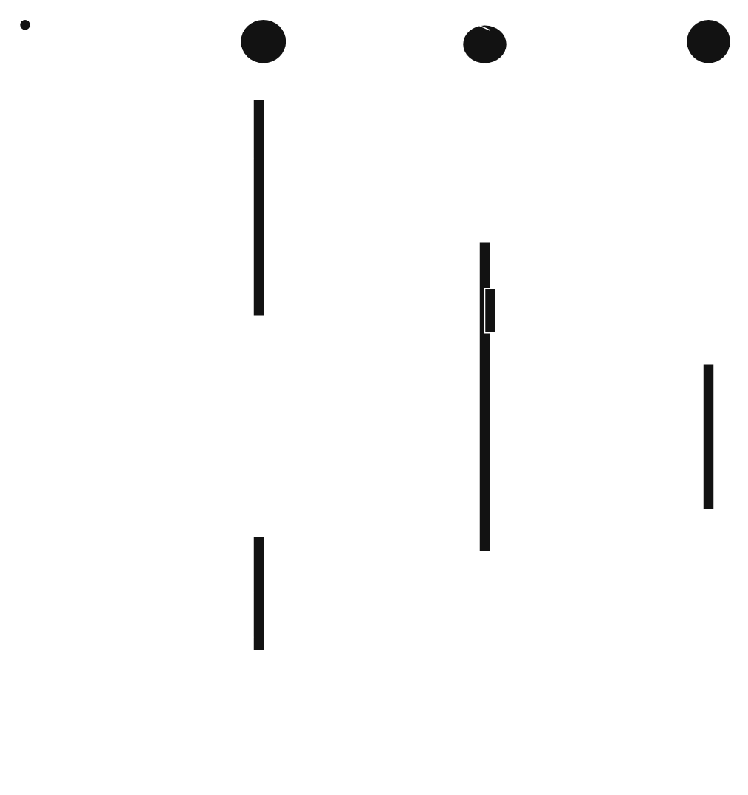
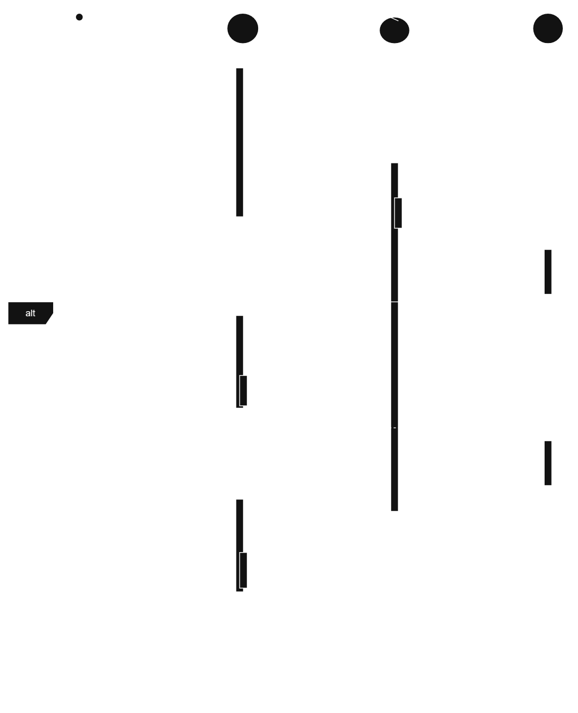
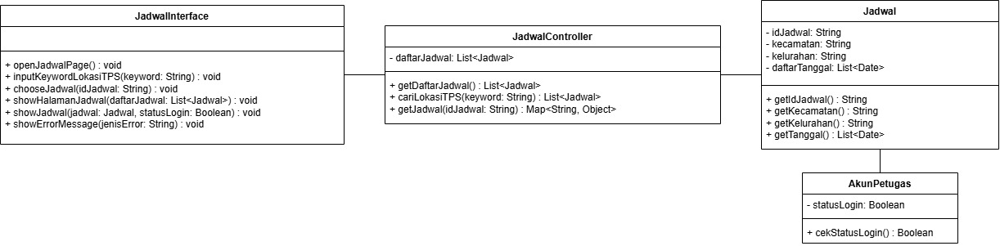
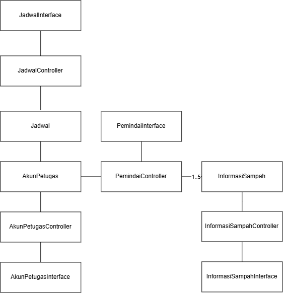

<h1>
IF2150 REKAYASA PERANGKAT LUNAK
 
TUGAS 5
 
DESKRIPSI PERANCANGAN PERANGKAT LUNAK (DPPL)
</h1>
 

## EcoTrack
### 

### Untuk: Agatha Tatianingseto

Dipersiapkan oleh:
| Informasi | Keterangan |
| --- | --- |
| Kelas | K2 |
| Kelompok | 5 |

| NIM | Nama |
|---|---|
| 13525038 | Mochammad Adhitya Nur Rohman |
| 13525068 | Kelvin Sebastian Yen |
| 13525086 | Arla Salsabila |
| 13525137 | Maharani Puan Satira |
| 13525146 | Muhammad Reffah |
---

## Daftar Perubahan

| Revisi | Deskripsi |
| :--- | :--- |
| *A* | Bab 4 Diagram Kelas Keseluruhan bagian Diagram Kelas dan Daftar Kelas Perancangan Keseluruhan ada beberapa ID Kelas yang diganti. |
| *B* | Ada beberapa atribut dan metode yang diubah dan ditambah untuk semua UC. |
| *C* | Skenario UC03 dan UC04 disesuaikan dengan *design system* sekarang yang sudah diperbarui. |

---

 

---

# BAB 1: Pendahuluan

## 1.1 Tujuan Penulisan Dokumen
Dokumen SKPL ditulis dengan tujuan menciptakan suatu dokumen penghubung antara pengembang dan pengguna perangkat lunak. Tidak dapat dipungkiri bahwa dalam pengembangan perangkat lunak, terdapat banyak masalah yang menghambat proses pengembangan, termasuk tapi tidak terbatas pada konflik kepentingan, tuntutan kontrak, dan pemahaman yang berbeda. Aplikasi EcoTrack sendiri tidak terlepas dari masalah ini, mengingat kompleksitas sistem yang dirancang dan akan dibangun. Oleh karena itu, diharapkan bahwa penulisan dokumen ini akan menghilangkan ambiguitas, mencegah miskomunikasi, dan menghasilkan perangkat lunak yang sesuai kebutuhan dan mudah dirawat.

Pengguna dokumen ini mencakup sejumlah pihak yang terlibat dalam proses pengembangan perangkat lunak. Pertama, dokumen ini akan digunakan oleh pengembang awal dan pengembang yang akan datang sebagai acuan kesesuaian spesifikasi dalam pengembangan dan perawatan lanjut. Kedua, dokumen ini menjadi standar untuk memverifikasi kesesuaian fungsionalitas perangkat lunak bagi penguji/evaluator. Ketiga, klien yang merupakan pemangku kepentingan dapat mengacu pada dokumen ini untuk memastikan kebutuhannya telah dipahami dan diimplementasikan dengan benar.

## 1.2 Lingkup Masalah
EcoTrack adalah sebuah sistem aplikasi perangkat lunak berbasis mobile yang dirancang untuk mengatasi isu tentang sampah. Aplikasi ini digunakan untuk mengidentifikasi jenis sampah secara praktis, penyedia panduan daur ulang serta sebagai penghubung antara masyarakat dengan petugas kebersihan.

## 1.3 Definisi, Istilah, dan Singkatan

Tabel 1.3. Definisi, Istilah, dan Singkatan

| Singkatan, Akronim, atau Istilah | Penjelasan |
| :--- | :--- |
| P/L | Singkatan dari Perangkat Lunak, yaitu aplikasi yang memberikan perintah kepada komputer untuk menjalankan tugas tertentu. |
| SKPL | Singkatan dari Spesifikasi Kebutuhan Perangkat Lunak, yaitu dokumen yang merangkum kriteria-kriteria yang diperlukan dalam membangun aplikasi agar dapat menjalankan tugasnya. |
| KF | Singkatan dari Kebutuhan Fungsional. |
| KNF | Singkatan dari Kebutuhan Non-Fungsional. |
| UC | Singkatan dari Use Case. |
| OS | Singkatan dari Operating System. |
| DBMS | Singkatan dari Database Management System. |
| UML | Singkatan dari Unified Modeling Language, yaitu bahasa notasi grafis untuk memodelkan sistem perangkat lunak. |
| TPS | Singkatan dari Tempat Penampungan Sementara untuk sampah. |
| API | Singkatan dari Application Programming Interface, yaitu mekanisme yang memungkinkan perangkat lunak berkomunikasi dengan perangkat lunak lainnya untuk bertukar data. |
| Computer Vision | Bidang dari kecerdasan buatan yang memungkinkan komputer memproses dan menganalisis gambar atau video agar dapat menghasilkan suatu informasi yang dapat digunakan untuk pengambilan keputusan. |
| Database | Kumpulan data yang disimpan secara terstruktur dalam sistem komputer. |
| Barcode | Representasi data dalam pola garis-garis vertikal dengan ketebalan dan jarak yang berbeda-beda yang dapat dipindai untuk mengidentifikasi suatu produk. |
| Query | Perintah yang dikirimkan ke database untuk mengambil, menambah, mengubah, atau menghapus data. |
| Dummy Data | Data tiruan yang digunakan untuk menguji sistem perangkat lunak. |
| Server | Sistem yang digunakan untuk memberikan layanan kepada komputer lain dalam satu jaringan. |
| Client | Sistem yang digunakan untuk mengakses layanan server. |

## 1.4 Aturan Penomoran

Tabel 1.4. Aturan Penomoran

| Hal/Bagian | Penomoran | Keterangan |
| :--- | :--- | :--- |
| Kebutuhan Fungsional | KFXX | Penomoran untuk ID kebutuhan fungsional dengan 2 digit angka yang dimulai dari KF01. |
| Kebutuhan Non-Fungsional | KNFXX | Penomoran untuk ID kebutuhan non-fungsional dengan 2 digit angka yang dimulai dari KNF01. |
| Use Case | UCXX | Penomoran untuk ID use case dengan 2 digit angka yang dimulai dari UC01. |
| Kelas | CXX | Penomoran untuk ID kelas dengan 2 digit angka yang dimulai dari C01. |
| Kebutuhan | RXX | Penomoran untuk ID kebutuhan dengan 2 digit angka yang dimulai dari R01. |

## 1.5 Referensi
- 11,3 Juta Ton Sampah di Indonesia Tidak Terkelola dengan Baik, brin.go.id, 26 Juli 2024, https://brin.go.id/drid/posts/kabar/113-juta-ton-sampah-di-indonesia-tidak-terkelola-dengan-baik. Accessed 30 Agustus 2026.
- Dampak Sampah yang Tidak Dikelola dengan Baik, paxel.co, 8 Juni 2025, https://paxel.co/id/berita-dan-promo/dampak-sampah-yang-tidak-dikelola-dengan-baik. Accessed 30 Agustus 2026.
- Apa yang terjadi jika target SDGs gagal tercapai pada tahun 2030?, jejakin.com, https://www.jejakin.com/id/blog/if-sdgs-fail-by-2030. Accessed 30 Agustus 2026.
- Pengelolaan Sampah Jadi Prioritas, Pemerintah Siapkan Strategi Komprehensif, Kementerian Sekretariat Negara Republik Indonesia, 12 Maret 2025, https://setneg.go.id/baca/index/pengelolaan_sampah_jadi_prioritas_pemerintah_siapkan_strategi_komprehensif. Accessed 30 Agustus 2026.
- 8 Manfaat Daur Ulang Sampah dan Cara Membiasakannya, BANK MEGA Syariah, 9 Desember 2024, https://www.megasyariah.co.id/id/artikel/edukasi-tips/lainnya/manfaat-daur-ulang. Accessed 30 Agustus 2026.
- Pristiandaru, Danur Lumbang. Mengenal Tujuan 15 SDGs: Ekosistem Daratan Sumber: https://lestari.kompas.com/read/2023/05/23/080000286/mengenal-tujuan-15-sdgs--ekosistem-daratan. Membership: https://kmp.im/plus6 Download aplikasi: https://kmp.im/app6, Kompas.com, 23 Mei 2023, https://lestari.kompas.com/read/2023/05/23/080000286/mengenal-tujuan-15-sdgs--ekosistem-daratan. Accessed 30 Agustus 2026.

## 1.6 Deskripsi Umum Dokumen (Ikhtisar)
Dokumen SKPL ini terdiri dari enam bab. Bab pertama adalah pendahuluan, yang merupakan penjelasan dari dokumen SKPL ini. Bab tersebut terdiri dari tujuan penulisan, lingkup masalah, tabel definisi, istilah, dan singkatan, aturan penomoran yang digunakan, referensi pembuatan dokumen, serta deskripsi umum dokumen. Bab kedua membahas deskripsi perangkat lunak yang dirancang. Bab tersebut terdiri dari deskripsi umum sistem, dan perangkat lunak, pengguna dan kebutuhannya, batasan perangkat lunak, dan lingkungan operasi perangkat lunak.

Bab tiga berisi deskripsi kebutuhan perangkat lunak, yang terdiri dari kebutuhan fungsional dan non fungsional perangkat lunak terkait. Bab empat membahas pemodelan use case, yang berisi identifikasi aktor dan use case, diagram use case, dan skenario-skenario terhadap use case terkait. Bab lima mendeskripsikan pemodelan kelas, yang terdiri dari identifikasi kelas, pemodelan kelas per use case, dan gabungan pemodelan kelas secara keseluruhan. Terkahkih, bab enam berisi tabel traceability yang menghubungkan kelas dan use case dengan kebutuhan awalnya.

---

# BAB 2: Perancangan Arsitektur

## 2.1 Rancangan Lingkungan Implementasi
Tabel 2.1. Rancangan Lingkungan Implementasi

| Komponen | Spesifikasi |
| :--- | :--- |
| OS | Android |
| DBMS | Firebase |
| *Development Tools* | GitHub, Visual Studio Code, Figma, Procreate |
| *Filing System* | Direktori model/ menyimpan kelas entitas dan representasi data, controller/ menyimpan kelas yang menangani logika PL, ui/ menyimpan komponen antarmuka pengguna, database/ menyimpan komponen untuk mengakses dan mengelola data Firebase, serta utils/ menyimpan fungsi utilitas yang digunakan bersama. |
| Bahasa Pemrograman | Python, Javascript |

## 2.2 Style/Pattern Arsitektur Acuan
Struktur MVC sesuai dengan kebutuhan fungsional EcoTrack karena setiap fitur dapat memiliki interface sebagai View, controller sebagai pengolah proses, dan entity sebagai Model. Sebagai contoh, proses pengelolaan jadwal melibatkan Jadwal Interface untuk interaksi pengguna, Jadwal Controller untuk menangani proses pengelolaan, dan Jadwal untuk mengelola data jadwal. Pembagian ini juga dapat diterapkan pada fitur autentikasi, pemindaian sampah, dan informasi sampah.

<i>Gambar 1. Contoh Arsitektur MVC</i>

## 2.3 Identifikasi Komponen / Modul / Subsistem
Tabel 2.3. Identifikasi Komponen/Modul/Subsistem

| Nama Komponen/Modul/Subsistem | Jenis                 | Penjelasan                                                                                                           |
| :---------------------------- | :-------------------- | :------------------------------------------------------------------------------------------------------------------- |
| AkunPetugasInterface                 | View                | Menampilkan antarmuka Log In, Sign Up, Log Out, dan akun petugas. Lalu meneruskan aksi ke AkunPetugasController     |
| JadwalInterface               | View                | Menampilkan antarmuka daftar jadwal pembuangan sampah, pencarian lokasi TPS, dan pengaturan jadwal. Lalu meneruskan aksi ke JadwalController.                                                       |
| InformasiSampahInterface                | View                | Menampilkan antarmuka daftar katalog informasi sampah dan cara mendaur ulang.                                        |
| PemindaiInterface          | View                | Menampilkan antarmuka pemindaian sampah.                                         |
| AkunPetugasController           | Controller          | Memproses logika autentikasi petugas (Log In, Sign Up, Log Out), melakukan validasi kredensial, dan melakukan enkripsi dan dekripsi data kredensial.                                             |
| JadwalController         | Controller          | Memproses permintaan penambahan, perubahan, dan penghapusan jadwal pengambilan sampah, serta mencari lokasi TPS.                                          |
| InformasiSampahController        | Controller          | Memproses permintaan data informasi sampah dan cara daur ulang yang sesuai.                |
| PemindaiController           | Controller          | Memproses pemindaian sampah.                                                              |
| AkunPetugas                      | Model               | Merepresentasikan data akun petugas kebersihan serta metode untuk verifikasi dan mengelola kredensial.                        |
| Jadwal                   | Model               | Merepresentasikan data jadwal pengambilan sampah serta metode untuk mengakses dan mengubahnya.       |
| InformasiSampah                     | Model               | Merepresentasikan data informasi sampah serta metode untuk mengakses detailnya.          |
| Database                     | Penyimpanan Data               | Menyimpan seluruh data model secara terpusat di Firebase.          |

## 2.4 Model Arsitektur Perangkat Lunak

### 2.4.1 Logical View 
Alasan penggunaan Logical View sebagai arsitektur model perangkat lunak EcoTrack adalah pemisahan tanggung jawab, ketertelusuran komponen, dan tingkat abstraksi logis. Melalui logical view, tanggung jawab setiap kelas terisolasi dengan jelas menurut perannya selaras arsitektur Modell-View-Controller (MVC). Selain itu, Logical View menjamin setiap komponen yang diidentifikasi pada bab 2 terpetakan secara lengkap dan konsisten pada diagram perancangan selama pengembangan. Relasi dan alur interaksi logis antar setiap komponen juga dapat dipahami dengan mudah.

<i>Gambar 2. Logical View pada P/L EcoTrack</i>

# BAB 3: Realisasi Use Case

## 3.1 Use Case Melakukan Log In

**ID Use Case:** *UC01*  
**Nama Use Case:** *Melakukan Log In*

### 3.1.1 Identifikasi Kelas

Tabel 3.1. Identifikasi Kelas Use Case [UC01]

| No | Nama Kelas Perancangan | Nama Kelas Analisis Terkait |
|:--- | :--- | :--- |
| 1 | *Akun Petugas* | *Akun Petugas* |
| 2 | *Akun Petugas Controller* | *Akun Petugas Controller* |
| 3 | *Akun Petugas Interface* | *Akun Petugas Interface* |

### 3.1.2 Sequence Diagram

- **Skenario Normal**

<

<i>Gambar 4. Sequence Diagram [UC01]</i>

- **Skenario Alternatif 1: Otorisasi Log In Akun Gagal**

<i>Gambar 5. Sequence Diagram [UC01]</i>

### 3.1.3 Diagram Kelas

<i>Gambar X. Diagram Kelas [Nama Uce Case]</i>

## 3.2 Use Case Memindai Sampah

**ID Use Case:** UC02 
**Nama Use Case:** Memindai Sampah

### 3.2.1 Identifikasi Kelas

Tabel 3.2. Identifikasi Kelas Use Case [UC02]

| No | Nama Kelas Perancangan | Nama Kelas Analisis Terkait |
|:--- | :--- | :--- |
| 1 | PemindaiInterface | PemindaiInterface |
| 2 | PemindaiController | PemindaiController |
| 3 | InformasiSampahInterface | InformasiSampahInterface |
| 4 | InformasiSampahController | InformasiSampahController |
| 5 | InformasiSampah | InformasiSampah |

### 3.2.2 Sequence Diagram

- **Skenario Normal**

<i>Gambar 6. Sequence Diagram [UC02]</i>

### 3.2.3 Diagram Kelas

<i>Gambar 7. Diagram Kelas [UC02]</i>

## 3.3 Use Case Mengatur Jadwal

**ID Use Case:** UC03 
**Nama Use Case:** Mengatur Jadwal

### 3.3.1 Identifikasi Kelas

Tabel 3.3. Identifikasi Kelas Use Case [UC03]

| No | Nama Kelas Perancangan | Nama Kelas Analisis Terkait |
|:--- | :--- | :--- |
| 1 | JadwalInterface | JadwalInterface |
| 2 | JadwalController | JadwalController |
| 3 | Jadwal | Jadwal |
| 4 | AkunPetugas | AkunPetugas |

### 3.3.2 Sequence Diagram

- **Skenario Normal**

<i>Gambar 8. Sequence Diagram [UC03]</i>

### 3.3.3 Diagram Kelas

<i>Gambar 9. Diagram Kelas [UC03]</i>

## 3.4 Use Case Melihat Jadwal

**ID Use Case:** UC04 
**Nama Use Case:** Melihat Jadwal

### 3.4.1 Identifikasi Kelas

Tabel 3.4. Identifikasi Kelas Use Case [UC04]

| No | Nama Kelas Perancangan | Nama Kelas Analisis Terkait |
|:--- | :--- | :--- |
| 1 | JadwalInterface | JadwalInterface |
| 2 | JadwalController | JadwalController |
| 3 | Jadwal | Jadwal |
| 4 | AkunPetugas | AkunPetugas |

### 3.4.2 Sequence Diagram

- **Skenario Normal**

<i>Gambar 9. Sequence Diagram [UC04]</i>

### 3.4.3 Diagram Kelas

<i>Gambar 10. Diagram Kelas [UC04]</i>

 

---

# BAB 4: Diagram Kelas Keseluruhan

## 4.1 Diagram Kelas

<i>Gambar 4.1. Diagram Kelas Perancangan Keseluruhan [Nama P/L]</i>

Tabel 4.1. Daftar Kelas Perancangan Keseluruhan

| ID Kelas | Nama Kelas | Atribut | Metode/Operasi |
| :--- | :--- | :--- | :--- |
| *C01* | AkunPetugas | -usernameExist, -passwordCorrect, -status | +validasiLogin(username, password), +cekUsername(username), +cekPassword(password), +encrypt(password), +createAkunPetugas() |
| *C02* | AkunPetugasController | -invalidLogin(), -validLogin, -status | +prosesLogin(), +prosesLogin(username, password), +clearInput(), +signup() |
| *C03* | AkunPetugasInterface | - | +showSignup(), +openLogin(), +showLogin(), +inputKredensial(username, password), +showPesan("Username/Password salah"), +showPesan("Selamat datang"), +showTampilan(masuk tampilan profil), +showSignUp(), +showSignUp(status) |
| *C04* | Jadwal | -idJadwal, -kecamatan, -kelurahan, -daftarTanggal, -statusSimpan | +getIdJadwal(), +getKecamatan(), +getKelurahan(), +getTanggal(), +setTanggal(daftarTanggalBaru), +simpanJadwal() |
| *C05* | JadwalController | -daftarJadwal | +getDaftarJadwal(), +cariLokasiTPS(keyword), +getJadwal(idJadwal), +cekStatusLogin(), +editJadwal(idJadwal, daftarTanggalBaru) |
| *C06* | JadwalInterface | - | +openJadwalPage(), +showHalamanJadwal(daftarJadwal), +inputKeywordLokasiTPS(keyword), +chooseJadwal(idJadwal), +showJadwal(jadwal, statusLogin), showErrorMessage(notFound), chooseEditJadwal(), fillFormEditJadwal(idJadwal, daftarTanggalBaru), showNotifikasi("Jadwal berhasil diperbarui"), showJadwal(jadwalDiperbarui, statusLogin) |
| *C07* | InformasiSampah | -dataSampah, -detailData, -infoSampah | +ambilDataDetail(idSampah), +cariBarcode(barcode), +getInfoSampah(), getInfoSampah(keyword) |
| *C08* | InformasiSampahController | -detailData, -infoSampah | +getDetailSampah(idSampah), +getMaterial(), +search(keyword) |
| *C09* | InformasiSampahInterface | - | +bukaDetail(idSampah), +showTampilanDetail(), +showMain(), +showDetail(), +showSearch(infoSampah) |
| *C10* | PemindaiController | -hasilIdentifikasi | +ubahMode("Barcode"), +startPemindaian(), +ambilFrame(), +prosesBarcode(frameData) |
| *C11* | PemindaiInterface | | +openPemindai(), +showLiveFeed(), +gantiMode(), +showJenis(), +klikNotifikasi() |

 

# BAB 5: Matriks Kerunutan

| Kelas | Use Case Terkait |
| :--- | :--- |
| *C01* - AkunPetugas | *UC01 - Melakukan Login, UC06 - Membuat Akun* |
| *C02* - AkunPetugasController | *UC01 - Melakukan Login, UC03 - Mengatur Jadwal, UC06 - Membuat Akun* |
| *C03* - AkunPetugasInterface | *UC01 - Melakukan Login, UC06 - Membuat Akun* |
| *C04* - Jadwal | *UC03 - Mengatur Jadwal, UC04 - Melihat Jadwal* |
| *C05* - JadwalControler | *UC03 - Mengatur Jadwal, UC04 - Melihat Jadwal* |
| *C06* - JadwalInterface | *UC03 - Mengatur Jadwal, UC04 - Melihat Jadwal* |
| *C07* - InformasiSampah | *UC02 - Memindai Sampah, UC05 - Mengakses Tampilan Informasi* |
| *C08* - InformasiSampahController | *UC02 - Memindai Sampah, UC05 - Mengakses Tampilan Informasi* |
| *C09* - InformasiSampahInterface | *UC02 - Memindai Sampah, UC05 - Mengakses Tampilan Informasi* |
| *C10* - PemindaiController | *UC02 - Memindai Sampah* | *KF01
| *C11* - PemindaiInterface | *UC02 - Memindai Sampah* | *KF01
