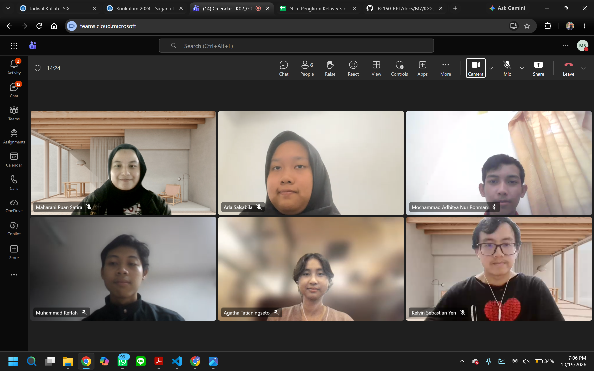

# Form Asistensi

## Tugas Besar IF2150 - Rekayasa Perangkat Lunak

| Informasi | Keterangan |
| --- | --- |
| **Hari** | Senin |
| **Tanggal** | \[19/10/2026\] |
| **Kelas** | K2 |
| **Nomor Kelompok** | 5  
| **Nama Kelompok** | Join yang mau |
| **Nama Perangkat Lunak** | EcoTrack |
| **Dokumen** | K02_G05_DPPL |

### Anggota Kelompok

| NIM | Nama |
|---|---|
| 13525038 | Mochammad Adhitya Nur Rohman |
| 13525068 | Kelvin Sebastian Yen |
| 13525086 | Arla Salsabila |
| 13525137 | Maharani Puan Satira |
| 13525146 | Muhammad Reffah |

### Catatan

| Catatan |
| --- |
| 1. filling system itu gimana kalian bakal design directory kalian, misal /model itu buat simpan class entity (/controller, /ui, /database, /lalalala) |
| 2. buat sequence diagram itu class yang berhubungan itu sama dengan yang udah kalian identifikasiin pas di usecase |
| 3. penamaan ga wajib berubah (tujuan dari perubahan ini jadi class yang kalian ubah ini adalah nama yang bakal kalian pakai buat impelementasi), misal kalian udah tau bakal pake case apa (misal camelCase, jdi bisa langsung userController - MISAL) |
| 4. class diagram masing-masing use case itu setiap node tambahin atribut dan method nya |
| 5. untuk best case dan alternatif itu dipidah sequence diagramnya, (alternative itu buat di masing-masing case aja) |

## Dokumentasi

<!--  -->

  

  <i>Gambar 1. Dokumentasi kegiatan asistensi.</i>

