<h1>
IF2150 REKAYASA PERANGKAT LUNAK
<br>
TUGAS 5
<br>
DESKRIPSI PERANCANGAN PERANGKAT LUNAK (DPPL)
</h1>
<br>

## EcoTrack
### <p align="center">

</p>
<p align="center">

### Untuk: Agatha Tatianingseto

Dipersiapkan oleh:
| Informasi | Keterangan |
| --- | --- |
| Kelas | K2 |
| Kelompok | 5 |

| NIM | Nama |
|---|---|
| 13525038 | Mochammad Adhitya Nur Rohman |
| 13525068 | Kelvin Sebastian Yen |
| 13525086 | Arla Salsabila |
| 13525137 | Maharani Puan Satira |
| 13525146 | Muhammad Reffah |
---

## Daftar Perubahan

| Revisi | Deskripsi |
| :--- | :--- |
| *A* | *Deskripsikan perubahan yang dilakukan dari dokumen sebelumnya pada dokumen ini. Jika tidak terdapat perubahan, harap kosongkan tabel.* |
| *B* |  |
| *C* |  |
| ... |  |

---

<br>

> **Petunjuk pengerjaan:** *[Silahkan hapus bagian ini setelah selesai mengerjakan]*
>
> Dokumen ini melanjutkan **Deskripsi Perancangan Perangkat Lunak**. Gunakan nama, ID, kebutuhan, dan use case yang konsisten dengan kedua dokumen tersebut. Contoh pola ID baru di bawah dapat disesuaikan dengan kesepakatan kelompok, ID yang sudah ada tetap dipertahankan.

<br>

---

# BAB 1: Pendahuluan

## 1.1 Tujuan Penulisan Dokumen
Dokumen SKPL ditulis dengan tujuan menciptakan suatu dokumen penghubung antara pengembang dan pengguna perangkat lunak. Tidak dapat dipungkiri bahwa dalam pengembangan perangkat lunak, terdapat banyak masalah yang menghambat proses pengembangan, termasuk tapi tidak terbatas pada konflik kepentingan, tuntutan kontrak, dan pemahaman yang berbeda. Aplikasi EcoTrack sendiri tidak terlepas dari masalah ini, mengingat kompleksitas sistem yang dirancang dan akan dibangun. Oleh karena itu, diharapkan bahwa penulisan dokumen ini akan menghilangkan ambiguitas, mencegah miskomunikasi, dan menghasilkan perangkat lunak yang sesuai kebutuhan dan mudah dirawat.

Pengguna dokumen ini mencakup sejumlah pihak yang terlibat dalam proses pengembangan perangkat lunak. Pertama, dokumen ini akan digunakan oleh pengembang awal dan pengembang yang akan datang sebagai acuan kesesuaian spesifikasi dalam pengembangan dan perawatan lanjut. Kedua, dokumen ini menjadi standar untuk memverifikasi kesesuaian fungsionalitas perangkat lunak bagi penguji/evaluator. Ketiga, klien yang merupakan pemangku kepentingan dapat mengacu pada dokumen ini untuk memastikan kebutuhannya telah dipahami dan diimplementasikan dengan benar.

## 1.2 Lingkup Masalah
EcoTrack adalah sebuah sistem aplikasi perangkat lunak berbasis mobile yang dirancang untuk mengatasi isu tentang sampah. Aplikasi ini digunakan untuk mengidentifikasi jenis sampah secara praktis, penyedia panduan daur ulang serta sebagai penghubung antara masyarakat dengan petugas kebersihan.

## 1.3 Definisi, Istilah, dan Singkatan

Tabel 1.3. Definisi, Istilah, dan Singkatan

| Singkatan, Akronim, atau Istilah | Penjelasan |
| :--- | :--- |
| P/L | Singkatan dari Perangkat Lunak, yaitu aplikasi yang memberikan perintah kepada komputer untuk menjalankan tugas tertentu. |
| SKPL | Singkatan dari Spesifikasi Kebutuhan Perangkat Lunak, yaitu dokumen yang merangkum kriteria-kriteria yang diperlukan dalam membangun aplikasi agar dapat menjalankan tugasnya. |
| KF | Singkatan dari Kebutuhan Fungsional. |
| KNF | Singkatan dari Kebutuhan Non-Fungsional. |
| UC | Singkatan dari Use Case. |
| OS | Singkatan dari Operating System. |
| DBMS | Singkatan dari Database Management System. |
| UML | Singkatan dari Unified Modeling Language, yaitu bahasa notasi grafis untuk memodelkan sistem perangkat lunak. |
| TPS | Singkatan dari Tempat Penampungan Sementara untuk sampah. |
| API | Singkatan dari Application Programming Interface, yaitu mekanisme yang memungkinkan perangkat lunak berkomunikasi dengan perangkat lunak lainnya untuk bertukar data. |
| Computer Vision | Bidang dari kecerdasan buatan yang memungkinkan komputer memproses dan menganalisis gambar atau video agar dapat menghasilkan suatu informasi yang dapat digunakan untuk pengambilan keputusan. |
| Database | Kumpulan data yang disimpan secara terstruktur dalam sistem komputer. |
| Barcode | Representasi data dalam pola garis-garis vertikal dengan ketebalan dan jarak yang berbeda-beda yang dapat dipindai untuk mengidentifikasi suatu produk. |
| Query | Perintah yang dikirimkan ke database untuk mengambil, menambah, mengubah, atau menghapus data. |
| Dummy Data | Data tiruan yang digunakan untuk menguji sistem perangkat lunak. |
| Server | Sistem yang digunakan untuk memberikan layanan kepada komputer lain dalam satu jaringan. |
| Client | Sistem yang digunakan untuk mengakses layanan server. |

## 1.4 Aturan Penomoran

Tabel 1.4. Aturan Penomoran

| Hal/Bagian | Penomoran | Keterangan |
| :--- | :--- | :--- |
| Use Case | UCXX | Penomoran untuk ID use case dengan 2 digit angka yang dimulai dari UC01. |
| Kelas | CXX | Penomoran untuk ID kelas dengan 2 digit angka yang dimulai dari C01. |
| Algoritma Kelas AkunPetugas | Algo-AP-XXX | Penomoran untuk ID algoritma kelas AkunPetugas dengan 3 digit angka yang dimulai dari Algo-AP-001. |
| Algoritma Kelas AkunPetugasController | Algo-AP-XXX | Penomoran untuk ID algoritma kelas AkunPetugasController dengan 3 digit angka yang dimulai dari Algo-APC-001. |
| Algoritma Kelas AkunPetugasInterface | Algo-API-XXX | Penomoran untuk ID algoritma kelas AkunPetugasInterface dengan 3 digit angka yang dimulai dari Algo-API-001. |
| Algoritma Kelas Jadwal | Algo-J-XXX | Penomoran untuk ID algoritma kelas Jadwal dengan 3 digit angka yang dimulai dari Algo-J-001. |
| Algoritma Kelas JadwalController | Algo-JC-XXX | Penomoran untuk ID algoritma kelas JadwalController dengan 3 digit angka yang dimulai dari Algo-JC-001. |
| Algoritma Kelas JadwalInterface | Algo-JI-XXX | Penomoran untuk ID algoritma kelas JadwalInterface dengan 3 digit angka yang dimulai dari Algo-JI-001. |
| Algoritma Kelas InformasiSampah | Algo-IS-XXX | Penomoran untuk ID algoritma kelas InformasiSampah dengan 3 digit angka yang dimulai dari Algo-IS-001. |
| Algoritma Kelas InformasiSampahController | Algo-ISC-XXX | Penomoran untuk ID algoritma kelas InformasiSampahController dengan 3 digit angka yang dimulai dari Algo-ISC-001. |
| Algoritma Kelas InformasiSampahInterface | Algo-ISI-XXX | Penomoran untuk ID algoritma kelas InformasiSampahInterface dengan 3 digit angka yang dimulai dari Algo-ISI-001. |
| Algoritma Kelas PemindaiController | Algo-PC-XXX | Penomoran untuk ID algoritma kelas PemindaiController dengan 3 digit angka yang dimulai dari Algo-PC-001. |
| Algoritma Kelas PemindaiInterface | Algo-PI-XXX | Penomoran untuk ID algoritma kelas PemindaiInterface dengan 3 digit angka yang dimulai dari Algo-PI-001. |
| Query Kelas AkunPetugas | Q-AP-XXX | Penomoran untuk ID Query kelas AkunPetugas dengan 3 digit angka yang dimulai dari Q-AP-001. |
| Query Kelas AkunPetugasController | Q-AP-XXX | Penomoran untuk ID Query kelas AkunPetugasController dengan 3 digit angka yang dimulai dari Q-APC-001. |
| Query Kelas AkunPetugasInterface | Q-API-XXX | Penomoran untuk ID Query kelas AkunPetugasInterface dengan 3 digit angka yang dimulai dari Q-API-001. |
| Query Kelas Jadwal | Q-J-XXX | Penomoran untuk ID Query kelas Jadwal dengan 3 digit angka yang dimulai dari Q-J-001. |
| Query Kelas JadwalController | Q-JC-XXX | Penomoran untuk ID Query kelas JadwalController dengan 3 digit angka yang dimulai dari Q-JC-001. |
| Query Kelas JadwalInterface | Q-JI-XXX | Penomoran untuk ID Query kelas JadwalInterface dengan 3 digit angka yang dimulai dari Q-JI-001. |
| Query Kelas InformasiSampah | Q-IS-XXX | Penomoran untuk ID Query kelas InformasiSampah dengan 3 digit angka yang dimulai dari Q-IS-001. |
| Query Kelas InformasiSampahController | Q-ISC-XXX | Penomoran untuk ID Query kelas InformasiSampahController dengan 3 digit angka yang dimulai dari Q-ISC-001. |
| Query Kelas InformasiSampahInterface | Q-ISI-XXX | Penomoran untuk ID Query kelas InformasiSampahInterface dengan 3 digit angka yang dimulai dari Q-ISI-001. |
| Query Kelas PemindaiController | Q-PC-XXX | Penomoran untuk ID Query kelas PemindaiController dengan 3 digit angka yang dimulai dari Q-PC-001. |
| Query Kelas PemindaiInterface | Q-PI-XXX | Penomoran untuk ID Query kelas PemindaiInterface dengan 3 digit angka yang dimulai dari Q-PI-001. |

## 1.5 Referensi
- 11,3 Juta Ton Sampah di Indonesia Tidak Terkelola dengan Baik, brin.go.id, 26 Juli 2024, https://brin.go.id/drid/posts/kabar/113-juta-ton-sampah-di-indonesia-tidak-terkelola-dengan-baik. Accessed 30 Agustus 2026.
- Dampak Sampah yang Tidak Dikelola dengan Baik, paxel.co, 8 Juni 2025, https://paxel.co/id/berita-dan-promo/dampak-sampah-yang-tidak-dikelola-dengan-baik. Accessed 30 Agustus 2026.
- Apa yang terjadi jika target SDGs gagal tercapai pada tahun 2030?, jejakin.com, https://www.jejakin.com/id/blog/if-sdgs-fail-by-2030. Accessed 30 Agustus 2026.
- Pengelolaan Sampah Jadi Prioritas, Pemerintah Siapkan Strategi Komprehensif, Kementerian Sekretariat Negara Republik Indonesia, 12 Maret 2025, https://setneg.go.id/baca/index/pengelolaan_sampah_jadi_prioritas_pemerintah_siapkan_strategi_komprehensif. Accessed 30 Agustus 2026.
- 8 Manfaat Daur Ulang Sampah dan Cara Membiasakannya, BANK MEGA Syariah, 9 Desember 2024, https://www.megasyariah.co.id/id/artikel/edukasi-tips/lainnya/manfaat-daur-ulang. Accessed 30 Agustus 2026.
- Pristiandaru, Danur Lumbang. Mengenal Tujuan 15 SDGs: Ekosistem Daratan Sumber: https://lestari.kompas.com/read/2023/05/23/080000286/mengenal-tujuan-15-sdgs--ekosistem-daratan. Membership: https://kmp.im/plus6 Download aplikasi: https://kmp.im/app6, Kompas.com, 23 Mei 2023, https://lestari.kompas.com/read/2023/05/23/080000286/mengenal-tujuan-15-sdgs--ekosistem-daratan. Accessed 30 Agustus 2026.

## 1.6 Deskripsi Umum Dokumen (Ikhtisar)
Dokumen SKPL ini terdiri dari enam bab. Bab pertama adalah pendahuluan, yang merupakan penjelasan dari dokumen SKPL ini. Bab tersebut terdiri dari tujuan penulisan, lingkup masalah, tabel definisi, istilah, dan singkatan, aturan penomoran yang digunakan, referensi pembuatan dokumen, serta deskripsi umum dokumen. Bab kedua membahas deskripsi perangkat lunak yang dirancang. Bab tersebut terdiri dari deskripsi umum sistem, dan perangkat lunak, pengguna dan kebutuhannya, batasan perangkat lunak, dan lingkungan operasi perangkat lunak.

Bab tiga berisi deskripsi kebutuhan perangkat lunak, yang terdiri dari kebutuhan fungsional dan non fungsional perangkat lunak terkait. Bab empat membahas pemodelan use case, yang berisi identifikasi aktor dan use case, diagram use case, dan skenario-skenario terhadap use case terkait. Bab lima mendeskripsikan pemodelan kelas, yang terdiri dari identifikasi kelas, pemodelan kelas per use case, dan gabungan pemodelan kelas secara keseluruhan. Terkahkih, bab enam berisi tabel traceability yang menghubungkan kelas dan use case dengan kebutuhan awalnya.

<br>

---

# BAB 2: Perancangan Arsitektur

## 2.1 Rancangan Lingkungan Implementasi
Tabel 2.1. Rancangan Lingkungan Implementasi

| Komponen | Spesifikasi |
| :--- | :--- |
| OS | Android |
| DBMS | Firebase |
| *Development Tools* | GitHub, Visual Studio Code, Figma, Procreate |
| *Filing System* | Direktori model/ menyimpan kelas entitas dan representasi data, controller/ menyimpan kelas yang menangani logika PL, ui/ menyimpan komponen antarmuka pengguna, database/ menyimpan komponen untuk mengakses dan mengelola data Firebase, serta utils/ menyimpan fungsi utilitas yang digunakan bersama. |
| Bahasa Pemrograman | Python, Javascript |

## 2.2 Style/Pattern Arsitektur Acuan
Struktur MVC sesuai dengan kebutuhan fungsional EcoTrack karena setiap fitur dapat memiliki interface sebagai View, controller sebagai pengolah proses, dan entity sebagai Model. Sebagai contoh, proses pengelolaan jadwal melibatkan Jadwal Interface untuk interaksi pengguna, Jadwal Controller untuk menangani proses pengelolaan, dan Jadwal untuk mengelola data jadwal. Pembagian ini juga dapat diterapkan pada fitur autentikasi, pemindaian sampah, dan informasi sampah.

<p align="center">
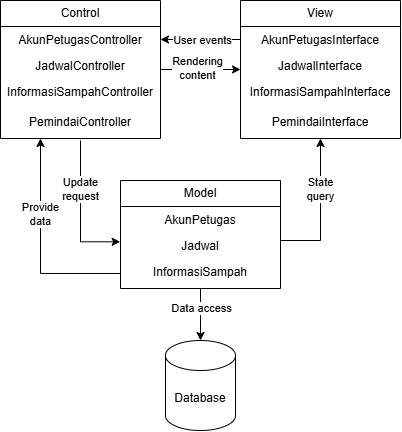
</p>
<p align="center">
<i>Gambar 1. Contoh Arsitektur MVC</i>
</p>

## 2.3 Identifikasi Komponen / Modul / Subsistem
Tabel 2.3. Identifikasi Komponen/Modul/Subsistem

| Nama Komponen/Modul/Subsistem | Jenis                 | Penjelasan                                                                                                           |
| :---------------------------- | :-------------------- | :------------------------------------------------------------------------------------------------------------------- |
| AkunPetugasInterface                 | View                | Menampilkan antarmuka Log In, Sign Up, Log Out, dan akun petugas. Lalu meneruskan aksi ke AkunPetugasController     |
| JadwalInterface               | View                | Menampilkan antarmuka daftar jadwal pembuangan sampah, pencarian lokasi TPS, dan pengaturan jadwal. Lalu meneruskan aksi ke JadwalController.                                                       |
| InformasiSampahInterface                | View                | Menampilkan antarmuka daftar katalog informasi sampah dan cara mendaur ulang.                                        |
| PemindaiInterface          | View                | Menampilkan antarmuka pemindaian sampah.                                         |
| AkunPetugasController           | Controller          | Memproses logika autentikasi petugas (Log In, Sign Up, Log Out), melakukan validasi kredensial, dan melakukan enkripsi dan dekripsi data kredensial.                                             |
| JadwalController         | Controller          | Memproses permintaan penambahan, perubahan, dan penghapusan jadwal pengambilan sampah, serta mencari lokasi TPS.                                          |
| InformasiSampahController        | Controller          | Memproses permintaan data informasi sampah dan cara daur ulang yang sesuai.                |
| PemindaiController           | Controller          | Memproses pemindaian sampah.                                                              |
| AkunPetugas                      | Model               | Merepresentasikan data akun petugas kebersihan serta metode untuk verifikasi dan mengelola kredensial.                        |
| Jadwal                   | Model               | Merepresentasikan data jadwal pengambilan sampah serta metode untuk mengakses dan mengubahnya.       |
| InformasiSampah                     | Model               | Merepresentasikan data informasi sampah serta metode untuk mengakses detailnya.          |
| Database                     | Penyimpanan Data               | Menyimpan seluruh data model secara terpusat di Firebase.          |

## 2.4 Model Arsitektur Perangkat Lunak

### 2.4.1 Logical View 
Alasan penggunaan Logical View sebagai arsitektur model perangkat lunak EcoTrack adalah pemisahan tanggung jawab, ketertelusuran komponen, dan tingkat abstraksi logis. Melalui logical view, tanggung jawab setiap kelas terisolasi dengan jelas menurut perannya selaras arsitektur Modell-View-Controller (MVC). Selain itu, Logical View menjamin setiap komponen yang diidentifikasi pada bab 2 terpetakan secara lengkap dan konsisten pada diagram perancangan selama pengembangan. Relasi dan alur interaksi logis antar setiap komponen juga dapat dipahami dengan mudah.

<p align="center">
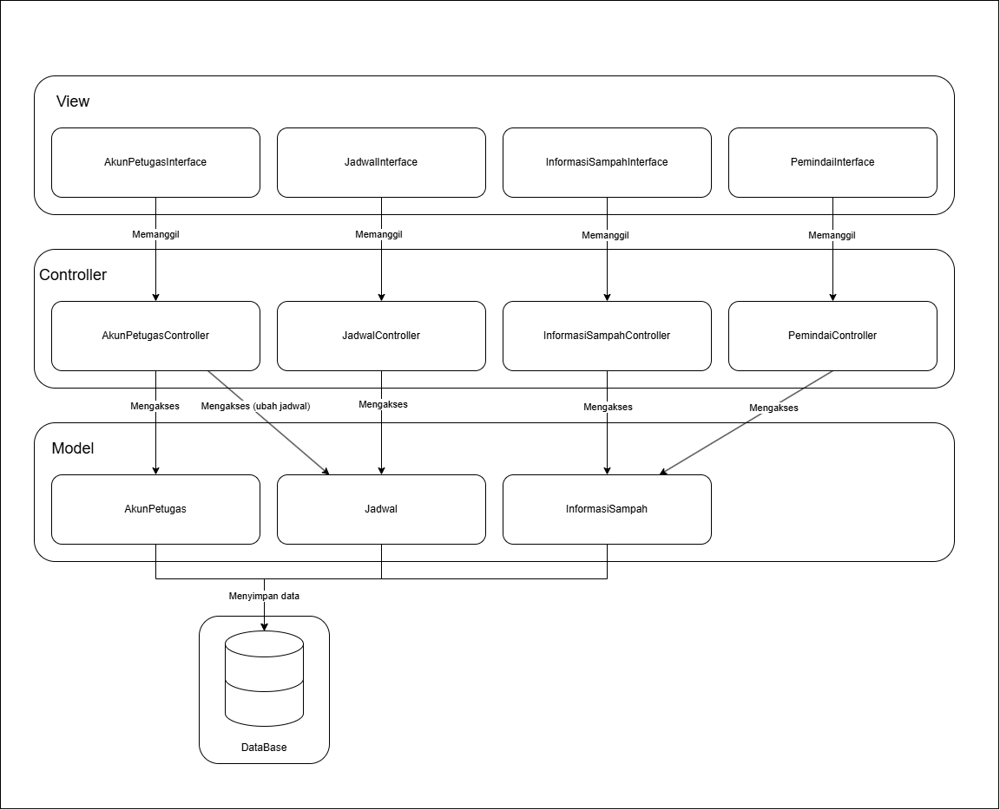
</p>
<p align="center">
<i>Gambar 2. Logical View pada P/L EcoTrack</i>
</p>

<br>

---


# BAB 3: Realisasi Use Case

## 3.1 Use Case Melakukan Log In

**ID Use Case:** *UC01*  
**Nama Use Case:** *Melakukan Log In*

### 3.1.1 Identifikasi Kelas

Tabel 3.1. Identifikasi Kelas Use Case [UC01]

| No | Nama Kelas Perancangan | Nama Kelas Analisis Terkait |
|:--- | :--- | :--- |
| 1 | *Akun Petugas* | *Akun Petugas* |
| 2 | *Akun Petugas Controller* | *Akun Petugas Controller* |
| 3 | *Akun Petugas Interface* | *Akun Petugas Interface* |

### 3.1.2 Sequence Diagram

- **Skenario Normal**

<<p align="center">

</p>
<p align="center">
<i>Gambar 4. Sequence Diagram [UC01]</i>
</p>

- **Skenario Alternatif 1: Otorisasi Log In Akun Gagal**

<p align="center">

</p>
<p align="center">
<i>Gambar 5. Sequence Diagram [UC01]</i>
</p>


### 3.1.3 Diagram Kelas

<p align="center">
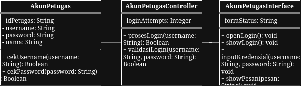
</p>
<p align="center">
<i>Gambar 5. Diagram Kelas [UC01]</i>
</p>

## 3.2 Use Case Memindai Sampah

**ID Use Case:** UC02  
**Nama Use Case:** Memindai Sampah  

### 3.2.1 Identifikasi Kelas

Tabel 3.2. Identifikasi Kelas Use Case UC02

| No | Nama Kelas Perancangan | Nama Kelas Analisis Terkait |
| :--- | :--- | :--- |
| 1 | PemindaiInterface | Pemindai Interface |
| 2 | PemindaiController | Pemindai Controller |
| 3 | InformasiSampahInterface | Informasi Sampah Interface |
| 4 | InformasiSampahController | Informasi Sampah Controller |
| 5 | InformasiSampah | Informasi Sampah |

### 3.2.2 Sequence Diagram

#### Skenario Normal

<p align="center">
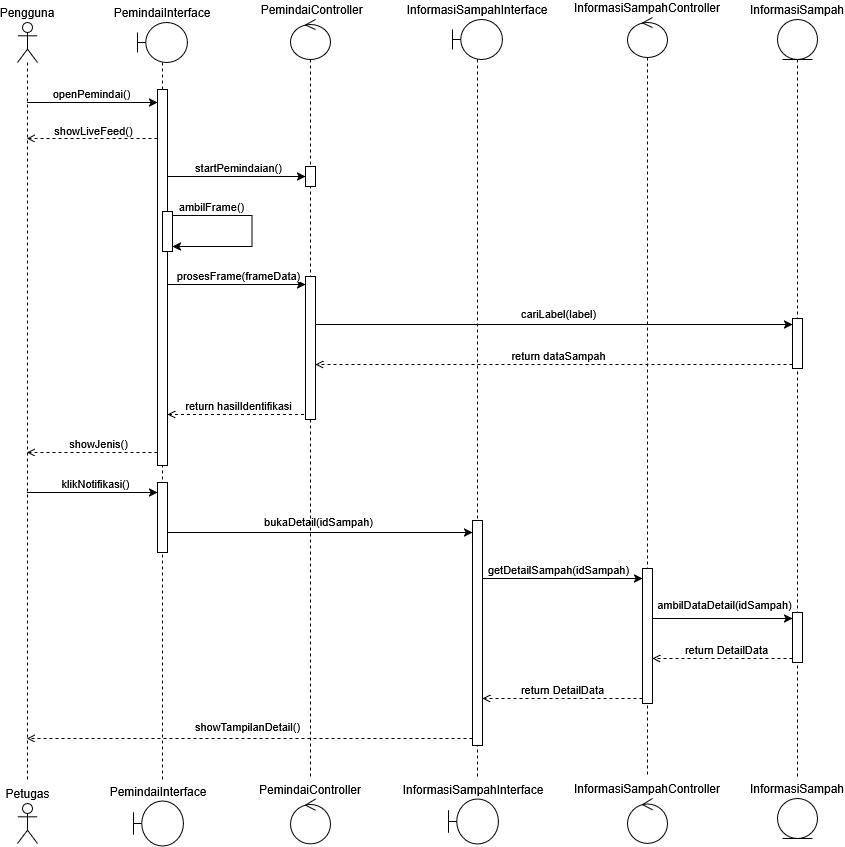
</p>
<p align="center">
<i>Gambar 3.2. Sequence Diagram Skenario Normal UC02</i>
</p>

#### Skenario Alternatif 1: Memindai dengan Barcode

<p align="center">
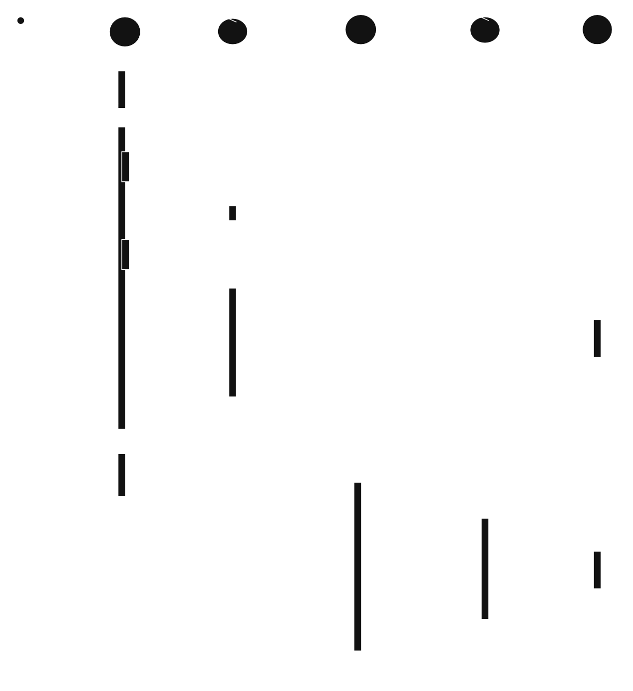
</p>
<p align="center">
<i>Gambar 3.3. Sequence Diagram Skenario Alternatif 1 UC02</i>
</p>

#### Skenario Alternatif 2: Data Barcode Tidak Ditemukan

<p align="center">
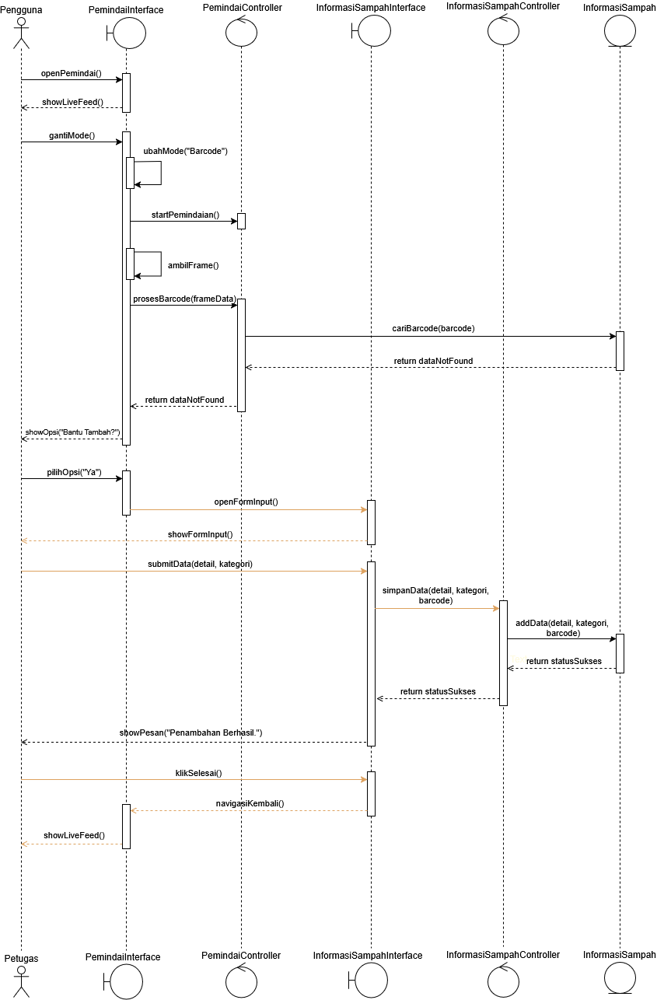
</p>
<p align="center">
<i>Gambar 3.4. Sequence Diagram Skenario Alternatif 2 UC02</i>
</p>

#### Skenario Alternatif 3: Kategori Sampah yang Ditampilkan Salah

<p align="center">
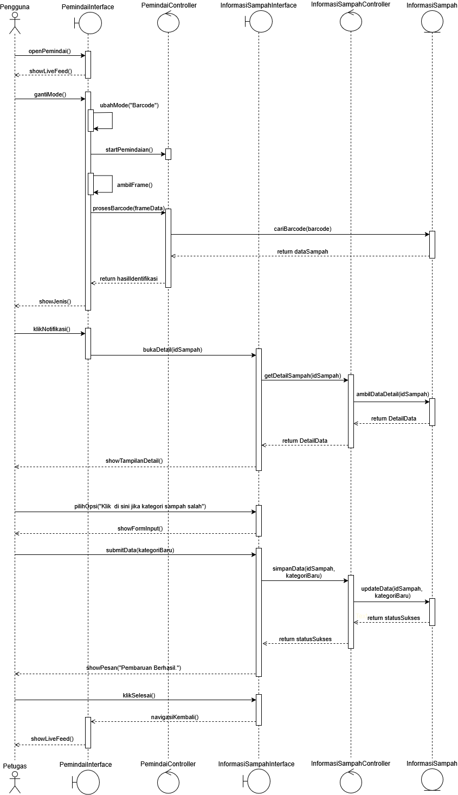
</p>
<p align="center">
<i>Gambar 3.5. Sequence Diagram Skenario Alternatif 3 UC02</i>
</p>

### 3.3.3 Diagram Kelas

<p align="center">
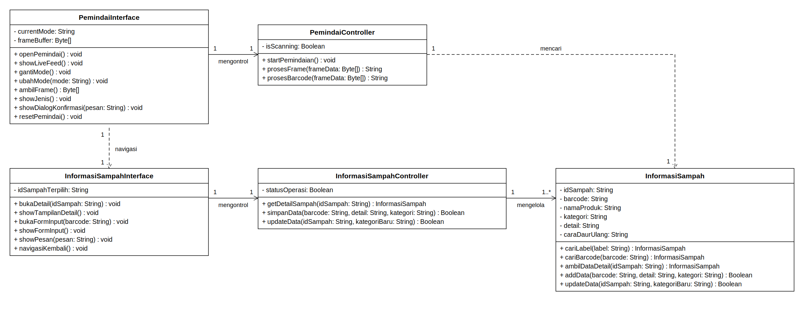
</p>
<p align="center">
<i>Gambar 9. Diagram Kelas [UC03]</i>
</p>


## 3.3 Use Case Mengatur Jadwal

**ID Use Case:** UC03  
**Nama Use Case:** Mengatur Jadwal

### 3.3.1 Identifikasi Kelas

Tabel 3.3. Identifikasi Kelas Use Case [UC03]

| No | Nama Kelas Perancangan | Nama Kelas Analisis Terkait |
|:--- | :--- | :--- |
| 1 | JadwalInterface | JadwalInterface |
| 2 | JadwalController | JadwalController |
| 3 | Jadwal | Jadwal |
| 4 | AkunPetugas | AkunPetugas |

### 3.3.2 Sequence Diagram

- **Skenario Normal**

<p align="center">
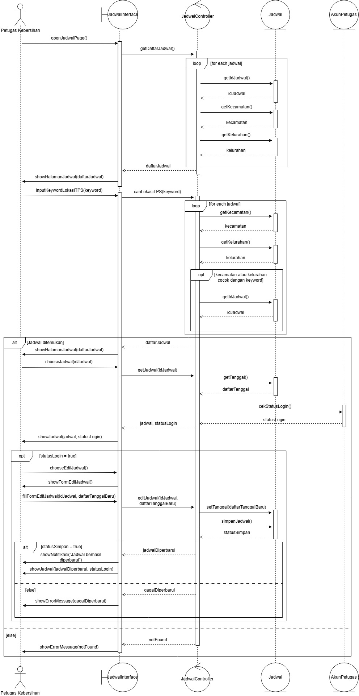
</p>
<p align="center">
<i>Gambar 8. Sequence Diagram [UC03]</i>
</p>

### 3.3.3 Diagram Kelas

<p align="center">
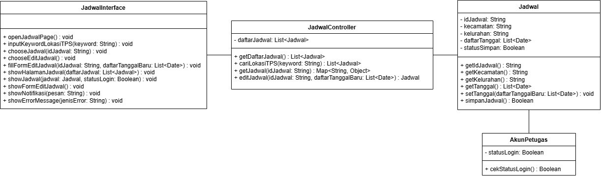
</p>
<p align="center">
<i>Gambar 9. Diagram Kelas [UC03]</i>
</p>

## 3.4 Use Case Melihat Jadwal

**ID Use Case:** UC04  
**Nama Use Case:** Melihat Jadwal

### 3.4.1 Identifikasi Kelas

Tabel 3.4. Identifikasi Kelas Use Case [UC04]

| No | Nama Kelas Perancangan | Nama Kelas Analisis Terkait |
|:--- | :--- | :--- |
| 1 | JadwalInterface | JadwalInterface |
| 2 | JadwalController | JadwalController |
| 3 | Jadwal | Jadwal |
| 4 | AkunPetugas | AkunPetugas |

### 3.4.2 Sequence Diagram

- **Skenario Normal**

<p align="center">
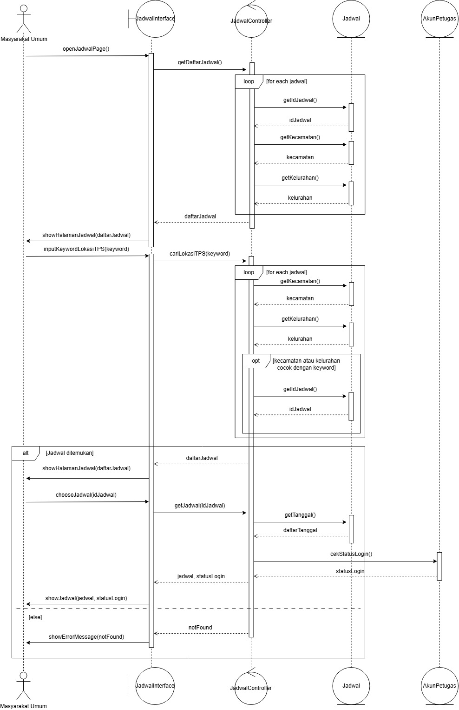
</p>
<p align="center">
<i>Gambar 9. Sequence Diagram [UC04]</i>
</p>

### 3.4.3 Diagram Kelas

<p align="center">

</p>
<p align="center">
<i>Gambar 10. Diagram Kelas [UC04]</i>
</p>

## 3.5 Use Case Mengakses Tampilan Informasi

**ID Use Case:** UC05  
**Nama Use Case:** Mengakses Tampilan Informasi

### 3.5.1 Identifikasi Kelas

Tabel 3.5. Identifikasi Kelas Use Case [UC05]

| ID Kelas | Nama Kelas | Nama Kelas Analisis Terkait |
| :--- | :--- | :--- |
| *C09* | *InformasiSampahInterface* |*InformasiSampahInterface*|
| *C08* | *InformasiSampahController* | *InformasiSampahController* |
| *C07* | *InformasiSampah* | *InformasiSampah* |

### 3.5.2 Sequence Diagram

- **Skenario Normal: Masyarakat mengakses halaman informasi**

<p align="center">
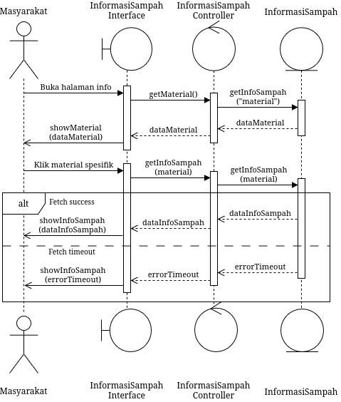
</p>
<p align="center">
<i>Gambar X. Sequence Diagram [UC05] Normal</i>
</p>

- **Skenario Alternatif: Masyarakat menggunakan fitur _search_**

<p align="center">
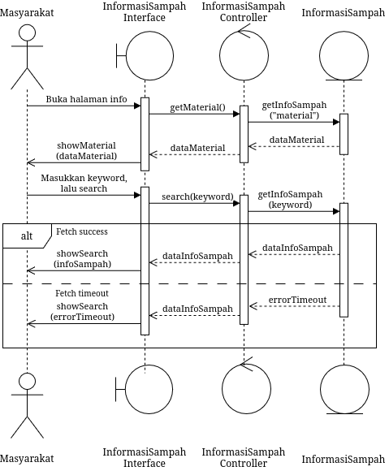
</p>
<p align="center">
<i>Gambar X. Sequence Diagram [UC05] Alt</i>
</p>

- **Skenario Eksepsi: Database gagal diakses**

<p align="center">
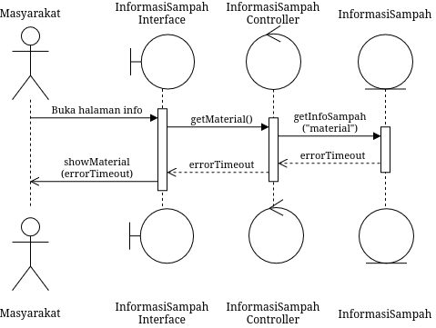
</p>
<p align="center">
<i>Gambar X. Sequence Diagram [UC05] Except</i>
</p>

### 3.5.3 Diagram Kelas

<p align="center">
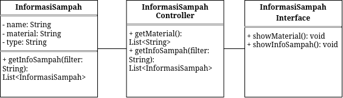
</p>
<p align="center">
<i>Gambar X. Diagram Kelas [UC05]</i>
</p>

## 3.6 Use Case Membuat Akun

**ID Use Case:** UC06  
**Nama Use Case:** Membuat Akun

### 3.6.1 Identifikasi Kelas

Tabel 3.6. Identifikasi Kelas Use Case [UC06]

| ID Kelas | Nama Kelas | Nama Kelas Analisis Terkait |
| :--- | :--- | :--- |
| *C09* | *AkunPetugas* | *AkunPetugas* |
| *C08* | *AkunPetugasController* | *AkunPetugasController* |
| *C07* | *AkunPetugasInterface* | *AkunPetugasInterface* |

### 3.6.2 Sequence Diagram

- **Skenario Normal: Masyarakat mengakses halaman informasi**

<p align="center">
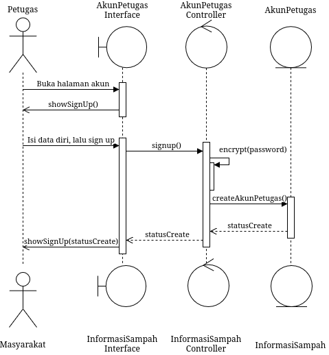
</p>
<p align="center">
<i>Gambar 11. Sequence Diagram [UC06]</i>
</p>

### 3.6.3 Diagram Kelas

<p align="center">
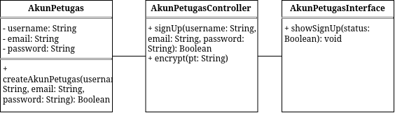
</p>
<p align="center">
<i>Gambar 12. Diagram Kelas [UC06]</i>
</p>

<br>

---

## BAB 4: Diagram Kelas Keseluruhan

## 4.1 Diagram Kelas

<p align="center">

</p>
<p align="center">
<i>Gambar 4.1. Diagram Kelas Perancangan Keseluruhan [Nama P/L]</i>
</p>

Tabel 4.1. Daftar Kelas Perancangan Keseluruhan

| ID Kelas | Nama Kelas | Atribut | Metode/Operasi |
| :--- | :--- | :--- | :--- |
| *C01* | AkunPetugas | -usernameExist, -passwordCorrect, -status | +validasiLogin(username, password), +cekUsername(username), +cekPassword(password), +encrypt(password), +createAkunPetugas() |
| *C02* | AkunPetugasController | -statusLogin | +validasiLogin(username, password), +prosesLogin(username, password), +signup(username, email, password) |
| *C03* | AkunPetugasInterface | - | +showSignup(), +openLogin(), +showLogin(), +inputKredensial(username, password), +showPesan("Username/Password salah"), +showPesan("Selamat datang"), +clearInput(), +showTampilan(masuk tampilan profil), +showSignUp(), +showSignUp(status) |
| *C04* | Jadwal | -idJadwal, -kecamatan, -kelurahan, -daftarTanggal, -statusSimpan | +getIdJadwal(), +getKecamatan(), +getKelurahan(), +getTanggal(), +setTanggal(daftarTanggalBaru), +simpanJadwal() |
| *C05* | JadwalController | -daftarJadwal | +getDaftarJadwal(), +cariLokasiTPS(keyword), +getJadwal(idJadwal), +cekStatusLogin(), +editJadwal(idJadwal, daftarTanggalBaru) |
| *C06* | JadwalInterface | - | +openJadwalPage(), +showHalamanJadwal(daftarJadwal), +inputKeywordLokasiTPS(keyword), +chooseJadwal(idJadwal), +showJadwal(jadwal, statusLogin), showErrorMessage(notFound), chooseEditJadwal(), fillFormEditJadwal(idJadwal, daftarTanggalBaru), showNotifikasi("Jadwal berhasil diperbarui"), showJadwal(jadwalDiperbarui, statusLogin) |
| *C07* | InformasiSampah | -dataSampah, -detailData, -infoSampah | +ambilDataDetail(idSampah), +cariBarcode(barcode), +getInfoSampah(), getInfoSampah(keyword) |
| *C08* | InformasiSampahController | -detailData, -infoSampah | +getDetailSampah(idSampah), +getMaterial(), +search(keyword) |
| *C09* | InformasiSampahInterface | - | +bukaDetail(idSampah), +showTampilanDetail(), +showMain(), +showDetail(), +showSearch(infoSampah) |
| *C10* | PemindaiController | -hasilIdentifikasi, -isMemindai | +startPemindaian(), +prosesBarcode(frameData), +prosesFrame(frameData) |
| *C11* | PemindaiInterface | -modeSekarang, -frameBuffer | +openPemindai(), +showLiveFeed(), +gantiMode(), +showJenis(), +klikNotifikasi(), -ubahMode(), +showOpsi(opsi: String), +pilihOpsi(opsi: String), -ambilFrame(), +navigasiKembali() |

---

# BAB 5: Perancangan Rinci Kelas

Tabel 5.1. Daftar Kelas Perancangan dan Kelas Analisis Terkait

| No | Nama Kelas Perancangan | Nama Kelas Analisis Terkait |
| :--- | :--- | :--- |
| 1 | AkunPetugas | AkunPetugas |
| 2 | AkunPetugasController | AkunPetugasController |
| 3 | AkunPetugasInterface | AkunPetugasInterface |
| 4 | Jadwal | Jadwal |
| 5 | JadwalController | JadwalController |
| 6 | JadwalInterface | JadwalInterface |
| 7 | InformasiSampah | InformasiSampah |
| 8 | InformasiSampahController | InformasiSampahController |
| 9 | InformasiSampahInterface | InformasiSampahInterface |
| 10 | PemindaiController | PemindaiController |
| 11 | PemindaiInterface | PemindaiInterface |

## 5.1 Kelas AkunPetugas

**Nama Kelas:** AkunPetugas  
**ID Kelas:** C01

Tabel 5.1.1. Operasi Kelas AkunPetugas

| Nama Operasi | Visibility (private, public) | Keterangan |
| :--- | :--- | :--- |
| *[Signature operasi, termasuk parameter dan tipe kembalian]* | *[Visibility]* | *[Tanggung jawab operasi]* |
| *...* | *...* | *...* |

Tabel 5.1.2. Atribut Kelas AkunPetugas

| Nama Atribut | Visibility (private, public) | Tipe |
| :--- | :--- | :--- |
| *[Nama atribut]* | *[Visibility]* | *[Tipe sesuai bahasa pemrograman yang digunakan]* |
| *...* | *...* | *...* |

### 5.1.1 Algoritma/Query

Bagian ini diisi untuk kerangka algoritma proses yang dianggap cukup penting. Algoritma dapat dituliskan sebagai *pseudocode*. Implementasi *skeleton code* juga dapat digunakan untuk kelas yang sudah terdefinisi pada bahasa pemrograman tertentu.

**Nama Kelas:** AkunPetugas  
**Nama Operasi:** *[Signature operasi]*  
**ID Algoritma:** Algo-AP-001

```text
[Tuliskan pseudocode algoritma operasi di sini.]
```

Jika operasi mengacu pada query tertentu, lengkapi tabel berikut. 

Tabel 5.1.1. Query Operasi [Nama Operasi]

| No Query | Query | Keterangan |
| :--- | :--- | :--- |
| *[Q-AP-001]* | *[Tuliskan query]* | *[Fungsi query]* |
| *...* | *...* | *...* |


### 5.1.2 Algoritma/Query

*[Ulangi pola 5.1.1 untuk operasi penting berikutnya pada kelas yang sama, jika ada.]*

## 5.2 Kelas AkunPetugasController

**Nama Kelas:** AkunPetugasController  
**ID Kelas:** C02

Tabel 5.2.1. Operasi Kelas AkunPetugasController

| Nama Operasi | Visibility (private, public) | Keterangan |
| :--- | :--- | :--- |
| *[Signature operasi, termasuk parameter dan tipe kembalian]* | *[Visibility]* | *[Tanggung jawab operasi]* |
| *+ prosesLogin(username: String, password: String): Boolean* | *public* | *Menerima masukan kredensial dari antarmuka dan mengoordinasikan proses autentikasi akun* |
| *- validasiLogin(username: String, password: String): Boolean* | *private* | *Memeriksa kebenaran masukan nama dan pengguna ke entitas Akunpetugas* |
| *+ signUp(username: String, email: String, password: String): Boolean* | *public* | *Memvalidasi dan mendaftarkan data akun petugas baru ke sistem* |

Tabel 5.2.2. Atribut Kelas AkunPetugasController

| Nama Atribut | Visibility (private, public) | Tipe |
| :--- | :--- | :--- |
| *[Nama atribut]* | *[Visibility]* | *[Tipe sesuai bahasa pemrograman yang digunakan]* |
| *- statusLogin* | *private* | *Boolean* |

### 5.2.1 Algoritma/Query

Bagian ini diisi untuk kerangka algoritma proses yang dianggap cukup penting. Algoritma dapat dituliskan sebagai *pseudocode*. Implementasi *skeleton code* juga dapat digunakan untuk kelas yang sudah terdefinisi pada bahasa pemrograman tertentu.

**Nama Kelas:** AkunPetugasController 
**Nama Operasi:** *+prosesLogin(username: String, password: String) -> Boolean*
**ID Algoritma:** Algo-APC-001

```text
PROGRAM prosesLogin(username: String, password: String) -> Boolean
DEKLARASI
    isValid: Boolean
ALGORITMA
    isValid <- validasiLogin(username, password)
    if isValid = true then
        statusLogin <- true
        return true
    else
        statusLogin <- false
        return false
    endif
[Tuliskan pseudocode algoritma operasi di sini.]
```

Jika operasi mengacu pada query tertentu, lengkapi tabel berikut. 

Tabel 5.2.3. Query Operasi [Nama Operasi]

| No Query | Query | Keterangan |
| :--- | :--- | :--- |
| *[Q-APC-001]* | *[Tuliskan query]* | *[Fungsi query]* |
| *...* | *...* | *...* |

### 5.2.2 Algoritma/Query

**Nama Kelas:** AkunPetugasController  
**Nama Operasi:** *-validasiLogin(username: String, password: String) -> Boolean*  
**ID Algoritma:** Algo-APC-002

```text
PROGRAM validasiLogin(username: String, password: String) -> Boolean 
DEKLARASI
    usernameExist : Boolean
    passwordValid : Boolean
ALGORITMA
    usernameExist <- AkunPetugas.cekUsername(username)
    if usernameExist = true then
        passwordValid <- Akunpetugas.cekPassword(password)
        if passwordValid = true then
            return true
        else
            return false
        endif
    else
        return false
    endif

[Tuliskan pseudocode algoritma operasi di sini.]
```

Jika operasi mengacu pada query tertentu, lengkapi tabel berikut. 

Tabel 5.2.4. Query Operasi [Nama Operasi]

| No Query | Query | Keterangan |
| :--- | :--- | :--- |
| *[Q-APC-001]* | *[Tuliskan query]* | *[Fungsi query]* |
| *...* | *...* | *...* |

### 5.2.3 Algoritma/Query

**Nama Kelas:** AkunPetugasController  
**Nama Operasi:** *+signUp(username: String, password: String, email: String) -> Boolean*  
**ID Algoritma:** Algo-APC-003

```text
PROGRAM signUp(username: String, password: String, email: String) -> Boolean
DEKLARASI
    isExist : Boolean
    passwordHash : String
    statusCreate: Boolean
ALGORITMA
    isExist <- AkunPetugas.cekUsername(username)
    if isExist = true then
        return false
    else
        passwordHash <- AkunPetugas.encrypt(password)
        statusCreate <- AkunPetugas.createAkunPetugas(username, email, passwordHash)
        return statusCreate
    endif
[Tuliskan pseudocode algoritma operasi di sini.]
```

Jika operasi mengacu pada query tertentu, lengkapi tabel berikut. 

Tabel 5.2.1. Query Operasi [Nama Operasi]

| No Query | Query | Keterangan |
| :--- | :--- | :--- |
| *[Q-APC-001]* | *[Tuliskan query]* | *[Fungsi query]* |
| *...* | *...* | *...* |


## 5.3 Kelas AkunPetugasInterface

**Nama Kelas:** AkunPetugasInterface  
**ID Kelas:** C03

Tabel 5.3.1. Operasi Kelas AkunPetugasInterface

| Nama Operasi | Visibility (private, public) | Keterangan |
| :--- | :--- | :--- |
| + openLogin(): void | public | Menerima aksi petugas membuka halaman Log In, lalu menampilkan form Log In melalui showLogin(). |
| + showLogin(): void | public | Menampilkan form Log In yang berisi kolom username, kolom password, dan tombol masuk. |
| + inputKredensial(username: String, password: String): void | public | Menerima username dan password yang diisi petugas, lalu meneruskannya ke AkunPetugasController melalui prosesLogin() untuk divalidasi. |
| + showPesan(pesan: String): void | public | Menampilkan pesan hasil Log In kepada petugas, yaitu "Selamat datang" jika berhasil atau "Username/Password salah" jika gagal. |
| + clearInput(): void | public | Mengosongkan kolom username dan password pada form Log In setelah Log In gagal. |
| + showTampilan(): void | public | Mengarahkan petugas ke tampilan profil setelah Log In berhasil. |
| + showSignUp(statusCreate: Boolean): void | public | Menampilkan hasil pembuatan akun sesuai statusCreate, yaitu pesan berhasil jika status = true atau pesan gagal jika status = false. |
| + inputDataSignUp(username: String, email: String, password: String): void | public | Menerima data diri yang diisi petugas pada form Sign Up, lalu meneruskannya ke AkunPetugasController melalui signUp() untuk dibuatkan akun. |

Tabel 5.3.2. Atribut Kelas AkunPetugasInterface

| Nama Atribut | Visibility (private, public) | Tipe |
| :--- | :--- | :--- |
| - | - | - |

### 5.3.1 Algoritma/Query

**Nama Kelas:** AkunPetugasInterface  
**Nama Operasi:** openLogin()  
**ID Algoritma:** Algo-API-001

```text
[Tuliskan pseudocode algoritma operasi di sini.]
```

Jika operasi mengacu pada query tertentu, lengkapi tabel berikut. 

Tabel 5.3.1. Query Operasi openLogin()

| No Query | Query | Keterangan |
| :--- | :--- | :--- |
| *[Q-API-001]* | *[Tuliskan query]* | *[Fungsi query]* |
| *...* | *...* | *...* |

### 5.3.2 Algoritma/Query

**Nama Kelas:** AkunPetugasInterface  
**Nama Operasi:** showLogin()  
**ID Algoritma:** Algo-API-002

```text
[Tuliskan pseudocode algoritma operasi di sini.]
```

Jika operasi mengacu pada query tertentu, lengkapi tabel berikut. 

Tabel 5.3.2. Query Operasi showLogin()

| No Query | Query | Keterangan |
| :--- | :--- | :--- |
| *[Q-API-001]* | *[Tuliskan query]* | *[Fungsi query]* |
| *...* | *...* | *...* |

### 5.3.3 Algoritma/Query

**Nama Kelas:** AkunPetugasInterface  
**Nama Operasi:** inputKredensial(username: String, password: String)  
**ID Algoritma:** Algo-API-003

```text
[Tuliskan pseudocode algoritma operasi di sini.]
```

Jika operasi mengacu pada query tertentu, lengkapi tabel berikut. 

Tabel 5.3.3. Query Operasi inputKredensial(username: String, password: String)

| No Query | Query | Keterangan |
| :--- | :--- | :--- |
| *[Q-API-001]* | *[Tuliskan query]* | *[Fungsi query]* |
| *...* | *...* | *...* |

### 5.3.4 Algoritma/Query

**Nama Kelas:** AkunPetugasInterface  
**Nama Operasi:** showPesan(pesan: String)  
**ID Algoritma:** Algo-API-004

```text
[Tuliskan pseudocode algoritma operasi di sini.]
```

Jika operasi mengacu pada query tertentu, lengkapi tabel berikut. 

Tabel 5.3.4. Query Operasi showPesan(pesan: String)

| No Query | Query | Keterangan |
| :--- | :--- | :--- |
| *[Q-API-001]* | *[Tuliskan query]* | *[Fungsi query]* |
| *...* | *...* | *...* |

### 5.3.5 Algoritma/Query

**Nama Kelas:** AkunPetugasInterface  
**Nama Operasi:** clearInput()  
**ID Algoritma:** Algo-API-005

```text
[Tuliskan pseudocode algoritma operasi di sini.]
```

Jika operasi mengacu pada query tertentu, lengkapi tabel berikut. 

Tabel 5.3.5. Query Operasi clearInput()

| No Query | Query | Keterangan |
| :--- | :--- | :--- |
| *[Q-API-001]* | *[Tuliskan query]* | *[Fungsi query]* |
| *...* | *...* | *...* |

### 5.3.6 Algoritma/Query

**Nama Kelas:** AkunPetugasInterface  
**Nama Operasi:** showTampilan()  
**ID Algoritma:** Algo-API-006

```text
[Tuliskan pseudocode algoritma operasi di sini.]
```

Jika operasi mengacu pada query tertentu, lengkapi tabel berikut. 

Tabel 5.3.6. Query Operasi showTampilan()

| No Query | Query | Keterangan |
| :--- | :--- | :--- |
| *[Q-API-001]* | *[Tuliskan query]* | *[Fungsi query]* |
| *...* | *...* | *...* |

### 5.3.7 Algoritma/Query

**Nama Kelas:** AkunPetugasInterface  
**Nama Operasi:** showSignUp(statusCreate: Boolean)  
**ID Algoritma:** Algo-API-007

```text
[Tuliskan pseudocode algoritma operasi di sini.]
```

Jika operasi mengacu pada query tertentu, lengkapi tabel berikut. 

Tabel 5.3.7. Query Operasi showSignUp(statusCreate: Boolean)

| No Query | Query | Keterangan |
| :--- | :--- | :--- |
| *[Q-API-001]* | *[Tuliskan query]* | *[Fungsi query]* |
| *...* | *...* | *...* |

### 5.3.8 Algoritma/Query

**Nama Kelas:** AkunPetugasInterface  
**Nama Operasi:** inputDataSignUp(username: String, email: String, password: String)  
**ID Algoritma:** Algo-API-008

```text
[Tuliskan pseudocode algoritma operasi di sini.]
```

Jika operasi mengacu pada query tertentu, lengkapi tabel berikut. 

Tabel 5.3.8. Query Operasi inputDataSignUp(username: String, email: String, password: String)

| No Query | Query | Keterangan |
| :--- | :--- | :--- |
| *[Q-API-001]* | *[Tuliskan query]* | *[Fungsi query]* |
| *...* | *...* | *...* |

## 5.4 Kelas Jadwal

**Nama Kelas:** Jadwal  
**ID Kelas:** C04

Tabel 5.4.1. Operasi Kelas Jadwal

| Nama Operasi | Visibility (private, public) | Keterangan |
| :--- | :--- | :--- |
| *[Signature operasi, termasuk parameter dan tipe kembalian]* | *[Visibility]* | *[Tanggung jawab operasi]* |
| *...* | *...* | *...* |

Tabel 5.4.2. Atribut Kelas Jadwal

| Nama Atribut | Visibility (private, public) | Tipe |
| :--- | :--- | :--- |
| *[Nama atribut]* | *[Visibility]* | *[Tipe sesuai bahasa pemrograman yang digunakan]* |
| *...* | *...* | *...* |

### 5.4.1 Algoritma/Query

Bagian ini diisi untuk kerangka algoritma proses yang dianggap cukup penting. Algoritma dapat dituliskan sebagai *pseudocode*. Implementasi *skeleton code* juga dapat digunakan untuk kelas yang sudah terdefinisi pada bahasa pemrograman tertentu.

**Nama Kelas:** Jadwal  
**Nama Operasi:** *[Signature operasi]*  
**ID Algoritma:** Algo-J-001

```text
[Tuliskan pseudocode algoritma operasi di sini.]
```

Jika operasi mengacu pada query tertentu, lengkapi tabel berikut. 

Tabel 5.4.1. Query Operasi [Nama Operasi]

| No Query | Query | Keterangan |
| :--- | :--- | :--- |
| *[Q-J-001]* | *[Tuliskan query]* | *[Fungsi query]* |
| *...* | *...* | *...* |


### 5.4.2 Algoritma/Query

*[Ulangi pola 5.4.1 untuk operasi penting berikutnya pada kelas yang sama, jika ada.]*

## 5.5 Kelas JadwalController

**Nama Kelas:** JadwalController  
**ID Kelas:** C05

Tabel 5.5.1. Operasi Kelas JadwalController

| Nama Operasi | Visibility (private, public) | Keterangan |
| :--- | :--- | :--- |
| + getDaftarJadwal(): List<Jadwal> | public | Mengambil data jadwal dari database, lalu menyusun daftar jadwal yang masing-masingnya berisi idJadwal, kecamatan, kelurahan untuk ditampilkan pada halaman jadwal. |
| + cariLokasiTPS(keyword: String): List<Jadwal> | public | Mencari jadwal yang kecamatan atau kelurahannya cocok dengan keyword yang dimasukkan pengguna. Operasi ini akan mengembalikan list kosong jika tidak ada yang cocok (notFound). |
| + getJadwal(idJadwal: String): Map<String, Object> | public | Mengambil detail jadwal yang berisi kecamatan, kelurahan, dan daftarTanggal berdasarkan idJadwal dan memeriksa status login pengguna melalui AkunPetugas, lalu mengembalikan keduanya ke antarmuka. |
| + editJadwal(idJadwal: String, daftarTanggalBaru: List<Date>): Jadwal | public | Mengubah daftar tanggal pada jadwal yang dipilih dan menyimpannya ke database. Mengembalikan jadal yang telah diperbarui atau NULL jika penyimpanan gagal. |

Tabel 5.5.2. Atribut Kelas JadwalController

| Nama Atribut | Visibility (private, public) | Tipe |
| :--- | :--- | :--- |
| daftarJadwal | private | List<Jadwal> |

### 5.5.1 Algoritma/Query

**Nama Kelas:** JadwalController  
**Nama Operasi:** getDaftarJadwal(): List<Jadwal>  
**ID Algoritma:** Algo-JC-001

```text
[Tuliskan pseudocode algoritma operasi di sini.]
```

Tabel 5.5.1. Query Operasi getDaftarJadwal()

| No Query | Query | Keterangan |
| :--- | :--- | :--- |
| Q-JC-01 | *[Tuliskan query]* | *[Fungsi query]* |
| *...* | *...* | *...* |


### 5.5.2 Algoritma/Query

**Nama Kelas:** JadwalController  
**Nama Operasi:** cariLokasiTPS(keyword: String): List<Jadwal>  
**ID Algoritma:** Algo-JC-002

```text
[Tuliskan pseudocode algoritma operasi di sini.]
```

Tabel 5.5.2. Query Operasi cariLokasiTPS(keyword: String)

| No Query | Query | Keterangan |
| :--- | :--- | :--- |
| Q-JC-01 | *[Tuliskan query]* | *[Fungsi query]* |
| *...* | *...* | *...* |


### 5.5.3 Algoritma/Query

**Nama Kelas:** JadwalController  
**Nama Operasi:** getJadwal(idJadwal: String): Map<String, Object>  
**ID Algoritma:** Algo-JC-003

```text
[Tuliskan pseudocode algoritma operasi di sini.]
```

Tabel 5.5.3. Query Operasi getJadwal(idJadwal: String)

| No Query | Query | Keterangan |
| :--- | :--- | :--- |
| Q-JC-01 | *[Tuliskan query]* | *[Fungsi query]* |
| *...* | *...* | *...* |


### 5.5.4 Algoritma/Query

**Nama Kelas:** JadwalController  
**Nama Operasi:** editJadwal(idJadwal: String, daftarTanggalBaru: List<Date>): Jadwal  
**ID Algoritma:** Algo-JC-004

```text
[Tuliskan pseudocode algoritma operasi di sini.]
```

Tabel 5.5.4. Query Operasi editJadwal(idJadwal: String, daftarTanggalBaru: List<Date>)

| No Query | Query | Keterangan |
| :--- | :--- | :--- |
| Q-JC-01 | *[Tuliskan query]* | *[Fungsi query]* |
| *...* | *...* | *...* |


## 5.6 Kelas JadwalInterface

**Nama Kelas:** JadwalInterface  
**ID Kelas:** C06

Tabel 5.6.1. Operasi Kelas JadwalInterface

| Nama Operasi | Visibility (private, public) | Keterangan |
| :--- | :--- | :--- |
| + openJadwalPage() | public | Menerima aksi pengguna membuka halaman jadwal, lalu meminta daftarJadwal ke JadwalController. |
| + inputKeywordLokasiTPS() | public | Menerima *keyword* lokasi TPS, yaitu kecamatan atau kelurahan dari pengguna dan meneruskannya ke JadwalController untuk dicari. |
| + chooseJadwal(idJadwal: String) | public | Menerima pilihan jadwal dari pengguna dan meminta detail jadwal ke JadwalController. |
| + chooseEditJadwal() | public | Menerima aksi petugas kebersihan menekan tombol edit jadwal. |
| + fillFormEditJadwal(idJadwal: String, daftarTanggalBaru: List<Date>) | public | Menerima isian form edit jadwal dari pengguna dan meneruskannya ke JadwalController untuk disimpan. |
| + showHalamanJadwal(daftarJadwal: List<Jadwal>) | public | Menampilkan daftarJadwal pada halaman jadwal. |
| + showJadwal(jadwal: Jadwal, statusLogin: Boolean) | public | Menampilkan detail jadwal dan tanggal pengambilan sampah. Tombol edit hanya ditampilkan jika statusLogin = true. |
| + showFormEditJadwal() | public | Menampilkan form edit jadwal untuk menambah atau menghapus daftarTanggal. |
| + showNotifikasi(pesan: String) | public | Menampilkan notifikasi keberhasilan. |
| + showErrorMessage(jenisError: String) | public | Menampilkan pesan kesalahan sesuai jenisnya. |

Tabel 5.6.2. Atribut Kelas JadwalInterface

| Nama Atribut | Visibility (private, public) | Tipe |
| :--- | :--- | :--- |
| - | - | - |

### 5.6.1 Algoritma/Query

**Nama Kelas:** AkunPetugasInterface  
**Nama Operasi:** +openJadwalPage()  
**ID Algoritma:** Algo-JI-001  

```text
PROGRAM openJadwalPage()
DEKLARASI
    daftarJadwal : List of Jadwal
ALGORITMA
    daftarJadwal <- JadwalController.getDaftarJadwal
    showHalamanJadwal(daftarJadwal)
```

Tabel 5.6.1. Query Operasi openJadwalPage()

| No Query | Query | Keterangan |
| :--- | :--- | :--- |
| *[Q-JI-001]* | *[Tuliskan query]* | *[Fungsi query]* |
| *...* | *...* | *...* |


### 5.6.2 Algoritma/Query

**Nama Kelas:** AkunPetugasInterface  
**Nama Operasi:** +inputKeywordLokasiTPS(keyword)  
**ID Algoritma:** Algo-JI-002  

```text
PROGRAM inputKeywordLokasiTPS(keyword)
DEKLARASI
    daftarJadwal : List of Jadwal
ALGORITMA
    daftarJadwal <- JadwalController.cariLokasiTPS(keyword)
    showHalamanJadwal(daftarJadwal)
```

Tabel 5.6.2. Query Operasi inputKeywordLokasiTPS(keyword: String) 

| No Query | Query | Keterangan |
| :--- | :--- | :--- |
| *[Q-JI-001]* | *[Tuliskan query]* | *[Fungsi query]* |
| *...* | *...* | *...* |


### 5.6.3 Algoritma/Query

**Nama Kelas:** AkunPetugasInterface  
**Nama Operasi:** +chooseJadwal(idJadwal)  
**ID Algoritma:** Algo-JI-003  

```text
chooseJadwal(idJadwal)
```

Tabel 5.6.3. Query Operasi chooseJadwal(idJadwal: String)

| No Query | Query | Keterangan |
| :--- | :--- | :--- |
| *[Q-JI-001]* | *[Tuliskan query]* | *[Fungsi query]* |
| *...* | *...* | *...* |


### 5.6.4 Algoritma/Query

**Nama Kelas:** JadwalInterface  
**Nama Operasi:** chooseEditJadwal()  
**ID Algoritma:** Algo-JI-004  

```text
[Tuliskan pseudocode algoritma operasi di sini.]
```

Jika operasi mengacu pada query tertentu, lengkapi tabel berikut. 

Tabel 5.6.4. Query Operasi chooseEditJadwal()

| No Query | Query | Keterangan |
| :--- | :--- | :--- |
| *[Q-JI-001]* | *[Tuliskan query]* | *[Fungsi query]* |
| *...* | *...* | *...* |

### 5.6.5 Algoritma/Query

**Nama Kelas:** AkunPetugasInterface  
**Nama Operasi:** +fillFormEditJadwal(idJadwal, daftarTanggalBaru)  
**ID Algoritma:** Algo-JI-005  

```text
fillFormEditJadwal(idJadwal, daftarTanggalBaru)
```

Tabel 5.6.5. Query Operasi fillFormEditJadwal(idJadwal: String, daftarTanggalBaru: List<Date>)

| No Query | Query | Keterangan |
| :--- | :--- | :--- |
| *[Q-JI-001]* | *[Tuliskan query]* | *[Fungsi query]* |
| *...* | *...* | *...* |

### 5.6.6 Algoritma/Query

**Nama Kelas:** AkunPetugasInterface  
**Nama Operasi:** +showHalamanJadwal(daftarJadwal)  
**ID Algoritma:** Algo-JI-006

```text
PROGRAM showHalamanJadwal(daftarJadwal)
DEKLARASI
    jadwal : Jadwal
    statusLogin : Boolean
ALGORITMA
    statusLogin <- JadwalController.cekStatusLogin()
    for jadwal in daftarJadwal
        showJadwal(jadwal, statusLogin)
```

Tabel 5.6.6. Query Operasi showHalamanJadwal(daftarJadwal: List<Jadwal>)

| No Query | Query | Keterangan |
| :--- | :--- | :--- |
| *[Q-JI-001]* | *[Tuliskan query]* | *[Fungsi query]* |
| *...* | *...* | *...* |

### 5.6.7 Algoritma/Query

**Nama Kelas:** *AkunPetugasInterface*  
**Nama Operasi:** *+showJadwal(jadwal, statusLogin)*  
**ID Algoritma:** Algo-JI-007

```text
showJadwal(jadwal, statusLogin)
```

Tabel 5.6.7. Query Operasi showJadwal(jadwal: Jadwal, statusLogin: Boolean)

| No Query | Query | Keterangan |
| :--- | :--- | :--- |
| *[Q-JI-001]* | *[Tuliskan query]* | *[Fungsi query]* |
| *...* | *...* | *...* |

### 5.6.8 Algoritma/Query

**Nama Kelas:** JadwalInterface  
**Nama Operasi:** showFormEditJadwal()
**ID Algoritma:** Algo-JI-008

```text
[Tuliskan pseudocode algoritma operasi di sini.]
```

Jika operasi mengacu pada query tertentu, lengkapi tabel berikut. 

Tabel 5.6.8. Query Operasi showFormEditJadwal()

| No Query | Query | Keterangan |
| :--- | :--- | :--- |
| *[Q-JI-001]* | *[Tuliskan query]* | *[Fungsi query]* |
| *...* | *...* | *...* |

### 5.6.9 Algoritma/Query

**Nama Kelas:** *AkunPetugasInterface*  
**Nama Operasi:** *+showNotifikasi("Jadwal berhasil diperbarui")*  
**ID Algoritma:** Algo-JI-009

```text
showNotifikasi("Jadwal berhasil diperbarui")
```

Tabel 5.6.9. Query Operasi showNotifikasi(pesan: String)

| No Query | Query | Keterangan |
| :--- | :--- | :--- |
| *[Q-JI-001]* | *[Tuliskan query]* | *[Fungsi query]* |
| *...* | *...* | *...* |

### 5.6.10 Algoritma/Query

**Nama Kelas:** AkunPetugasInterface  
**Nama Operasi:** +showErrorMessage(notFound)  
**ID Algoritma:** Algo-JI-010  

```text
showErrorMessage(notFound)
```

Tabel 5.6.10. Query Operasi showErrorMessage(jenisError: String)

| No Query | Query | Keterangan |
| :--- | :--- | :--- |
| *[Q-JI-001]* | *[Tuliskan query]* | *[Fungsi query]* |
| *...* | *...* | *...* |

## 5.7 Kelas InformasiSampah

**Nama Kelas:** InformasiSampah  
**ID Kelas:** C07

Tabel 5.7.1. Operasi Kelas InformasiSampah

| Nama Operasi | Visibility (private, public) | Keterangan |
| :--- | :--- | :--- |
| *[Signature operasi, termasuk parameter dan tipe kembalian]* | *[Visibility]* | *[Tanggung jawab operasi]* |
| *...* | *...* | *...* |

Tabel 5.7.2. Atribut Kelas InformasiSampah

| Nama Atribut | Visibility (private, public) | Tipe |
| :--- | :--- | :--- |
| *[Nama atribut]* | *[Visibility]* | *[Tipe sesuai bahasa pemrograman yang digunakan]* |
| *...* | *...* | *...* |

### 5.7.1 Algoritma/Query

Bagian ini diisi untuk kerangka algoritma proses yang dianggap cukup penting. Algoritma dapat dituliskan sebagai *pseudocode*. Implementasi *skeleton code* juga dapat digunakan untuk kelas yang sudah terdefinisi pada bahasa pemrograman tertentu.

**Nama Kelas:** InformasiSampah  
**Nama Operasi:** *[Signature operasi]*  
**ID Algoritma:** Algo-IS-001

```text
[Tuliskan pseudocode algoritma operasi di sini.]
```

Jika operasi mengacu pada query tertentu, lengkapi tabel berikut. 

Tabel 5.7.1. Query Operasi [Nama Operasi]

| No Query | Query | Keterangan |
| :--- | :--- | :--- |
| *[Q-IS-001]* | *[Tuliskan query]* | *[Fungsi query]* |
| *...* | *...* | *...* |


### 5.7.2 Algoritma/Query

*[Ulangi pola 5.7.1 untuk operasi penting berikutnya pada kelas yang sama, jika ada.]*

## 5.8 Kelas InformasiSampahController

**Nama Kelas:** InformasiSampahController  
**ID Kelas:** C08

Tabel 5.8.1. Operasi Kelas InformasiSampahController

| Nama Operasi | Visibility (private, public) | Keterangan |
| :--- | :--- | :--- |
| *[Signature operasi, termasuk parameter dan tipe kembalian]* | *[Visibility]* | *[Tanggung jawab operasi]* |
| *...* | *...* | *...* |

Tabel 5.8.2. Atribut Kelas InformasiSampahController

| Nama Atribut | Visibility (private, public) | Tipe |
| :--- | :--- | :--- |
| *[Nama atribut]* | *[Visibility]* | *[Tipe sesuai bahasa pemrograman yang digunakan]* |
| *...* | *...* | *...* |

### 5.8.1 Algoritma/Query

Bagian ini diisi untuk kerangka algoritma proses yang dianggap cukup penting. Algoritma dapat dituliskan sebagai *pseudocode*. Implementasi *skeleton code* juga dapat digunakan untuk kelas yang sudah terdefinisi pada bahasa pemrograman tertentu.

**Nama Kelas:** InformasiSampahController  
**Nama Operasi:** *[Signature operasi]*  
**ID Algoritma:** Algo-ISC-001

```text
[Tuliskan pseudocode algoritma operasi di sini.]
```

Jika operasi mengacu pada query tertentu, lengkapi tabel berikut. 

Tabel 5.8.1. Query Operasi [Nama Operasi]

| No Query | Query | Keterangan |
| :--- | :--- | :--- |
| *[Q-ISC-001]* | *[Tuliskan query]* | *[Fungsi query]* |
| *...* | *...* | *...* |


### 5.8.2 Algoritma/Query

*[Ulangi pola 5.8.1 untuk operasi penting berikutnya pada kelas yang sama, jika ada.]*

## 5.9 Kelas InformasiSampahInterface

**Nama Kelas:** InformasiSampahInterface  
**ID Kelas:** C09

Tabel 5.9.1. Operasi Kelas InformasiSampahInterface

| Nama Operasi | Visibility (private, public) | Keterangan |
| :--- | :--- | :--- |
| *[Signature operasi, termasuk parameter dan tipe kembalian]* | *[Visibility]* | *[Tanggung jawab operasi]* |
| *...* | *...* | *...* |

Tabel 5.9.2. Atribut Kelas InformasiSampahInterface

| Nama Atribut | Visibility (private, public) | Tipe |
| :--- | :--- | :--- |
| *[Nama atribut]* | *[Visibility]* | *[Tipe sesuai bahasa pemrograman yang digunakan]* |
| *...* | *...* | *...* |

### 5.9.1 Algoritma/Query

Bagian ini diisi untuk kerangka algoritma proses yang dianggap cukup penting. Algoritma dapat dituliskan sebagai *pseudocode*. Implementasi *skeleton code* juga dapat digunakan untuk kelas yang sudah terdefinisi pada bahasa pemrograman tertentu.

**Nama Kelas:** InformasiSampahInterface  
**Nama Operasi:** *[Signature operasi]*  
**ID Algoritma:** Algo-ISI-001

```text
[Tuliskan pseudocode algoritma operasi di sini.]
```

Jika operasi mengacu pada query tertentu, lengkapi tabel berikut. 

Tabel 5.9.1. Query Operasi [Nama Operasi]

| No Query | Query | Keterangan |
| :--- | :--- | :--- |
| *[Q-ISI-001]* | *[Tuliskan query]* | *[Fungsi query]* |
| *...* | *...* | *...* |


### 5.9.2 Algoritma/Query

*[Ulangi pola 5.9.1 untuk operasi penting berikutnya pada kelas yang sama, jika ada.]*

## 5.10 Kelas PemindaiController

**Nama Kelas:** PemindaiController  
**ID Kelas:** C10

Tabel 5.10.1. Operasi Kelas PemindaiController

| Nama Operasi | Visibility (private, public) | Keterangan |
| :--- | :--- | :--- |
| *+ startPemindaian(): void* | *public* | *Mengaktifkan model CV untuk melakukan pemindaian* |
| *+ prosesFrame(frameData: Byte[]): String* | *public* | *Memroses frame yang telah ditangkap dan melakukan identifikasi* |
| *+ prosesBarcode(frameData: Byte[]): String* | *public* | *Memroses barcode yang dipindai oleh kamera dan melakukan identifikasi berdasarkan barcode* |


Tabel 5.10.2. Atribut Kelas PemindaiController

| Nama Atribut | Visibility (private, public) | Tipe |
| :--- | :--- | :--- |
| *- isMemindai* | *private* | *Boolean* |

| *...* | *...* | *...* |

### 5.10.1 Algoritma/Query

Bagian ini diisi untuk kerangka algoritma proses yang dianggap cukup penting. Algoritma dapat dituliskan sebagai *pseudocode*. Implementasi *skeleton code* juga dapat digunakan untuk kelas yang sudah terdefinisi pada bahasa pemrograman tertentu.

**Nama Kelas:** PemindaiController  
**Nama Operasi:** *prosesFrame(frameData: Byte[]): String*  
**ID Algoritma:** Algo-PC-001

```text
openPemindai
startPemindaian
if isMemindai = True then
    dataFrame <- PemindaiInterface.ambilFrame(frame)
    dataProses <- prosesFrame(dataFrame)
    if dataProses != NULL then
        dataHasil <- InformasiSampah.cariLabel(dataFrame)
        if dataHasil != NULL then
            return dataHasil.label
        else
            return "NOT_FOUND"
        endif
    endif
endif
return NULL
        


[Tuliskan pseudocode algoritma operasi di sini.]
```

Jika operasi mengacu pada query tertentu, lengkapi tabel berikut. 

Tabel 5.10.1. Query Operasi [Nama Operasi]

| No Query | Query | Keterangan |
| :--- | :--- | :--- |
| *[Q-PC-001]* | *[Tuliskan query]* | *[Fungsi query]* |
| *...* | *...* | *...* |


### 5.10.2 Algoritma/Query

*Nama Kelas:** *PemindaiController*  
**Nama Operasi:** *prosesBarcode(frameData: Byte[]): String* 
**ID Algoritma:** Algo-PC-002

```text
openPemindai
startPemindaian
gantiMode("Barcode")
if isMemindai = True then
    rawBarcode <- BarcodeScannerLibrary.decode
    if rawBarcode != NULL then
        dataHasil <- InformasiSampah.cariBarcode(rawBarcode)
        if dataHasil != NULL then
            return dataHasil.label
        else
            return "NOT_FOUND"
        endif
    endif
endif
return NULL
        


[Tuliskan pseudocode algoritma operasi di sini.]
```
## 5.11 Kelas PemindaiInterface

**Nama Kelas:** PemindaiInterface  
**ID Kelas:** C11

Tabel 5.11.1. Operasi Kelas PemindaiInterface

| Nama Operasi | Visibility (private, public) | Keterangan |
| :--- | :--- | :--- |
| *+ openPemindai(): void* | *public* | *Membuka layar pemindai dan mengaktifkan kamera perangkat* |
| *+ showLiveFeed(): void* | *public* | *Menampilkan hasil tangkapan kamera pada antarmuka pemindai* |
| *+ gantiMode(): void* | *private* | *Menerima aksi pengguna ketika tombol mengganti mode pemindaian ditekan* |
| *- ubahMode(mode: String): void* | *private* | *Mengubah mode pemindai untuk memindai barcode* |
| *- ambilFrame(): Byte[]* | *public* | *Mengambil tangkapan frame gambar dari kamera* |
| *+ showJenis(kategori: String): void* | *public* | *Menampilkan jenis sampah berdasarkan hasil identifikasi* |
| *+ showOpsi(opsi: String): void* | *public* | *Menampilkan opsi bagi pengguna untuk menyetujui atau menolak penambahan data barcode * |
| *+ pilihOpsi(opsi: String): void* | *public* | *Menerima opsi pengguna* |
| *+ navigasiKembali(): void* | *public* | *Menerima instruksi navigasi dari antarmuka informasi sampah untuk kembali ke pemindai* |
| *+ klikNotifikasi(): void* | *public* | *Menerima input ketika pengguna menyentuh notifikasi yang muncul* |


Tabel 5.11.2. Atribut Kelas PemindaiInterface

| Nama Atribut | Visibility (private, public) | Tipe |
| :--- | :--- | :--- |
| *- modeSekarang* | *private* | *String* |
| *- frameBuffer* | *private* | *Byte[]* |

### 5.11.1 Algoritma/Query

Bagian ini diisi untuk kerangka algoritma proses yang dianggap cukup penting. Algoritma dapat dituliskan sebagai *pseudocode*. Implementasi *skeleton code* juga dapat digunakan untuk kelas yang sudah terdefinisi pada bahasa pemrograman tertentu.

**Nama Kelas:** PemindaiInterface  
**Nama Operasi:** *[Signature operasi]*  
**ID Algoritma:** *[Algo-PI-001]*

```text
[Tuliskan pseudocode algoritma operasi di sini.]
```

Jika operasi mengacu pada query tertentu, lengkapi tabel berikut. 

Tabel 5.11.1. Query Operasi [Nama Operasi]

| No Query | Query | Keterangan |
| :--- | :--- | :--- |
| *[Q-PI-001]* | *[Tuliskan query]* | *[Fungsi query]* |
| *...* | *...* | *...* |


### 5.11.2 Algoritma/Query

*[Ulangi pola 5.11.1 untuk operasi penting berikutnya pada kelas yang sama, jika ada.]*

<br>

---

# BAB 6: Perancangan Antarmuka

## 6.1 Rancangan Antarmuka [ID Layar 1]

Masukkan versi awal prototipe antarmuka, dimana untuk setiap antarmuka/layar, tuliskan spesifikasi rinci objek yang ditampilkan dan reaksi sistem terhadap interaksi pengguna.

**Antarmuka:** *[ID layar]*  
**Nama Layar:** *[Nama layar]*

<p align="center">

</p>
<p align="center">
<i>Gambar 6.1. Rancangan Antarmuka [ID Layar] - [Nama Layar]</i>
</p>

Tabel 6.1. Spesifikasi Objek Antarmuka [ID Layar]

| Id_Objek | Jenis | Konten | Keterangan |
| :--- | :--- | :--- | :--- |
| *[ID objek]* | *[Jenis objek, misalnya Button, RTF Box, dll]* | *[String yang tampil pada layar]* | *[Reaksi sistem, layar tujuan, tautan, atau ID algoritma yang dijalankan]* |
| *[ID objek]* | *[Jenis objek]* | *[Konten yang ditampilkan]* | *[Reaksi sistem atau nama file terkait beserta deskripsi ringkasnya]* |
| *...* | *...* | *...* | *...* |


## 6.X Rancangan Antarmuka [ID Layar X]

*[Ulangi pola 6.1 untuk layar berikutnya sampai semua layar teridentifikasi]*

## 6.Y Rancangan Antarmuka Keseluruhan

Tuliskan daftar gambar seluruh antarmuka. Berikan ID unik untuk setiap tampilan dan gunakan ID yang sama pada subbab perancangan antarmuka masing-masing.

Tabel 6.Y. Rancangan Antarmuka Keseluruhan

| No | Tampilan Antarmuka |
| :--- | :--- |
| *[I-01]* |  |
| *[I-02]* | *[Sisipkan gambar antarmuka I-02]* |
| *[I-XX]* | *[Sisipkan gambar antarmuka berikutnya]* |

<br>

---

# BAB 7: Matriks Kerunutan

Tabel 7.1. Matriks Kerunutan Kelas terhadap Use Case

| Kelas | Use Case Terkait |
| :--- | :--- |
| *C01* - AkunPetugas | *UC01 - Melakukan Login, UC06 - Membuat Akun* |
| *C02* - AkunPetugasController | *UC01 - Melakukan Login, UC03 - Mengatur Jadwal, UC06 - Membuat Akun* |
| *C03* - AkunPetugasInterface | *UC01 - Melakukan Login, UC06 - Membuat Akun* |
| *C04* - Jadwal | *UC03 - Mengatur Jadwal, UC04 - Melihat Jadwal* |
| *C05* - JadwalControler | *UC03 - Mengatur Jadwal, UC04 - Melihat Jadwal* |
| *C06* - JadwalInterface | *UC03 - Mengatur Jadwal, UC04 - Melihat Jadwal* |
| *C07* - InformasiSampah | *UC02 - Memindai Sampah, UC05 - Mengakses Tampilan Informasi* |
| *C08* - InformasiSampahController | *UC02 - Memindai Sampah, UC05 - Mengakses Tampilan Informasi* |
| *C09* - InformasiSampahInterface | *UC02 - Memindai Sampah, UC05 - Mengakses Tampilan Informasi* |
| *C10* - PemindaiController | *UC02 - Memindai Sampah* | *KF01
| *C11* - PemindaiInterface | *UC02 - Memindai Sampah* | *KF01
