<h1>
IF2150 REKAYASA PERANGKAT LUNAK
<br>
TUGAS 5
<br>
DESKRIPSI PERANCANGAN PERANGKAT LUNAK (DPPL)
</h1>
<br>

## EcoTrack
### <p align="center">

</p>
<p align="center">

### Untuk: Agatha Tatianingseto

Dipersiapkan oleh:
| Informasi | Keterangan |
| --- | --- |
| Kelas | K2 |
| Kelompok | 5 |

| NIM | Nama |
|---|---|
| 13525038 | Mochammad Adhitya Nur Rohman |
| 13525068 | Kelvin Sebastian Yen |
| 13525086 | Arla Salsabila |
| 13525137 | Maharani Puan Satira |
| 13525146 | Muhammad Reffah |
---

## Daftar Perubahan

| Revisi | Deskripsi |
| :--- | :--- |
| *A* | *Penambahan operasi/metode di antarmuka* |

---

<br>

> **Petunjuk pengerjaan:** *[Silahkan hapus bagian ini setelah selesai mengerjakan]*
>
> Dokumen ini melanjutkan **Deskripsi Perancangan Perangkat Lunak**. Gunakan nama, ID, kebutuhan, dan use case yang konsisten dengan kedua dokumen tersebut. Contoh pola ID baru di bawah dapat disesuaikan dengan kesepakatan kelompok, ID yang sudah ada tetap dipertahankan.

<br>

---

# BAB 1: Pendahuluan

## 1.1 Tujuan Penulisan Dokumen
Dokumen DPPL ditulis dengan tujuan menciptakan suatu dokumen penghubung antara pengembang dan pengguna perangkat lunak. Tidak dapat dipungkiri bahwa dalam pengembangan perangkat lunak, terdapat banyak masalah yang menghambat proses pengembangan, termasuk tapi tidak terbatas pada konflik kepentingan, tuntutan kontrak, dan pemahaman yang berbeda. Aplikasi EcoTrack sendiri tidak terlepas dari masalah ini, mengingat kompleksitas sistem yang dirancang dan akan dibangun. Oleh karena itu, diharapkan bahwa penulisan dokumen ini akan menghilangkan ambiguitas, mencegah miskomunikasi, dan menghasilkan perangkat lunak yang sesuai kebutuhan dan mudah dirawat.

Pengguna dokumen ini mencakup sejumlah pihak yang terlibat dalam proses pengembangan perangkat lunak. Pertama, dokumen ini akan digunakan oleh pengembang awal dan pengembang yang akan datang sebagai acuan kesesuaian spesifikasi dalam pengembangan dan perawatan lanjut. Kedua, dokumen ini menjadi standar untuk memverifikasi kesesuaian fungsionalitas perangkat lunak bagi penguji/evaluator. Ketiga, klien yang merupakan pemangku kepentingan dapat mengacu pada dokumen ini untuk memastikan kebutuhannya telah dipahami dan diimplementasikan dengan benar.

## 1.2 Lingkup Masalah
EcoTrack adalah sebuah sistem aplikasi perangkat lunak berbasis mobile yang dirancang untuk mengatasi isu tentang sampah. Aplikasi ini digunakan untuk mengidentifikasi jenis sampah secara praktis, penyedia panduan daur ulang serta sebagai penghubung antara masyarakat dengan petugas kebersihan.

## 1.3 Definisi, Istilah, dan Singkatan

Tabel 1.3. Definisi, Istilah, dan Singkatan

| Singkatan, Akronim, atau Istilah | Penjelasan |
| :--- | :--- |
| P/L | Singkatan dari Perangkat Lunak, yaitu aplikasi yang memberikan perintah kepada komputer untuk menjalankan tugas tertentu. |
| SKPL | Singkatan dari Spesifikasi Kebutuhan Perangkat Lunak, yaitu dokumen yang merangkum kriteria-kriteria yang diperlukan dalam membangun aplikasi agar dapat menjalankan tugasnya. |
| KF | Singkatan dari Kebutuhan Fungsional. |
| KNF | Singkatan dari Kebutuhan Non-Fungsional. |
| UC | Singkatan dari Use Case. |
| OS | Singkatan dari Operating System. |
| DBMS | Singkatan dari Database Management System. |
| UML | Singkatan dari Unified Modeling Language, yaitu bahasa notasi grafis untuk memodelkan sistem perangkat lunak. |
| TPS | Singkatan dari Tempat Penampungan Sementara untuk sampah. |
| API | Singkatan dari Application Programming Interface, yaitu mekanisme yang memungkinkan perangkat lunak berkomunikasi dengan perangkat lunak lainnya untuk bertukar data. |
| Computer Vision | Bidang dari kecerdasan buatan yang memungkinkan komputer memproses dan menganalisis gambar atau video agar dapat menghasilkan suatu informasi yang dapat digunakan untuk pengambilan keputusan. |
| Database | Kumpulan data yang disimpan secara terstruktur dalam sistem komputer. |
| Barcode | Representasi data dalam pola garis-garis vertikal dengan ketebalan dan jarak yang berbeda-beda yang dapat dipindai untuk mengidentifikasi suatu produk. |
| Query | Perintah yang dikirimkan ke database untuk mengambil, menambah, mengubah, atau menghapus data. |
| Dummy Data | Data tiruan yang digunakan untuk menguji sistem perangkat lunak. |
| Server | Sistem yang digunakan untuk memberikan layanan kepada komputer lain dalam satu jaringan. |
| Client | Sistem yang digunakan untuk mengakses layanan server. |

## 1.4 Aturan Penomoran

Tabel 1.4. Aturan Penomoran

| Hal/Bagian | Penomoran | Keterangan |
| :--- | :--- | :--- |
| Use Case | UCXX | Penomoran untuk ID use case dengan 2 digit angka yang dimulai dari UC01. |
| Kelas | CXX | Penomoran untuk ID kelas dengan 2 digit angka yang dimulai dari C01. |
| Algoritma Kelas AkunPetugas | Algo-AP-XXX | Penomoran untuk ID algoritma kelas AkunPetugas dengan 3 digit angka yang dimulai dari Algo-AP-001. |
| Algoritma Kelas AkunPetugasController | Algo-AP-XXX | Penomoran untuk ID algoritma kelas AkunPetugasController dengan 3 digit angka yang dimulai dari Algo-APC-001. |
| Algoritma Kelas AkunPetugasInterface | Algo-API-XXX | Penomoran untuk ID algoritma kelas AkunPetugasInterface dengan 3 digit angka yang dimulai dari Algo-API-001. |
| Algoritma Kelas Jadwal | Algo-J-XXX | Penomoran untuk ID algoritma kelas Jadwal dengan 3 digit angka yang dimulai dari Algo-J-001. |
| Algoritma Kelas JadwalController | Algo-JC-XXX | Penomoran untuk ID algoritma kelas JadwalController dengan 3 digit angka yang dimulai dari Algo-JC-001. |
| Algoritma Kelas JadwalInterface | Algo-JI-XXX | Penomoran untuk ID algoritma kelas JadwalInterface dengan 3 digit angka yang dimulai dari Algo-JI-001. |
| Algoritma Kelas InformasiSampah | Algo-IS-XXX | Penomoran untuk ID algoritma kelas InformasiSampah dengan 3 digit angka yang dimulai dari Algo-IS-001. |
| Algoritma Kelas InformasiSampahController | Algo-ISC-XXX | Penomoran untuk ID algoritma kelas InformasiSampahController dengan 3 digit angka yang dimulai dari Algo-ISC-001. |
| Algoritma Kelas InformasiSampahInterface | Algo-ISI-XXX | Penomoran untuk ID algoritma kelas InformasiSampahInterface dengan 3 digit angka yang dimulai dari Algo-ISI-001. |
| Algoritma Kelas PemindaiController | Algo-PC-XXX | Penomoran untuk ID algoritma kelas PemindaiController dengan 3 digit angka yang dimulai dari Algo-PC-001. |
| Algoritma Kelas PemindaiInterface | Algo-PI-XXX | Penomoran untuk ID algoritma kelas PemindaiInterface dengan 3 digit angka yang dimulai dari Algo-PI-001. |
| Query Kelas AkunPetugas | Q-AP-XXX | Penomoran untuk ID Query kelas AkunPetugas dengan 3 digit angka yang dimulai dari Q-AP-001. |
| Query Kelas AkunPetugasController | Q-AP-XXX | Penomoran untuk ID Query kelas AkunPetugasController dengan 3 digit angka yang dimulai dari Q-APC-001. |
| Query Kelas AkunPetugasInterface | Q-API-XXX | Penomoran untuk ID Query kelas AkunPetugasInterface dengan 3 digit angka yang dimulai dari Q-API-001. |
| Query Kelas Jadwal | Q-J-XXX | Penomoran untuk ID Query kelas Jadwal dengan 3 digit angka yang dimulai dari Q-J-001. |
| Query Kelas JadwalController | Q-JC-XXX | Penomoran untuk ID Query kelas JadwalController dengan 3 digit angka yang dimulai dari Q-JC-001. |
| Query Kelas JadwalInterface | Q-JI-XXX | Penomoran untuk ID Query kelas JadwalInterface dengan 3 digit angka yang dimulai dari Q-JI-001. |
| Query Kelas InformasiSampah | Q-IS-XXX | Penomoran untuk ID Query kelas InformasiSampah dengan 3 digit angka yang dimulai dari Q-IS-001. |
| Query Kelas InformasiSampahController | Q-ISC-XXX | Penomoran untuk ID Query kelas InformasiSampahController dengan 3 digit angka yang dimulai dari Q-ISC-001. |
| Query Kelas InformasiSampahInterface | Q-ISI-XXX | Penomoran untuk ID Query kelas InformasiSampahInterface dengan 3 digit angka yang dimulai dari Q-ISI-001. |
| Query Kelas PemindaiController | Q-PC-XXX | Penomoran untuk ID Query kelas PemindaiController dengan 3 digit angka yang dimulai dari Q-PC-001. |
| Query Kelas PemindaiInterface | Q-PI-XXX | Penomoran untuk ID Query kelas PemindaiInterface dengan 3 digit angka yang dimulai dari Q-PI-001. |
| Layar | I-XX | Penomoran untuk ID layar dengan 2 digit angka yang dimulai dari Q-PI-01. |

## 1.5 Referensi
- 11,3 Juta Ton Sampah di Indonesia Tidak Terkelola dengan Baik, brin.go.id, 26 Juli 2024, https://brin.go.id/drid/posts/kabar/113-juta-ton-sampah-di-indonesia-tidak-terkelola-dengan-baik. Accessed 30 Agustus 2026.
- Dampak Sampah yang Tidak Dikelola dengan Baik, paxel.co, 8 Juni 2025, https://paxel.co/id/berita-dan-promo/dampak-sampah-yang-tidak-dikelola-dengan-baik. Accessed 30 Agustus 2026.
- Apa yang terjadi jika target SDGs gagal tercapai pada tahun 2030?, jejakin.com, https://www.jejakin.com/id/blog/if-sdgs-fail-by-2030. Accessed 30 Agustus 2026.
- Pengelolaan Sampah Jadi Prioritas, Pemerintah Siapkan Strategi Komprehensif, Kementerian Sekretariat Negara Republik Indonesia, 12 Maret 2025, https://setneg.go.id/baca/index/pengelolaan_sampah_jadi_prioritas_pemerintah_siapkan_strategi_komprehensif. Accessed 30 Agustus 2026.
- 8 Manfaat Daur Ulang Sampah dan Cara Membiasakannya, BANK MEGA Syariah, 9 Desember 2024, https://www.megasyariah.co.id/id/artikel/edukasi-tips/lainnya/manfaat-daur-ulang. Accessed 30 Agustus 2026.
- Pristiandaru, Danur Lumbang. Mengenal Tujuan 15 SDGs: Ekosistem Daratan Sumber: https://lestari.kompas.com/read/2023/05/23/080000286/mengenal-tujuan-15-sdgs--ekosistem-daratan. Membership: https://kmp.im/plus6 Download aplikasi: https://kmp.im/app6, Kompas.com, 23 Mei 2023, https://lestari.kompas.com/read/2023/05/23/080000286/mengenal-tujuan-15-sdgs--ekosistem-daratan. Accessed 30 Agustus 2026.

## 1.6 Deskripsi Umum Dokumen (Ikhtisar)
Dokumen SKPL ini terdiri dari enam bab. Bab pertama adalah pendahuluan, yang merupakan penjelasan dari dokumen SKPL ini. Bab tersebut terdiri dari tujuan penulisan, lingkup masalah, tabel definisi, istilah, dan singkatan, aturan penomoran yang digunakan, referensi pembuatan dokumen, serta deskripsi umum dokumen. Bab kedua membahas deskripsi perangkat lunak yang dirancang. Bab tersebut terdiri dari deskripsi umum sistem, dan perangkat lunak, pengguna dan kebutuhannya, batasan perangkat lunak, dan lingkungan operasi perangkat lunak.

Bab tiga berisi deskripsi kebutuhan perangkat lunak, yang terdiri dari kebutuhan fungsional dan non fungsional perangkat lunak terkait. Bab empat membahas pemodelan use case, yang berisi identifikasi aktor dan use case, diagram use case, dan skenario-skenario terhadap use case terkait. Bab lima mendeskripsikan pemodelan kelas, yang terdiri dari identifikasi kelas, pemodelan kelas per use case, dan gabungan pemodelan kelas secara keseluruhan. Terkahkih, bab enam berisi tabel traceability yang menghubungkan kelas dan use case dengan kebutuhan awalnya.

<br>

---

# BAB 2: Perancangan Arsitektur

## 2.1 Rancangan Lingkungan Implementasi
Tabel 2.1. Rancangan Lingkungan Implementasi

| Komponen | Spesifikasi |
| :--- | :--- |
| OS | Android |
| DBMS | Firebase |
| *Development Tools* | GitHub, Visual Studio Code, Figma, Procreate |
| *Filing System* | Direktori model/ menyimpan kelas entitas dan representasi data, controller/ menyimpan kelas yang menangani logika PL, ui/ menyimpan komponen antarmuka pengguna, database/ menyimpan komponen untuk mengakses dan mengelola data Firebase, serta utils/ menyimpan fungsi utilitas yang digunakan bersama. |
| Bahasa Pemrograman | Javascript |

## 2.2 Style/Pattern Arsitektur Acuan
Struktur MVC sesuai dengan kebutuhan fungsional EcoTrack karena setiap fitur dapat memiliki interface sebagai View, controller sebagai pengolah proses, dan entity sebagai Model. Sebagai contoh, proses pengelolaan jadwal melibatkan Jadwal Interface untuk interaksi pengguna, Jadwal Controller untuk menangani proses pengelolaan, dan Jadwal untuk mengelola data jadwal. Pembagian ini juga dapat diterapkan pada fitur autentikasi, pemindaian sampah, dan informasi sampah.

<p align="center">

</p>
<p align="center">
<i>Gambar 1. Contoh Arsitektur MVC</i>
</p>

## 2.3 Identifikasi Komponen / Modul / Subsistem
Tabel 2.3. Identifikasi Komponen/Modul/Subsistem

| Nama Komponen/Modul/Subsistem | Jenis                 | Penjelasan                                                                                                           |
| :---------------------------- | :-------------------- | :------------------------------------------------------------------------------------------------------------------- |
| AkunPetugasInterface                 | View                | Menampilkan antarmuka Log In, Sign Up, Log Out, dan akun petugas. Lalu meneruskan aksi ke AkunPetugasController     |
| JadwalInterface               | View                | Menampilkan antarmuka daftar jadwal pembuangan sampah, pencarian lokasi TPS, dan pengaturan jadwal. Lalu meneruskan aksi ke JadwalController.                                                       |
| InformasiSampahInterface                | View                | Menampilkan antarmuka daftar katalog informasi sampah dan cara mendaur ulang.                                        |
| PemindaiInterface          | View                | Menampilkan antarmuka pemindaian sampah.                                         |
| AkunPetugasController           | Controller          | Memproses logika autentikasi petugas (Log In, Sign Up, Log Out), melakukan validasi kredensial, dan melakukan enkripsi dan dekripsi data kredensial.                                             |
| JadwalController         | Controller          | Memproses permintaan penambahan, perubahan, dan penghapusan jadwal pengambilan sampah, serta mencari lokasi TPS.                                          |
| InformasiSampahController        | Controller          | Memproses permintaan data informasi sampah dan cara daur ulang yang sesuai.                |
| PemindaiController           | Controller          | Memproses pemindaian sampah.                                                              |
| AkunPetugas                      | Model               | Merepresentasikan data akun petugas kebersihan serta metode untuk verifikasi dan mengelola kredensial.                        |
| Jadwal                   | Model               | Merepresentasikan data jadwal pengambilan sampah serta metode untuk mengakses dan mengubahnya.       |
| InformasiSampah                     | Model               | Merepresentasikan data informasi sampah serta metode untuk mengakses detailnya.          |
| Database                     | Penyimpanan Data               | Menyimpan seluruh data model secara terpusat di Firebase.          |

## 2.4 Model Arsitektur Perangkat Lunak

### 2.4.1 Logical View 
Alasan penggunaan Logical View sebagai arsitektur model perangkat lunak EcoTrack adalah pemisahan tanggung jawab, ketertelusuran komponen, dan tingkat abstraksi logis. Melalui logical view, tanggung jawab setiap kelas terisolasi dengan jelas menurut perannya selaras arsitektur Modell-View-Controller (MVC). Selain itu, Logical View menjamin setiap komponen yang diidentifikasi pada bab 2 terpetakan secara lengkap dan konsisten pada diagram perancangan selama pengembangan. Relasi dan alur interaksi logis antar setiap komponen juga dapat dipahami dengan mudah.

<p align="center">

</p>
<p align="center">
<i>Gambar 2. Logical View pada P/L EcoTrack</i>
</p>

<br>

---


# BAB 3: Realisasi Use Case

## 3.1 Use Case Melakukan Log In

**ID Use Case:** *UC01*  
**Nama Use Case:** *Melakukan Log In*

### 3.1.1 Identifikasi Kelas

Tabel 3.1. Identifikasi Kelas Use Case [UC01]

| No | Nama Kelas Perancangan | Nama Kelas Analisis Terkait |
|:--- | :--- | :--- |
| 1 | *Akun Petugas* | *Akun Petugas* |
| 2 | *Akun Petugas Controller* | *Akun Petugas Controller* |
| 3 | *Akun Petugas Interface* | *Akun Petugas Interface* |

### 3.1.2 Sequence Diagram

- **Skenario Normal**

<<p align="center">

</p>
<p align="center">
<i>Gambar 4. Sequence Diagram [UC01]</i>
</p>

- **Skenario Alternatif 1: Otorisasi Log In Akun Gagal**

<p align="center">

</p>
<p align="center">
<i>Gambar 5. Sequence Diagram [UC01]</i>
</p>


### 3.1.3 Diagram Kelas

<p align="center">

</p>
<p align="center">
<i>Gambar 6. Diagram Kelas [UC01]</i>
</p>

## 3.2 Use Case Memindai Sampah

**ID Use Case:** UC02  
**Nama Use Case:** Memindai Sampah  

### 3.2.1 Identifikasi Kelas

Tabel 3.2. Identifikasi Kelas Use Case UC02

| No | Nama Kelas Perancangan | Nama Kelas Analisis Terkait |
| :--- | :--- | :--- |
| 1 | PemindaiInterface | Pemindai Interface |
| 2 | PemindaiController | Pemindai Controller |
| 3 | InformasiSampahInterface | Informasi Sampah Interface |
| 4 | InformasiSampahController | Informasi Sampah Controller |
| 5 | InformasiSampah | Informasi Sampah |

### 3.2.2 Sequence Diagram

#### Skenario Normal

<p align="center">

</p>
<p align="center">
<i>Gambar 7. Sequence Diagram Skenario Normal UC02</i>
</p>

#### Skenario Alternatif 1: Memindai dengan Barcode

<p align="center">

</p>
<p align="center">
<i>Gambar 8. Sequence Diagram Skenario Alternatif 1 UC02</i>
</p>

#### Skenario Alternatif 2: Data Barcode Tidak Ditemukan

<p align="center">

</p>
<p align="center">
<i>Gambar 9. Sequence Diagram Skenario Alternatif 2 UC02</i>
</p>

#### Skenario Alternatif 3: Kategori Sampah yang Ditampilkan Salah

<p align="center">

</p>
<p align="center">
<i>Gambar 10. Sequence Diagram Skenario Alternatif 3 UC02</i>
</p>

### 3.3.3 Diagram Kelas

<p align="center">

</p>
<p align="center">
<i>Gambar 11. Diagram Kelas [UC03]</i>
</p>


## 3.3 Use Case Mengatur Jadwal

**ID Use Case:** UC03  
**Nama Use Case:** Mengatur Jadwal

### 3.3.1 Identifikasi Kelas

Tabel 3.3. Identifikasi Kelas Use Case [UC03]

| No | Nama Kelas Perancangan | Nama Kelas Analisis Terkait |
|:--- | :--- | :--- |
| 1 | JadwalInterface | JadwalInterface |
| 2 | JadwalController | JadwalController |
| 3 | Jadwal | Jadwal |
| 4 | AkunPetugas | AkunPetugas |

### 3.3.2 Sequence Diagram

- **Skenario Normal**

<p align="center">

</p>
<p align="center">
<i>Gambar 12. Sequence Diagram [UC03]</i>
</p>

### 3.3.3 Diagram Kelas

<p align="center">

</p>
<p align="center">
<i>Gambar 13. Diagram Kelas [UC03]</i>
</p>

## 3.4 Use Case Melihat Jadwal

**ID Use Case:** UC04  
**Nama Use Case:** Melihat Jadwal

### 3.4.1 Identifikasi Kelas

Tabel 3.4. Identifikasi Kelas Use Case [UC04]

| No | Nama Kelas Perancangan | Nama Kelas Analisis Terkait |
|:--- | :--- | :--- |
| 1 | JadwalInterface | JadwalInterface |
| 2 | JadwalController | JadwalController |
| 3 | Jadwal | Jadwal |
| 4 | AkunPetugas | AkunPetugas |

### 3.4.2 Sequence Diagram

- **Skenario Normal**

<p align="center">

</p>
<p align="center">
<i>Gambar 14. Sequence Diagram [UC04]</i>
</p>

### 3.4.3 Diagram Kelas

<p align="center">

</p>
<p align="center">
<i>Gambar 15. Diagram Kelas [UC04]</i>
</p>

## 3.5 Use Case Mengakses Tampilan Informasi

**ID Use Case:** UC05  
**Nama Use Case:** Mengakses Tampilan Informasi

### 3.5.1 Identifikasi Kelas

Tabel 3.5. Identifikasi Kelas Use Case [UC05]

| ID Kelas | Nama Kelas | Nama Kelas Analisis Terkait |
| :--- | :--- | :--- |
| *C09* | *InformasiSampahInterface* |*InformasiSampahInterface*|
| *C08* | *InformasiSampahController* | *InformasiSampahController* |
| *C07* | *InformasiSampah* | *InformasiSampah* |

### 3.5.2 Sequence Diagram

- **Skenario Normal: Masyarakat mengakses halaman informasi**

<p align="center">

</p>
<p align="center">
<i>Gambar 16. Sequence Diagram [UC05] Normal</i>
</p>

- **Skenario Alternatif: Masyarakat menggunakan fitur _search_**

<p align="center">

</p>
<p align="center">
<i>Gambar 17. Sequence Diagram [UC05] Alt</i>
</p>

- **Skenario Eksepsi: Database gagal diakses**

<p align="center">

</p>
<p align="center">
<i>Gambar 18. Sequence Diagram [UC05] Except</i>
</p>

### 3.5.3 Diagram Kelas

<p align="center">

</p>
<p align="center">
<i>Gambar 19. Diagram Kelas [UC05]</i>
</p>

## 3.6 Use Case Membuat Akun

**ID Use Case:** UC06  
**Nama Use Case:** Membuat Akun

### 3.6.1 Identifikasi Kelas

Tabel 3.6. Identifikasi Kelas Use Case [UC06]

| ID Kelas | Nama Kelas | Nama Kelas Analisis Terkait |
| :--- | :--- | :--- |
| *C09* | *AkunPetugas* | *AkunPetugas* |
| *C08* | *AkunPetugasController* | *AkunPetugasController* |
| *C07* | *AkunPetugasInterface* | *AkunPetugasInterface* |

### 3.6.2 Sequence Diagram

- **Skenario Normal: Masyarakat mengakses halaman informasi**

<p align="center">

</p>
<p align="center">
<i>Gambar 20. Sequence Diagram [UC06]</i>
</p>

### 3.6.3 Diagram Kelas

<p align="center">

</p>
<p align="center">
<i>Gambar 21. Diagram Kelas [UC06]</i>
</p>

<br>

---

## BAB 4: Diagram Kelas Keseluruhan

## 4.1 Diagram Kelas

<p align="center">

</p>
<p align="center">
<i>Gambar 22. Diagram Kelas Perancangan Keseluruhan EcoTrack</i>
</p>

Tabel 4.1. Daftar Kelas Perancangan Keseluruhan

| ID Kelas | Nama Kelas | Atribut | Metode/Operasi |
| :--- | :--- | :--- | :--- |
| *C01* | AkunPetugas | -usernameExist, -passwordCorrect, -status | +validasiLogin(email, password), +cekUsername(username), +cekPassword(password), +encrypt(password), +createAkunPetugas() |
| *C02* | AkunPetugasController | -statusLogin | -validasiLogin(email, password), +prosesLogin(email, password), +signUp(namalengkap, nik, email, nomortelepon, password, konfirmasi), +logout(), +editProfil(nama, nomortelepon), +changePassword(passwordLama, passwordBaru)|
| *C03* | AkunPetugasInterface | - | +showSignup(), +openLogin(), +showLogin(), +inputKredensial(username, password), +showPesan("Username/Password salah"), +showPesan("Selamat datang"), +clearInput(), +showTampilan(masuk tampilan profil), +showSignUp(), +showSignUp(status) |
| *C04* | Jadwal | -idJadwal, -kecamatan, -kelurahan, -daftarTanggal, -statusSimpan | +getIdJadwal(), +getKecamatan(), +getKelurahan(), +getTanggal(), +setTanggal(daftarTanggalBaru), +simpanJadwal() |
| *C05* | JadwalController | -daftarJadwal | +getDaftarJadwal(), +cariLokasiTPS(keyword), +getJadwal(idJadwal), +cekStatusLogin(), +editJadwal(idJadwal, daftarTanggalBaru) |
| *C06* | JadwalInterface | - | +openJadwalPage(), +showHalamanJadwal(daftarJadwal), +inputKeywordLokasiTPS(keyword), +chooseJadwal(idJadwal), +showJadwal(jadwal, statusLogin), showErrorMessage(notFound), chooseEditJadwal(), fillFormEditJadwal(idJadwal, daftarTanggalBaru), showNotifikasi("Jadwal berhasil diperbarui"), showJadwal(jadwalDiperbarui, statusLogin) |
| *C07* | InformasiSampah | -dataSampah, -detailData, -infoSampah | +ambilDataDetail(idSampah), +cariBarcode(barcode), +getInfoSampah(), getInfoSampah(keyword) |
| *C08* | InformasiSampahController | -detailData, -infoSampah | +getDetailSampah(idSampah), +getMaterial(), +search(keyword) |
| *C09* | InformasiSampahInterface | - | +bukaDetail(idSampah), +showTampilanDetail(), +showMain(), +showDetail(), +showSearch(infoSampah) |
| *C10* | PemindaiController | -hasilIdentifikasi, -isMemindai | +startPemindaian(), +prosesBarcode(frameData), +prosesFrame(frameData) |
| *C11* | PemindaiInterface | -modeSekarang, -frameBuffer | +openPemindai(), +showLiveFeed(), +gantiMode(), +showJenis(), +klikNotifikasi(), -ubahMode(), +showOpsi(opsi: String), +pilihOpsi(opsi: String), -ambilFrame(), +navigasiKembali() |

---

# BAB 5: Perancangan Rinci Kelas

Tabel 5.1. Daftar Kelas Perancangan dan Kelas Analisis Terkait

| No | Nama Kelas Perancangan | Nama Kelas Analisis Terkait |
| :--- | :--- | :--- |
| 1 | AkunPetugas | AkunPetugas |
| 2 | AkunPetugasController | AkunPetugasController |
| 3 | AkunPetugasInterface | AkunPetugasInterface |
| 4 | Jadwal | Jadwal |
| 5 | JadwalController | JadwalController |
| 6 | JadwalInterface | JadwalInterface |
| 7 | InformasiSampah | InformasiSampah |
| 8 | InformasiSampahController | InformasiSampahController |
| 9 | InformasiSampahInterface | InformasiSampahInterface |
| 10 | PemindaiController | PemindaiController |
| 11 | PemindaiInterface | PemindaiInterface |

## 5.1 Kelas AkunPetugas
 
**Nama Kelas:** AkunPetugas  
**ID Kelas:** C01
 
Tabel 5.1.1. Operasi Kelas AkunPetugas
 
| Nama Operasi | Visibility (private, public) | Keterangan |
| :--- | :--- | :--- |
| + cekEmail(email: String): Boolean | public | Mencari akun petugas di database berdasarkan email. Jika ditemukan, data akun dimuat ke atribut kelas dan operasi mengembalikan true. Jika tidak ditemukan, operasi mengembalikan false. |
| + cekPassword(password: String): Boolean | public | Mencocokkan password yang dimasukkan dengan password akun yang sudah dimuat oleh cekEmail(), lalu memperbarui statusLogin sesuai hasilnya. |
| + encrypt(password: String): String | public | Mengubah password menjadi bentuk terenkripsi (hash) sebelum disimpan atau dicocokkan, sehingga password asli tidak pernah tersimpan di database. |
| + createAkunPetugas(username: String, nik: String, email: String, noTelepon: String, password: String): Boolean | public | Menyimpan data akun petugas baru ke database. Parameter password yang diterima sudah dalam bentuk terenkripsi. Wilayah tugas dikosongkan dan diisi kemudian melalui editProfil(). Mengembalikan statusCreate. |
| + cekStatusLogin(): Boolean | public | Mengembalikan status login petugas saat ini. Digunakan JadwalController untuk menentukan apakah tombol edit jadwal ditampilkan. |
| + getProfil(): Map<String, Object> | public | Mengembalikan data profil petugas yang sedang login, yaitu username, email, noTelepon, dan wilayahTugas, untuk ditampilkan pada halaman Profil Petugas. |
| + editProfil(email: String, noTelepon: String, wilayahTugas: String): Boolean | public | Memperbarui email, nomor telepon, dan wilayah tugas petugas yang sedang login di database. Mengembalikan statusEdit. |
| + changePassword(passwordBaru: String): Boolean | public | Mengenkripsi password baru lalu memperbaruinya di database untuk petugas yang sedang login. Mengembalikan statusUbah. |
| + verifikasiPetugas(nik: String, username: String): String | public | Mencocokkan NIK dan nama lengkap (username) dengan data petugas kebersihan pada database pemerintah untuk memastikan pendaftar benar-benar petugas. Mengembalikan "VALID", "NIK_TIDAK_TERDAFTAR", atau "NAMA_TIDAK_SESUAI" agar antarmuka dapat menandai kolom yang salah. |
| + logout(): Boolean | public | Mengakhiri sesi petugas dengan mengubah statusLogin menjadi false dan mengosongkan data akun yang dimuat. |
 
Tabel 5.1.2. Atribut Kelas AkunPetugas
 
| Nama Atribut | Visibility (private, public) | Tipe |
| :--- | :--- | :--- |
| - idPetugas | private | String |
| - username | private | String |
| - nik | private | String |
| - email | private | String |
| - noTelepon | private | String |
| - password | private | String |
| - wilayahTugas | private | String |
| - statusLogin | private | Boolean |
 
Atribut username berisi nama lengkap petugas sesuai data kependudukan.
 
### 5.1.1 Algoritma/Query
 
**Nama Kelas:** AkunPetugas  
**Nama Operasi:** +cekEmail(email: String) -> Boolean  
**ID Algoritma:** Algo-AP-001
 
```text
FUNCTION cekEmail(email: String) -> Boolean
DEKLARASI KAMUS
    dataAkun : Map<String, Object>
ALGORITMA
    dataAkun <- cari akun petugas dengan email = email di database
    if dataAkun != NULL then
        idPetugas <- dataAkun["idPetugas"]
        username <- dataAkun["username"]
        nik <- dataAkun["nik"]
        this.email <- dataAkun["email"]
        noTelepon <- dataAkun["noTelepon"]
        password <- dataAkun["password"]
        wilayahTugas <- dataAkun["wilayahTugas"]
        return true
    else
        return false
```
 
Tabel 5.1.1. Query Operasi cekEmail(email: String)
 
| No Query | Query | Keterangan |
| :--- | :--- | :--- |
| Q-AP-001 | getDocs(query(collection(db, "akunPetugas"), where("email", "==", email))) | Mengambil dokumen akun petugas yang email-nya sama dengan email yang dimasukkan. Hasil kosong berarti email belum terdaftar. |
 
### 5.1.2 Algoritma/Query
 
**Nama Kelas:** AkunPetugas  
**Nama Operasi:** +cekPassword(password: String) -> Boolean  
**ID Algoritma:** Algo-AP-002
 
```text
FUNCTION cekPassword(password: String) -> Boolean
DEKLARASI KAMUS
    passwordHash : String
ALGORITMA
    passwordHash <- encrypt(password)
    if passwordHash = this.password then
        statusLogin <- true
        return true
    else
        statusLogin <- false
        return false
```
 
### 5.1.3 Algoritma/Query
 
**Nama Kelas:** AkunPetugas  
**Nama Operasi:** +encrypt(password: String) -> String  
**ID Algoritma:** Algo-AP-003
 
```text
FUNCTION encrypt(password: String) -> String
DEKLARASI KAMUS
    passwordHash : String
ALGORITMA
    passwordHash <- SHA256(password)
    return passwordHash
```
 
### 5.1.4 Algoritma/Query
 
**Nama Kelas:** AkunPetugas  
**Nama Operasi:** +createAkunPetugas(username: String, nik: String, email: String, noTelepon: String, password: String) -> Boolean  
**ID Algoritma:** Algo-AP-004
 
```text
FUNCTION createAkunPetugas(username: String, nik: String, email: String, noTelepon: String, password: String) -> Boolean
DEKLARASI KAMUS
    idBaru : String
    statusCreate : Boolean
ALGORITMA
    idBaru <- simpan akun baru (username, nik, email, noTelepon, password) ke database
    if idBaru != NULL then
        idPetugas <- idBaru
        this.username <- username
        this.nik <- nik
        this.email <- email
        this.noTelepon <- noTelepon
        this.password <- password
        wilayahTugas <- ""
        statusCreate <- true
    else
        statusCreate <- false
    return statusCreate
```
 
Tabel 5.1.4. Query Operasi createAkunPetugas(username: String, nik: String, email: String, noTelepon: String, password: String)
 
| No Query | Query | Keterangan |
| :--- | :--- | :--- |
| Q-AP-002 | addDoc(collection(db, "akunPetugas"), { username: username, nik: nik, email: email, noTelepon: noTelepon, password: password, wilayahTugas: "" }) | Menambahkan dokumen akun petugas baru. Password yang disimpan sudah terenkripsi oleh encrypt(). |
 
### 5.1.5 Algoritma/Query
 
**Nama Kelas:** AkunPetugas  
**Nama Operasi:** +cekStatusLogin() -> Boolean  
**ID Algoritma:** Algo-AP-005
 
```text
FUNCTION cekStatusLogin() -> Boolean
DEKLARASI KAMUS
    -
ALGORITMA
    return statusLogin
```
 
### 5.1.6 Algoritma/Query
 
**Nama Kelas:** AkunPetugas  
**Nama Operasi:** +getProfil() -> Map<String, Object>  
**ID Algoritma:** Algo-AP-006
 
```text
FUNCTION getProfil() -> Map<String, Object>
DEKLARASI KAMUS
    profil : Map<String, Object>
ALGORITMA
    profil["username"] <- username
    profil["email"] <- email
    profil["noTelepon"] <- noTelepon
    profil["wilayahTugas"] <- wilayahTugas
    return profil
```
 
### 5.1.7 Algoritma/Query
 
**Nama Kelas:** AkunPetugas  
**Nama Operasi:** +editProfil(email: String, noTelepon: String, wilayahTugas: String) -> Boolean  
**ID Algoritma:** Algo-AP-007
 
```text
FUNCTION editProfil(email: String, noTelepon: String, wilayahTugas: String) -> Boolean
DEKLARASI KAMUS
    statusEdit : Boolean
ALGORITMA
    statusEdit <- perbarui email, noTelepon, dan wilayahTugas akun dengan idPetugas di database
    if statusEdit = true then
        this.email <- email
        this.noTelepon <- noTelepon
        this.wilayahTugas <- wilayahTugas
    return statusEdit
```
 
Tabel 5.1.7. Query Operasi editProfil(email: String, noTelepon: String, wilayahTugas: String)
 
| No Query | Query | Keterangan |
| :--- | :--- | :--- |
| Q-AP-003 | updateDoc(doc(db, "akunPetugas", idPetugas), { email: email, noTelepon: noTelepon, wilayahTugas: wilayahTugas }) | Memperbarui email, nomor telepon, dan wilayah tugas pada dokumen akun petugas yang sedang login. |
 
### 5.1.8 Algoritma/Query
 
**Nama Kelas:** AkunPetugas  
**Nama Operasi:** +changePassword(passwordBaru: String) -> Boolean  
**ID Algoritma:** Algo-AP-008
 
```text
FUNCTION changePassword(passwordBaru: String) -> Boolean
DEKLARASI KAMUS
    passwordHash : String
    statusUbah : Boolean
ALGORITMA
    passwordHash <- encrypt(passwordBaru)
    statusUbah <- perbarui password akun dengan idPetugas di database menjadi passwordHash
    if statusUbah = true then
        password <- passwordHash
    return statusUbah
```
 
Tabel 5.1.8. Query Operasi changePassword(passwordBaru: String)
 
| No Query | Query | Keterangan |
| :--- | :--- | :--- |
| Q-AP-004 | updateDoc(doc(db, "akunPetugas", idPetugas), { password: passwordHash }) | Mengganti password pada dokumen akun petugas yang sedang login dengan password baru yang sudah terenkripsi. |
 
### 5.1.9 Algoritma/Query
 
**Nama Kelas:** AkunPetugas  
**Nama Operasi:** +logout() -> Boolean  
**ID Algoritma:** Algo-AP-009
 
```text
FUNCTION logout() -> Boolean
DEKLARASI KAMUS
    -
ALGORITMA
    statusLogin <- false
    idPetugas <- ""
    username <- ""
    nik <- ""
    email <- ""
    noTelepon <- ""
    password <- ""
    wilayahTugas <- ""
    return true
```
 
### 5.1.10 Algoritma/Query
 
**Nama Kelas:** AkunPetugas  
**Nama Operasi:** +verifikasiPetugas(nik: String, username: String) -> String  
**ID Algoritma:** Algo-AP-010
 
```text
FUNCTION verifikasiPetugas(nik: String, username: String) -> String
DEKLARASI KAMUS
    dataPetugas : Map<String, Object>
ALGORITMA
    dataPetugas <- cari data petugas dengan nik = nik di database pemerintah
    if dataPetugas = NULL then
        return "NIK_TIDAK_TERDAFTAR"
    else
        if dataPetugas["namaLengkap"] != username then
            return "NAMA_TIDAK_SESUAI"
        else
            return "VALID"
```
 
Tabel 5.1.10. Query Operasi verifikasiPetugas(nik: String, username: String)
 
| No Query | Query | Keterangan |
| :--- | :--- | :--- |
| Q-AP-005 | GET {URL_API_PEMERINTAH}/petugas?nik={nik} | Asumsi: sistem terhubung ke API database pemerintah yang menyimpan data petugas kebersihan. Request mengembalikan data petugas (termasuk nama lengkap) jika NIK terdaftar, atau kosong jika tidak terdaftar. |


## 5.2 Kelas AkunPetugasController

**Nama Kelas:** AkunPetugasController  
**ID Kelas:** C02

Tabel 5.2.1. Operasi Kelas AkunPetugasController

| Nama Operasi | Visibility (private, public) | Keterangan |
| :--- | :--- | :--- |
| *[Signature operasi, termasuk parameter dan tipe kembalian]* | *[Visibility]* | *[Tanggung jawab operasi]* |
| *+ prosesLogin(email: String, password: String): Boolean* | *public* | *Menerima masukan kredensial dari antarmuka dan mengoordinasikan proses autentikasi akun* |
| *- validasiLogin(email: String, password: String): Boolean* | *private* | *Memeriksa kebenaran masukan nama dan pengguna ke entitas Akunpetugas* |
| *+ signUp(namalengkap: String, nik: String, email: String, nomortelepon: String, password: String, konfirmasi: String): Boolean* | *public* | *Memvalidasi dan mendaftarkan data akun petugas baru ke sistem* |
| *+ logout(): void* | *public* | *Mengeluarkan akun petugas dari aplikasi pada perangkat* |
| *+ changePassword(passwordLama: String, passwordBaru: String): Boolean* | *public* | *Mengganti kata sandi dari akun petugas yang sedang berada di dalam aplikasi* |
| *+ editProfil(nama: String, nomortelepon: String): Boolean* | *public* | *Mengganti data lama pada akun dengan data yang baru* |

Tabel 5.2.2. Atribut Kelas AkunPetugasController

| Nama Atribut | Visibility (private, public) | Tipe |
| :--- | :--- | :--- |
| *[Nama atribut]* | *[Visibility]* | *[Tipe sesuai bahasa pemrograman yang digunakan]* |
| *- statusLogin* | *private* | *Boolean* |

### 5.2.1 Algoritma/Query

Bagian ini diisi untuk kerangka algoritma proses yang dianggap cukup penting. Algoritma dapat dituliskan sebagai *pseudocode*. Implementasi *skeleton code* juga dapat digunakan untuk kelas yang sudah terdefinisi pada bahasa pemrograman tertentu.

**Nama Kelas:** AkunPetugasController 
**Nama Operasi:** *+prosesLogin(email: String, password: String) -> Boolean*
**ID Algoritma:** Algo-APC-001

```text
PROGRAM prosesLogin(email: String, password: String) -> Boolean
DEKLARASI
    isValid: Boolean
ALGORITMA
    isValid <- validasiLogin(email, password)
    if isValid = true then
        statusLogin <- true
        return true
    else
        statusLogin <- false
        return false
    endif
[Tuliskan pseudocode algoritma operasi di sini.]
```

Jika operasi mengacu pada query tertentu, lengkapi tabel berikut. 

Tabel 5.2.3. Query Operasi [Nama Operasi]

| No Query | Query | Keterangan |
| :--- | :--- | :--- |
| *[Q-APC-001]* | *[Tuliskan query]* | *[Fungsi query]* |
| *...* | *...* | *...* |

### 5.2.2 Algoritma/Query

**Nama Kelas:** AkunPetugasController  
**Nama Operasi:** *-validasiLogin(email: String, password: String) -> Boolean*  
**ID Algoritma:** Algo-APC-002

```text
PROGRAM validasiLogin(email: String, password: String) -> Boolean 
DEKLARASI
    emailExist : Boolean
    passwordValid : Boolean
ALGORITMA
    emailExist <- AkunPetugas.cekEmail(email)
    if emailExist = true then
        passwordValid <- AkunPetugas.cekPassword(password)
        if passwordValid = true then
            return true
        else
            return false
        endif
    else
        return false
    endif

[Tuliskan pseudocode algoritma operasi di sini.]
```

Jika operasi mengacu pada query tertentu, lengkapi tabel berikut. 

Tabel 5.2.4. Query Operasi [Nama Operasi]

| No Query | Query | Keterangan |
| :--- | :--- | :--- |
| *[Q-APC-001]* | *[Tuliskan query]* | *[Fungsi query]* |
| *...* | *...* | *...* |

### 5.2.3 Algoritma/Query

**Nama Kelas:** AkunPetugasController  
**Nama Operasi:** *+ signUp(namalengkap: String, nik: String, email: String, nomortelepon: String, password: String, konfirmasi: String): Boolean*  
**ID Algoritma:** Algo-APC-003

```text
PROGRAM signUp(namalengkap: String, nik: String, email: String, nomortelepon: String, password: String, konfirmasi: String): Boolean
DEKLARASI
    isExistEmail : Boolean
    isPetugasNIK : Boolean
    passwordHash : String
    statusCreate: Boolean
ALGORITMA
    if password != konfirmasi or password = "" then
        return false
    endif

    isExistEmail <- AkunPetugas.cekEmail(email)
    if isExistEmail = true then
        return false
    endif

    isPetugasNIK <- LayananPemerintah.verifikasi(nik, namalengkap)
    if isPetugasNIK != true then
        return false
    endif

    passwordHash <- AkunPetugas.encrypt(password)
    statusCreate <- AkunPetugas.createAkunPetugas()
    return statusCreate

[Tuliskan pseudocode algoritma operasi di sini.]
```

Jika operasi mengacu pada query tertentu, lengkapi tabel berikut. 

Tabel 5.2.5. Query Operasi [Nama Operasi]

| No Query | Query | Keterangan |
| :--- | :--- | :--- |
| *[Q-APC-001]* | *[Tuliskan query]* | *[Fungsi query]* |
| *...* | *...* | *...* |


## 5.3 Kelas AkunPetugasInterface
 
**Nama Kelas:** AkunPetugasInterface  
**ID Kelas:** C03
 
Tabel 5.3.1. Operasi Kelas AkunPetugasInterface
 
| Nama Operasi | Visibility (private, public) | Keterangan |
| :--- | :--- | :--- |
| + openLogin(): void | public | Menerima aksi petugas membuka halaman Log In, lalu menampilkan form Log In melalui showLogin(). |
| + showLogin(): void | public | Menampilkan form Log In yang berisi kolom email, kolom kata sandi, tombol Masuk, dan tautan ke halaman Sign Up. |
| + inputKredensial(email: String, password: String): void | public | Menerima email dan kata sandi yang diisi petugas, memeriksa kolom yang masih kosong, lalu meneruskannya ke AkunPetugasController melalui prosesLogin() untuk divalidasi. |
| + showPesan(pesan: String): void | public | Menampilkan pesan atau notifikasi kepada petugas, misalnya "Selamat datang", "Email/Kata sandi salah", "Profil berhasil diperbarui", atau "Kata sandi gagal diperbarui". |
| + showErrorInput(kolom: String, pesan: String): void | public | Menandai kolom input yang salah dengan border merah dan menampilkan pesan kesalahan tepat di bawah kolom tersebut, misalnya "Kata sandi wajib diisi" atau "NIK tidak terdaftar sebagai petugas kebersihan". |
| + clearInput(): void | public | Mengosongkan kolom email dan kata sandi pada form Log In setelah Log In gagal. |
| + showTampilan(): void | public | Menampilkan halaman Profil Petugas yang berisi username, email, nomor telepon, wilayah tugas, tombol Edit Profil, menu Ganti Kata Sandi, dan tombol Keluar Akun. |
| + openSignUp(): void | public | Menerima aksi petugas menekan tautan daftar akun, lalu menampilkan form Sign Up. |
| + inputDataSignUp(username: String, nik: String, email: String, noTelepon: String, password: String, konfirmasiPassword: String): void | public | Menerima data diri yang diisi petugas pada form Sign Up, memeriksa kesamaan kata sandi dan konfirmasinya, lalu meneruskan data ke AkunPetugasController melalui signUp(). |
| + showSignUp(statusCreate: String): void | public | Menampilkan hasil pembuatan akun sesuai statusCreate. Jika "BERHASIL", menampilkan pesan berhasil dan membuka halaman Log In. Jika gagal, menandai kolom yang salah melalui showErrorInput() sesuai jenis kegagalannya. |
| + chooseEditProfil(): void | public | Menerima aksi petugas menekan tombol Edit Profil. |
| + showFormEditProfil(): void | public | Menampilkan form edit profil berisi email, nomor telepon, dan wilayah tugas saat ini, beserta tombol Batal dan Simpan. |
| + fillFormEditProfil(email: String, noTelepon: String, wilayahTugas: String): void | public | Menerima isian form edit profil dan meneruskannya ke AkunPetugasController untuk disimpan. |
| + chooseChangePassword(): void | public | Menerima aksi petugas menekan menu Ganti Kata Sandi. |
| + showFormChangePassword(): void | public | Menampilkan dialog Ubah Kata Sandi berisi kolom kata sandi baru, konfirmasi kata sandi baru, tombol Batal, dan tombol Simpan. |
| + fillFormChangePassword(passwordBaru: String, konfirmasiPassword: String): void | public | Menerima isian dialog Ubah Kata Sandi, memeriksa kesamaan kedua kata sandi, lalu meneruskannya ke AkunPetugasController untuk disimpan. |
| + chooseLogout(): void | public | Menerima aksi petugas menekan tombol Keluar Akun. |
| + showKonfirmasiLogout(): void | public | Menampilkan dialog konfirmasi Keluar Akun berisi tombol Keluar dan Batal. |
| + konfirmasiLogout(pilihan: Boolean): void | public | Menerima pilihan petugas pada dialog Keluar Akun. Jika pilihan = true, logout diproses dan petugas diarahkan ke halaman Log In. Jika pilihan = false, dialog ditutup. |
 
Tabel 5.3.2. Atribut Kelas AkunPetugasInterface
 
| Nama Atribut | Visibility (private, public) | Tipe |
| :--- | :--- | :--- |
| - | - | - |
 
### 5.3.1 Algoritma/Query
 
**Nama Kelas:** AkunPetugasInterface  
**Nama Operasi:** +openLogin()  
**ID Algoritma:** Algo-API-001
 
```text
PROCEDURE openLogin()
DEKLARASI KAMUS
    -
ALGORITMA
    showLogin()
```
 
### 5.3.2 Algoritma/Query
 
**Nama Kelas:** AkunPetugasInterface  
**Nama Operasi:** +showLogin()  
**ID Algoritma:** Algo-API-002
 
```text
PROCEDURE showLogin()
DEKLARASI KAMUS
    -
ALGORITMA
    tampilkan halaman Log In
    tampilkan kolom email kosong
    tampilkan kolom kata sandi kosong
    tampilkan tombol "Masuk"
    tampilkan tautan "Belum punya akun? Klik di sini"
```
 
### 5.3.3 Algoritma/Query
 
**Nama Kelas:** AkunPetugasInterface  
**Nama Operasi:** +inputKredensial(email: String, password: String)  
**ID Algoritma:** Algo-API-003
 
```text
PROCEDURE inputKredensial(email: String, password: String)
DEKLARASI KAMUS
    adaKosong : Boolean
    validLogin : Boolean
ALGORITMA
    adaKosong <- false
    if email = "" then
        showErrorInput("email", "Email wajib diisi")
        adaKosong <- true
    endif
    if password = "" then
        showErrorInput("password", "Kata sandi wajib diisi")
        adaKosong <- true
    endif
    if adaKosong = false then
        validLogin <- AkunPetugasController.prosesLogin(email, password)
        if validLogin = true then
            showPesan("Selamat datang")
            showTampilan()
        else
            showPesan("Email/Kata sandi salah")
            clearInput()
```
 
### 5.3.4 Algoritma/Query
 
**Nama Kelas:** AkunPetugasInterface  
**Nama Operasi:** +showPesan(pesan: String)  
**ID Algoritma:** Algo-API-004
 
```text
PROCEDURE showPesan(pesan: String)
DEKLARASI KAMUS
    -
ALGORITMA
    tampilkan pesan pada layar
    tunggu 5 detik
    sembunyikan pesan
```
 
### 5.3.5 Algoritma/Query
 
**Nama Kelas:** AkunPetugasInterface  
**Nama Operasi:** +clearInput()  
**ID Algoritma:** Algo-API-005
 
```text
PROCEDURE clearInput()
DEKLARASI KAMUS
    -
ALGORITMA
    kosongkan kolom email
    kosongkan kolom kata sandi
```
 
### 5.3.6 Algoritma/Query
 
**Nama Kelas:** AkunPetugasInterface  
**Nama Operasi:** +showTampilan()  
**ID Algoritma:** Algo-API-006
 
```text
PROCEDURE showTampilan()
DEKLARASI KAMUS
    profil : Map<String, Object>
ALGORITMA
    profil <- AkunPetugasController.getProfil()
    tampilkan halaman Profil Petugas
    tampilkan profil["username"]
    tampilkan profil["email"]
    tampilkan profil["noTelepon"]
    tampilkan profil["wilayahTugas"]
    tampilkan tombol "Edit Profil"
    tampilkan menu "Ganti Kata Sandi"
    tampilkan tombol "Keluar Akun"
```
 
### 5.3.7 Algoritma/Query
 
**Nama Kelas:** AkunPetugasInterface  
**Nama Operasi:** +openSignUp()  
**ID Algoritma:** Algo-API-007
 
```text
PROCEDURE openSignUp()
DEKLARASI KAMUS
    -
ALGORITMA
    tampilkan halaman Sign Up
    tampilkan kolom nama lengkap, NIK, email, nomor telepon, kata sandi, dan konfirmasi kata sandi dalam keadaan kosong
    tampilkan tombol "Daftar"
    tampilkan tautan "Sudah punya akun? Klik di sini"
```

### 5.3.8 Algoritma/Query
 
**Nama Kelas:** AkunPetugasInterface  
**Nama Operasi:** +inputDataSignUp(username: String, nik: String, email: String, noTelepon: String, password: String, konfirmasiPassword: String)  
**ID Algoritma:** Algo-API-008
 
```text
PROCEDURE inputDataSignUp(username: String, nik: String, email: String, noTelepon: String, password: String, konfirmasiPassword: String)
DEKLARASI KAMUS
    statusCreate : String
ALGORITMA
    if password != konfirmasiPassword then
        showErrorInput("konfirmasiPassword", "Konfirmasi kata sandi tidak sama")
    else
        statusCreate <- AkunPetugasController.signUp(username, nik, email, noTelepon, password)
        showSignUp(statusCreate)
```
 
### 5.3.9 Algoritma/Query
 
**Nama Kelas:** AkunPetugasInterface  
**Nama Operasi:** +showSignUp(statusCreate: String)  
**ID Algoritma:** Algo-API-009
 
```text
PROCEDURE showSignUp(statusCreate: String)
DEKLARASI KAMUS
    -
ALGORITMA
    if statusCreate = "BERHASIL" then
        showPesan("Akun berhasil dibuat")
        openLogin()
    else if statusCreate = "EMAIL_TERDAFTAR" then
        showErrorInput("email", "Email sudah terdaftar")
    else if statusCreate = "NIK_TIDAK_TERDAFTAR" then
        showErrorInput("nik", "NIK tidak terdaftar sebagai petugas kebersihan")
    else if statusCreate = "NAMA_TIDAK_SESUAI" then
        showErrorInput("username", "Nama lengkap tidak sesuai dengan data NIK")
    else
        showPesan("Akun gagal dibuat. Silakan coba lagi")
```
 
### 5.3.10 Algoritma/Query
 
**Nama Kelas:** AkunPetugasInterface  
**Nama Operasi:** +chooseEditProfil()  
**ID Algoritma:** Algo-API-010
 
```text
PROCEDURE chooseEditProfil()
DEKLARASI KAMUS
    -
ALGORITMA
    showFormEditProfil()
```
 
### 5.3.11 Algoritma/Query
 
**Nama Kelas:** AkunPetugasInterface  
**Nama Operasi:** +showFormEditProfil()  
**ID Algoritma:** Algo-API-011
 
```text
PROCEDURE showFormEditProfil()
DEKLARASI KAMUS
    profil : Map<String, Object>
ALGORITMA
    profil <- AkunPetugasController.getProfil()
    tampilkan kolom email berisi profil["email"]
    tampilkan kolom nomor telepon berisi profil["noTelepon"]
    tampilkan kolom wilayah tugas berisi profil["wilayahTugas"]
    tampilkan tombol "Batal" dan "Simpan"
```
 
### 5.3.12 Algoritma/Query
 
**Nama Kelas:** AkunPetugasInterface  
**Nama Operasi:** +fillFormEditProfil(email: String, noTelepon: String, wilayahTugas: String)  
**ID Algoritma:** Algo-API-012
 
```text
PROCEDURE fillFormEditProfil(email: String, noTelepon: String, wilayahTugas: String)
DEKLARASI KAMUS
    statusEdit : Boolean
ALGORITMA
    statusEdit <- AkunPetugasController.editProfil(email, noTelepon, wilayahTugas)
    showTampilan()
    if statusEdit = true then
        showPesan("Profil berhasil diperbarui")
    else
        showPesan("Profil gagal diperbarui")
```
 
### 5.3.13 Algoritma/Query
 
**Nama Kelas:** AkunPetugasInterface  
**Nama Operasi:** +chooseChangePassword()  
**ID Algoritma:** Algo-API-013
 
```text
PROCEDURE chooseChangePassword()
DEKLARASI KAMUS
    -
ALGORITMA
    showFormChangePassword()
```
 
### 5.3.14 Algoritma/Query
 
**Nama Kelas:** AkunPetugasInterface  
**Nama Operasi:** +showFormChangePassword()  
**ID Algoritma:** Algo-API-014
 
```text
PROCEDURE showFormChangePassword()
DEKLARASI KAMUS
    -
ALGORITMA
    tampilkan dialog "Ubah Kata Sandi"
    tampilkan kolom kata sandi baru kosong
    tampilkan kolom konfirmasi kata sandi baru kosong
    tampilkan tombol "Batal" dan "Simpan"
```
 
### 5.3.15 Algoritma/Query
 
**Nama Kelas:** AkunPetugasInterface  
**Nama Operasi:** +fillFormChangePassword(passwordBaru: String, konfirmasiPassword: String)  
**ID Algoritma:** Algo-API-015
 
```text
PROCEDURE fillFormChangePassword(passwordBaru: String, konfirmasiPassword: String)
DEKLARASI KAMUS
    statusUbah : Boolean
ALGORITMA
    if passwordBaru != konfirmasiPassword then
        showErrorInput("konfirmasiPassword", "Konfirmasi kata sandi tidak sama")
    else
        statusUbah <- AkunPetugasController.changePassword(passwordBaru)
        tutup dialog "Ubah Kata Sandi"
        if statusUbah = true then
            showPesan("Kata sandi berhasil diperbarui")
        else
            showPesan("Kata sandi gagal diperbarui")
```
 
### 5.3.16 Algoritma/Query
 
**Nama Kelas:** AkunPetugasInterface  
**Nama Operasi:** +chooseLogout()  
**ID Algoritma:** Algo-API-016
 
```text
PROCEDURE chooseLogout()
DEKLARASI KAMUS
    -
ALGORITMA
    showKonfirmasiLogout()
```
 
### 5.3.17 Algoritma/Query
 
**Nama Kelas:** AkunPetugasInterface  
**Nama Operasi:** +showKonfirmasiLogout()  
**ID Algoritma:** Algo-API-017
 
```text
PROCEDURE showKonfirmasiLogout()
DEKLARASI KAMUS
    -
ALGORITMA
    tampilkan dialog "Keluar Akun"
    tampilkan pesan "Apakah Anda yakin ingin keluar akun ini?"
    tampilkan tombol "Keluar" dan "Batal"
```
 
### 5.3.18 Algoritma/Query
 
**Nama Kelas:** AkunPetugasInterface  
**Nama Operasi:** +konfirmasiLogout(pilihan: Boolean)  
**ID Algoritma:** Algo-API-018
 
```text
PROCEDURE konfirmasiLogout(pilihan: Boolean)
DEKLARASI KAMUS
    statusLogout : Boolean
ALGORITMA
    tutup dialog "Keluar Akun"
    if pilihan = true then
        statusLogout <- AkunPetugasController.logout()
        if statusLogout = true then
            openLogin()
```
 
### 5.3.19 Algoritma/Query
 
**Nama Kelas:** AkunPetugasInterface  
**Nama Operasi:** +showErrorInput(kolom: String, pesan: String)  
**ID Algoritma:** Algo-API-019
 
```text
PROCEDURE showErrorInput(kolom: String, pesan: String)
DEKLARASI KAMUS
    -
ALGORITMA
    ubah border kolom menjadi merah
    tampilkan ikon peringatan dan pesan di bawah kolom
```


## 5.4 Kelas Jadwal

**Nama Kelas:** Jadwal  
**ID Kelas:** C04

Tabel 5.4.1. Operasi Kelas Jadwal

| Nama Operasi | Visibility (private, public) | Keterangan |
| :--- | :--- | :--- |
| *[Signature operasi, termasuk parameter dan tipe kembalian]* | *[Visibility]* | *[Tanggung jawab operasi]* |
| *...* | *...* | *...* |

Tabel 5.4.2. Atribut Kelas Jadwal

| Nama Atribut | Visibility (private, public) | Tipe |
| :--- | :--- | :--- |
| *[Nama atribut]* | *[Visibility]* | *[Tipe sesuai bahasa pemrograman yang digunakan]* |
| *...* | *...* | *...* |

### 5.4.1 Algoritma/Query

Bagian ini diisi untuk kerangka algoritma proses yang dianggap cukup penting. Algoritma dapat dituliskan sebagai *pseudocode*. Implementasi *skeleton code* juga dapat digunakan untuk kelas yang sudah terdefinisi pada bahasa pemrograman tertentu.

**Nama Kelas:** Jadwal  
**Nama Operasi:** *[Signature operasi]*  
**ID Algoritma:** Algo-J-001

```text
[Tuliskan pseudocode algoritma operasi di sini.]
```

Jika operasi mengacu pada query tertentu, lengkapi tabel berikut. 

Tabel 5.4.1. Query Operasi [Nama Operasi]

| No Query | Query | Keterangan |
| :--- | :--- | :--- |
| *[Q-J-001]* | *[Tuliskan query]* | *[Fungsi query]* |
| *...* | *...* | *...* |


### 5.4.2 Algoritma/Query

*[Ulangi pola 5.4.1 untuk operasi penting berikutnya pada kelas yang sama, jika ada.]*

## 5.5 Kelas JadwalController

**Nama Kelas:** JadwalController  
**ID Kelas:** C05

Tabel 5.5.1. Operasi Kelas JadwalController

| Nama Operasi | Visibility (private, public) | Keterangan |
| :--- | :--- | :--- |
| + getDaftarJadwal(): List<Jadwal> | public | Mengambil data jadwal dari database, lalu menyusun daftar jadwal yang masing-masingnya berisi idJadwal, kecamatan, kelurahan untuk ditampilkan pada halaman jadwal. |
| + cariLokasiTPS(keyword: String): List<Jadwal> | public | Mencari jadwal yang kecamatan atau kelurahannya cocok dengan keyword yang dimasukkan pengguna. Operasi ini akan mengembalikan list kosong jika tidak ada yang cocok (notFound). |
| + getJadwal(idJadwal: String): Map<String, Object> | public | Mengambil detail jadwal yang berisi kecamatan, kelurahan, dan daftarTanggal berdasarkan idJadwal dan memeriksa status login pengguna melalui AkunPetugas, lalu mengembalikan keduanya ke antarmuka. |
| + editJadwal(idJadwal: String, daftarTanggalBaru: List<Date>): Jadwal | public | Mengubah daftar tanggal pada jadwal yang dipilih dan menyimpannya ke database. Mengembalikan jadal yang telah diperbarui atau NULL jika penyimpanan gagal. |

Tabel 5.5.2. Atribut Kelas JadwalController

| Nama Atribut | Visibility (private, public) | Tipe |
| :--- | :--- | :--- |
| daftarJadwal | private | List<Jadwal> |

### 5.5.1 Algoritma/Query

**Nama Kelas:** JadwalController  
**Nama Operasi:** getDaftarJadwal(): List<Jadwal>  
**ID Algoritma:** Algo-JC-001

```text
FUNCTION getDaftarJadwal() -> List<Jadwal>
DEKLARASI KAMUS
    dataJadwal : List of Jadwal
    jadwal : Jadwal
    idJadwal : String
    kecamatan : String
    kelurahan : String
ALGORITMA
    dataJadwal <- ambil seluruh data jadwal dari database
    daftarJadwal <- []
    for jadwal in dataJadwal
        idJadwal <- jadwal.getIdJadwal()
        kecamatan <- jadwal.getKecamatan()
        kelurahan <- jadwal.getKelurahan()
        daftarJadwal.tambah(jadwal)
    endfor
    return daftarJadwal
```

Tabel 5.5.1. Query Operasi getDaftarJadwal()

| No Query | Query | Keterangan |
| :--- | :--- | :--- |
| Q-JC-001 | getDocs(collection(db, "jadwal")) | Mengambil seluruh dokumen jadwal (idJadwal, kecamatan, kelurahan, daftarTanggal) dari database. |


### 5.5.2 Algoritma/Query

**Nama Kelas:** JadwalController  
**Nama Operasi:** cariLokasiTPS(keyword: String): List<Jadwal>  
**ID Algoritma:** Algo-JC-002

```text
FUNCTION cariLokasiTPS(keyword: String) -> List<Jadwal>
DEKLARASI KAMUS
    hasilCari : List of Jadwal
    jadwal : Jadwal
    idJadwal : String
    kecamatan : String
    kelurahan : String
ALGORITMA
    hasilCari <- []
    for jadwal in daftarJadwal
        kecamatan <- jadwal.getKecamatan()
        kelurahan <- jadwal.getKelurahan()
        if kecamatan cocok dengan keyword or kelurahan cocok dengan keyword then
            idJadwal <- jadwal.getIdJadwal()
            hasilCari.tambah(jadwal)
        endif
    endfor
    return hasilCari
```


### 5.5.3 Algoritma/Query

**Nama Kelas:** JadwalController  
**Nama Operasi:** getJadwal(idJadwal: String): Map<String, Object>  
**ID Algoritma:** Algo-JC-003

```text
FUNCTION getJadwal(idJadwal: String) -> Map<String, Object>
DEKLARASI KAMUS
    hasil : Map<String, Object>
    jadwal : Jadwal
    jadwalDipilih : Jadwal
    daftarTanggal : List of Date
    statusLogin : Boolean
ALGORITMA
    jadwalDipilih <- NULL
    for jadwal in daftarJadwal
        if jadwal.getIdJadwal() = idJadwal then
            jadwalDipilih <- jadwal
        endif
    endfor
    if jadwalDipilih != NULL then
        daftarTanggal <- jadwalDipilih.getTanggal()
        statusLogin <- AkunPetugas.cekStatusLogin()
        hasil["jadwal"] <- jadwalDipilih
        hasil["statusLogin"] <- statusLogin
        return hasil
    else
        return NULL
    endif
```


### 5.5.4 Algoritma/Query

**Nama Kelas:** JadwalController  
**Nama Operasi:** editJadwal(idJadwal: String, daftarTanggalBaru: List<Date>): Jadwal  
**ID Algoritma:** Algo-JC-004

```text
FUNCTION editJadwal(idJadwal: String, daftarTanggalBaru: List<Date>) -> Jadwal
DEKLARASI KAMUS
    jadwal : Jadwal
    jadwalDipilih : Jadwal
    statusSimpan : Boolean
ALGORITMA
    jadwalDipilih <- NULL
    for jadwal in daftarJadwal
        if jadwal.getIdJadwal() = idJadwal then
            jadwalDipilih <- jadwal
    if jadwalDipilih = NULL then
        return NULL
    jadwalDipilih.setTanggal(daftarTanggalBaru)
    statusSimpan <- jadwalDipilih.simpanJadwal()
    if statusSimpan = true then
        return jadwalDipilih
    else
        return NULL
```

Tabel 5.5.4. Query Operasi editJadwal(idJadwal: String, daftarTanggalBaru: List<Date>)

| No Query | Query | Keterangan |
| :--- | :--- | :--- |
| Q-JC-002 | updateDoc(doc(db, "jadwal", idJadwal), { daftarTanggal: daftarTanggalBaru }) | Memperbarui daftar tanggal pada dokumen jadwal yang dipilih. Query dijalankan di dalam Jadwal.simpanJadwal() yang dipanggil oleh operasi ini. |


## 5.6 Kelas JadwalInterface

**Nama Kelas:** JadwalInterface  
**ID Kelas:** C06

Tabel 5.6.1. Operasi Kelas JadwalInterface

| Nama Operasi | Visibility (private, public) | Keterangan |
| :--- | :--- | :--- |
| + openJadwalPage() | public | Menerima aksi pengguna membuka halaman jadwal, lalu meminta daftarJadwal ke JadwalController. |
| + inputKeywordLokasiTPS() | public | Menerima *keyword* lokasi TPS, yaitu kecamatan atau kelurahan dari pengguna dan meneruskannya ke JadwalController untuk dicari. |
| + chooseJadwal(idJadwal: String) | public | Menerima pilihan jadwal dari pengguna dan meminta detail jadwal ke JadwalController. |
| + chooseEditJadwal() | public | Menerima aksi petugas kebersihan menekan tombol edit jadwal. |
| + fillFormEditJadwal(idJadwal: String, daftarTanggalBaru: List<Date>) | public | Menerima isian form edit jadwal dari pengguna dan meneruskannya ke JadwalController untuk disimpan. |
| + showHalamanJadwal(daftarJadwal: List<Jadwal>) | public | Menampilkan daftarJadwal pada halaman jadwal. |
| + showJadwal(jadwal: Jadwal, statusLogin: Boolean) | public | Menampilkan detail jadwal dan tanggal pengambilan sampah. Tombol edit hanya ditampilkan jika statusLogin = true. |
| + showFormEditJadwal() | public | Menampilkan form edit jadwal untuk menambah atau menghapus daftarTanggal. |
| + showNotifikasi(pesan: String) | public | Menampilkan notifikasi keberhasilan. |
| + showErrorMessage(jenisError: String) | public | Menampilkan pesan kesalahan sesuai jenisnya. |

Tabel 5.6.2. Atribut Kelas JadwalInterface

| Nama Atribut | Visibility (private, public) | Tipe |
| :--- | :--- | :--- |
| - | - | - |

### 5.6.1 Algoritma/Query

**Nama Kelas:** AkunPetugasInterface  
**Nama Operasi:** +openJadwalPage()  
**ID Algoritma:** Algo-JI-001  

```text
PROGRAM openJadwalPage()
ALGORITMA
    Meminta daftar jadwal kepada JadwalController.
    Menampilkan halaman jadwal menggunakan daftar jadwal tersebut.
```

Tabel 5.6.1. Query Operasi openJadwalPage()

| No Query | Query | Keterangan |
| :--- | :--- | :--- |
| *[Q-JI-001]* | getDaftarJadwal | Mengambil seluruh daftar jadwal TPS untuk ditampilkan. |

### 5.6.2 Algoritma/Query

**Nama Kelas:** AkunPetugasInterface  
**Nama Operasi:** +inputKeywordLokasiTPS(keyword)  
**ID Algoritma:** Algo-JI-002  

```text
PROGRAM inputKeywordLokasiTPS(keyword)
ALGORITMA
    Menerima keyword lokasi TPS dari pengguna.
    Meminta JadwalController mencari jadwal berdasarkan keyword.
    Menampilkan daftar jadwal hasil pencarian.
    Jika hasil pencarian kosong, tampilkan pesan notFound.
```

Tabel 5.6.2. Query Operasi inputKeywordLokasiTPS(keyword: String) 

| No Query | Query | Keterangan |
| :--- | :--- | :--- |
| *[Q-JI-002]* | cariLokasiTPS(keyword) | Mencari jadwal TPS berdasarkan kecamatan atau kelurahan. |

### 5.6.3 Algoritma/Query

**Nama Kelas:** AkunPetugasInterface  
**Nama Operasi:** +chooseJadwal(idJadwal)  
**ID Algoritma:** Algo-JI-003  

```text
PROGRAM chooseJadwal(idJadwal)
ALGORITMA
    Menerima pilihan jadwal dari pengguna.
    Meminta JadwalController mengambil jadwal berdasarkan idJadwal.
    Jika jadwal ditemukan, periksa status login pengguna.
    Tampilkan detail jadwal beserta tanggal pengambilan sampah.
    Jika jadwal tidak ditemukan, tampilkan pesan notFound.
```

Tabel 5.6.3. Query Operasi chooseJadwal(idJadwal: String)

| No Query | Query | Keterangan |
| :--- | :--- | :--- |
| *[Q-JI-003]* | getJadwal(idJadwal) | Mengambil detail jadwal berdasarkan ID jadwal. |
| *[Q-JI-004]* | cekStatusLogin() | Memeriksa apakah pengguna sedang login untuk menentukan akses edit jadwal. |

### 5.6.4 Algoritma/Query

**Nama Kelas:** JadwalInterface  
**Nama Operasi:** chooseEditJadwal()  
**ID Algoritma:** Algo-JI-004  

```text
PROGRAM chooseEditJadwal()
ALGORITMA
    Menerima aksi pengguna ketika menekan tombol edit jadwal.
    Memeriksa apakah pengguna sudah login.
    Jika sudah login, tampilkan form edit jadwal.
    Jika belum login, tampilkan pesan bahwa akses edit memerlukan login.
```

### 5.6.5 Algoritma/Query

**Nama Kelas:** AkunPetugasInterface  
**Nama Operasi:** +fillFormEditJadwal(idJadwal, daftarTanggalBaru)  
**ID Algoritma:** Algo-JI-005  

```text
PROGRAM fillFormEditJadwal(idJadwal, daftarTanggalBaru)
ALGORITMA
    Menerima ID jadwal dan daftar tanggal baru dari form.
    Meminta JadwalController menyimpan perubahan jadwal.
    Jika penyimpanan berhasil, tampilkan notifikasi keberhasilan
    dan tampilkan kembali jadwal yang telah diperbarui.
    Jika penyimpanan gagal, tampilkan pesan kesalahan.
```

Tabel 5.6.5. Query Operasi fillFormEditJadwal(idJadwal: String, daftarTanggalBaru: List<Date>)

| No Query | Query | Keterangan |
| :--- | :--- | :--- |
| *[Q-JI-001]* | *[Tuliskan query]* | *[Fungsi query]* |
| *...* | *...* | *...* |

### 5.6.6 Algoritma/Query

**Nama Kelas:** AkunPetugasInterface  
**Nama Operasi:** +showHalamanJadwal(daftarJadwal)  
**ID Algoritma:** Algo-JI-006

```text
PROGRAM showHalamanJadwal(daftarJadwal)
DEKLARASI
    jadwal : Jadwal
    statusLogin : Boolean
ALGORITMA
    statusLogin <- JadwalController.cekStatusLogin()
    for jadwal in daftarJadwal
        showJadwal(jadwal, statusLogin)
```

### 5.6.7 Algoritma/Query

**Nama Kelas:** *AkunPetugasInterface*  
**Nama Operasi:** *+showJadwal(jadwal, statusLogin)*  
**ID Algoritma:** Algo-JI-007

```text
PROGRAM showJadwal(jadwal, statusLogin)
ALGORITMA
    Menampilkan lokasi TPS dan daftar tanggal pengambilan sampah.
    Jika statusLogin bernilai true, tampilkan tombol edit jadwal.
    Jika statusLogin bernilai false, sembunyikan tombol edit jadwal.
```

### 5.6.8 Algoritma/Query

**Nama Kelas:** JadwalInterface  
**Nama Operasi:** showFormEditJadwal()
**ID Algoritma:** Algo-JI-008

```text
PROGRAM showFormEditJadwal()
ALGORITMA
    Menampilkan form edit jadwal.
    Menampilkan daftar tanggal jadwal saat ini.
    Memungkinkan pengguna menambah atau menghapus tanggal.
    Menerima perubahan tanggal untuk diteruskan ke operasi penyimpanan.
```

### 5.6.9 Algoritma/Query

**Nama Kelas:** *AkunPetugasInterface*  
**Nama Operasi:** *+showNotifikasi("Jadwal berhasil diperbarui")*  
**ID Algoritma:** Algo-JI-009

```text
PROGRAM showNotifikasi(pesan)
ALGORITMA
    Menerima pesan notifikasi dari proses penyimpanan jadwal.
    Menampilkan notifikasi kepada pengguna.
```

### 5.6.10 Algoritma/Query

**Nama Kelas:** AkunPetugasInterface  
**Nama Operasi:** +showErrorMessage(notFound)  
**ID Algoritma:** Algo-JI-010  

```text
PROGRAM showErrorMessage(jenisError)
ALGORITMA
    Menerima jenis kesalahan yang terjadi.
    Jika jenisError adalah notFound, tampilkan pesan jadwal tidak ditemukan.
    Jika jenisError adalah saveFailed, tampilkan pesan gagal menyimpan jadwal.
    Jika jenisError adalah unauthorized, tampilkan pesan bahwa pengguna harus login.
```

## 5.7 Kelas InformasiSampah

**Nama Kelas:** InformasiSampah  
**ID Kelas:** C07

Tabel 5.7.1. Operasi Kelas InformasiSampah

| Nama Operasi | Visibility (private, public) | Keterangan |
| :--- | :--- | :--- |
| *[Signature operasi, termasuk parameter dan tipe kembalian]* | *[Visibility]* | *[Tanggung jawab operasi]* |
| *...* | *...* | *...* |

Tabel 5.7.2. Atribut Kelas InformasiSampah

| Nama Atribut | Visibility (private, public) | Tipe |
| :--- | :--- | :--- |
| *[Nama atribut]* | *[Visibility]* | *[Tipe sesuai bahasa pemrograman yang digunakan]* |
| *...* | *...* | *...* |

### 5.7.1 Algoritma/Query

Bagian ini diisi untuk kerangka algoritma proses yang dianggap cukup penting. Algoritma dapat dituliskan sebagai *pseudocode*. Implementasi *skeleton code* juga dapat digunakan untuk kelas yang sudah terdefinisi pada bahasa pemrograman tertentu.

**Nama Kelas:** InformasiSampah  
**Nama Operasi:** *[Signature operasi]*  
**ID Algoritma:** Algo-IS-001

```text
[Tuliskan pseudocode algoritma operasi di sini.]
```

Jika operasi mengacu pada query tertentu, lengkapi tabel berikut. 

Tabel 5.7.1. Query Operasi [Nama Operasi]

| No Query | Query | Keterangan |
| :--- | :--- | :--- |
| *[Q-IS-001]* | *[Tuliskan query]* | *[Fungsi query]* |
| *...* | *...* | *...* |


### 5.7.2 Algoritma/Query

*[Ulangi pola 5.7.1 untuk operasi penting berikutnya pada kelas yang sama, jika ada.]*

## 5.8 Kelas InformasiSampahController

**Nama Kelas:** InformasiSampahController  
**ID Kelas:** C08

Tabel 5.8.1. Operasi Kelas InformasiSampahController

| Nama Operasi | Visibility (private, public) | Keterangan |
| :--- | :--- | :--- |
| *[Signature operasi, termasuk parameter dan tipe kembalian]* | *[Visibility]* | *[Tanggung jawab operasi]* |
| *...* | *...* | *...* |

Tabel 5.8.2. Atribut Kelas InformasiSampahController

| Nama Atribut | Visibility (private, public) | Tipe |
| :--- | :--- | :--- |
| *[Nama atribut]* | *[Visibility]* | *[Tipe sesuai bahasa pemrograman yang digunakan]* |
| *...* | *...* | *...* |

### 5.8.1 Algoritma/Query

Bagian ini diisi untuk kerangka algoritma proses yang dianggap cukup penting. Algoritma dapat dituliskan sebagai *pseudocode*. Implementasi *skeleton code* juga dapat digunakan untuk kelas yang sudah terdefinisi pada bahasa pemrograman tertentu.

**Nama Kelas:** InformasiSampahController  
**Nama Operasi:** *[Signature operasi]*  
**ID Algoritma:** Algo-ISC-001

```text
[Tuliskan pseudocode algoritma operasi di sini.]
```

Jika operasi mengacu pada query tertentu, lengkapi tabel berikut. 

Tabel 5.8.1. Query Operasi [Nama Operasi]

| No Query | Query | Keterangan |
| :--- | :--- | :--- |
| *[Q-ISC-001]* | *[Tuliskan query]* | *[Fungsi query]* |
| *...* | *...* | *...* |


### 5.8.2 Algoritma/Query

*[Ulangi pola 5.8.1 untuk operasi penting berikutnya pada kelas yang sama, jika ada.]*

## 5.9 Kelas InformasiSampahInterface

**Nama Kelas:** InformasiSampahInterface  
**ID Kelas:** C09

Tabel 5.9.1. Operasi Kelas InformasiSampahInterface

| Nama Operasi | Visibility (private, public) | Keterangan |
| :--- | :--- | :--- |
| *[Signature operasi, termasuk parameter dan tipe kembalian]* | *[Visibility]* | *[Tanggung jawab operasi]* |
| *...* | *...* | *...* |

Tabel 5.9.2. Atribut Kelas InformasiSampahInterface

| Nama Atribut | Visibility (private, public) | Tipe |
| :--- | :--- | :--- |
| *[Nama atribut]* | *[Visibility]* | *[Tipe sesuai bahasa pemrograman yang digunakan]* |
| *...* | *...* | *...* |

### 5.9.1 Algoritma/Query

Bagian ini diisi untuk kerangka algoritma proses yang dianggap cukup penting. Algoritma dapat dituliskan sebagai *pseudocode*. Implementasi *skeleton code* juga dapat digunakan untuk kelas yang sudah terdefinisi pada bahasa pemrograman tertentu.

**Nama Kelas:** InformasiSampahInterface  
**Nama Operasi:** *[Signature operasi]*  
**ID Algoritma:** Algo-ISI-001

```text
[Tuliskan pseudocode algoritma operasi di sini.]
```

Jika operasi mengacu pada query tertentu, lengkapi tabel berikut. 

Tabel 5.9.1. Query Operasi [Nama Operasi]

| No Query | Query | Keterangan |
| :--- | :--- | :--- |
| *[Q-ISI-001]* | *[Tuliskan query]* | *[Fungsi query]* |
| *...* | *...* | *...* |


### 5.9.2 Algoritma/Query

*[Ulangi pola 5.9.1 untuk operasi penting berikutnya pada kelas yang sama, jika ada.]*

## 5.10 Kelas PemindaiController

**Nama Kelas:** PemindaiController  
**ID Kelas:** C10

Tabel 5.10.1. Operasi Kelas PemindaiController

| Nama Operasi | Visibility (private, public) | Keterangan |
| :--- | :--- | :--- |
| *+ startPemindaian(): void* | *public* | *Mengaktifkan model CV untuk melakukan pemindaian* |
| *+ prosesFrame(frameData: Byte[]): String* | *public* | *Memroses frame yang telah ditangkap dan melakukan identifikasi* |
| *+ prosesBarcode(frameData: Byte[]): String* | *public* | *Memroses barcode yang dipindai oleh kamera dan melakukan identifikasi berdasarkan barcode* |


Tabel 5.10.2. Atribut Kelas PemindaiController

| Nama Atribut | Visibility (private, public) | Tipe |
| :--- | :--- | :--- |
| *- isMemindai* | *private* | *Boolean* |
| *- hasilIdentifikasi* | *private* | *String* |

| *...* | *...* | *...* |

### 5.10.1 Algoritma/Query

Bagian ini diisi untuk kerangka algoritma proses yang dianggap cukup penting. Algoritma dapat dituliskan sebagai *pseudocode*. Implementasi *skeleton code* juga dapat digunakan untuk kelas yang sudah terdefinisi pada bahasa pemrograman tertentu.

**Nama Kelas:** PemindaiController  
**Nama Operasi:** *prosesFrame(frameData: Byte[]): String*  
**ID Algoritma:** Algo-PC-001

```text
PROGRAM prosesFrame(frameData: Byte[]): String
ALGORITMA
    if isMemindai = True then
        dataProses <- CVModel.proses(dataFrame
        if dataProses != NULL then
            dataHasil <- InformasiSampah.cariLabel(dataFrame)
            if dataHasil != NULL then
                return dataHasil.label
            else
                return "NOT_FOUND"
            endif
        endif
    endif
    return NULL
        


[Tuliskan pseudocode algoritma operasi di sini.]
```

Jika operasi mengacu pada query tertentu, lengkapi tabel berikut. 

Tabel 5.10.1. Query Operasi [Nama Operasi]

| No Query | Query | Keterangan |
| :--- | :--- | :--- |
| *[Q-PC-001]* | *[Tuliskan query]* | *[Fungsi query]* |
| *...* | *...* | *...* |


### 5.10.2 Algoritma/Query

**Nama Kelas:** *PemindaiController*  
**Nama Operasi:** *prosesBarcode(frameData: Byte[]): String* 
**ID Algoritma:** Algo-PC-002

```text
PROGRAM prosesBarcode(frameData: Byte[]): String
DEKLARASI
    rawBarcode: String
    dataHasil: InformasiSampah
ALGORITMA
    if isMemindai = True then
        rawBarcode <- BarcodeScannerLibrary.decode(frameData)
        if rawBarcode != NULL then
            dataHasil <- InformasiSampah.cariBarcode(rawBarcode)
            if dataHasil != NULL then
                kategori <- dataHasil.label
                return kategori
            else
                return "NOT_FOUND"
            endif
        endif
    endif
    return NULL
        


[Tuliskan pseudocode algoritma operasi di sini.]
```
## 5.11 Kelas PemindaiInterface

**Nama Kelas:** PemindaiInterface  
**ID Kelas:** C11

Tabel 5.11.1. Operasi Kelas PemindaiInterface

| Nama Operasi | Visibility (private, public) | Keterangan |
| :--- | :--- | :--- |
| *+ openPemindai(): void* | *public* | *Membuka layar pemindai dan mengaktifkan kamera perangkat* |
| *+ showLiveFeed(): void* | *public* | *Menampilkan hasil tangkapan kamera pada antarmuka pemindai* |
| *+ gantiMode(): void* | *public* | *Menerima aksi pengguna ketika tombol mengganti mode pemindaian ditekan* |
| *- ubahMode(mode: String): void* | *private* | *Mengubah mode pemindai untuk memindai barcode* |
| *- ambilFrame(): Byte[]* | *private* | *Mengambil tangkapan frame gambar dari kamera* |
| *+ showJenis(kategori: String): void* | *public* | *Menampilkan jenis sampah berdasarkan hasil identifikasi* |
| *+ showOpsi(opsi: String): void* | *public* | *Menampilkan opsi bagi pengguna untuk menyetujui atau menolak penambahan data barcode * |
| *+ pilihOpsi(opsi: String): void* | *public* | *Menerima opsi pengguna* |
| *+ navigasiKembali(): void* | *public* | *Menerima instruksi navigasi dari antarmuka informasi sampah untuk kembali ke pemindai* |
| *+ klikNotifikasi(): void* | *public* | *Menerima input ketika pengguna menyentuh notifikasi yang muncul* |


Tabel 5.11.2. Atribut Kelas PemindaiInterface

| Nama Atribut | Visibility (private, public) | Tipe |
| :--- | :--- | :--- |
| *- modeSekarang* | *private* | *String* |
| *- frameBuffer* | *private* | *Byte[]* |

### 5.11.1 Algoritma/Query

Bagian ini diisi untuk kerangka algoritma proses yang dianggap cukup penting. Algoritma dapat dituliskan sebagai *pseudocode*. Implementasi *skeleton code* juga dapat digunakan untuk kelas yang sudah terdefinisi pada bahasa pemrograman tertentu.

**Nama Kelas:** PemindaiInterface  
**Nama Operasi:** *showJenis(kategori: String): void*  
**ID Algoritma:** *[Algo-PI-001]*

```text
PROGRAM showJenis(kategori: String)
ALGORITMA
    if kategori = "NOT_FOUND" then
        showOpsi("Bantu Tambah?")
    else
        renderlabel(kategori)
    endif
[Tuliskan pseudocode algoritma operasi di sini.]
```

Jika operasi mengacu pada query tertentu, lengkapi tabel berikut. 

Tabel 5.11.1. Query Operasi [Nama Operasi]

| No Query | Query | Keterangan |
| :--- | :--- | :--- |
| *[Q-PI-001]* | *[Tuliskan query]* | *[Fungsi query]* |
| *...* | *...* | *...* |


### 5.11.2 Algoritma/Query

*[Ulangi pola 5.11.1 untuk operasi penting berikutnya pada kelas yang sama, jika ada.]*

<br>

---

# BAB 6: Perancangan Antarmuka

## 6.1 Rancangan Antarmuka [ID]

Masukkan versi awal prototipe antarmuka, dimana untuk setiap antarmuka/layar, tuliskan spesifikasi rinci objek yang ditampilkan dan reaksi sistem terhadap interaksi pengguna.

**Antarmuka:** *[ID layar]*  
**Nama Layar:** *[Nama layar]*

<p align="center">

</p>
<p align="center">
<i>Gambar 6.1. Rancangan Antarmuka [ID Layar] - [Nama Layar]</i>
</p>

## 6.1 Rancangan Antarmuka [I-01]
**Antarmuka:** [I-01] 
**Nama Layar:** *Daftar Akun/Sign Up*

<p align="center">
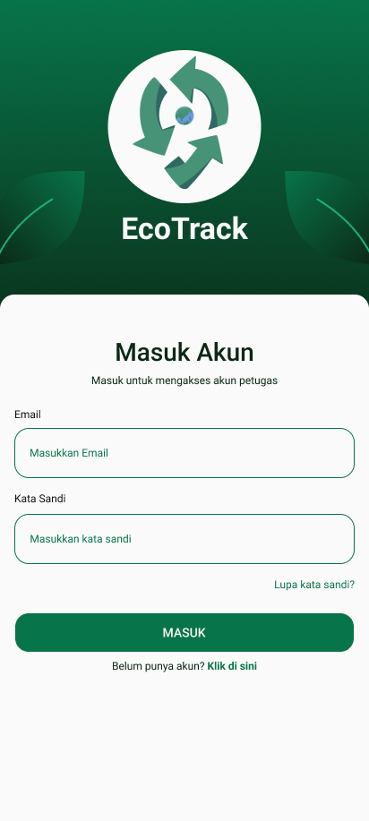
</p>
<p align="center">
<i>Gambar 6.1. Rancangan Antarmuka I-01 - Daftar Akun/Sign Up</i>
</p>

| Id_Objek | Jenis | Konten | Keterangan |
| :--- | :--- | :--- | :--- |
| O-01 | Label | Daftar Akun Petugas | Menampilkan judul halaman pendaftaran akun petugas kebersihan. |
| O-02 | Label | Buat akun untuk mulai mengelola sampah | Menampilkan deskripsi singkat halaman pendaftaran. |
| O-03 | Label | Nama Lengkap | Menampilkan label kolom nama lengkap. |
| O-04 | Text Field | Masukkan nama lengkap | Menerima input nama lengkap petugas. |
| O-05 | Label | NIK | Menampilkan label kolom Nomor Induk Kependudukan. |
| O-06 | Text Field | Masukkan NIK | Menerima input NIK calon petugas. |
| O-07 | Label | Email | Menampilkan label kolom email. |
| O-08 | Text Field | Masukkan Email | Menerima input alamat email calon petugas. |
| O-09 | Label | No. Telepon | Menampilkan label kolom nomor telepon. |
| O-10 | Text Field | Masukkan No. Telepon | Menerima input nomor telepon calon petugas. |
| O-11 | Label | Kata Sandi | Menampilkan label kolom kata sandi. |
| O-12 | Text Field | Masukkan kata sandi | Menerima input kata sandi untuk akun baru. |
| O-13 | Label | Konfirmasi Kata Sandi | Menampilkan label kolom konfirmasi kata sandi. |
| O-14 | Text Field | Ulangi kata sandi | Menerima input ulang kata sandi untuk memeriksa kesesuaian dengan kata sandi sebelumnya. |
| O-15 | Button | DAFTAR | Memvalidasi seluruh input dan mengirim data pendaftaran. Jika valid, sistem membuat akun; jika tidak, sistem menampilkan pesan kesalahan. |

## 6.2 Rancangan Antarmuka [I-02]
**Antarmuka:** [I-02] 
**Nama Layar:** *Masuk Akun/Log In*

<p align="center">
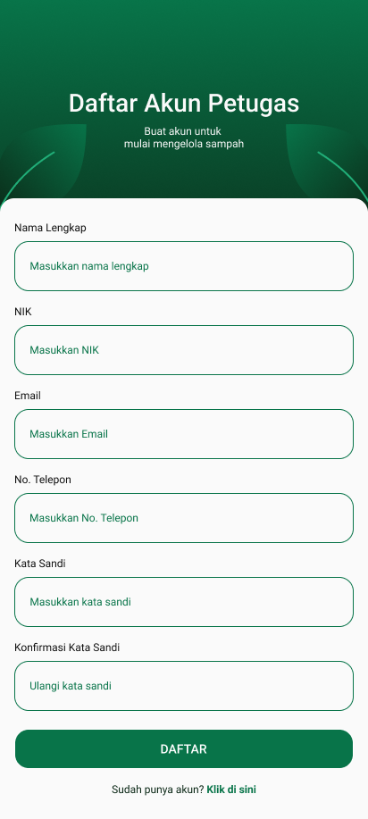
</p>
<p align="center">
<i>Gambar 6.2. Rancangan Antarmuka I-01 - Masuk Akun/Log In</i>
</p>

| Id_Objek | Jenis | Konten | Keterangan |
| :--- | :--- | :--- | :--- |
| O-01 | Image | Logo EcoTrack | Menampilkan logo aplikasi EcoTrack. |
| O-02 | Label | EcoTrack | Menampilkan nama aplikasi. |
| O-03 | Label | Masuk Akun | Menampilkan judul halaman login. |
| O-04 | Label | Masuk untuk mengakses akun petugas | Menampilkan deskripsi singkat halaman login. |
| O-05 | Label | Email | Menampilkan label kolom email. |
| O-06 | Text Field | Masukkan Email | Menerima input email yang terdaftar. |
| O-07 | Label | Kata Sandi | Menampilkan label kolom kata sandi. |
| O-08 | Text Field | Masukkan kata sandi | Menerima input kata sandi akun. |
| O-09 | Button | Lupa kata sandi? | Ketika ditekan, sistem membuka alur pemulihan kata sandi jika fitur tersebut tersedia. |
| O-10 | Button | MASUK | Memvalidasi email dan kata sandi. Jika valid, sistem mengarahkan pengguna ke halaman sesuai perannya; jika tidak, sistem menampilkan pesan kesalahan. |
| O-11 | Label/Button | Belum punya akun? Klik di sini | Ketika bagian “Klik di sini” ditekan, sistem membuka halaman pendaftaran akun petugas. |

## 6.3 Rancangan Antarmuka [I-03]
**Antarmuka:** [I-03]
**Nama Layar:** *Halaman Utama Daur Ulang*

<p align="center">
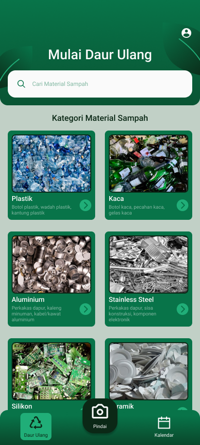
</p>
<p align="center">
<i>Gambar 6.3. Rancangan Antarmuka I-03 - Halaman Utama Daur Ulang</i>
</p>

Tabel 6.3. Spesifikasi Objek Antarmuka [ID Layar]

| Id_Objek | Jenis | Konten | Keterangan |
| :--- | :--- | :--- | :--- |
| O-01 | Label | Mulai Daur Ulang | Menampilkan judul halaman utama fitur daur ulang. |
| O-02 | Button | Ikon menu | Ketika ditekan, bila belum terdaftar akan masuk page daftar/masuk akun. Jika sudah terdaftar ke profil petugas. |
| O-03 | Text Field | Cari Material Sampah | Menerima kata kunci material sampah. Sistem menampilkan kategori yang sesuai dengan kata kunci yang dimasukkan. Jika tidak ditemukan, sistem menampilkan pesan bahwa material tidak ditemukan. |
| O-04 | Label | Kategori Material Sampah | Menampilkan judul bagian yang berisi daftar kategori material sampah. |
| O-05 | Card | Plastik | Menampilkan gambar dan deskripsi singkat sampah plastik. Ketika dipilih, sistem membuka halaman Informasi Sampah dengan kategori plastik. |
| O-06 | Card | Kaca | Menampilkan gambar dan deskripsi singkat sampah kaca. Ketika dipilih, sistem membuka halaman Informasi Sampah dengan kategori kaca. |
| O-07 | Card | Aluminium | Menampilkan gambar dan deskripsi singkat sampah aluminium. Ketika dipilih, sistem membuka halaman Informasi Sampah dengan kategori aluminium. |
| O-08 | Card | Stainless Steel | Menampilkan gambar dan deskripsi singkat sampah stainless steel. Ketika dipilih, sistem membuka halaman Informasi Sampah dengan kategori stainless steel. |
| O-09 | Card | Silikon | Menampilkan gambar dan deskripsi singkat sampah silikon. Ketika dipilih, sistem membuka halaman Informasi Sampah dengan kategori silikon. |
| O-10 | Card | Keramik | Menampilkan gambar dan deskripsi singkat sampah keramik. Ketika dipilih, sistem membuka halaman Informasi Sampah dengan kategori keramik. |
| O-11 | Navigation Bar | Daur Ulang | Menampilkan menu Daur Ulang sebagai navigasi aktif. Ketika ditekan, sistem membuka halaman Mulai Daur Ulang. |
| O-12 | Button | Pindai (ikon kamera) | Ketika ditekan, sistem membuka halaman pemindai untuk mengidentifikasi jenis sampah melalui kamera. |
| O-13 | Button | Kalender (ikon kalender) | Ketika ditekan, sistem membuka halaman Kalender untuk melihat jadwal pengambilan sampah. |

## 6.4 Rancangan Antarmuka [I-04]
**Antarmuka:** [I-04] 
**Nama Layar:** *Halaman Utama Kosong Daur Ulang*

<p align="center">
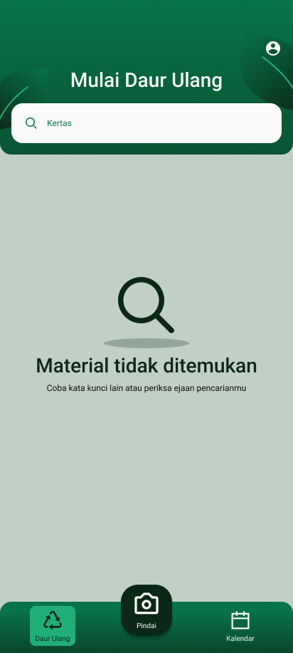
</p>
<p align="center">
<i>Gambar 6.4. Rancangan Antarmuka I-04 - Halaman Utama Kosong Daur Ulang</i>
</p>

| Id_Objek | Jenis | Konten | Keterangan |
| :--- | :--- | :--- | :--- |
| O-01 | Ilustrasi | Ikon kaca pembesar | Menampilkan ilustrasi sebagai penanda bahwa hasil pencarian tidak ditemukan. |
| O-02 | Label | Material tidak ditemukan | Menampilkan pesan bahwa tidak ada kategori material yang sesuai dengan kata kunci pencarian. |
| O-03 | Label | Coba kata kunci lain atau periksa ejaan pencarianmu | Memberikan arahan kepada pengguna untuk mencoba kata kunci lain atau memperbaiki ejaan pencarian. |

## 6.5 Rancangan Antarmuka [I-06]
**Antarmuka:** [I-06] 
**Nama Layar:** *Halaman Informasi Material Sampah*

<p align="center">
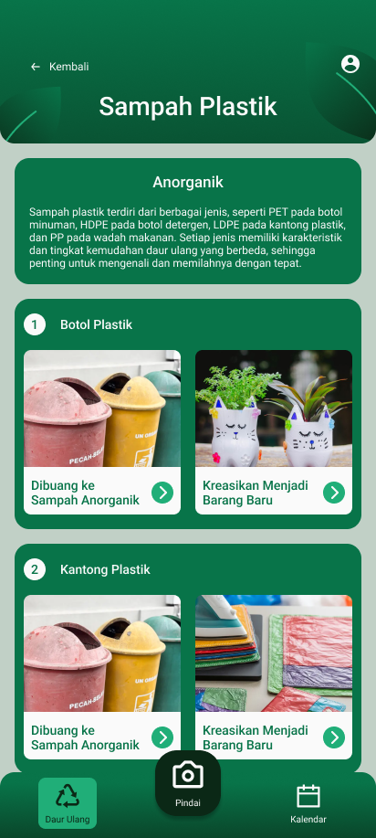
</p>
<p align="center">
<i>Gambar 6.5. Rancangan Antarmuka I-05 - Halaman Informasi Material Sampah</i>
</p>

| Id_Objek | Jenis | Konten | Keterangan |
| :--- | :--- | :--- | :--- |
| O-01 | Button | Kembali | Ketika ditekan, sistem kembali ke halaman Mulai Daur Ulang. |
| O-02 | Label | Sampah Plastik | Menampilkan nama kategori material yang dipilih pengguna. Judul menyesuaikan kategori material yang sedang dibuka. |
| O-03 | Label | Anorganik | Menampilkan jenis pengelompokan sampah berdasarkan kategori yang dipilih. |
| O-04 | Label | Deskripsi sampah plastik | Menampilkan penjelasan mengenai karakteristik, jenis, dan pentingnya memilah sampah plastik. |
| O-05 | Card | Botol Plastik | Menampilkan nomor urut dan nama jenis sampah plastik. |
| O-06 | Card | Dibuang ke Sampah Anorganik | Menampilkan gambar dan pilihan untuk melihat informasi pembuangan botol plastik ke sampah anorganik. Ketika ditekan, sistem membuka informasi terkait pembuangan sampah tersebut. |
| O-07 | Card | Kreasikan Menjadi Barang Baru | Menampilkan gambar contoh kreasi dari botol plastik. Ketika ditekan, sistem menampilkan pop-up Panduan Kreasi Daur Ulang. |
| O-08 | Card | Kantong Plastik | Menampilkan nomor urut dan nama jenis sampah plastik berupa kantong plastik, beserta pilihan pembuangan dan kreasi daur ulang. |
| O-09 | Card | Wadah Plastik | Menampilkan nomor urut dan nama jenis sampah plastik berupa wadah plastik, beserta pilihan pembuangan dan kreasi daur ulang. |

## 6.6 Rancangan Antarmuka [I-06]
**Antarmuka:** [I-06] 
**Nama Layar:** *Pop-up Panduan Daur Ulang*

<p align="center">
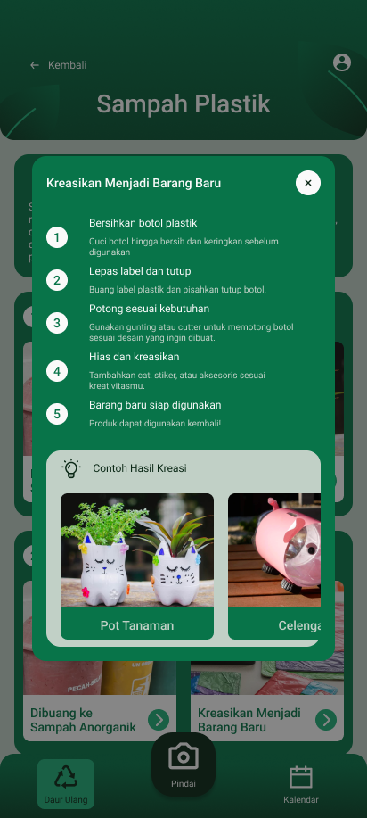
</p>
<p align="center">
<i>Gambar 6.6. Rancangan Antarmuka I-06 - Pop-up Panduan Daur Ulang</i>
</p>

| Id_Objek | Jenis | Konten | Keterangan |
| :--- | :--- | :--- | :--- |
| O-01 | Button | Kembali | Ketika ditekan, sistem kembali ke halaman Mulai Daur Ulang. |
| O-02 | Label | Sampah Plastik | Menampilkan nama kategori material yang dipilih pengguna. Judul menyesuaikan kategori material yang sedang dibuka. |
| O-03 | Label | Anorganik | Menampilkan jenis pengelompokan sampah berdasarkan kategori yang dipilih. |
| O-04 | Label | Deskripsi sampah plastik | Menampilkan penjelasan mengenai karakteristik, jenis, dan pentingnya memilah sampah plastik. |
| O-05 | Card | Botol Plastik | Menampilkan nomor urut dan nama jenis sampah plastik. |
| O-06 | Card | Dibuang ke Sampah Anorganik | Menampilkan gambar dan pilihan untuk melihat informasi pembuangan botol plastik ke sampah anorganik. Ketika ditekan, sistem membuka informasi terkait pembuangan sampah tersebut. |
| O-07 | Card | Kreasikan Menjadi Barang Baru | Menampilkan gambar contoh kreasi dari botol plastik. Ketika ditekan, sistem menampilkan pop-up Panduan Kreasi Daur Ulang. |
| O-08 | Card | Kantong Plastik | Menampilkan nomor urut dan nama jenis sampah plastik berupa kantong plastik, beserta pilihan pembuangan dan kreasi daur ulang. |
| O-09 | Card | Wadah Plastik | Menampilkan nomor urut dan nama jenis sampah plastik berupa wadah plastik, beserta pilihan pembuangan dan kreasi daur ulang. |


## 6.7 Rancangan Antarmuka [I-07]
**Antarmuka:** [I-07] 
**Nama Layar:** *Halaman Utama Jadwal Pengambilan Sampah*

<p align="center">
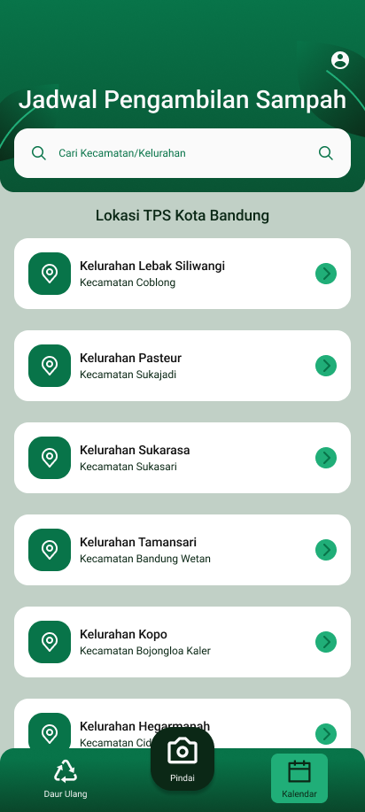
</p>
<p align="center">
<i>Gambar 6.7. Rancangan Antarmuka I-07 - Halaman Utama Jadwal Pengambilan Sampah</i>
</p>

| Id_Objek | Jenis | Konten | Keterangan |
| :--- | :--- | :--- | :--- |
| O-01 | Label | Jadwal Pengambilan Sampah | Menampilkan judul halaman jadwal pengambilan sampah. |
| O-02 | Button | Ikon profil | Ketika ditekan, sistem membuka halaman profil petugas jika pengguna sudah login. |
| O-03 | Text Field | Cari Kecamatan/Kelurahan | Menerima kata kunci lokasi TPS berdasarkan kecamatan atau kelurahan. Sistem menampilkan daftar lokasi yang sesuai dengan pencarian. |
| O-04 | Label | Lokasi TPS Kota Bandung | Menampilkan judul daftar lokasi TPS yang tersedia di Kota Bandung. |
| O-05 | Card | Kelurahan Lebak Siliwangi, Kecamatan Coblong | Menampilkan lokasi TPS. Ketika dipilih, sistem membuka halaman kalender jadwal pengambilan sampah untuk lokasi tersebut. |
| O-06 | Card | Kelurahan Pasteur, Kecamatan Sukajadi | Menampilkan lokasi TPS. Ketika dipilih, sistem membuka halaman kalender jadwal pengambilan sampah untuk lokasi tersebut. |
| O-07 | Card | Kelurahan Sukarasa, Kecamatan Sukasari | Menampilkan lokasi TPS. Ketika dipilih, sistem membuka halaman kalender jadwal pengambilan sampah untuk lokasi tersebut. |
| O-08 | Card | Kelurahan Tamansari, Kecamatan Bandung Wetan | Menampilkan lokasi TPS. Ketika dipilih, sistem membuka halaman kalender jadwal pengambilan sampah untuk lokasi tersebut. |
| O-09 | Card | Kelurahan Kopo, Kecamatan Bojongloa Kaler | Menampilkan lokasi TPS. Ketika dipilih, sistem membuka halaman kalender jadwal pengambilan sampah untuk lokasi tersebut. |
| O-10 | Card | Kelurahan Hegarmanah | Menampilkan lokasi TPS. Ketika dipilih, sistem membuka halaman kalender jadwal pengambilan sampah untuk lokasi tersebut. |
| O-11 | Navigation Bar | Daur Ulang | Ketika ditekan, sistem membuka halaman utama daur ulang. |
| O-12 | Button | Pindai | Ketika ditekan, sistem membuka halaman pemindai sampah. |
| O-13 | Navigation Bar | Kalender | Menampilkan menu kalender sebagai navigasi aktif. |

## 6.8 Rancangan Antarmuka [I-08]
**Antarmuka:** [I-08] 
**Nama Layar:** *Halaman Utama Kosong Jadwal Pengambilan Sampah*

<p align="center">
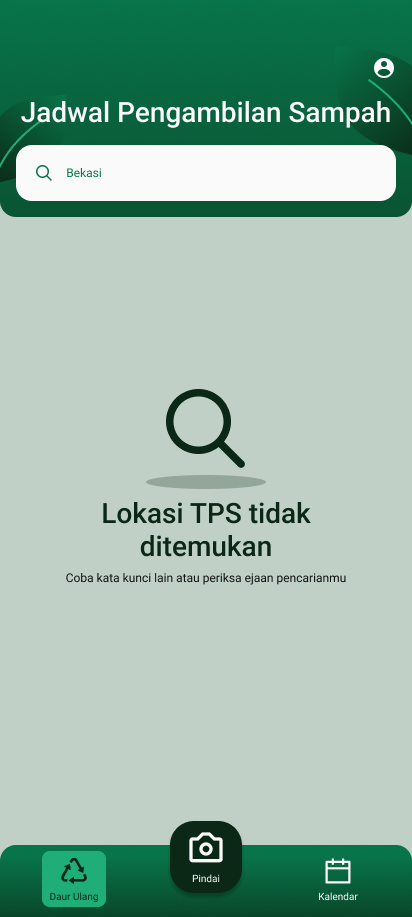
</p>
<p align="center">
<i>Gambar 6.8. Rancangan Antarmuka I-08 - Halaman Utama Kosong Jadwal Pengambilan Sampah</i>
</p>

| Id_Objek | Jenis | Konten | Keterangan |
| :--- | :--- | :--- | :--- |
| O-01 | Label | Jadwal Pengambilan Sampah | Menampilkan judul halaman jadwal pengambilan sampah. |
| O-02 | Text Field | Bekasi | Menampilkan kata kunci lokasi yang dimasukkan pengguna untuk melakukan pencarian TPS. |
| O-03 | Icon | Ikon kaca pembesar | Menampilkan ilustrasi bahwa hasil pencarian lokasi tidak ditemukan. |
| O-04 | Label | Lokasi TPS tidak ditemukan | Menampilkan pesan bahwa tidak terdapat lokasi TPS yang sesuai dengan kata kunci pencarian. |
| O-05 | Label | Coba kata kunci lain atau periksa ejaan pencarianmu | Memberikan arahan kepada pengguna untuk mencoba pencarian kembali. |

## 6.9 Rancangan Antarmuka [I-09]
**Antarmuka:** [I-09] 
**Nama Layar:** *Halaman Utama Kalendar (Masyarakat Umum)*

<p align="center">
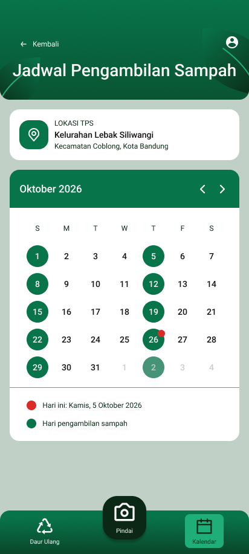
</p>
<p align="center">
<i>Gambar 6.09. Rancangan Antarmuka I-09 - Halaman Utama Kalendar (Masyarakat Umum)</i>
</p>

| Id_Objek | Jenis | Konten | Keterangan |
| :--- | :--- | :--- | :--- |
| O-01 | Button | Kembali | Ketika ditekan, sistem kembali ke halaman daftar lokasi TPS. |
| O-02 | Label | Jadwal Pengambilan Sampah | Menampilkan judul halaman jadwal pengambilan sampah. |
| O-03 | Button | Ikon profil | Ketika ditekan, sistem membuka halaman profil atau pilihan akun sesuai status login pengguna. |
| O-04 | Card | Lokasi TPS | Menampilkan informasi kelurahan dan kecamatan dari lokasi TPS yang dipilih. |
| O-05 | Label | Oktober 2026 | Menampilkan bulan dan tahun kalender yang sedang ditampilkan. |
| O-06 | Button | Panah kiri | Menampilkan kalender bulan sebelumnya. |
| O-07 | Button | Panah kanan | Menampilkan kalender bulan berikutnya. |
| O-08 | Calendar | Kalender Pengambilan Sampah | Menampilkan tanggal dalam satu bulan beserta penanda tanggal pengambilan sampah yang telah dijadwalkan. |
| O-09 | Legend | Hari ini: Kamis, 5 Oktober 2026 | Menampilkan keterangan penanda tanggal hari ini pada kalender. |
| O-10 | Legend | Hari pengambilan sampah | Menampilkan keterangan bahwa tanggal berwarna hijau merupakan jadwal pengambilan sampah. |
| O-11 | Navigation Bar | Daur Ulang | Ketika ditekan, sistem membuka halaman utama daur ulang. |
| O-12 | Button | Pindai | Ketika ditekan, sistem membuka halaman pemindai sampah. |
| O-13 | Navigation Bar | Kalender | Menampilkan menu kalender sebagai navigasi aktif. |

## 6.10 Rancangan Antarmuka [I-10]
**Antarmuka:** [I-10] 
**Nama Layar:** *Halaman Utama Kalendar (Petugas Kebersihan)*

<p align="center">
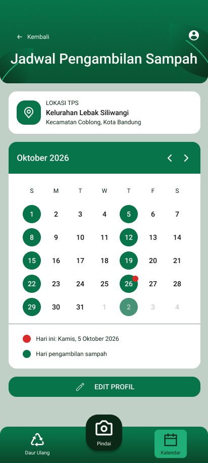
</p>
<p align="center">
<i>Gambar 6.10. Rancangan Antarmuka I-10 - Halaman Utama Kalendar (Petugas Kebersihan)</i>
</p>

| Id_Objek | Jenis | Konten | Keterangan |
| :--- | :--- | :--- | :--- |
| O-01 | Button | Kembali | Ketika ditekan, sistem kembali ke halaman daftar lokasi TPS. |
| O-02 | Label | Jadwal Pengambilan Sampah | Menampilkan judul halaman jadwal pengambilan sampah. |
| O-03 | Button | Ikon profil | Ketika ditekan, sistem membuka halaman profil petugas kebersihan. |
| O-04 | Card | Lokasi TPS | Menampilkan informasi kelurahan dan kecamatan dari lokasi TPS yang dipilih. |
| O-05 | Label | Oktober 2026 | Menampilkan bulan dan tahun kalender yang sedang ditampilkan. |
| O-06 | Button | Panah kiri | Menampilkan kalender bulan sebelumnya. |
| O-07 | Button | Panah kanan | Menampilkan kalender bulan berikutnya. |
| O-08 | Calendar | Kalender Pengambilan Sampah | Menampilkan tanggal dalam satu bulan beserta penanda tanggal pengambilan sampah yang telah dijadwalkan. |
| O-09 | Legend | Hari ini: Kamis, 5 Oktober 2026 | Menampilkan keterangan penanda tanggal hari ini pada kalender. |
| O-10 | Legend | Hari pengambilan sampah | Menampilkan keterangan bahwa tanggal berwarna hijau merupakan jadwal pengambilan sampah. |
| O-11 | Button | EDIT PROFIL | Ketika ditekan, sistem membuka halaman edit kalender agar petugas dapat mengubah jadwal pengambilan sampah. |
| O-12 | Navigation Bar | Daur Ulang | Ketika ditekan, sistem membuka halaman utama daur ulang. |
| O-13 | Button | Pindai | Ketika ditekan, sistem membuka halaman pemindai sampah. |
| O-14 | Navigation Bar | Kalender | Menampilkan menu kalender sebagai navigasi aktif. |

## 6.11 Rancangan Antarmuka [I-11]
**Antarmuka:** [I-11] 
**Nama Layar:** *Halaman Utama Kalendar (Petugas Kebersihan)*

<p align="center">
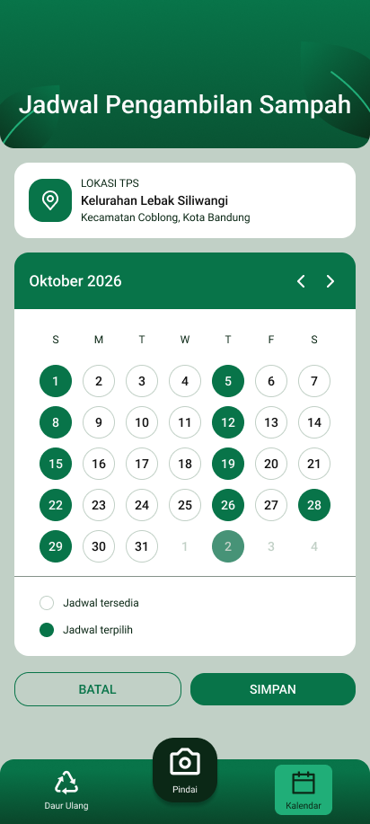
</p>
<p align="center">
<i>Gambar 6.11. Rancangan Antarmuka I-11 - Halaman Edit Kalendar (Petugas Kebersihan)</i>
</p>

| Id_Objek | Jenis | Konten | Keterangan |
| :--- | :--- | :--- | :--- |
| O-01 | Label | Jadwal Pengambilan Sampah | Menampilkan judul halaman jadwal pengambilan sampah. |
| O-02 | Card | Lokasi TPS | Menampilkan informasi kelurahan dan kecamatan dari lokasi TPS yang sedang diedit. |
| O-03 | Label | Oktober 2026 | Menampilkan bulan dan tahun kalender yang sedang diedit. |
| O-04 | Button | Panah kiri | Menampilkan kalender bulan sebelumnya. |
| O-05 | Button | Panah kanan | Menampilkan kalender bulan berikutnya. |
| O-06 | Calendar | Kalender Pengambilan Sampah | Menampilkan seluruh tanggal pada bulan yang dipilih. Petugas dapat menekan tanggal untuk menambah atau menghapus jadwal pengambilan sampah. |
| O-07 | Legend | Jadwal tersedia | Menampilkan keterangan tanggal yang belum dipilih sebagai jadwal pengambilan sampah. |
| O-08 | Legend | Jadwal terpilih | Menampilkan keterangan tanggal yang telah dipilih sebagai jadwal pengambilan sampah. |
| O-09 | Button | BATAL | Membatalkan perubahan jadwal dan kembali ke halaman kalender petugas tanpa menyimpan perubahan. |
| O-10 | Button | SIMPAN | Ketika ditekan, sistem menampilkan pop-up konfirmasi penyimpanan perubahan jadwal. |
| O-11 | Navigation Bar | Daur Ulang | Ketika ditekan, sistem membuka halaman utama daur ulang. |
| O-12 | Button | Pindai | Ketika ditekan, sistem membuka halaman pemindai sampah. |
| O-13 | Navigation Bar | Kalender | Menampilkan menu kalender sebagai navigasi aktif. |

## 6.12 Rancangan Antarmuka [I-12]
**Antarmuka:** [I-12] 
**Nama Layar:** *Pop Up Simpan Kalendar Baru (Petugas Kebersihan)*

<p align="center">
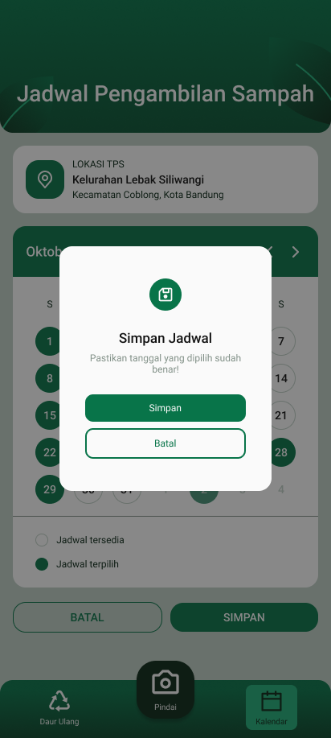
</p>
<p align="center">
<i>Gambar 6.12. Rancangan Antarmuka I-12 - Pop Up Simpan Kalendar Baru (Petugas Kebersihan)</i>
</p>

| Id_Objek | Jenis | Konten | Keterangan |
| :--- | :--- | :--- | :--- |
| O-01 | Modal/Popup | Simpan Jadwal | Menampilkan pop-up konfirmasi sebelum perubahan jadwal disimpan. |
| O-02 | Icon | Ikon simpan | Menampilkan ikon yang merepresentasikan proses penyimpanan jadwal. |
| O-03 | Label | Simpan Jadwal | Menampilkan judul pop-up konfirmasi penyimpanan jadwal. |
| O-04 | Label | Pastikan tanggal yang dipilih sudah benar! | Memberikan pengingat kepada petugas untuk memeriksa kembali tanggal yang telah dipilih. |
| O-05 | Button | Simpan | Mengirim perubahan jadwal ke sistem untuk disimpan. Sistem menampilkan notifikasi keberhasilan atau kegagalan sesuai hasil penyimpanan. |
| O-06 | Button | Batal | Menutup pop-up dan kembali ke halaman edit kalender tanpa menyimpan perubahan. |

## 6.13 Rancangan Antarmuka [I-13]
**Antarmuka:** [I-13] 
**Nama Layar:** *Pop Up Kalendar Baru Berhasil Tersimpan (Petugas Kebersihan)*

<p align="center">
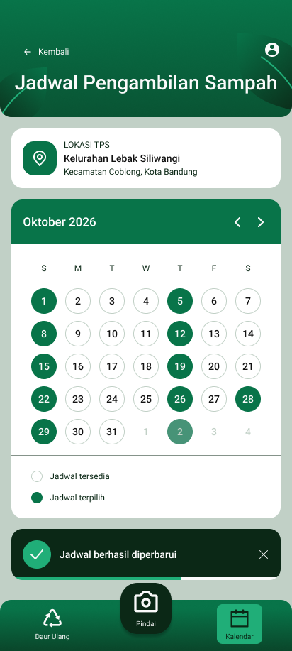
</p>
<p align="center">
<i>Gambar 6.13. Rancangan Antarmuka I-13 - Pop Up Kalendar Baru Berhasil Tersimpan (Petugas Kebersihan)</i>
</p>

| Id_Objek | Jenis | Konten | Keterangan |
| :--- | :--- | :--- | :--- |
| O-01 | Toast Notification | Jadwal berhasil diperbarui | Menampilkan notifikasi bahwa perubahan jadwal pengambilan sampah berhasil disimpan. Kalender menampilkan tanggal pengambilan sampah yang telah diperbarui. |
| O-02 | Icon | Ikon centang hijau | Menampilkan indikator visual bahwa proses penyimpanan jadwal berhasil. |
| O-03 | Button | Ikon tutup (X) | Ketika ditekan, sistem menutup notifikasi keberhasilan. |

## 6.14 Rancangan Antarmuka [I-14]
**Antarmuka:** [I-14] 
**Nama Layar:** *Pop Up Kalendar Baru Gagal Tersimpan (Petugas Kebersihan)*

<p align="center">
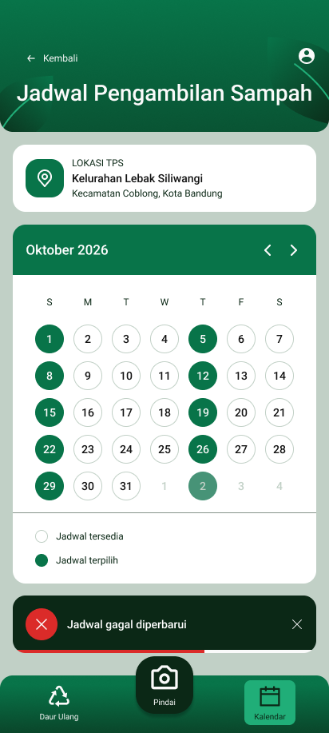
</p>
<p align="center">
<i>Gambar 6.14. Rancangan Antarmuka I-14 - Pop Up Kalendar Baru Gagal Tersimpan (Petugas Kebersihan)</i>
</p>

| Id_Objek | Jenis | Konten | Keterangan |
| :--- | :--- | :--- | :--- |
| O-01 | Toast Notification | Jadwal gagal diperbarui | Menampilkan notifikasi bahwa perubahan jadwal pengambilan sampah gagal disimpan. Pengguna dapat mencoba menyimpan perubahan kembali. |
| O-02 | Icon | Ikon silang merah | Menampilkan indikator visual bahwa proses penyimpanan jadwal gagal. |
| O-03 | Button | Ikon tutup (X) | Ketika ditekan, sistem menutup notifikasi kegagalan. |

## 6.15 Rancangan Antarmuka [I-15]
**Antarmuka:** [I-15] 
**Nama Layar:** *Halaman Utama Profil Petugas Kebersihan*

<p align="center">
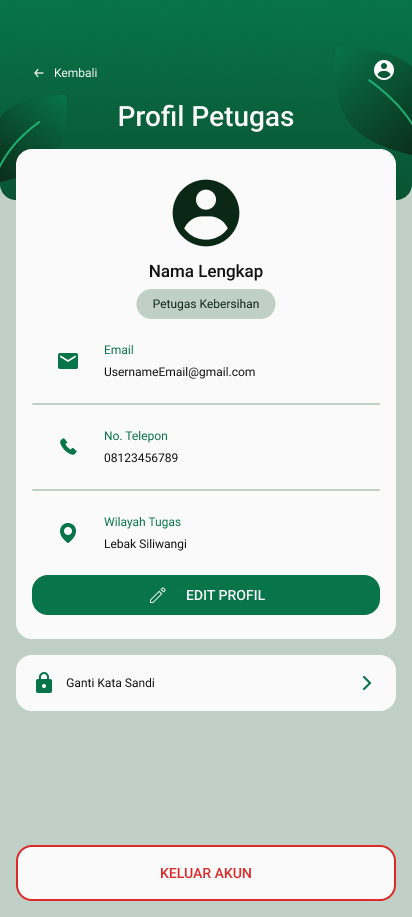
</p>
<p align="center">
<i>Gambar 6.15. Rancangan Antarmuka I-15 - Halaman Utama Profil Petugas Kebersihan</i>
</p>

| Id_Objek | Jenis | Konten | Keterangan |
| :--- | :--- | :--- | :--- |
| O-01 | Label | Profil Petugas | Menampilkan judul halaman profil petugas kebersihan. |
| O-02 | Icon | Ikon profil | Menampilkan ikon yang merepresentasikan pengguna. |
| O-03 | Label | Nama Lengkap | Menampilkan nama lengkap petugas kebersihan yang sedang login. |
| O-04 | Label | Petugas Kebersihan | Menampilkan peran pengguna dalam aplikasi. |
| O-05 | Label | Email dan alamat email | Menampilkan alamat email petugas yang terdaftar. |
| O-06 | Label | No. Telepon dan nomor telepon | Menampilkan nomor telepon petugas yang terdaftar. |
| O-07 | Label | Wilayah Tugas dan nama wilayah | Menampilkan wilayah penugasan petugas kebersihan. |
| O-08 | Button | EDIT PROFIL | Ketika ditekan, sistem membuka halaman edit profil petugas. |
| O-09 | Button | Ganti Kata Sandi | Ketika ditekan, sistem menampilkan pop-up untuk mengubah kata sandi akun. |
| O-10 | Button | KELUAR AKUN | Ketika ditekan, sistem menampilkan pop-up konfirmasi keluar akun. |

## 6.16 Rancangan Antarmuka [I-16]
**Antarmuka:** [I-16] 
**Nama Layar:** *Halaman Edit Profil Petugas Kebersihan*

<p align="center">
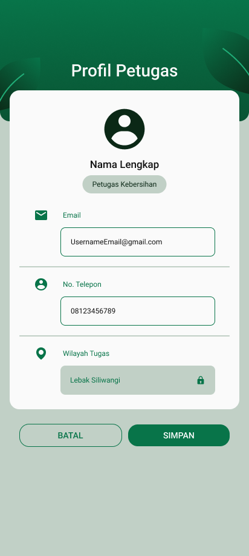
</p>
<p align="center">
<i>Gambar 6.16. Rancangan Antarmuka I-16 - Halaman Edit Profil Petugas Kebersihan</i>
</p>

| Id_Objek | Jenis | Konten | Keterangan |
| :--- | :--- | :--- | :--- |
| O-01 | Toast Notification | Profil berhasil diperbarui | Menampilkan notifikasi bahwa perubahan profil berhasil disimpan. |
| O-02 | Button | Ikon tutup (X) | Ketika ditekan, sistem menutup notifikasi keberhasilan. |

## 6.17 Rancangan Antarmuka [I-17]
**Antarmuka:** [I-17] 
**Nama Layar:** *Halaman Berhasil Simpan Profil Baru Petugas Kebersihan*

<p align="center">
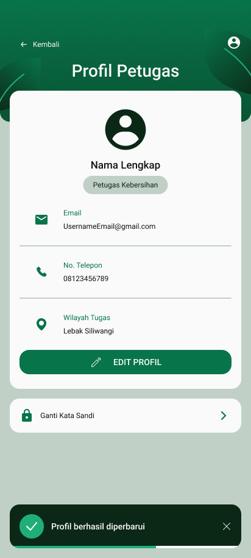
</p>
<p align="center">
<i>Gambar 6.17. Rancangan Antarmuka I-17 - Halaman Edit Profil Petugas Kebersihan</i>
</p>

| Id_Objek | Jenis | Konten | Keterangan |
| :--- | :--- | :--- | :--- |
| O-01 | Toast Notification | Profil gagal diperbarui | Menampilkan notifikasi bahwa perubahan profil gagal disimpan. Pengguna dapat memperbaiki input atau mencoba menyimpan kembali. |
| O-02 | Button | Ikon tutup (X) | Ketika ditekan, sistem menutup notifikasi kegagalan. |

## 6.18 Rancangan Antarmuka [I-18]
**Antarmuka:** [I-18] 
**Nama Layar:** *Halaman Gagal Simpan Profil Baru Petugas Kebersihan*

<p align="center">
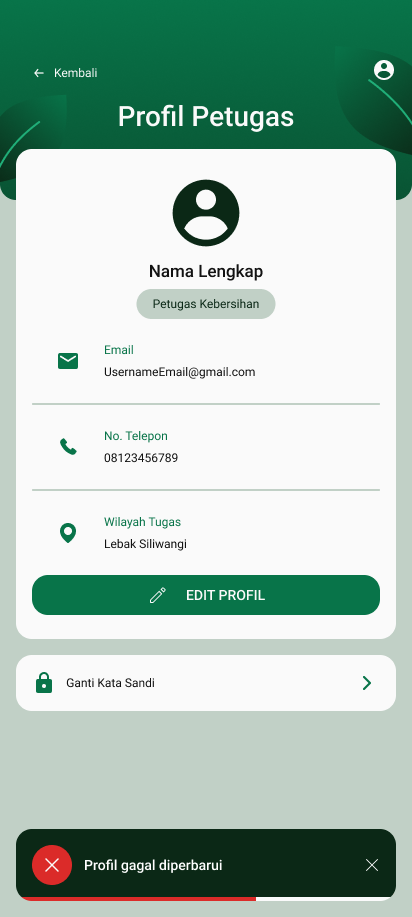
</p>
<p align="center">
<i>Gambar 6.18. Rancangan Antarmuka I-18 - Halaman Gagal Profil Petugas Kebersihan</i>
</p>

| Id_Objek | Jenis | Konten | Keterangan |
| :--- | :--- | :--- | :--- |
| O-01 | Toast Notification | Profil gagal diperbarui | Menampilkan notifikasi bahwa perubahan profil gagal disimpan. Pengguna dapat memperbaiki input atau mencoba menyimpan kembali. |
| O-02 | Button | Ikon tutup (X) | Ketika ditekan, sistem menutup notifikasi kegagalan. |

## 6.19 Rancangan Antarmuka [I-19]
**Antarmuka:** [I-19] 
**Nama Layar:** *Pop up Keluar Akun Petugas*

<p align="center">
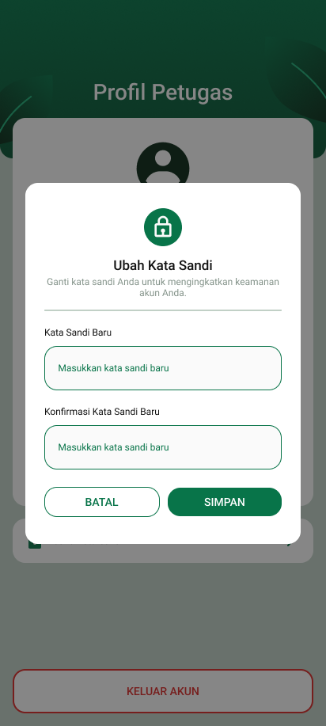
</p>
<p align="center">
<i>Gambar 6.19. Rancangan Antarmuka I-19 - Pop up Keluar Akun Petugas</i>
</p>

| Id_Objek | Jenis | Konten | Keterangan |
| :--- | :--- | :--- | :--- |
| O-01 | Modal/Popup | Keluar Akun | Menampilkan pop-up konfirmasi sebelum pengguna keluar dari akun. |
| O-02 | Icon | Ikon keluar akun | Memberikan ilustrasi visual untuk tindakan keluar akun. |
| O-03 | Label | Keluar Akun | Menampilkan judul konfirmasi keluar akun. |
| O-04 | Label | Apakah Anda yakin hendak keluar akun ini? | Meminta konfirmasi pengguna sebelum proses keluar akun dilakukan. |
| O-05 | Button | Keluar | Mengakhiri sesi pengguna dan mengarahkan pengguna ke halaman login. |
| O-06 | Button | Batal | Menutup pop-up dan kembali ke halaman profil tanpa keluar dari akun. |

## 6.20 Rancangan Antarmuka [I-20]
**Antarmuka:** [I-20] 
**Nama Layar:** *Halaman Edit Password Akun Petugas*

<p align="center">

</p>
<p align="center">
<i>Gambar 6.20. Rancangan Antarmuka I-20 - Halaman Edit Password Akun Petugas</i>

| Id_Objek | Jenis | Konten | Keterangan |
| :--- | :--- | :--- | :--- |
| O-01 | Modal/Popup | Ubah Kata Sandi | Menampilkan formulir untuk mengubah kata sandi akun petugas. |
| O-02 | Icon | Ikon gembok | Memberikan ilustrasi visual terkait keamanan akun. |
| O-03 | Label | Ubah Kata Sandi | Menampilkan judul formulir pengubahan kata sandi. |
| O-04 | Label | Ganti kata sandi Anda untuk meningkatkan keamanan akun Anda. | Memberikan penjelasan singkat mengenai tujuan penggantian kata sandi. |
| O-05 | Text Field | Kata Sandi Baru | Menerima input kata sandi baru dari pengguna. |
| O-06 | Text Field | Konfirmasi Kata Sandi Baru | Menerima input ulang kata sandi baru untuk memastikan kesesuaian dengan kata sandi yang dimasukkan sebelumnya. |
| O-07 | Button | BATAL | Menutup formulir tanpa menyimpan perubahan kata sandi. |
| O-08 | Button | SIMPAN | Memvalidasi kata sandi baru dan konfirmasinya, kemudian meminta sistem menyimpan perubahan. Sistem menampilkan notifikasi berhasil atau gagal sesuai hasil proses. |

## 6.21 Rancangan Antarmuka [I-21]
**Antarmuka:** [I-21] 
**Nama Layar:** *Halaman Berhasil Edit Password Akun Petugas*

<p align="center">
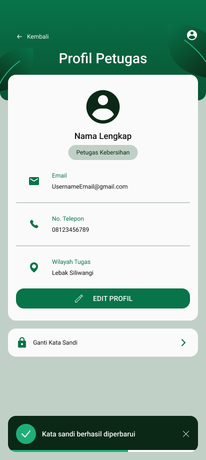
</p>
<p align="center">
<i>Gambar 6.21. Rancangan Antarmuka I-21 - Halaman Berhasil Edit Password Akun Petugas</i>

| Id_Objek | Jenis | Konten | Keterangan |
| :--- | :--- | :--- | :--- |
| O-01 | Toast Notification | Kata sandi berhasil diperbarui | Menampilkan notifikasi bahwa kata sandi akun berhasil diubah. |
| O-02 | Button | Ikon tutup (X) | Ketika ditekan, sistem menutup notifikasi keberhasilan. |

## 6.22 Rancangan Antarmuka [I-22]
**Antarmuka:** [I-22] 
**Nama Layar:** *Halaman Gagal Edit Password Akun Petugas*

<p align="center">
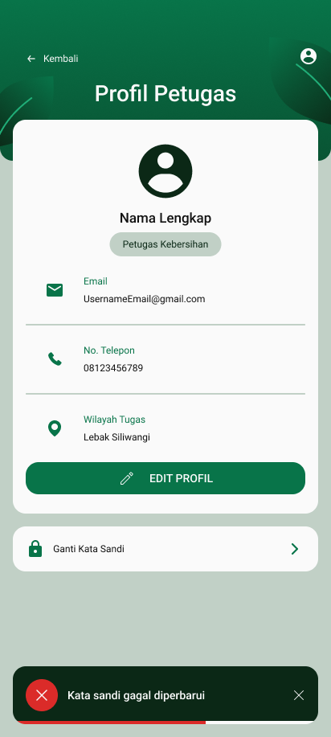
</p>
<p align="center">
<i>Gambar 6.22. Rancangan Antarmuka I-22 - Halaman Gagal Edit Password Akun Petugas</i>

| Id_Objek | Jenis | Konten | Keterangan |
| :--- | :--- | :--- | :--- |
| O-01 | Toast Notification | Kata sandi gagal diperbarui | Menampilkan notifikasi bahwa proses pengubahan kata sandi gagal. Pengguna dapat memperbaiki input atau mencoba kembali. |
| O-02 | Button | Ikon tutup (X) | Ketika ditekan, sistem menutup notifikasi kegagalan. |

## 6.23 Rancangan Antarmuka [I-23]
**Antarmuka:** [I-23] 
**Nama Layar:** *Halaman Utama Pemindaian Sampah*

<p align="center">
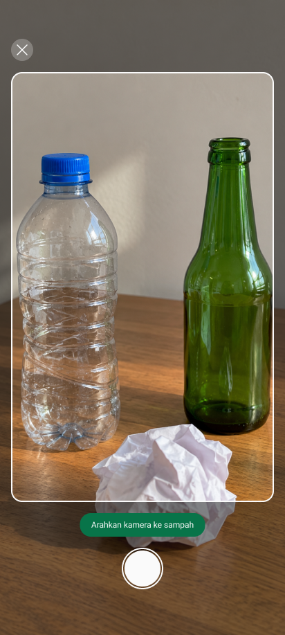
</p>
<p align="center">
<i>Gambar 6.23. Rancangan Antarmuka I-23 - Halaman Utama Pemindaian Sampah</i>
</p>

| Id_Objek | Jenis | Konten | Keterangan |
| :--- | :--- | :--- | :--- |
| O-26 | Button | Ikon tutup (X) | Ketika ditekan, sistem menutup halaman pemindaian dan kembali ke halaman sebelumnya. |
| O-27 | Camera Preview | Tampilan kamera | Menampilkan tangkapan kamera secara langsung untuk membantu pengguna mengarahkan kamera ke objek sampah yang ingin dipindai. |
| O-28 | Label | Arahkan kamera ke sampah | Memberikan petunjuk kepada pengguna agar mengarahkan kamera ke objek sampah yang akan diidentifikasi. |
| O-29 | Button | Tombol pemindaian (ikon kamera) | Ketika ditekan, sistem mengambil gambar objek sampah dan memprosesnya untuk mengidentifikasi jenis material sampah. |

## 6.24 Rancangan Antarmuka [I-24]
**Antarmuka:** [I-24] 
**Nama Layar:** *Halaman Hasil Pemindaian Sampah*

<p align="center">
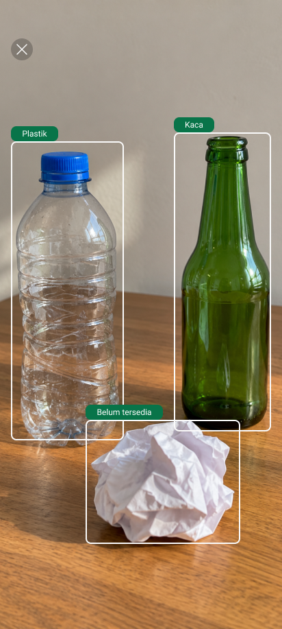
</p>
<p align="center">
<i>Gambar 6.24. Rancangan Antarmuka I-24 - Halaman Hasil Pemindaian Sampah</i>
</p>

| Id_Objek | Jenis | Konten | Keterangan |
| :--- | :--- | :--- | :--- |
| O-30 | Button | Ikon tutup (X) | Ketika ditekan, sistem menutup halaman hasil pemindaian dan kembali ke halaman sebelumnya. |
| O-31 | Image | Foto hasil pemindaian | Menampilkan foto asli yang diambil oleh kamera sebagai dasar visual untuk identifikasi objek sampah. |
| O-32 | Bounding Box | Kotak deteksi sampah | Menandai lokasi setiap objek sampah yang terdeteksi pada foto. Kotak disesuaikan dengan posisi objek hasil identifikasi. |
| O-33 | Label | Plastik | Menampilkan jenis material yang teridentifikasi sebagai plastik pada objek yang ditandai. |
| O-34 | Label | Kaca | Menampilkan jenis material yang teridentifikasi sebagai kaca pada objek yang ditandai. |
| O-35 | Label | Belum tersedia | Menandai objek yang berhasil terdeteksi, tetapi informasi jenis material atau detailnya belum tersedia dalam database aplikasi. Ketika dipilih, sistem menampilkan pop-up Material Sampah Belum Tersedia. |

## 6.25 Rancangan Antarmuka [I-25]
**Antarmuka:** [I-25] 
**Nama Layar:** *Pop Up Material Sampah Belum Tersedia*

<p align="center">
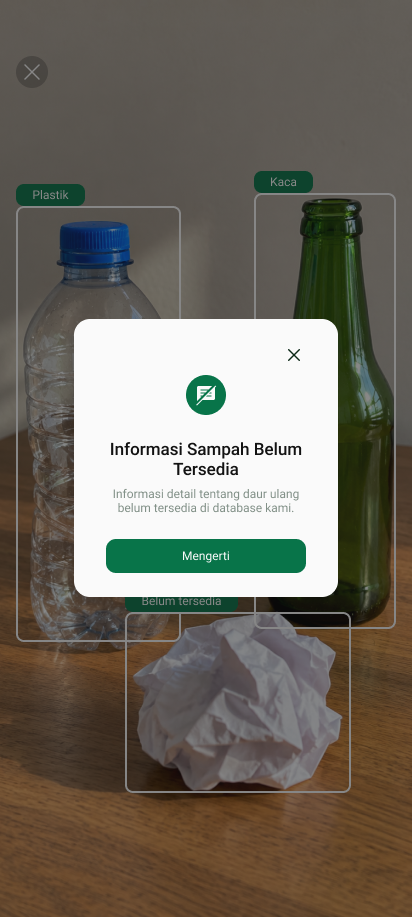
</p>
<p align="center">
<i>Gambar 6.25. Rancangan Antarmuka I-25 - Pop Up Material Sampah Belum Tersedia</i>

| Id_Objek | Jenis | Konten | Keterangan |
| :--- | :--- | :--- | :--- |
| O-01 | Modal/Popup | Informasi Sampah Belum Tersedia | Menampilkan pemberitahuan bahwa informasi detail mengenai daur ulang objek sampah belum tersedia dalam database aplikasi. |
| O-02 | Button | Ikon tutup (X) | Ketika ditekan, sistem menutup pop-up dan kembali menampilkan halaman hasil pemindaian sampah. |
| O-03 | Icon | Ikon informasi tidak tersedia | Memberikan ilustrasi visual bahwa informasi detail material sampah belum tersedia. |
| O-04 | Label | Informasi Sampah Belum Tersedia | Menampilkan judul pemberitahuan kepada pengguna. |
| O-05 | Label | Informasi detail tentang daur ulang belum tersedia di database kami. | Menjelaskan bahwa informasi daur ulang untuk objek yang dipilih belum tersedia dalam database aplikasi. |
| O-06 | Button | Mengerti | Ketika ditekan, sistem menutup pop-up dan kembali menampilkan halaman hasil pemindaian sampah. |

## 6.26 Rancangan Antarmuka [I-26]
**Antarmuka:** [I-26] 
**Nama Layar:** *Masuk Akun/Log In Salah*

<p align="center">
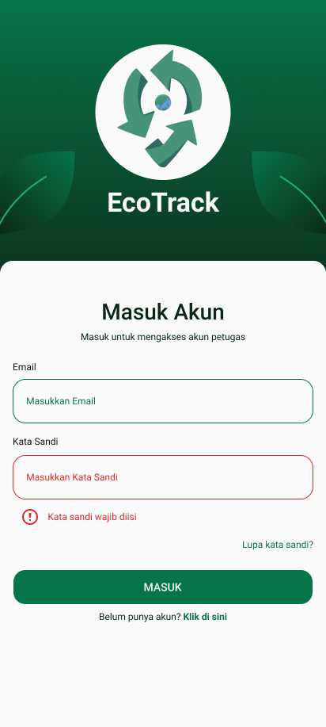
</p>
<p align="center">
<i>Gambar 6.26. Rancangan Antarmuka I-26 - Masuk Akun/Log In Salah</i>

| Id_Objek | Jenis | Konten | Keterangan |
| :--- | :--- | :--- | :--- |
| O-01 | Image | Logo EcoTrack | Menampilkan logo aplikasi EcoTrack. |
| O-02 | Label | EcoTrack | Menampilkan nama aplikasi. |
| O-03 | Label | Masuk Akun | Menampilkan judul halaman login. |
| O-04 | Label | Masuk untuk mengakses akun petugas | Menampilkan deskripsi singkat halaman login. |
| O-05 | Label | Email | Menampilkan label kolom email. |
| O-06 | Text Field | Masukkan Email | Menerima input email yang terdaftar. |
| O-07 | Label | Kata Sandi | Menampilkan label kolom kata sandi. |
| O-08 | Text Field | Masukkan Kata Sandi | Menerima input kata sandi dan ditandai merah ketika kosong setelah validasi. |
| O-09 | Error Message | Kata sandi wajib diisi | Menampilkan pesan kesalahan ketika pengguna mencoba login tanpa memasukkan kata sandi. |
| O-10 | Button | Lupa kata sandi? | Ketika ditekan, sistem membuka alur pemulihan kata sandi jika fitur tersebut tersedia. |
| O-11 | Button | MASUK | Memvalidasi input login. Jika kata sandi kosong, sistem menampilkan pesan kesalahan dan tidak melanjutkan proses login. |
| O-12 | Label/Button | Belum punya akun? Klik di sini | Ketika bagian “Klik di sini” ditekan, sistem membuka halaman pendaftaran akun petugas. |

## 6.27 Rancangan Antarmuka [I-27]
**Antarmuka:** [I-27] 
**Nama Layar:** *Daftar Akun/Sign Up Salah*

<p align="center">
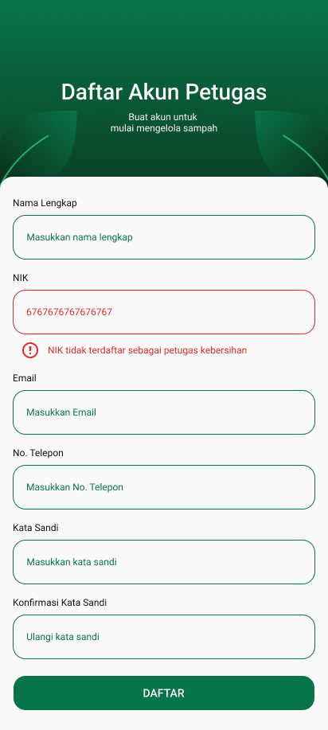
</p>
<p align="center">
<i>Gambar 6.27. Rancangan Antarmuka I-27 - Daftar Akun/Sign Up Salah</i>

| Id_Objek | Jenis | Konten | Keterangan |
| :--- | :--- | :--- | :--- |
| O-01 | Label | Daftar Akun Petugas | Menampilkan judul halaman pendaftaran akun petugas kebersihan. |
| O-02 | Label | Buat akun untuk mulai mengelola sampah | Menampilkan deskripsi singkat halaman pendaftaran. |
| O-03 | Label | Nama Lengkap | Menampilkan label kolom nama lengkap. |
| O-04 | Text Field | Masukkan nama lengkap | Menerima input nama lengkap petugas. |
| O-05 | Label | NIK | Menampilkan label kolom NIK. |
| O-06 | Text Field | Nomor NIK yang dimasukkan | Menampilkan NIK yang telah dimasukkan dengan penanda visual merah karena tidak valid. |
| O-07 | Error Message | NIK tidak terdaftar sebagai petugas kebersihan | Menampilkan pesan bahwa NIK tidak terdaftar dalam data petugas kebersihan. |
| O-08 | Label | Email | Menampilkan label kolom email. |
| O-09 | Text Field | Masukkan Email | Menerima input alamat email calon petugas. |
| O-10 | Label | No. Telepon | Menampilkan label kolom nomor telepon. |
| O-11 | Text Field | Masukkan No. Telepon | Menerima input nomor telepon calon petugas. |
| O-12 | Label | Kata Sandi | Menampilkan label kolom kata sandi. |
| O-13 | Text Field | Masukkan kata sandi | Menerima input kata sandi untuk akun baru. |
| O-14 | Label | Konfirmasi Kata Sandi | Menampilkan label kolom konfirmasi kata sandi. |
| O-15 | Text Field | Ulangi kata sandi | Menerima input ulang kata sandi untuk memeriksa kesesuaian. |
| O-16 | Button | DAFTAR | Memproses pendaftaran setelah validasi. Jika NIK tidak terdaftar, sistem menolak pendaftaran dan menampilkan pesan kesalahan pada kolom NIK. |

## 6.28 Rancangan Antarmuka Keseluruhan

Tabel 6.28. Rancangan Antarmuka Keseluruhan

| No | Tampilan Antarmuka |
| :--- | :--- |
| [I-01] | **Daftar Akun/Sign Up** <br>  |
| [I-02] | **Masuk Akun/Log In** <br>  |
| [I-03] | **Halaman Utama Daur Ulang** <br>  |
| [I-04] | **Halaman Utama Kosong Daur Ulang** <br>  |
| [I-05] | **Halaman Informasi Material Sampah** <br>  |
| [I-06] | **Pop-up Panduan Daur Ulang** <br>  |
| [I-07] | **Halaman Utama Jadwal Pengambilan Sampah** <br>  |
| [I-08] | **Halaman Utama Kosong Jadwal Pengambilan Sampah** <br>  |
| [I-09] | **Halaman Utama Kalender (Masyarakat Umum)** <br>  |
| [I-10] | **Halaman Utama Kalender (Petugas Kebersihan)** <br>  |
| [I-11] | **Halaman Edit Kalender (Petugas Kebersihan)** <br>  |
| [I-12] | **Pop-up Simpan Kalender Baru (Petugas Kebersihan)** <br>  |
| [I-13] | **Pop-up Kalender Baru Berhasil Tersimpan (Petugas Kebersihan)** <br>  |
| [I-14] | **Pop-up Kalender Baru Gagal Tersimpan (Petugas Kebersihan)** <br>  |
| [I-15] | **Halaman Utama Profil Petugas Kebersihan** <br>  |
| [I-16] | **Halaman Edit Profil Petugas Kebersihan** <br>  |
| [I-17] | **Halaman Berhasil Simpan Profil Baru Petugas Kebersihan** <br>  |
| [I-18] | **Halaman Gagal Simpan Profil Baru Petugas Kebersihan** <br>  |
| [I-19] | **Pop-up Keluar Akun Petugas** <br> 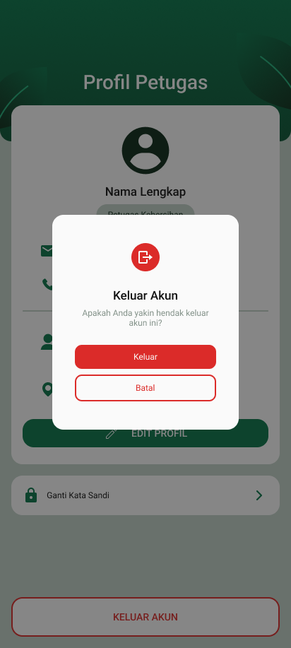 |
| [I-20] | **Halaman Edit Password Akun Petugas** <br>  |
| [I-21] | **Halaman Berhasil Edit Password Akun Petugas** <br>  |
| [I-22] | **Halaman Gagal Edit Password Akun Petugas** <br>  |
| [I-23] | **Halaman Utama Pemindaian Sampah** <br>  |
| [I-24] | **Halaman Hasil Pemindaian Sampah** <br>  |
| [I-25] | **Pop-up Material Sampah Belum Tersedia** <br>  |

<br>

---

# BAB 7: Matriks Kerunutan

Tabel 7.1. Matriks Kerunutan Kelas terhadap Use Case

| Kelas | Use Case Terkait |
| :--- | :--- |
| *C01* - AkunPetugas | *UC01 - Melakukan Login, UC06 - Membuat Akun* |
| *C02* - AkunPetugasController | *UC01 - Melakukan Login, UC03 - Mengatur Jadwal, UC06 - Membuat Akun* |
| *C03* - AkunPetugasInterface | *UC01 - Melakukan Login, UC06 - Membuat Akun* |
| *C04* - Jadwal | *UC03 - Mengatur Jadwal, UC04 - Melihat Jadwal* |
| *C05* - JadwalControler | *UC03 - Mengatur Jadwal, UC04 - Melihat Jadwal* |
| *C06* - JadwalInterface | *UC03 - Mengatur Jadwal, UC04 - Melihat Jadwal* |
| *C07* - InformasiSampah | *UC02 - Memindai Sampah, UC05 - Mengakses Tampilan Informasi* |
| *C08* - InformasiSampahController | *UC02 - Memindai Sampah, UC05 - Mengakses Tampilan Informasi* |
| *C09* - InformasiSampahInterface | *UC02 - Memindai Sampah, UC05 - Mengakses Tampilan Informasi* |
| *C10* - PemindaiController | *UC02 - Memindai Sampah* | *KF01
| *C11* - PemindaiInterface | *UC02 - Memindai Sampah* | *KF01

# Lampiran
- https://www.figma.com/design/wpSrvFAroXTaGU1htf6erd/EcoTrack?node-id=54-492&t=5C9wQrONg0HONNk8-1