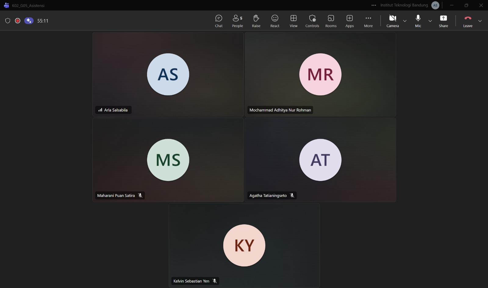

# Form Asistensi

| Informasi | Keterangan |
| --- | --- |
| **Hari** | Senin |
| **Tanggal** | 28/10/2026 |
| **Kelas** | K2 |
| **Nomor Kelompok** | 5  |
| **Nama Kelompok** | Join yang mau |
| **Nama Perangkat Lunak** | EcoTrack |
| **Dokumen** | K02_G05_DPPL2 |

### Anggota Kelompok

| NIM | Nama |
|---|---|
| 13525038 | Mochammad Adhitya Nur Rohman |
| 13525068 | Kelvin Sebastian Yen |
| 13525086 | Arla Salsabila |
| 13525137 | Maharani Puan Satira |
| 13525146 | Muhammad Reffah |

### Catatan

1. sequence konsisten warna bg nya
2. ⁠pseudocode boleh kalimat aja, gausah kode lengkap
3. ⁠query namanya boleh “ambil dari database apa” 
4. ⁠id query tiap algoritma beda2 kan tabel gitu dan idnya bisa nyambung ga tiap algoritma? pisah jg aman
5. ⁠pake judul, kamus, sama algoritma bagus si biar ketermudahan dibaca
6. ⁠Kalau ada perubahan di metode/operasi itu boleh aja ganti2 paling ya pastiin juga revisi ke yang lainnya

## Dokumentasi

<!--  -->

  

  <i>Gambar 1. Dokumentasi kegiatan asistensi.</i>

